<h1></h1>

FlowMLLab is an open course and software toolkit for **scientific machine learning in fluid mechanics**. Run flow solvers, train predictive models, and test their predictions against physical benchmarks. The course spans continuum and rarefied flows, reduced-order models, physics-informed networks, neural operators, and attention for flow reconstruction. The framework and its applications are described in the [FlowMLLab paper in *AI Thermal Fluids*](https://doi.org/10.1016/j.aitf.2026.100064).

Developed for **MIE 690A: AI in Fluid Mechanics** at the University of Massachusetts Amherst.

## Start here

[**Open the interactive labs**](https://ehsan-roohi.github.io/FlowMLLab/) — explore cavity fields, compare CFD with neural predictions, and follow the complete course.

- [**Open your first lab**](notebooks/week01/01_python_for_cfd_ai_fluids.ipynb) to learn the Python tools used in the course.
- [**Browse all weeks**](#continue-through-the-course) for guides, notebooks and lectures.
- [**Install FlowMLLab**](START_HERE.md) for setup, prerequisites and reproduction instructions.

[Course map](COURSE_MAP.md) · [Notebooks](notebooks/README.md) · [Lectures](lectures/README.md) · [Results gallery](#results-gallery) · [Technical guide](docs/RESULTS_GUIDE.md) · [Attention and language modeling](docs/TRANSFORMER_COURSE.md)

## Continue through the course

Each week has a guide, a notebook link and its lecture or companion reading.

| Week | Topic | Notebook / lab | Lecture |
| --- | --- | --- | --- |
| [1](weeks/week01/README.md) | Python, numerical methods and CFD validation | [Week 1 labs](notebooks/week01/) | [Lecture 1](lectures/week01_numerical_foundations.pdf) · [TensorFlow/Keras guide](lectures/week01_02_tensorflow_keras.pdf) |
| [1.1](weeks/week01_1/README.md) | Specification, verification, physical gates and accountable AI use | [Week 1.1 lab](notebooks/week01_1/W1_1_AI_Assisted_Scientific_Software.ipynb) | [Lecture 1.1](lectures/week01_1_ai_assisted_scientific_software.pdf) |
| [1.2](weeks/week01_2/README.md) | SIMPLE, PISO and PIMPLE pressure-velocity coupling; Re=100 cavity | [Week 1.2 lab](notebooks/week01_2/W1_2_Cavity_Pressure_Velocity.ipynb) | [Lecture 1.2](lectures/week01_2_pressure_velocity.pdf) |
| [1.3](weeks/week01_3/README.md) | Controlled optimizer comparisons, target scaling and validation | [Week 1.3 lab](notebooks/week01_3/W1_3_Keras_Optimizers.ipynb) | [Lecture PDF](lectures/week01_3_keras_optimizers.pdf) |
| [1.4](weeks/week01_4/README.md) | Spectral cavity CFD and DG transport after pressure-velocity coupling | [CPU spectral/DG lab](notebooks/week01_4/W1_4_Spectral_DG_CPU.ipynb) | [Lecture 1.4](lectures/week01_4_spectral_dg.pdf) |
| [2](weeks/week02/README.md) | Features, scaling, baselines and model validity | [Week 2 lab](notebooks/week02/AI_in_Fluids_Week2_Colab_Expanded.ipynb) | [Lecture 2](lectures/week02_supervised_learning_rarefaction.pdf) |
| [2.1](weeks/week02_1/README.md) | Bayesian prediction, calibration and uncertainty | [Week 2.1 lab](notebooks/week02_1/Probabilistic_UQ_CFD.ipynb) | [Lecture 2.1](lectures/week02_1_probabilistic_uq.pdf) |
| [3](weeks/week03/README.md) | Maxwellian sampling and particle simulation | [Week 3 labs](notebooks/week03/) | [Lecture 3](lectures/week03_kinetic_dsmc.pdf) |
| [4](weeks/week04/README.md) | CFD datasets, field surrogates and operator learning | [Week 4 labs](notebooks/week04/) | [Lecture 4](lectures/week04_cavity_surrogates_deeponet.pdf) |
| [4.1](weeks/week04_1/README.md) | POD–Galerkin and POD–DEIM | [Week 4.1 lab](notebooks/week04/W4_1_Classical_ROM_Cavity.ipynb) | [Week 4 companion](lectures/week04_cavity_surrogates_deeponet.pdf); theory in lab |
| [4.2](weeks/week04_2/README.md) | Matched Stokes input and learned Navier–Stokes correction | [Week 4.2 lab](notebooks/week04/W4_Lab4_Stokes_to_Navier_Stokes.ipynb) | [Week 4.2 companion](lectures/week04_2_stokes_to_navier_stokes.pdf) |
| [5](weeks/week05/README.md) | POD, physics-guided learning and frozen project protocols | [Week 5 project setup and tracks](notebooks/week05_06/README.md) | [Shared Weeks 5–6 guide](lectures/week05_06_project_guide.pdf) |
| [6](weeks/week06/README.md) | Closure testing, physical validation and reproducibility | [Week 6 closure track](notebooks/week05_06/P6_FP_Cavity_Closure.ipynb) · [All tracks](notebooks/week05_06/README.md) | [Shared Weeks 5–6 guide](lectures/week05_06_project_guide.pdf) |
| [7](weeks/week07/README.md) | LBM, vortex shedding and autonomous surrogates | [Week 7 lab](notebooks/week07/W7_Lattice_Boltzmann_Cylinder_Student.ipynb) | [Lecture 7](lectures/week07_cylinder_lbm_neural_surrogate.pdf) |
| [7.1](weeks/week07_1/README.md) | DSMC fields and Mach-to-field operators | [Week 7.1 lab](notebooks/week07_1/W7_1_Hypersonic_Rarefied_Cylinder_DeepONet.ipynb) | [Lecture 7.1](lectures/week07_1_hypersonic_rarefied_cylinder.pdf) |
| [7.2](weeks/week07_2/README.md) | Causal filtering of a cylinder wake from noisy sparse sensors | [Week 7.2 lab](notebooks/week07_2/README.md) | [Lecture 7.2](lectures/week07_2_cylinder_state_estimation.pdf) |
| [7.3](weeks/week07_3/README.md) | Masked pretraining and label efficiency in cylinder wakes | [Week 7.3 lab](notebooks/week07_3/README.md) | [Lecture 7.3](lectures/week07_3_masked_pretraining.pdf) |
| [7.4](weeks/week07_4/README.md) | Representation transfer and target-label efficiency for lift | [Week 7.4 lab](notebooks/week07_4/README.md) | [Lecture 7.4](lectures/week07_4_diverse_wake_pretraining.pdf) |
| [8](weeks/week08/README.md) | Exact compressible-flow branches and learned inverse maps | [Week 8 labs](notebooks/week08/README.md) | [Lecture 8](lectures/week08_gas_dynamics_sciml.pdf) |
| [9](weeks/week09/README.md) | Geometry-dependent and shock-aligned operators | [Week 9 labs](notebooks/week09/README.md) | [Lecture 9](lectures/week09_rarefied_deeponet_case_studies.pdf) |
| [10](weeks/week10/README.md) | Cavity and mono/diatomic shock reproduction | [Week 10 lab](notebooks/week10/README.md) | [Lecture 10](lectures/week10_dsmc_data_driven_surrogates.pdf) |
| [10.1](weeks/week10_1/README.md) | Molecular scattering and DSMC cylinder contours | [CPU scattering lab](notebooks/week10_1/W10_1_Collision_Map_Surrogate_Audit.ipynb) · [Research fields](results/abinitio_deeponet_cylinder/README.md) | [Lecture companion](lectures/week10_1_abinitio_collision_deeponet.md) |
| [10.2](weeks/week10_2/README.md) | One-dimensional kinetic shocks: BGK, Shakhov and PINN/DVM comparison | [Kinetic-shock lab](notebooks/week10_2/W10_2_BGK_Shakhov_Shock_PINN_DVM.ipynb) | [Lecture 10.2](lectures/week10_2_bgk_shakhov_shock_pinn_dvm.pdf) |
| [11](weeks/week11/README.md) | Shock/vortex identification; alpha and pressure methods for vapor clouds | [Week 11 lab](notebooks/week11/README.md) | [Lecture 11](lectures/week11_shock_vortex_identification.pdf) |
| [12](weeks/week12/README.md) | Additive moments, observation-conditioned reconstruction and support | [Week 12 lab](notebooks/week12/README.md) | [Lecture 12](lectures/week12_dsmc_moment_reconstruction.pdf) |
| [13](weeks/week13/README.md) | Streamfunction PINNs: build one on CPU, then audit deep-cavity and four-case research runs | [Week 13 lab](notebooks/week13/README.md) | [Lecture 13](lectures/week13_rectangular_cavity_pinn.pdf) |
| [14](weeks/week14/README.md) | Davidson-based RANS, inverse PINN and neural closures | [Week 14 lab](notebooks/week14/README.md) | [Lecture 14](lectures/week14_rans_pinn_nn.pdf) |
| [15](weeks/week15/README.md) | Train a small geometry-conditioned operator on CPU, then compare geometry/topology generalization across neural operators | [Complete Week 15 notebook](notebooks/week15/W15_Complete_Geometry_Generalization.ipynb) | [Expanded Lecture 15](lectures/week15_geometry_generalization.pdf) |
| [16](weeks/week16/README.md) | Supersonic shape optimization with verified Gmsh/SU2 CFD | [Week 16 notebook](notebooks/week16/W16_Supersonic_Shape_Optimization.ipynb) | [Lecture 16](lectures/week16_supersonic_shape_optimization.pdf) |
| [17](weeks/week17/README.md) | Q/K/V algebra, permutation tests and attention interpretation | [Week 17 student notebook](notebooks/week17/W17_CFD_Transformer.ipynb) | [Lecture 17](lectures/week17_cfd_transformer.pdf) |
| [18](weeks/week18/README.md) | Next-character likelihood, perplexity and causal prefix invariance | [Week 18 student notebook](notebooks/week18/W18_CFD_Transformer.ipynb) | [Lecture 18](lectures/week18_cfd_transformer.pdf) |
| [19](weeks/week19/README.md) | Patch inversion, POD representation floors and noise-aware sensing | [Week 19 student notebook](notebooks/week19/W19_CFD_Transformer.ipynb) | [Lecture 19](lectures/week19_cfd_transformer.pdf) |
| [20](weeks/week20/README.md) | Sensor-to-field reconstruction, baselines and validation-only selection | [Week 20 student notebook](notebooks/week20/W20_CFD_Transformer.ipynb) | [Lecture 20](lectures/week20_cfd_transformer.pdf) |
| [21](weeks/week21/README.md) | History-MLP/DMD comparisons, representation error and rollout diagnostics | [Week 21 student notebook](notebooks/week21/W21_CFD_Transformer.ipynb) | [Lecture 21](lectures/week21_cfd_transformer.pdf) |
| [22](weeks/week22/README.md) | Target-label accounting, matched updates and representation controls | [Week 22 student notebook](notebooks/week22/W22_CFD_Transformer.ipynb) | [Lecture 22](lectures/week22_cfd_transformer.pdf) |

<!-- course-counts:start -->
[Course inventory](docs/COURSE_INVENTORY.md)
<!-- course-counts:end -->

## Choose a learning path

Week numbers and notebook addresses stay fixed; the order below follows prerequisites.
The gallery is an overview, not a requirement to run every research experiment.

| Stage | Route | What to establish before continuing |
| --- | --- | --- |
| Foundations | [Week 1: Python, Keras and cavity validation](weeks/week01/README.md) → [Week 2: supervised learning](weeks/week02/README.md) → [Week 1.3: optimizers](weeks/week01_3/README.md) | Array shapes, training/validation/test roles, scaling and a fair baseline |
| Field models | [Week 4: CFD → POD → DeepONet](weeks/week04/README.md) → [Weeks 5–6: one project](notebooks/week05_06/README.md) | Qualify CFD labels, withhold complete cases, and separate discretization error from prediction error |
| Dynamics and attention | [Week 7: wakes](weeks/week07/README.md) → [7.2: sensing](weeks/week07_2/README.md) → [7.3: attention primer and pretraining](weeks/week07_3/README.md) → [7.4: transfer](weeks/week07_4/README.md) | Understand observations and time splits before pretraining; [Weeks 17–22](docs/TRANSFORMER_COURSE.md) develop attention and forecasting in depth |
| Physics-informed models | [Week 13 Part A: a small CPU PINN](weeks/week13/README.md) → [Week 4 Lab 9: seven-Re audit](notebooks/week04/W4_Lab9_Label_Free_Ghia_PINN_Audit.ipynb) → [deep-cavity studies](notebooks/week13/README.md) | Distinguish residual reduction from field accuracy before comparing research runs |

**Optional branches:** [Week 1.1](weeks/week01_1/README.md) develops software verification;
[Week 1.2](weeks/week01_2/README.md) compares numerical algorithms after the cavity lab.
[Week 1.4](weeks/week01_4/README.md) continues that branch with spectral cavity CFD at Re=100 and 400, Ghia comparisons, and DG transport experiments on CPU.
Start scalar [Week 2.1 uncertainty](weeks/week02_1/README.md) after Week 2 and return
to its POD–GP section after Week 4. Kinetic and compressible-flow routes begin with
[Week 3](weeks/week03/README.md) and [Week 8](weeks/week08/README.md).
[Full route and readiness guide](START_HERE.md#learning-order-and-optional-branches).

## Results gallery

The figures below connect each week to an experiment or teaching example.
Follow the captions for data provenance and validity limits; the
[technical guide](docs/RESULTS_GUIDE.md) retains the detailed protocols and metrics.

**Reading the conditions:** Re = UL/ν compares inertia with viscosity; M = U/a
compares speed with sound speed; Kn = λ/L compares molecular mean free path with
the stated length. Cavity Re uses lid speed and cavity width; cylinder Re uses
freestream speed and diameter. Incompressible examples do not prescribe a
physical Mach number. Captions distinguish prescribed conditions from predicted
local fields and identify missing source metadata where applicable.

### Week 1 — Numerical foundations

**[Open Week 1: lecture, notebooks and guide](weeks/week01/README.md)**

**Problem:** Lid-driven cavity benchmark. 
**CFD / data:** FlowMLLab finite-difference streamfunction–vorticity Navier–Stokes solver. 
**Learning method:** No neural network; CFD is checked against Ghia centreline data.

At Re = 400, the moving lid drives a large clockwise vortex and weaker corner recirculation. The black streamlines come from the retained 65 × 65 solution. The right panels compare both velocity centerlines with Ghia et al. The cross marks the published point omitted from the qualified horizontal-profile error norm.
[Cavity benchmark and Ghia comparison](results/article_figures/fig02_cavity_benchmark.png) · [Figure contract](ARTICLE_FIGURE_MAP.md)

Continue to the [Week 4 validation and neural studies](#week-4--cavity-surrogates-and-deeponet)
for all seven Ghia Reynolds numbers, mesh checks and held-out field predictions.

### Week 1.1 — AI-assisted scientific software

**[Open Week 1.1: lecture, notebooks and guide](weeks/week01_1/README.md)**

**Problem:** Verify cavity diagnostics and physical constraints. 
**CFD / data:** Analytic manufactured solution and a retained FlowMLLab cavity field. 
**Learning method:** No trained network; independent tests verify AI-proposed code.

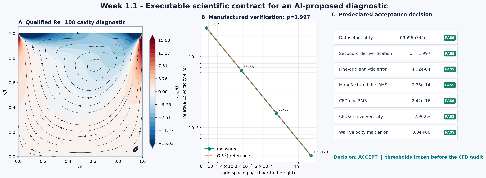

An independently derived manufactured solution establishes second-order
convergence before the accepted `Re=100` cavity case is opened. Seven frozen gates
then bind array semantics, vorticity convention, incompressibility, wall
conditions, thresholds and the complete data hash into one machine-readable
decision. [Run the lab](notebooks/week01_1/W1_1_AI_Assisted_Scientific_Software.ipynb)
· [Read the scientific specification](notebooks/week01_1/SCIENTIFIC_SPEC.md)
· [Complete the agent-assisted GitHub assignment](notebooks/week01_1/ASSIGNMENT.md)
· [Inspect the retained evidence](results/week01_1_scientific_software/README.md)

### Week 1.2 — Pressure–velocity coupling

**[Open Week 1.2: lecture, notebooks and guide](weeks/week01_2/README.md)**

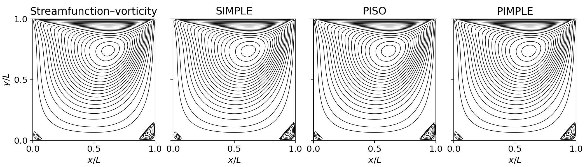

The four panels show the same square cavity at **Re = 100**, with a unit-speed
top lid and three stationary no-slip walls, on nominal 64-cell grids.
They use identical streamline levels; the finite-volume streamfunctions live
on cell corners, while the independent reference includes boundary nodes.

This optional numerical branch follows the Week 1 cavity lab. Compare SIMPLE,
PISO and PIMPLE on the same cavity and check their converged velocity fields
against an independent streamfunction–vorticity solver. Start at **Re=100**,
then use the retained **Re=400 and 1000** experiments to separate mesh error,
coupling convergence and measured solver work on 32 and 64 cells per side.
Then use the [CPU experiments](results/week01_2_literature/README.md) to distinguish
pressure-solver tolerance, mass conservation and startup time-step accuracy.
The [cavity startup movie lab](notebooks/week01_2/W1_2_Cavity_Startup_Movies.ipynb) follows
streamlines, signed vorticity and pressure from rest at Re = 100, 400, 1000,
3200, 5000, 7500 and 10000. [Watch the longer startup, t⋆ = 0–100](https://ehsan-roohi.github.io/FlowMLLab/cavity-continuation/)
· [Original 0–10 movies](https://ehsan-roohi.github.io/FlowMLLab/cavity-startup/).
These finite-time trajectories are separate from steady Ghia validation; a common movie endpoint does not mean that every case is steady.
The [final-results CPU companion](notebooks/week01_2/W1_2_Cavity_Stationarity_and_Resolution.ipynb)
tests full-window stationarity and separates it from grid and timestep sensitivity.
[All seven outcomes and physical comparisons](results/cavity_settling/README.md):
Re = 100, 400 and 1000 pass fixed-grid temporal confirmation; the higher-Re endpoints remain unresolved.

### Week 1.3 — Optimizers for scientific machine learning

**[Open Week 1.3: lecture, notebook and exercises](weeks/week01_3/README.md)**

The displayed target is **0.20 sin(2πx) + exp[−((x − 0.72)/0.035)²]**, on
**0 ≤ x ≤ 1**. This is scalar regression, so Re, Mach and Kn do not apply.
After Keras basics and Week 2 data splitting/scaling, four routes fit this
signal from identical starting weights and training samples. The lower panels show which routes resolve the narrow peak and where
errors remain. A separate exercise tests the SOAP and self-scaled Broyden
sequence used in the deep-cavity study. [Read the lecture](lectures/week01_3_keras_optimizers.pdf).

### Week 2 — Supervised learning and rarefaction

**[Open Week 2: lecture, notebooks and guide](weeks/week02/README.md)**

**Problem:** Predict response across Knudsen number and accommodation. 
**CFD / data:** Synthetic teaching equation; no CFD/DSMC run. 
**Learning method:** Ridge regression, not a neural CFD model.

The synthetic response spans **Kn = 10⁻⁴ to 10¹·⁵** at accommodation
**α = 0.6, 0.8 and 1.0**, pressure ratio **3** and temperature ratio **1**.
The horizontal axis is log₁₀(Kn). This is a teaching equation, not a CFD/DSMC
result. [Run the lab](notebooks/week02/AI_in_Fluids_Week2_Colab_Expanded.ipynb)

### Week 2.1 — Probabilistic uncertainty

**[Open Week 2.1: lecture, notebooks and guide](weeks/week02_1/README.md)**

**Problem:** Predict cavity quantities and fields with uncertainty. 
**CFD / data:** Retained FlowMLLab cavity CFD data. 
**Learning method:** Bayesian regression and POD–Gaussian processes; non-neural models.

The field panels show the held-out **Re = 275 square cavity**, with speed
normalized by lid speed. The coverage panel pools **Re = 175, 275 and 375**;
interval-width calibration uses the separate **Re = 300** case.

Start with scalar Bayesian regression after Week 2; return to the POD–GP field
section after Week 4. Bayesian and POD–Gaussian-process predictions use proper scores
and blind coverage; the retained under-coverage is part of the lesson.
[UQ evidence](results/probabilistic_uq/README.md)

### Week 3 — Kinetic theory and DSMC

**[Open Week 3: lecture, notebooks and guide](weeks/week03/README.md)**

**Problem:** Predict wall pressure from molecular motion. 
**CFD / data:** FlowMLLab hard-sphere DSMC with no-time-counter (HS–NTC) collisions. 
**Learning method:** No network in the displayed particle-solver validation.

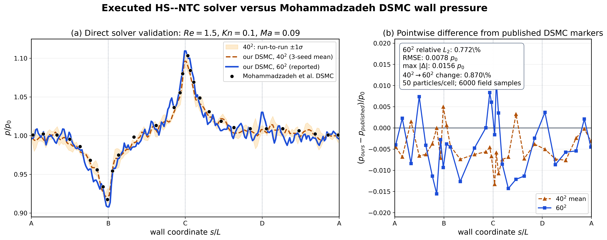

Square DSMC cavity at **Kn = 0.1**, with reference-reported **Re = 1.5** and
**M = 0.09**. The 40 × 40 three-seed mean and 60 × 60 run are compared with
Mohammadzadeh's wall-pressure samples. Pressure is normalized by p₀ and the
perimeter coordinate s/L runs from 0 to 4.
[Validation contract](ARTICLE_FIGURE_MAP.md)

### Week 4 — Cavity surrogates and DeepONet

**[Open Week 4: lecture, notebooks and guide](weeks/week04/README.md)**

Begin with [Lab 1: CFD data production](notebooks/week04/W4_Lab1_CFD_Data_Production_Student.ipynb)
and [Lab 2: scalar and field models](notebooks/week04/W4_Lab2_Scalar_and_Field_Surrogates_Student.ipynb).
The lecture maps each of the nine labs to its aim, algorithm and experiments.
The investigations below then distinguish CFD qualification, learning published
centreline samples, learning full fields and solving the governing equations.

| Investigation | Data and test | Open |
| --- | --- | --- |
| CFD qualification | Our solutions versus Ghia at all seven Re; inspect mesh and time sensitivity | [Lab 5: coverage](notebooks/week04/W4_Lab5_All_Re_Ghia_Validation.ipynb) · [Lab 7: high-Re fields](notebooks/week04/W4_Lab7_High_Re_CFD_Ghia.ipynb) |
| Profile learning | Ghia samples as labels; whole-Re tests at 3200 and 7500 | [Lab 6: optimizers and depth](notebooks/week04/W4_Lab6_Ghia_Profile_Optimizer_Depth.ipynb) |
| Full-field learning | Our CFD as labels; compare frozen predictions with interpolation | [Lab 3: low-Re introduction](notebooks/week04/W4_Lab3_DeepONet_Cavity_Student.ipynb) · [Lab 8: high-Re extension](notebooks/week04/W4_Lab8_High_Re_Field_DeepONet.ipynb) |
| Label-free PINNs | PDE and wall constraints; CFD/Ghia used only to audit accuracy | [Advanced Lab 9](notebooks/week04/W4_Lab9_Label_Free_Ghia_PINN_Audit.ipynb), after [Week 13 Part A](weeks/week13/README.md) |

**1. Start with Re = 100, 400 and 1000.**

**Our CFD against Ghia at three Reynolds numbers.** Solid curves below come
from FlowMLLab's retained solver fields; circles are the corresponding published
Ghia samples. Re=100 uses SIMPLE on 64 cells; Re=400 and 1000 use the independent
finite-difference solver on 128 cells. The cross preserves the flagged Re=400
printed entry. These are numerical solutions, not curves fitted to Ghia.

**Re = 100, 400 and 1000**, square cavity, moving top lid and three stationary
walls; velocities are divided by lid speed. Solver grids and the excluded
printed reference point are identified above.

[Open the executed CFD validation lab](notebooks/week04/W4_Lab5_All_Re_Ghia_Validation.ipynb)
· [Grid comparisons, signed errors and source fields](results/cavity_cfd_ghia/README.md).

**2. Extend CFD validation to Re = 3200–10000.**

**High-Re CFD validation before learning.** The four cases below were independently solved on
128, 256 and 512 cells per side; circles remain the original Ghia samples.

Square lid-driven cavities at **Re = 3200, 5000, 7500 and 10000**. Both
centreline velocity components use lid-speed normalization; each case compares
128-, 256- and 512-cell solutions with Ghia's samples.

[Open the high-Re CFD lab](notebooks/week04/W4_Lab7_High_Re_CFD_Ghia.ipynb) ·
[Native fields and mesh/time sensitivity](results/cavity_highre_ghia/README.md).
These are converged discrete roots; remaining high-Re mesh sensitivity is reported.

**3. Learn from qualified data.** Start with the low-Re example below, then move to the profile-learning and full-field high-Re tests.

Start with the low-Re POD–DeepONet worked example

**Problem:** Map Reynolds number to cavity fields. 
**CFD / data:** FlowMLLab finite-difference streamfunction–vorticity Navier–Stokes solver. 
**Learning method:** POD–DeepONet: learned parameter-to-coefficient map with a fixed POD spatial basis.

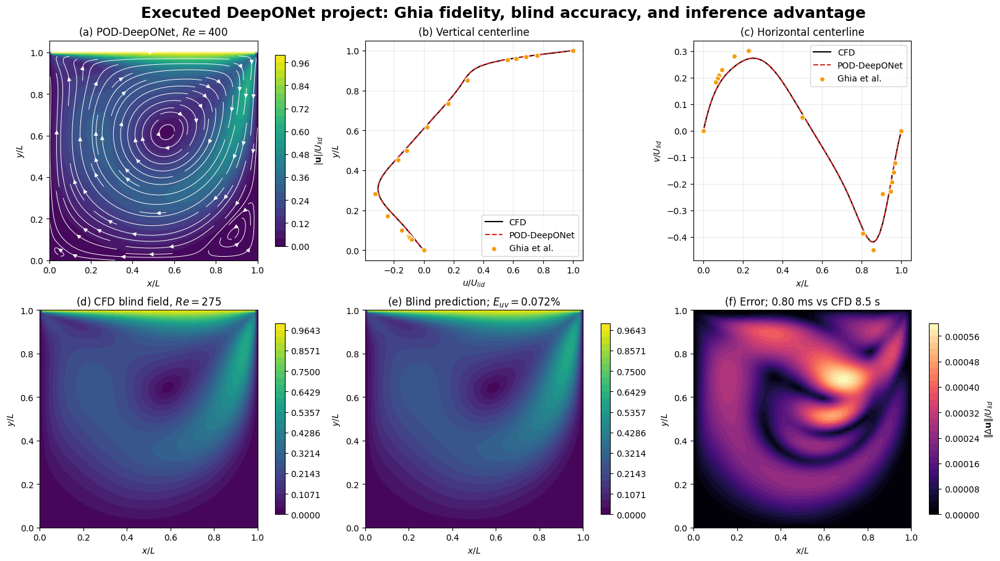

The field panels show the **Re = 275 square cavity on 65 × 65 nodes**,
with velocity divided by lid speed. Training uses CFD cases within Re = 100–400;
whole-field tests use Re = 175, 275 and 375. The **Re = 100 and 400** Ghia
centreline comparisons are benchmark checks, not unseen-Re tests.

Complete-case testing combines field error, wall/divergence checks, reference
centerlines and measured inference cost.
[Model and validation evidence](results/pod_deeponet/README.md)

Separate profile-learning experiment: all seven Ghia cases

**Neural learning across the seven Ghia cases.** A separate CPU MLP learns
centreline velocity profiles directly from Ghia samples. Training uses Re=100,
1000, 5000 and 10000; validation uses 400; Re=3200 and 7500 are held out in full.
The figure shows the Adam baseline, the validation-selected five-layer
Adam-to-L-BFGS network with wall-data weights, and linear interpolation in log Re.
The lower panels retain the signed error at actual reference sample locations.

Held-out **Re = 3200**, square cavity: u/U at x/L = 0.5 and v/U at y/L = 0.5.
Signed discrepancies use the actual Ghia sample positions.

View the second held-out case: Re=7500

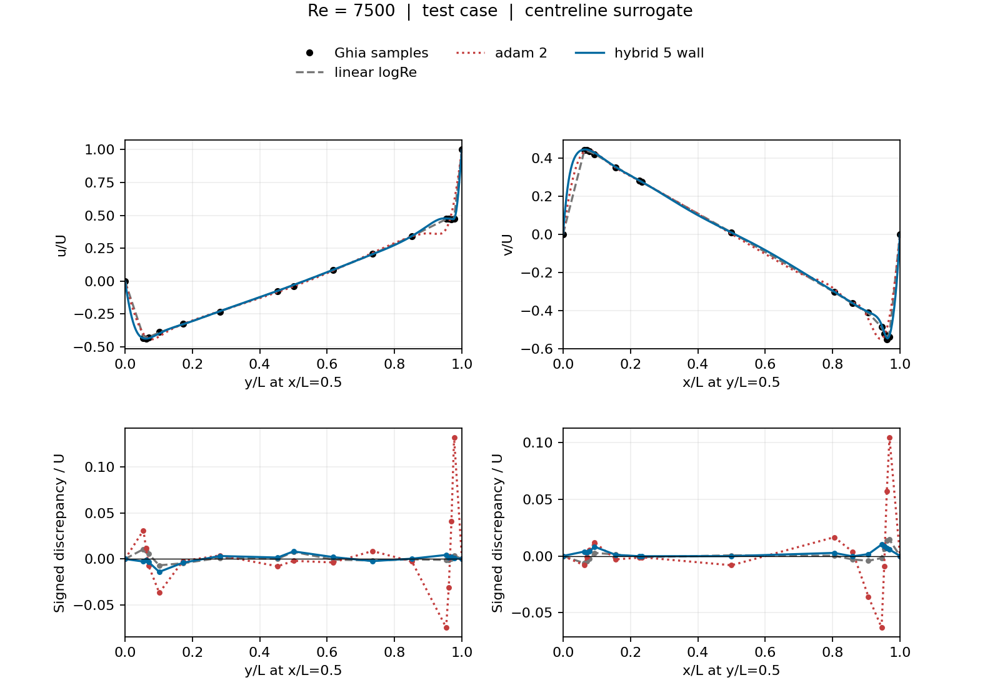

Held-out **Re = 7500**, with the same square-cavity geometry, lid-speed
normalization and centreline definitions as the Re = 3200 comparison.

The selected network's mean u/v RMSE is 0.01974 U at Re=3200 and 0.00563 U at
Re=7500, compared with Adam's 0.03395 U and 0.03800 U. Interpolation is still
better at 0.01629 U and 0.00518 U. These numbers average individual-seed errors;
plotted neural curves are three-seed means. This is a profile-regression test,
not a high-Re full-field DeepONet or PINN result.
[Open the optimizer/depth lab](notebooks/week04/W4_Lab6_Ghia_Profile_Optimizer_Depth.ipynb)
· [All seven profile figures and frozen results](results/cavity_ghia_allre/README.md).

#### Full-field neural follow-on to Week 4

The high-Re POD-DeepONet learns our matched CFD velocity fields across Re=100–10000.
Re=3200 and 7500 are withheld in full. Architecture and interpolation convention
are selected on Re=400 and 6500; neither test field is used for fitting or selection.

Held-out **Re = 3200 square cavity**: the 512-cell CFD reference, frozen
POD–DeepONet and interpolation are evaluated on matching points. Velocity
uses lid-speed units; vector-error colors retain a linear scale.

| Re | Neural mean | Linear in Re | Linear in log Re |
| --- | --- | --- | --- |
| 3200 | 0.0951% | 0.8400% | 0.5394% |
| 7500 | 0.0844% | 0.4703% | 0.3139% |

Errors compare with the 512-cell CFD discretization. Its remaining mesh
sensitivity is larger than some surrogate errors.
[Open the field-neural lab](notebooks/week04/W4_Lab8_High_Re_Field_DeepONet.ipynb) ·
[Both tests, signed profiles, seed variation and limitations](results/cavity_field_deeponet/README.md).

<!-- cavity-flow-comparison:start -->
**Streamlines, vorticity and pressure: CFD overlaid with the neural field.**
The panels below place Re=1000 (training) beside Re=7500 (held-out test).
Black solid curves are CFD; orange dashed curves are the frozen POD–DeepONet mean.
The same streamline seeds and contour levels are used for both methods.

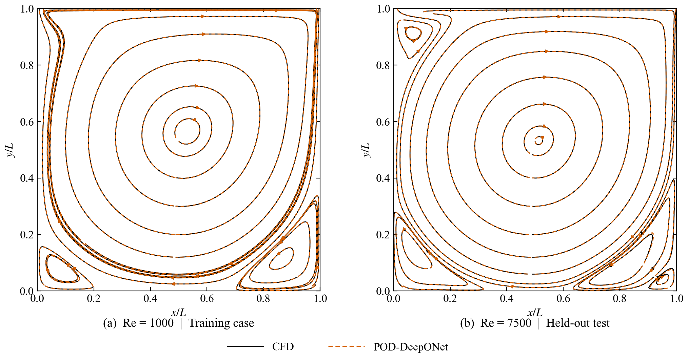

**Re = 1000 (left, training) and 7500 (right, test)** in the same square
lid-driven cavity; x/L and y/L use cavity width. Black and orange curves
compare CFD and the frozen neural mean at identical streamline seeds.

Enlarge the corner vortices

Corner views of the same **Re = 1000 and 7500** fields; axes retain x/L and
y/L, and each method uses the same seed locations in each enlarged region.

Derived vorticity and pressure: matched contours and mesh limits

**Re = 1000 and 7500**, square cavity: signed vorticity from the velocity curl,
scaled by U/L, with matched CFD/neural contour levels.

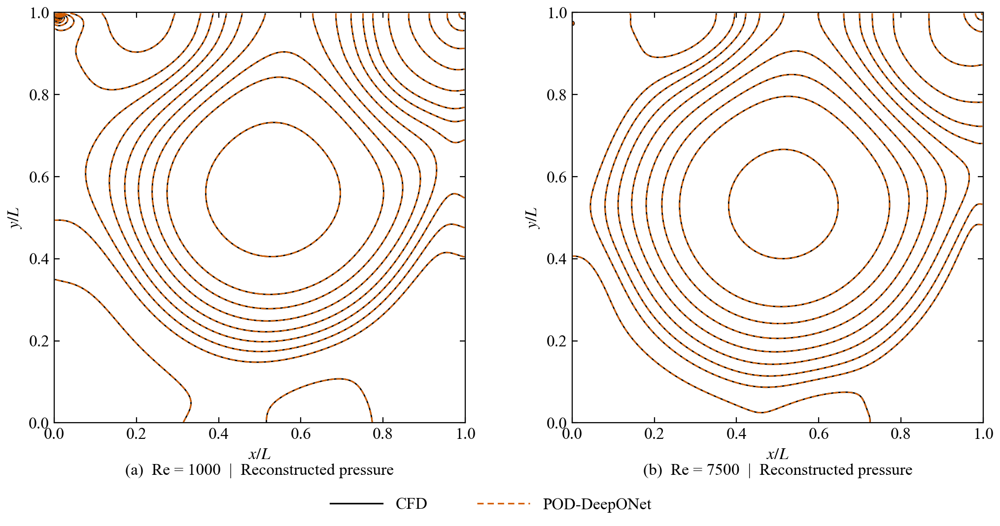

**Re = 1000 and 7500**, square cavity: pressure reconstructed from each velocity
field, divided by ρU² and placed at the same mean-zero gauge.

Vorticity and pressure are **derived from velocity, not separately trained outputs**.
Pressure still has 8.90% 256-to-512 mesh sensitivity at Re=7500; close contours
show agreement with the retained discretization, not mesh-independent pressure accuracy.

Field comparisons and signed discrepancies

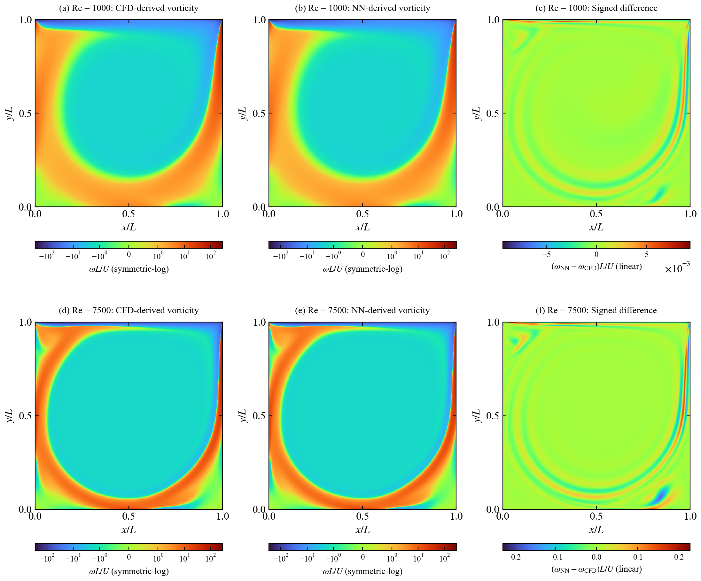

**Re = 1000 and 7500**: CFD and neural vorticity in U/L units, followed by the
signed neural-minus-CFD difference. Field and error scales are kept distinct.

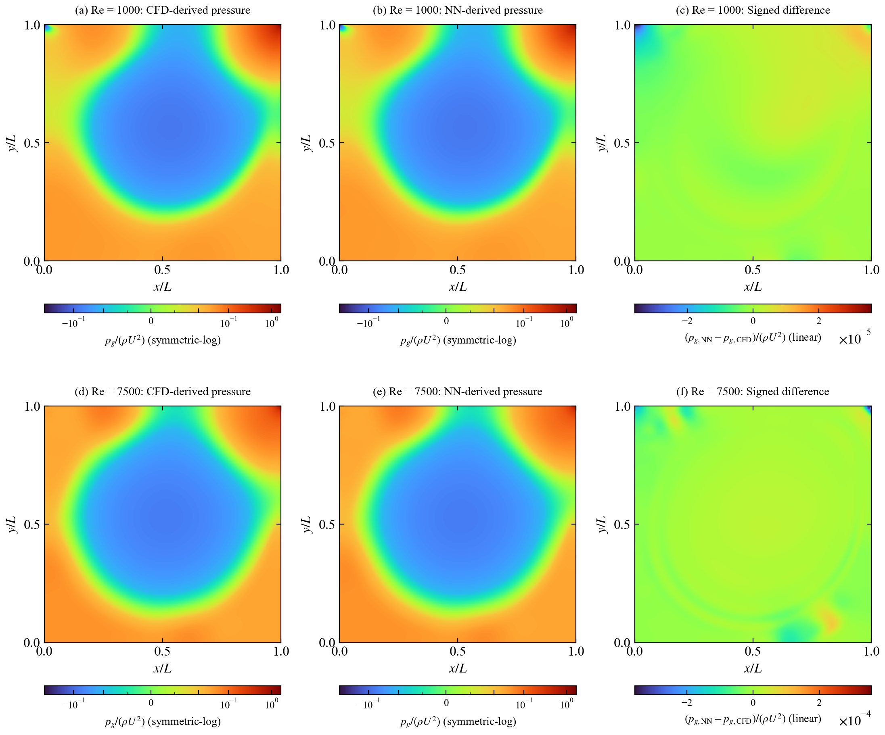

**Re = 1000 and 7500**: mean-zero pressure in ρU² units and its signed
neural-minus-CFD difference, using the same reconstruction for both methods.

[Vector PDFs, definitions and numerical checks](results/cavity_field_deeponet/flow_comparison/README.md) ·
[Executed Lab 8](notebooks/week04/W4_Lab8_High_Re_Field_DeepONet.ipynb) ·
[Week 4 lecture](lectures/week04_cavity_surrogates_deeponet.pdf)
<!-- cavity-flow-comparison:end -->

<!-- cavity-pinn-audit:start -->

What can fail in a data-free PINN? A 42-run Ghia audit

After the [Week 13 Part A PINN introduction](weeks/week13/README.md),
[Lab 9](notebooks/week04/W4_Lab9_Label_Free_Ghia_PINN_Audit.ipynb) tests all seven Reynolds numbers without CFD or Ghia training labels, with
three independent initializations and two corner collars. **None of the 42
finite-budget runs passes all preregistered accuracy and physics checks.**
The high-Re networks miss the interior circulation despite exact wall values
and incompressibility. These case-specific PINNs are separate from the accurate
supervised POD-DeepONet above.

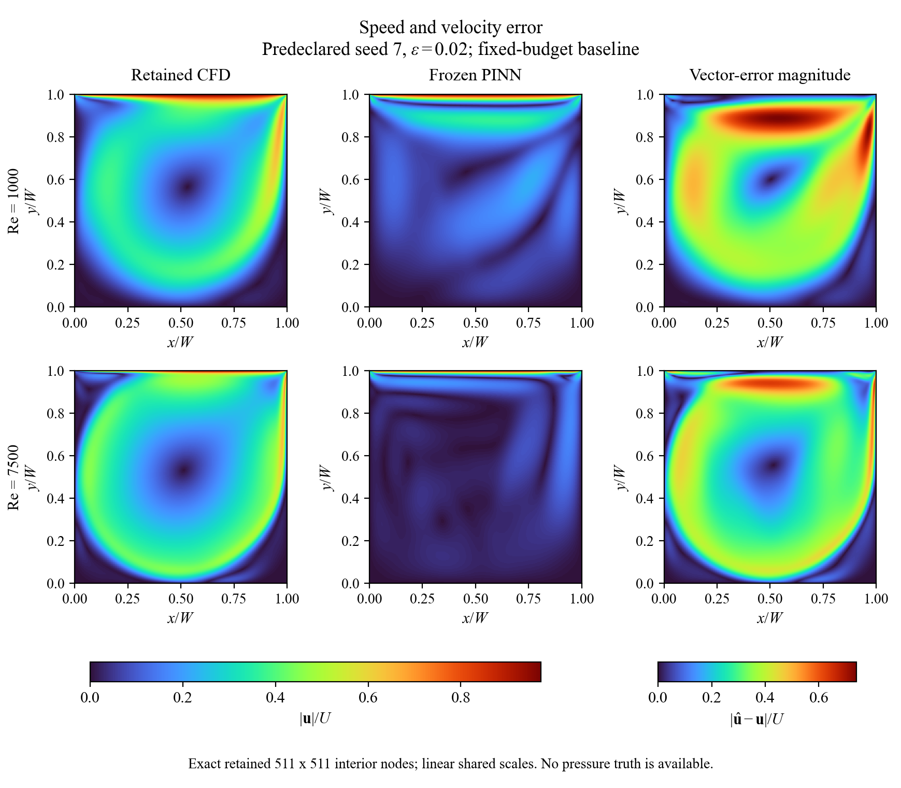

Square cavities at **Re = 1000 and 7500**, with the same lid/wall conditions
and lid-speed normalization. These are separately trained, label-free PINNs;
the full-range error compares them with the retained CFD fields.

The lab explains the training/audit residual gap and why 14 of 21 nominal
collar comparisons actually used identical collocation points. It retains all
seeds, signed profiles and failures.

A [12-case sampling comparison](results/cavity_pinn_stratified/README.md)
then tests fixed area-weighted corner, wall and interior samples at the same
objective/gradient work as each original counterpart. Velocity error improves
in two pairs and worsens in ten; all six Re=7500 pairs worsen. The lab explains
why better sample coverage alone does not guarantee the correct circulation.
[Full physical evidence](results/cavity_pinn_campaign/README.md) ·
[Protocol](docs/CAVITY_PINN_CAMPAIGN_PROTOCOL.md) ·
[Week 4 lecture](lectures/week04_cavity_surrogates_deeponet.pdf)

<!-- cavity-pinn-audit:end -->

### Week 4.1 — Classical reduced-order models

**[Open Week 4.1: lecture, notebooks and guide](weeks/week04_1/README.md)**

**Problem:** Evolve cavity flow in a reduced state space. 
**CFD / data:** The Week-4 cavity equations and finite-difference full-order model. 
**Learning method:** POD–Galerkin and POD–DEIM; neither is a neural network.

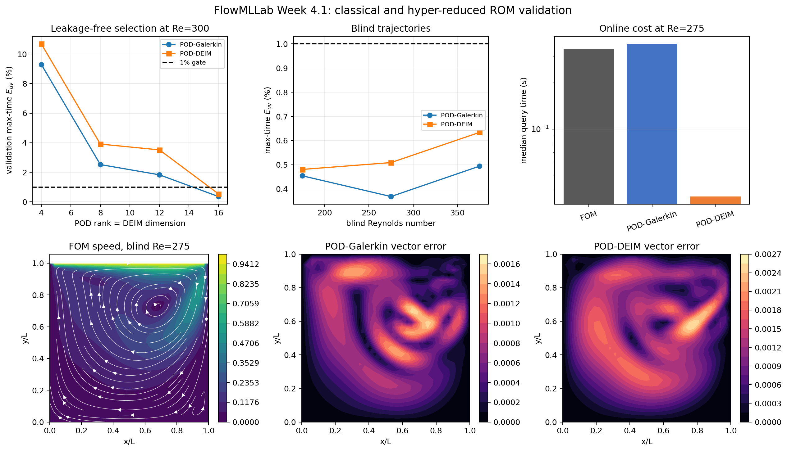

The displayed field is the **Re = 275 square cavity at tU/L = 5**, on a
33 × 33 grid. Model selection uses Re = 300; blind trajectories use
Re = 175, 275 and 375 over 0 ≤ tU/L ≤ 5. The fluid starts from rest under the moving lid.

Compare reduced dynamics, hyper-reduction, blind trajectories and the offline/online
cost tradeoff. [Run the ROM lab](notebooks/week04/W4_1_Classical_ROM_Cavity.ipynb)

### Week 4.2 — Stokes-to-Navier-Stokes correction

**[Open Week 4.2: lecture, notebooks and guide](weeks/week04_2/README.md)**

**Problem:** Predict the nonlinear cavity-flow correction from a matched Stokes field. 
**CFD / data:** Constant and spatially diverse lid conditions, solved independently on 25 × 25 and 51 × 51 grids. 
**Learning method:** A POD-based neural correction conditioned on the Stokes field and Reynolds number; pressure is recovered afterwards.

The 51 × 51 refinement solves all 184 cases again and retrains the selected
three-seed POD correction. Mean same-family velocity errors are 0.097% for
constant lids and 0.810% for diverse lids, compared with 0.107% and 0.917%
at 25 × 25. The 25-to-51 CFD velocity change is still about 20.6% for constant
tests and 17.8% for diverse tests when the fine solution is sampled on the
coarse grid. This is a better resolved surrogate experiment, not a claim of
mesh-independent CFD accuracy.

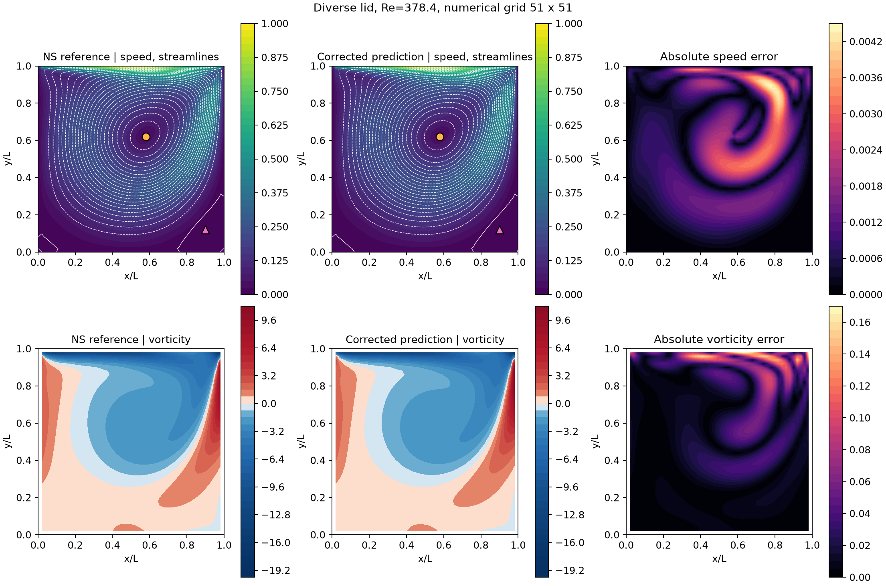

**Re = 378.4**, square cavity, **51 × 51 nodes**. The top-wall speed varies
with position as the retained positive three-mode sine profile; the other
walls are stationary. Here Re = U_ref L/ν uses the maximum lid speed,
with L = 1 and ν = 0.0025. Each field is compared with its matched CFD case.

[Open the 51 × 51 validation notebook](notebooks/week04/W4_Lab4_Grid51_Validation.ipynb)
· [Read the 51 × 51 PDF addendum](lectures/week04_2_grid51_validation.pdf)
· [Inspect the refined data and metrics](results/stokes_grid51/README.md)

Earlier 25 × 25 fields and the coarse-to-fine comparison

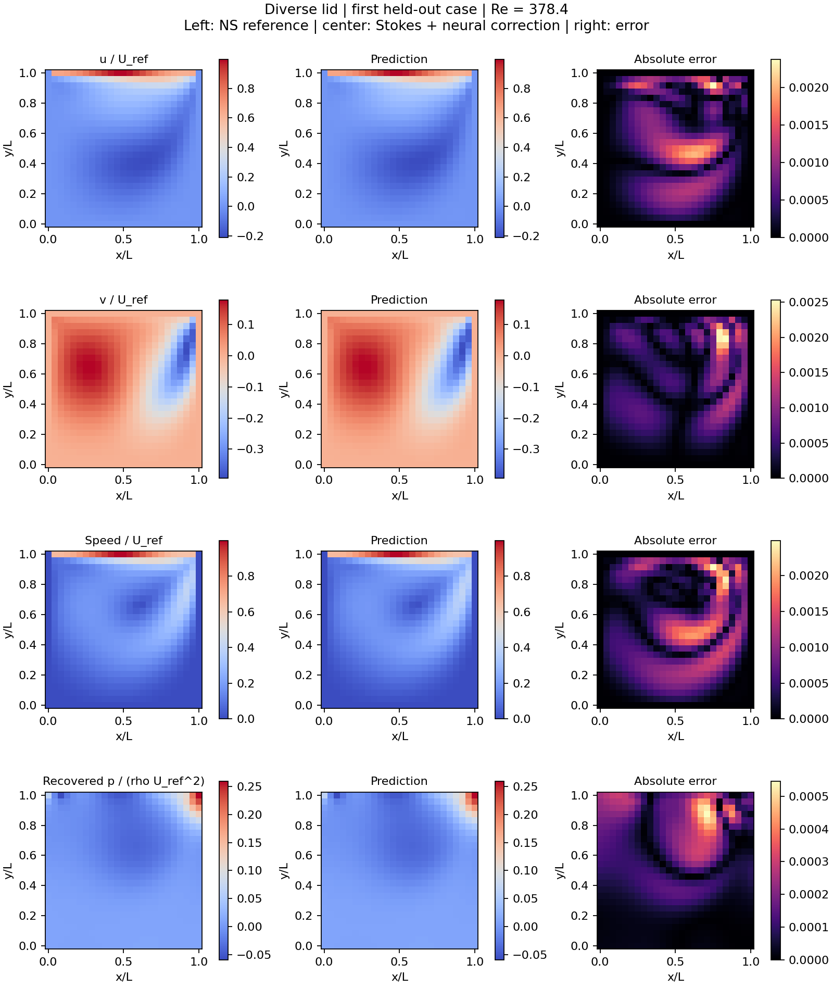

The same **Re = 378.4 diverse-lid square cavity**, on the original **25 × 25**
grid: velocity components and speed use U_ref units; recovered pressure uses
ρU_ref². Left, centre and right columns are CFD, prediction and absolute error.

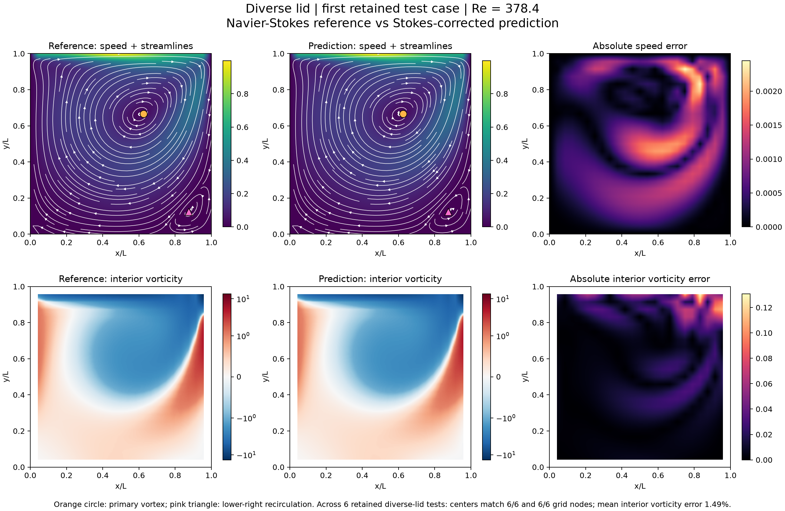

**Re = 378.4**, the same 25 × 25 diverse-lid case: speed, recirculation and
signed vorticity are compared on matching spatial support.

This held-out diverse-lid example shows reference fields, predictions and absolute
errors, including speed streamlines and interior vorticity. Across six retained
same-family tests per lid type, the primary and lower-right recirculation centers
match the reference grid nodes in all cases; mean interior vorticity errors are
0.12% for constant lids and 1.49% for diverse lids. The contours are linearly
interpolated for display; errors use the original 25 × 25 samples. These same-grid
regression tests do not establish grid-independent CFD accuracy or independently
validated corner vortices. [See the constant-lid vortex figure](figures/Cavity_constant_streamlines_vorticity.png)
· [Run the Week 4.2 lab](notebooks/week04/W4_Lab4_Stokes_to_Navier_Stokes.ipynb)
· [Read the lecture companion](lectures/week04_2_stokes_to_navier_stokes.pdf)
· [Inspect the retained results](results/stokes_refined/README.md)

### Week 5 — Physics-guided projects

**[Open Week 5: lecture, notebooks and guide](weeks/week05/README.md)**

**Problem:** Build a cavity surrogate or reconstruct a wake from sparse sensors. 
**CFD / data:** FlowMLLab cavity CFD for the animation; D2Q9–TRT LBM for the wake extension. 
**Learning method:** POD–DeepONet for the animation; gappy POD, sensor placement and SINDy in the extension.

The animation cycles through **Re = 175, 275 and 375** square cavities withheld
from the low-Re model. These are separate steady-case comparisons, not the
time evolution of a single cavity; coordinates and velocities use L and U_lid.

Weeks 5–6 form one project: complete P0, choose one track, and finish it in Week 6.
This animation revisits the Week 4 low-Re model; the new task is to design a controlled
comparison rather than repeat its worked example. Use it as a starting point: freeze a baseline,
change one modeling choice and evaluate complete unseen cases.
[Project pack](notebooks/week05_06/README.md) · [Interactive demo](demo/README.md)

Extend the project with the [sparse sensing lab](notebooks/week05_06/W5_Lab2_Sparse_Sensing_Dynamics.ipynb):
reconstruct fields from limited measurements and inspect the
[retained modal-method comparisons](results/modal_labs/README.md).
This companion uses the Week 7 cylinder-wake data and should be taken after
the Week 7 module.

### Week 6 — Physical validation and final evidence

**[Open Week 6: lecture, notebooks and guide](weeks/week06/README.md)**

**Problem:** Recover and validate cavity pressure. 
**CFD / data:** FlowMLLab cavity CFD with least-squares pressure-gradient reconstruction. 
**Learning method:** No neural model in this pressure-recovery figure.

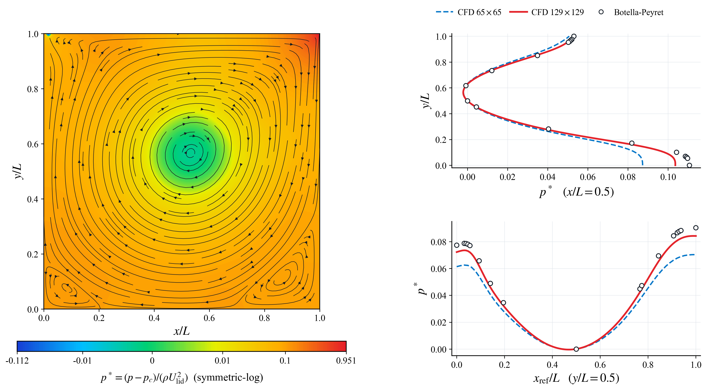

**Re = 1000, square cavity.** Left: recovered pressure and velocity streamlines
on a **129 × 129** grid. Right: vertical and horizontal pressure profiles on
**65 × 65 and 129 × 129** grids compared with Botella–Peyret.

Pressure is measured relative to the cavity center:
<i>p</i>∗ = (<i>p</i> − <i>p</i>c)/(ρ<i>U</i>lid2),
where <i>p</i>c = <i>p</i>(<i>L</i>/2, <i>L</i>/2).
The symmetric-log scale is linear for |<i>p</i>∗| ≤ 0.01.
The reference coordinate <i>x</i>ref/<i>L</i> = 1 − <i>x</i>/<i>L</i>
matches the published lid-motion convention.

This existing pressure benchmark illustrates the independent physical checks
expected in a final evidence bundle; it is not a learned Fokker–Planck result.
Week 6 completes the selected Week-5 track, including optional closure testing.
[Project completion guide](notebooks/week05_06/README.md)

### Week 7 — Unsteady cylinder wakes

**[Open Week 7: lecture, notebooks and guide](weeks/week07/README.md)**

**Problem:** Predict future cylinder-wake vorticity. 
**CFD / data:** FlowMLLab D2Q9–TRT lattice Boltzmann solver (LBM). 
**Learning methods:** A one-step CNN and a separate phase-stable Fourier decoder for long-horizon forecasts.

All three panels show the same retained Re = 105 frame at tU∞/D = 77.29. The CNN predicts the next frame from four preceding LBM frames. Signed error is the CNN minus the reference as a percentage of the reference vorticity RMS over the displayed fluid region.
[One-step CNN protocol](results/cylinder_cnn/README.md) ·
[Separate Re = 95 forecast diagnostics](results/cylinder_phase/homepage_week07.png)

[Watch the LBM/decoder wake animation](results/cylinder_phase/re095_phase_stable_lbm_vs_decoder.webp)

Four initial fields seed **277 autonomous future frames** at unseen **Re = 95**,
with **4.281% global vorticity error** against educational LBM labels.
The grid study passes practical fine-pair limits but fails the formal
asymptotic/GCI gate; these labels are not high-fidelity DNS.
[Video](results/cylinder_phase/re095_phase_stable_lbm_vs_decoder.mp4)
· [Model evidence](results/cylinder_phase/README.md)
· [Grid study](results/cylinder_grid_convergence/README.md)

Continue with the [modal forecasting lab](notebooks/week07/W7_Lab2_Modal_Forecasting.ipynb)
and its [reproducible evidence](results/modal_labs/README.md).
The [Re100 D40 dataset](results/cylinder_d40/README.md) provides force histories,
final fields and a three-grid comparison. A separate
[frozen-model Re115 evaluation](results/cylinder_re115_evaluation/README.md)
reports 3.17% global vorticity error, with sampling and pressure limitations.

### Week 7.1 — Rarefied hypersonic cylinder

**[Open Week 7.1: lecture, notebooks and guide](weeks/week07_1/README.md)**

**Problem:** Predict cylinder fields as Mach number varies. 
**CFD / data:** Author-supplied DSMC archives; exact source/checkpoint attribution remains subject to the linked audit. 
**Learning method:** 3×96 tanh MLP versus Mach interpolation; separate from the article's Fusion-DeepONet.

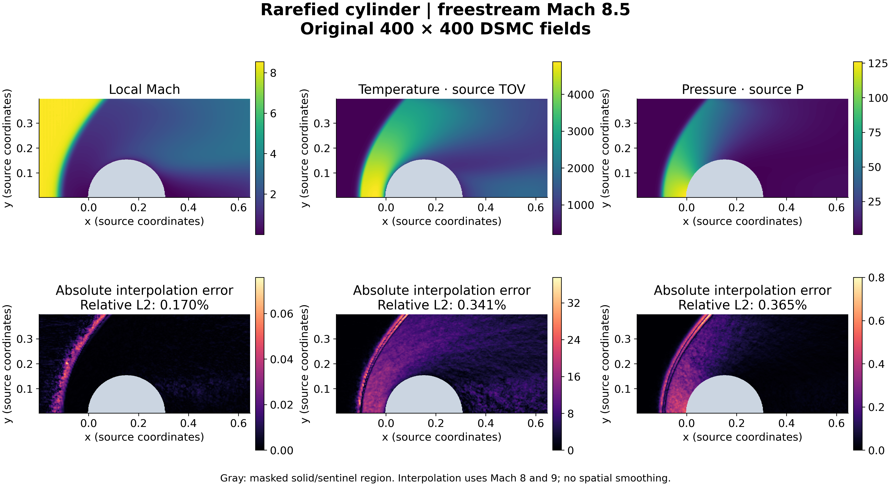

The original **400 × 400 fields at freestream Mach M∞ = 8.5** are rendered with continuous contours.
Error panels compare against Mach-8/Mach-9 interpolation; gray marks the masked
solid/sentinel region. The retained teaching metadata do not specify a verified
Knudsen number or wall-temperature setting for this archive; they must be recovered
from its matching solver input before treating this as a fully specified DSMC case.
[Figure provenance](results/hypersonic_cylinder_week7_1/cylinder_homepage_provenance.json)

Across the five held-out cases in the **compact teaching dataset**, interpolation
errors are **0.398% / 0.609% / 0.779%** for local Mach, temperature and pressure.
The trained **3×96 tanh MLP** gives **1.53% / 2.70% / 2.50%**, with training
errors **1.26% / 2.21% / 1.82%**. Interpolation still wins; the earlier
underfit random-feature ridge is no longer the default classroom comparison.
These are new teaching runs, not the published model's accuracy.
[Data and paper](data/hypersonic_cylinder/README.md) · [MLP metrics](results/hypersonic_cylinder_week7_1/mlp_metrics.json)

For matched circle and ellipse DSMC fields, see the [geometry comparison](results/ds2v_geometry/README.md).

### Week 7.2 — Sparse-sensor state estimation

**[Open Week 7.2: lecture, notebooks and guide](weeks/week07_2/README.md)**

**Problem:** Estimate a wake from noisy velocity sensors. 
**CFD / data:** Retained FlowMLLab D2Q9–TRT LBM Re110 trajectory. 
**Learning method:** POD–DMD dynamics and a Kalman filter; no neural network in this estimator.

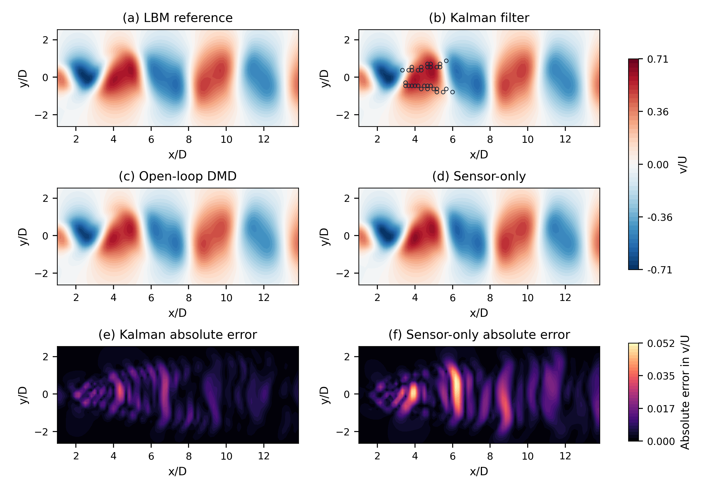

**Re = 110 cylinder wake**, final retained test frame: all panels use the same
field and 32 noisy transverse-velocity observations; the selected POD rank is 8.

A validation-selected rank-8 Kalman filter assimilates 32 noisy transverse-velocity
sensors on the retained Re110 wake. Mean test relative L2 is **2.18%**, versus
**3.16%** for matched sensor-only POD reconstruction and **4.36%** for open-loop
DMD. Its nominal 95% marginal intervals cover only **55.1%** of sampled values;
the overconfidence is retained as a model failure.
[Protocol, all baselines and limits](results/week07_2_state_estimation/README.md)

### Week 7.3 — Self-supervised pretraining and label efficiency

**[Open Week 7.3: lecture, notebooks and guide](weeks/week07_3/README.md)**

**Problem:** Complete a wake field from 25% of its patches for a new trajectory with few labelled frames. 
**CFD / data:** The four retained FlowMLLab D2Q9–TRT LBM wakes (Re = 90, 100, 105, 110). 
**Learning method:** A masked autoencoder pretrained on the unlabelled Re90/Re100 wakes (He et al., 2022; the MAPA protocol of Tang, Spalding and Cogan, 2026), used zero-shot, with a frozen linear probe, fine-tuned and from scratch; gappy POD with transferred, target-only and pooled bases as the matched classical baselines.

**Target Re = 110**, with unlabelled pretraining at **Re = 90 and 100**.
Every point evaluates the same cylinder-wake completion task with 25% of patches
visible; the horizontal axis changes the number of labelled target frames.

The pretrained pipeline beats the same architecture from scratch at every label
count under the matched 300-step downstream budget. At `k = 1, 2`, validation
early stopping keeps the zero-shot pretrained weights; label-driven improvement
starts at `k = 4`. With the full pretraining budget the from-scratch model still
fails at `k = 2`. Gappy POD with a basis transferred from the unlabelled wakes is
nevertheless an order of magnitude more accurate (**about 1.4%** zero-shot
against **about 18%** for the network), and its pooled basis improves with every
label. The classical win is retained and explained: this periodic wake is low-rank.
[Protocol, all methods and limits](results/week07_3_pretraining/README.md)

### Week 7.4 — Diverse-wake pretraining

**[Open Week 7.4: lecture, notebooks and guide](weeks/week07_4/README.md)**

**Problem:** Decode instantaneous lift on Reynolds trajectories excluded from pretraining. 
**CFD / data:** Sixteen compact D2Q9-TRT LBM trajectories, Re60-135; eleven development cases, Re105 validation, four target cases. 
**Learning method:** Frozen pretrained and random encoders plus ridge, compared with POD-32 plus ridge.

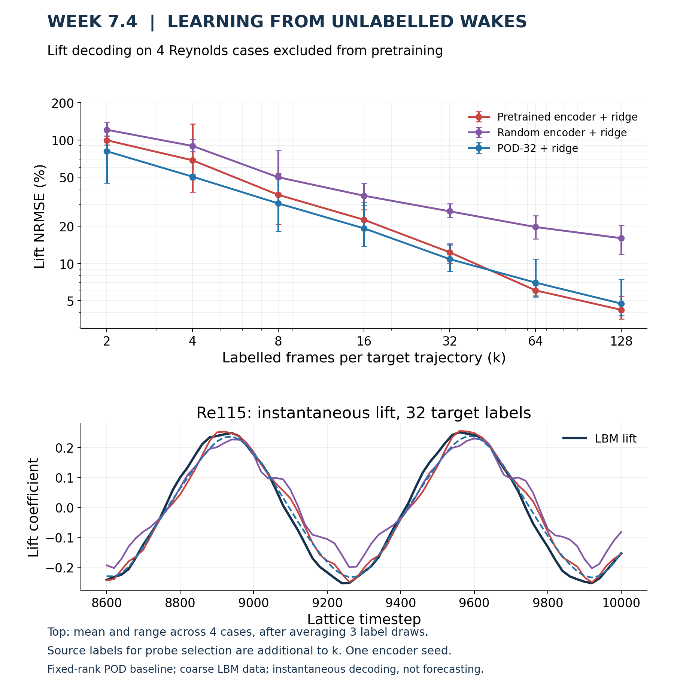

**Target Re = 95, 115, 125 and 135**, with **Re = 105** reserved for validation.
These four target trajectories are excluded from pretraining. The geometry and
coarse **120 × 48 LBM grid** are fixed; curves vary the target-label budget.

The retained pretrained encoder achieves **12.31% mean lift NRMSE with 32 target labels**, versus **16.02% for the random encoder with 128**: better mean accuracy with one-quarter as many target labels. POD-32 leads through k=32; the pretrained encoder has lower mean error at k=64 and 128. This is a MAPA-inspired teaching result, not a reproduction of MAPA or a universal neural advantage. Source labels used in ridge selection are additional to k. One encoder initialization and coarse, fixed-geometry CFD limit the claim.
[Protocol, per-trajectory results and limitations](results/week07_4_diverse_pretraining/README.md)

### Week 8 — Gas dynamics and SciML

**[Open Week 8: lecture, notebooks and guide](weeks/week08/README.md)**

**Problem:** Predict and invert compressible-flow relations. 
**CFD / data:** Exact gas-dynamics relations and numerical root finding; no spatial CFD run. 
**Learning method:** MLP inverse maps versus interpolation and radial-basis-function baselines.

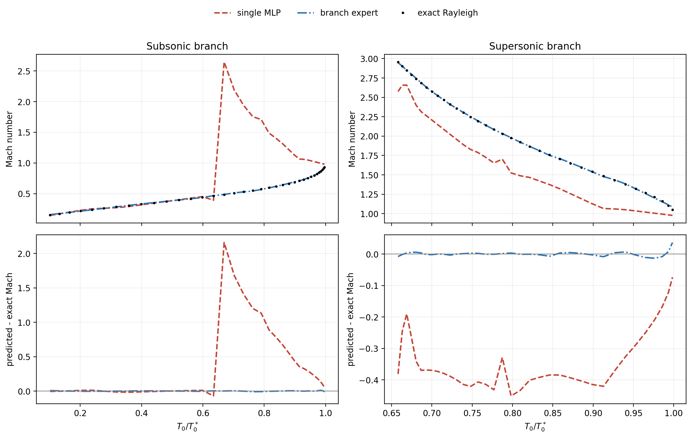

This figure aggregates inverse gas-dynamics tests across their declared input
ranges; it is **not a flow field at one Mach number**. The higher-dimensional
comparison varies two through five shock-tube inputs at approximately 4096
training states. Branches, parameter ranges and gas assumptions are part of each
[benchmark's source protocol](https://github.com/Ehsan-Roohi/GasDynamicsSciML/tree/374431a1033138f56e2752bf8bbf9b75a454d80c).

Preserve physical branches while comparing exact solvers, interpolation and
learned inverse maps under matched budgets.
[Benchmarks and validity limits](results/gas_dynamics_week8/README.md)

### Week 9 — Rarefied micro-step and micro-nozzle

**[Open Week 9: lecture, notebooks and guide](weeks/week09/README.md)**

**Problem:** Predict geometry-dependent step fields and pressure-dependent nozzle fields. 
**CFD / data:** Author-supplied DSMC archives; the nozzle uses modified Bird-family exports with a documented boundary defect. 
**Learning method:** Step: geometry/coordinate MLP. Nozzle: shock-aligned POD with polynomial or tanh-MLP coefficient maps. Article and experimental DeepONet results are distinguished in the linked reports.

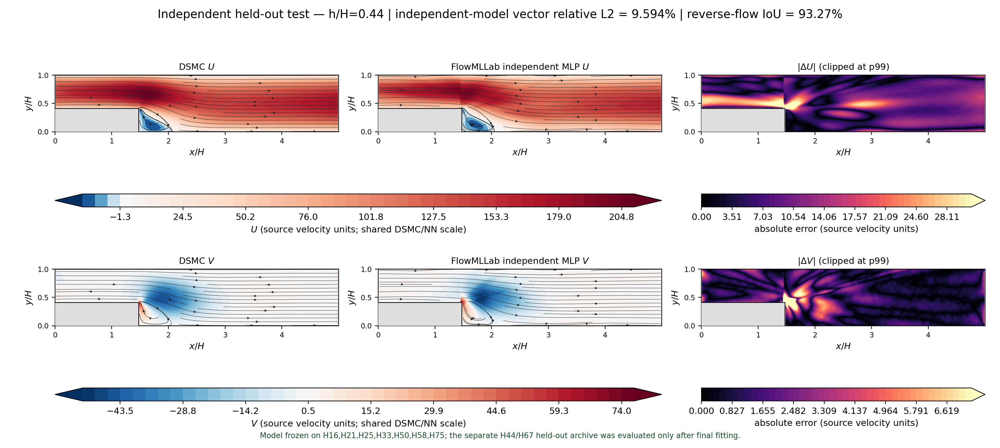

**Kn = 0.01**, nominal step-height ratio **h/H = 0.44** (case H44).
The digitized solid mask has height 0.4083H; H is the channel height.
The independent teaching model uses geometry and coordinates only. This is the
fixed-Kn height study, not simultaneous Kn/geometry generalization.
[Step evidence and provenance](results/mahdavi_deeponet/README.md)

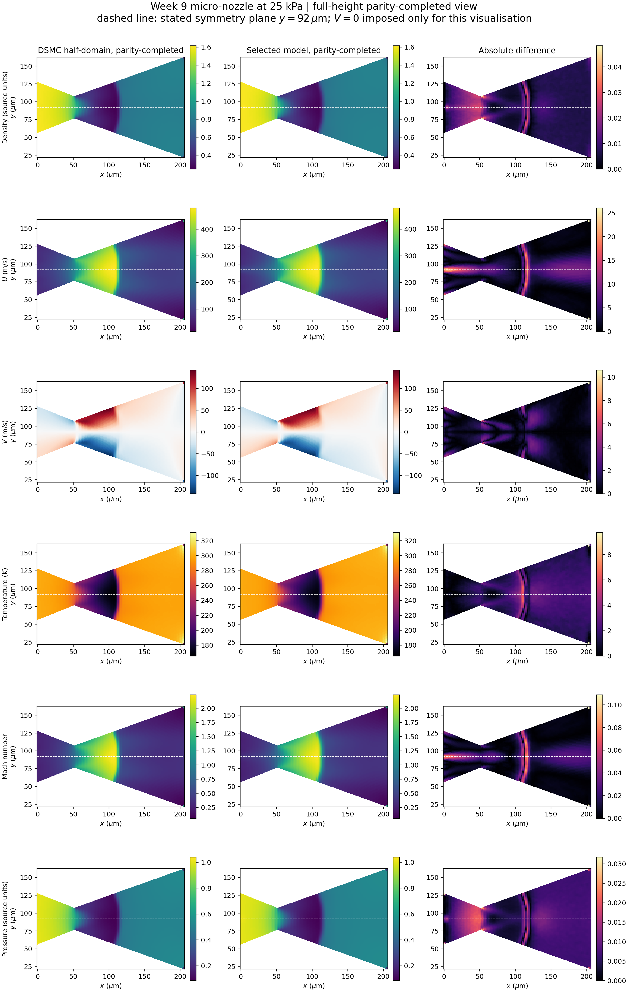

**Back pressure p_out = 25 kPa**; the recovered legacy input specifies
**p_in = 100 kPa**, hence p_in/p_out = 4. The 25-kPa label is neither inlet
pressure nor a Mach number. Mach varies spatially through the nozzle. The view
mirrors the measured half-domain about y = 92 µm with physical parity.
The exact producing input and a verified case Kn remain unresolved in the
[source audit](data/nozzle_bird_pr/README.md).

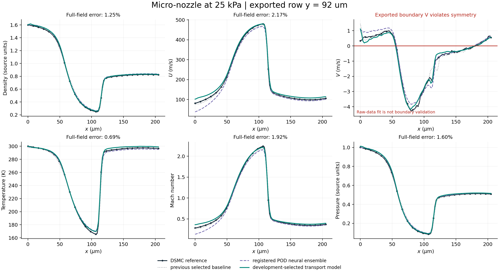

Profiles from the **same p_out = 25 kPa case** at the displayed axial/transverse
sampling locations, with the same source geometry and units as the fields above.

The selected registered-POD polynomial model and trained neural branches are
compared with the original interpolation baseline. The displayed transverse
velocity on the symmetry plane is the prescribed **V = 0** boundary condition,
not a learned accuracy result. The full-height field view is a parity-completed
visualisation about that plane, not new CFD. Raw exports have a documented symmetry defect;
these are historical-holdout regression results, not fresh blind validation.
[Nozzle report](results/nozzle_transport/README.md)
· [Raw boundary audit](results/nozzle_transport/symmetry_boundary_audit.png)

#### Week 9 Lab 3 — Moving-throat data-alignment audit

**Problem:** Detect a silent branch/trunk correspondence error before fitting a nozzle operator. 
**Reference:** Independent quasi-1D isentropic solutions for three moving-throat geometries. 
**Learning method:** Matched 2×48 tanh MLP surrogates isolate the effect of correct versus corrupted trunk-coordinate pairing.

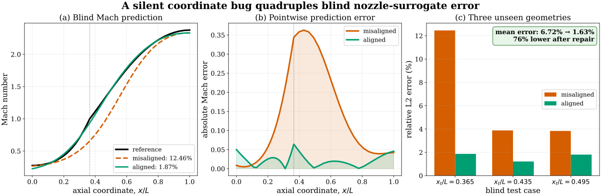

**Quasi-1D isentropic flow, γ = 1.4**, subsonic before and supersonic after a sonic
throat (**M = 1**). The three unseen geometries have (x_throat/L, A_exit/A_throat)
= **(0.365, 2.35), (0.435, 3.15), (0.495, 3.65)**. Mach is the predicted spatial
profile; panels (a–b) show the first geometry, and panel (c) compares all three.
Re and Kn are not inputs to this inviscid continuum example.

In a controlled quasi-1D stress test, reusing the first nozzle's coordinates
for every target preserves array shape but raises mean relative L2 error on
three unseen geometries from **1.63% to 6.72%**. Correct pairing reduces blind
error by **76%** under the same architecture, training cases and random seed.
This isolates the value of the pre-fit audit; it is not a DSMC accuracy claim.
[Run the audit](notebooks/week09/W9_Lab3_Nozzle_Data_Alignment_Audit.ipynb) ·
[Metrics and protocol](results/nozzle_alignment_audit/README.md) ·
[Companion notes](lectures/week09_3_nozzle_data_alignment.pdf)

### Week 10 — DSMC cavity and molecular shocks

**[Open Week 10: lecture, notebooks and guide](weeks/week10/README.md)**

**Problem:** Reconstruct rarefied cavity and mono/diatomic shock data. 
**CFD / data:** Author-supplied article DSMC tables, not new particle-solver runs. 
**Article learning method:** the cavity uses a family of coordinate MLP experts,
one per training Kn: fixed Fourier features of (x, y) feed three 256-unit
Swish dense layers, and neighboring experts are fused by log-Kn interpolation.
It is **not DeepONet**. The article uses DeepONet for its diatomic-shock study. 
**Displayed course reproduction:** direct log-Kn interpolation for the cavity and
POD–polynomial profile surrogates for the shocks. These displayed predictions do
not rerun the article's trained neural networks.

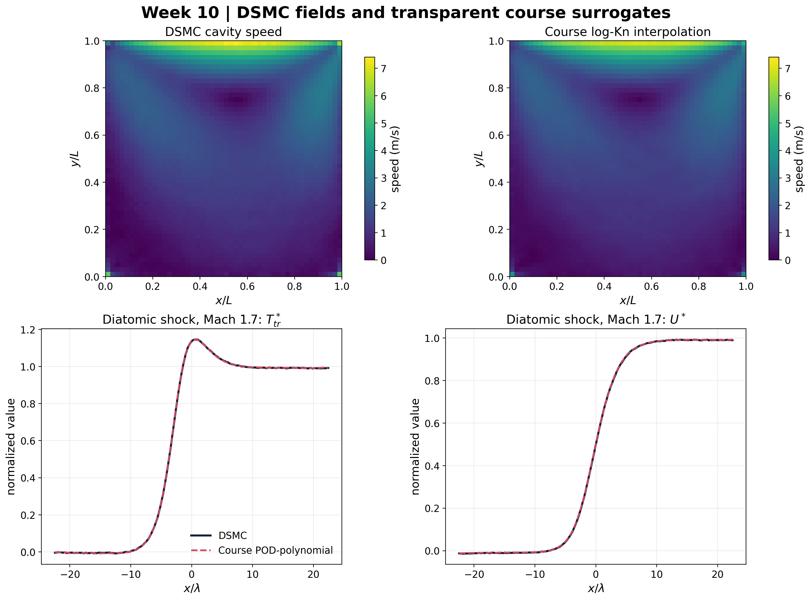

**Upper panels:** square DSMC cavity at **Kn = 0.05**, **lid speed 10 m/s**,
on the retained **50 × 50** field grid. **Lower panels:** a stationary
**nitrogen shock at upstream Mach M₁ = 1.7**, compared at 300 profile locations.
The shock coordinate is scaled by the upstream mean free path; these are two
different physical problems, not a common Re/Mach case.

The article-data experiment retains **1.281% maximum primary cavity NRMSE**
and **1.018% maximum shock-profile relative L2 error**, with the data contract
and regeneration workflow available for inspection.
[Article (Roohi & Shoja-Sani, 2026)](https://doi.org/10.1016/j.ast.2025.110785)
· [Reproduction evidence](results/aescte_dsmc/README.md)
· [Data contract](data/aescte_dsmc/README.md)

### Week 10.1 — Ab initio collision DeepONet

**[Open Week 10.1: lecture, notebooks and guide](weeks/week10_1/README.md)**

**Problem:** Compute cylinder flow using a collision-angle surrogate. 
**CFD / data:** Author-supplied DS2V-based DSMC research runs. 
**Learning method:** DeepONet supplies scattering-angle tables, not whole-field predictions; the CPU lab is a separate Lennard-Jones analog.

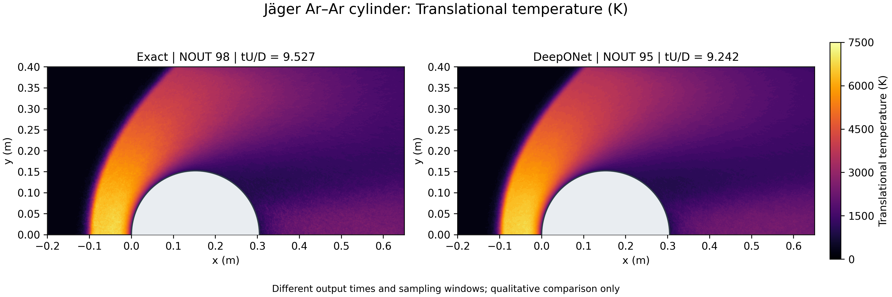

**Argon, M∞ = 10**, cylinder radius **0.1524 m**, T∞ = **200 K**,
n∞ = **4.247 × 10²⁰ m⁻³**, U∞ = **2634.1 m/s**, diffuse wall at **500 K**.
The upper-half-domain outputs are at **tU∞/D = 9.5265 (Exact)** and
**9.2420 (DeepONet)**, where D = 0.3048 m. The retained contour manifest does
not specify a verified Kn; no value is inferred from a different collision model.

Author-supplied research fields from the later DeepONet collision-angle package,
related to [Roohi, Shoja-sani and Stefanov, PoF 38, 057123 (2026)](https://doi.org/10.1063/5.0328463).
DSMC generates these fields using exact-derived or DeepONet-derived angle tables;
this is not a whole-field neural prediction or reproduction of the article's MLP.
Shared colors, **different times and sampling windows**: qualitative comparison only.
[All four colored fields and provenance](results/abinitio_deeponet_cylinder/README.md)
· [Surface pressure and heat flux](results/abinitio_deeponet_cylinder/README.md#surface-pressure-and-heat-flux)
· [Week 10.1 lecture companion](lectures/week10_1_abinitio_collision_deeponet.md)

[Run the CPU collision-map lab](notebooks/week10_1/W10_1_Collision_Map_Surrogate_Audit.ipynb):
solve a reduced Lennard-Jones scattering problem, check analytic limits and
audit a fitted surrogate using transport integrals. This executable analog is
separate from the Jäger research fields above; it does not reproduce the
article's potential or network.

### Week 10.2 — Kinetic shocks: what do the learned moments miss?

**[Open Week 10.2: lecture, notebook and guide](weeks/week10_2/README.md)**

**Problem:** Determine whether accurate density and temperature also imply accurate heat flux, stress and fourth-order moments. 
**Computation:** Train a BGK PINN from random weights on CPU and compare its initial and trained fields with an independent DVM. Check reference space/time and velocity sensitivity. 
**Learning method:** Change network depth, optimizer and density/momentum/energy loss weights. Then audit equation-trained and moment-supervised research models from [Roohi's kinetic-shock study](https://arxiv.org/abs/2605.29211v2).

**Transient BGK shock tube, t = 0.02**, x ∈ [−0.5, 0.5], constant
**τ = Kn = 1** in the source nondimensionalization, **Pr = 1, γ = 5/3, R_g = 1**.
The initial left/right states (ρ, u, T) are **(1, 0, 1)** and **(0.125, 0, 0.8)**,
joined with H(x) = [1 + tanh(20x)]/2; the pressure ratio is 10.
Both reservoirs initially rest, so **no stationary upstream Mach number is
prescribed**. The plot compares the initial and trained CPU PINN with an
independent **800-cell DVM**; the notebook also checks 400/800 cells and velocity quadrature.

The CPU experiment exposes both the gains and limits of training: exact initial
and inflow transport already contributes most of this short-time solution.
DVM targets are excluded from fitting. The twelve investigations cover physical
diagnostics, network capacity, optimizer work, loss weighting and numerical sensitivity.
The retained research comparison below is a separate experiment.

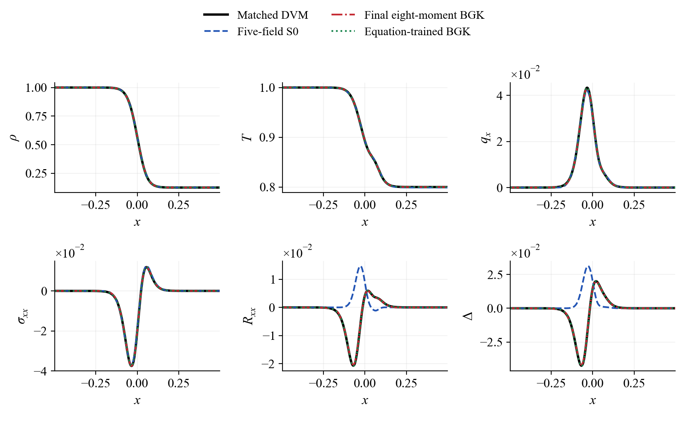

**The same transient BGK tube**: t = 0.02, τ = Kn = 1, Pr = 1, γ = 5/3,
x ∈ [−0.5, 0.5], and the same smoothed left/right states above; **no prescribed
stationary upstream Mach**. This research comparison uses a **6400-cell DVM**,
distinct from the smaller CPU reference. The notebook's separate stationary
shock experiment is **M₁ = 2, Shakhov, Pr = 2/3, τ = 1/ρ**.

All curves use the same 399 comparison nodes and 6400-cell DVM reference.
Five-field supervision can leave large fourth-order errors. Eight-moment
supervision improves that state, while equation training remains more accurate
for several nonequilibrium moments. The notebook also checks small tail signs
that global error norms can hide. Training/reference roles are documented;
these saved results are not a new training run or a held-out generalization test.

[Physical profiles and scores](results/week10_2_kinetic_shock/README.md) ·
[Twelve numerical investigations](notebooks/week10_2/README.md) ·
[Data provenance](data/week10_2_kinetic_shock/README.md)

### Week 11 — Shock and vortex identification

**[Open Week 11: lecture, notebooks and guide](weeks/week11/README.md)**

**Problem:** Identify shocks/vortex cores and test reconstruction before detection. 
**CFD / data:** Archived ShockVortexML compressible fields for the lead figure; FlowMLLab D2Q9–TRT LBM for the wake extension. The lead archive's exact producing-solver revision is not established here. 
**Learning method:** Harmonized Joint (HJ), a custom shared-encoder, multi-branch
encoder-decoder with specialist shock, vortex-core, wake/shear and expansion
paths. The displayed masks use the frozen task-preserving HJ shock-repair
checkpoint: the shared encoder and complete vortex pathway remain fixed while
the shock-specific path is adapted. HJ-joint and a capacity-matched U-Net are
comparison models, not the network shown here. A separate lab uses U-Net for
velocity-field reconstruction before physical vortex identification.

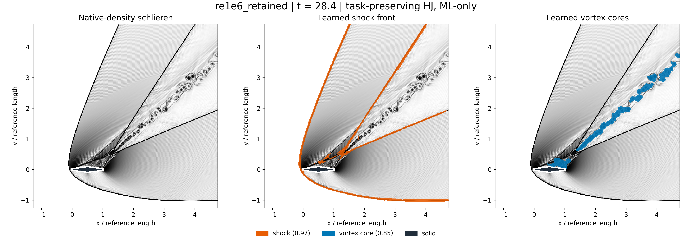

**Source case Re = 10⁶**, snapshot `re1e6_retained_s000153090`, at the
archive's time **t = 28.35**. Coordinates use the archive reference length.
The retained figure metadata do not establish freestream Mach, angle of attack
or the time normalization; these must not be borrowed from a different airfoil
case in the upstream repository.

Six fresh fixed-checkpoint forward passes on existing airfoil and cylinder fields from
Roohi's [ShockVortexML research](https://github.com/Ehsan-Roohi/ShockVortexML).
ML-only outputs; previously inspected development-test cases, not human-validated accuracy.
[All six full-size figures and provenance](results/week11_research/README.md) ·
[Notebook and lecture](notebooks/week11/README.md).
Synthetic controls remain as the warm-up.

**Watch the extended research pipeline — airfoil and cylinder**

**Airfoil movie S9:** a time sequence of density schlieren and detected structures.
Its preview does not supply verified Mach/Re/angle-of-attack settings; consult
the linked movie provenance before assigning the still image's case conditions
to this separate sequence.

[▶ Watch the airfoil video (S9)](https://www.youtube.com/watch?v=ULA8x2jUEvA)
· [▶ Watch the cylinder video (S10)](https://www.youtube.com/watch?v=opVMf1OVdM4)
· [Explore both examples on Hugging Face](https://huggingface.co/spaces/ehsanroohi/ShockVortexML-Demo)
· [Download original-quality movies and provenance](https://github.com/Ehsan-Roohi/ShockVortexML/releases/tag/movies-localfront-v2-20260909)

Click the preview to open the video on YouTube. The left panel shows numerical
density schlieren; the right shows localized learned shock fronts, vortex-core
candidates, wake/shear and expanding-flow regions. These movies use the extended
local-front model with retained core/wake branches and the PM-v4 expansion-region
branch, a different configuration from the HJ control checkpoint described above.
Blue denotes expanding flow, not a validated centred Prandtl–Meyer fan.
These inspected research examples retain detection errors; their visual coverage
is not an independent accuracy measurement.

**Real-field extension:** [U-Net reconstruction followed by vortex identification](results/week11_reconstruction/README.md)
compares interpolation, reconstructed velocity plus swirling strength, and direct
mask prediction on the same retained LBM wake cases. Three training seeds, loss
histories and saved-checkpoint audits are included. These are weak-reference
vortex scores on coarse incompressible data, not shock accuracy or a blind test.

#### Hydrofoil vapor-cloud detection

**Problem:** Detect attached cavities and disconnected vapor clouds around a hydrofoil. 
**CFD / data:** The author's existing Fluent fields: 158 original alpha-input
snapshots, plus 16 shared moving-case snapshots for comparing the methods. 
**Methods:** Alpha-input context U-Net, fixed pressure threshold, pressure-only
3×3 model, pressure U-Net and pressure topology U-Net. The notebook reruns the
original saved models, including all three pressure-model seeds.

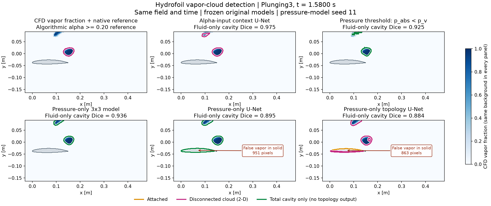

**Plunging hydrofoil, case Plunging3_003, t = 1.58 s**, model seed 11,
on a **192 × 384** image grid. The background is vapor volume fraction α ∈ [0, 1].
The compact retained metadata do not report Re, cavitation number or the
plunge amplitude/frequency; the image is an archived detection comparison,
not a fully specified new hydrodynamic validation case.

All panels show the same CFD field, geometry and time. Orange/magenta denote
attached/disconnected classes; green denotes total cavity for methods without
a topology output. Pressure models receive no alpha input. Colored contours
have white contrast halos; arrows mark erroneous vapor predictions
inside the solid hydrofoil. The displayed Dice excludes solid/uncertain support.
The illustrated frame has the largest valid CFD cavity area in this retained trajectory and
uses the first seed (11); the notebook includes all 16 frames and three seeds.
These inspected nontraining cases use algorithmic weak references and different
input information, so this is not a blind or matched-input accuracy ranking.

[Open in Colab](https://colab.research.google.com/github/Ehsan-Roohi/FlowMLLab/blob/main/notebooks/week11/W11_Cavitation_Cloud_Detection.ipynb)
· [Notebook](notebooks/week11/W11_Cavitation_Cloud_Detection.ipynb)
· [Detection and training code](flowmllab/cavitation_detection.py)
· [Alpha/pressure comparison code](flowmllab/cavitation_methods.py)
· [Results and provenance](results/week11_cavitation/README.md)
· [Expanded Lecture 11](lectures/week11_shock_vortex_identification.pdf)

### Week 12 — DSMC moment reconstruction

**[Open Week 12: lecture, notebooks and guide](weeks/week12/README.md)**

**Problem:** Reduce cavity heat-flux sampling noise. 
**CFD / data:** Author-supplied multi-seed DSMC with an independent finite-sample reference. 
**Learning method:** Archived observation-conditioned estimator in the lead figure; a separate 64×32 tanh patch MLP in the Noise2Noise lab.

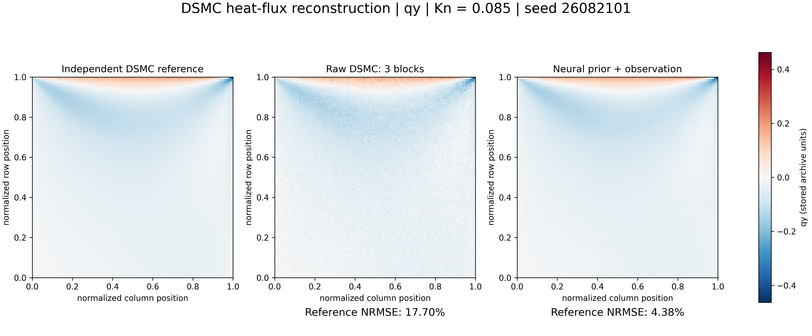

**Square cavity, Kn = 0.085, lid speed 350 m/s**, on the **100 × 100 native
sampling grid**. The illustrated realization is seed 26082101; the panels compare
the same signed vertical heat flux q_y with an independent sampled reference.
Axes are normalized array positions; colors retain the archive units.

Existing author-supplied DSMC cavity results associated with
[Roohi, arXiv:2609.01637](https://doi.org/10.48550/arXiv.2609.01637).
Eight seeds, both heat-flux components, 80 recomputed errors; no new DSMC or neural training.
Mean reference NRMSE for qy: Raw(3) 17.61%, Raw(10) 9.80%, conditioned estimator 4.34%.
[Full comparisons, profiles and all-seed errors](results/week12_research/README.md) ·
[Notebook and lecture](notebooks/week12/README.md). The independent reference still has sampling noise.

The companion [Noise2Noise-style MLP lab](results/week12_noise2noise/README.md)
trains on raw DSMC observations, compares seven estimators and reports both
held-out seeds. Its training results are documented separately from the
archived research reconstruction shown above.

### Week 13 — Rectangular-cavity PINN research audit

**[Open Week 13: lecture, notebooks and guide](weeks/week13/README.md)**

The separate [D/W=5 regional-accuracy notebook](notebooks/week13/W13_Deep_Cavity_D5_Regional_Accuracy.ipynb)
adds the authors' retained CFD/PINN fields at Re=100,250,500,1000 and regional velocity, pressure and vorticity comparisons.

The new [controlled optimizer notebook](notebooks/week13/W13_D5_Controlled_Optimizer_Study.ipynb)
compares six fresh D/W=5 runs with matched starts, samples and work. It exposes
different velocity, pressure and vorticity rankings across three paired seeds.
Both finite-budget pipelines miss accurate deep-cavity flow; the
[full comparison](results/deep_cavity_ablation/README.md) preserves those failures
separately from the historical paper results.

The front page retains only two representative comparisons. The notebook has three parts:
build and train a small streamfunction PINN on CPU and judge it against the Week 1 CFD
reference; inspect the deep-cavity field beside CFD; audit the four-case research matrix.
Complete fields, loss histories and the audit tables are in the [Week 13 notebook](notebooks/week13/W13_Rectangular_Cavity_PINN_Research.ipynb).

**Problem:** Solve square and deep lid-driven cavities. 
**CFD / data:** Nektar++ CFD and PINN fields are shown in separate, labelled rows on a common grid. The square case retains a near-matched CFD/PINN validation panel. 
**Learning method:** Streamfunction PINN with hard wall constraints, trained using Adam then SSBroyden2 in float64.

The Week 13 module develops streamfunction PINNs for square and deep lid-driven
cavities. Compare **Re = 100 and 400**, **H/L = 1 and 2**, and **Adam followed
by SSBroyden2** using retained float64 A100 runs, exact wall constraints and
independent residual checks. The selected D/W=2.2 comparison uses Nektar++ at
t=120 and PINN checkpoint 55118. Its 3.59% velocity relative L2 is not a final
mesh/steady-convergence claim: the retained lid profiles differ.

[Lecture](lectures/week13_rectangular_cavity_pinn.pdf) ·
[Notebook and results](notebooks/week13/README.md) ·
[Reproduction protocol](qa/WEEK13_PINN_MATRIX_PROTOCOL.md)

Preparatory reading covers [PINN residuals and hard boundary constraints](lectures/week04_2_pinn_cavity.pdf)
(this reading and its `results/week04_2_pinn_cavity/` evidence keep their original
Week 4.2 file numbering; the Week 4.2 row of the course table is the
Stokes-to-Navier-Stokes lab),
including [McDevitt's DeepPlasma cavity code](https://github.com/cmcdevitt2/DeepPlasma/tree/fcb1566eaa3253d4a4108fbac9d49a38fd10ad6b/LDC),
used with his permission. The earlier [Re=100 qualification and CFD comparison](results/week04_2_pinn_cavity/README.md)
provides supporting evidence for this module.

**Selected case A — Re=1000, D/W=2.2:** CFD and PINN speed/streamlines and
mean-zero pressure use common scales. The pressure scale is symmetric-log and
retains the full range.

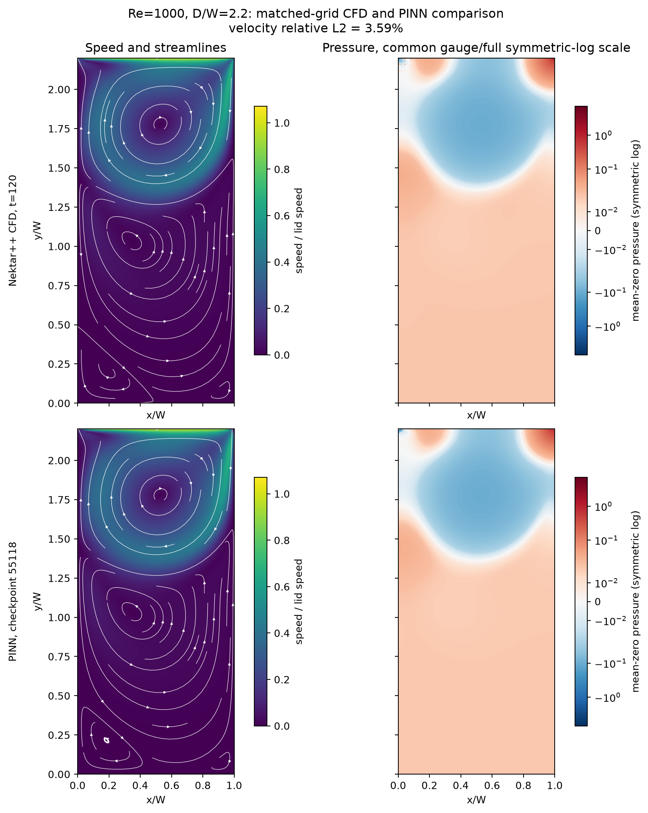

**Re = 1000, depth/width D/W = 2.2**: CFD at retained t = 120 and PINN
checkpoint 55118. Their lid profiles are near-matched, not identical; the
displayed discrepancy includes that boundary-condition difference.

**Selected case B — Re=100, D/W=1:** the PINN fields, pointwise velocity
difference and CFD/PINN centreline profiles are kept as the compact square-case
qualification. This selected near-matched run has 3.10% interior velocity
relative L2; the separate frozen four-case matrix reports 3.343% for its
`Re=100`, `D/W=1` checkpoint.

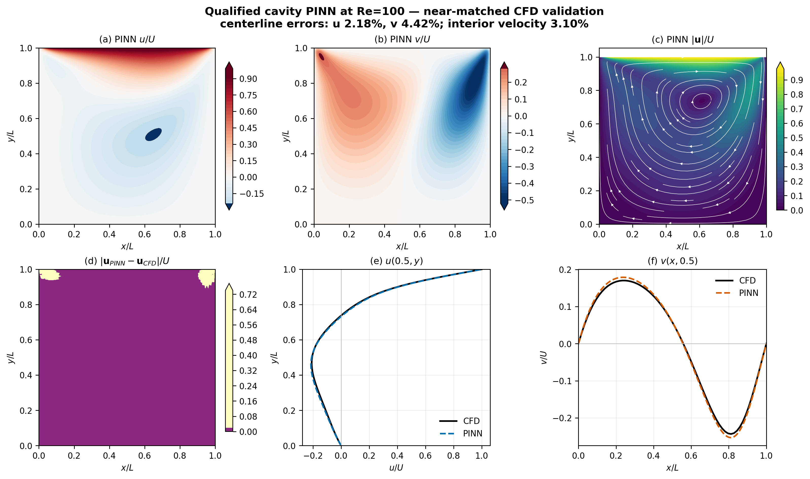

**Re = 100, square cavity D/W = 1**: near-matched CFD/PINN velocity and
centreline comparisons, with the selected run's 3.10% interior relative L2.

### Week 14 - RANS, inverse PINN and neural turbulence closures

**[Open Week 14: lecture, notebooks and guide](weeks/week14/README.md)**

**Problem:** Improve turbulent kinetic energy without confusing a coefficient fit
with a validated coupled flow solution. 
**CFD / data:** Lars Davidson's pyCALC-RANS source-checkpoint channel restarts;
Lee-Moser DNS reference statistics. 
**Learning method:** Inverse PINN diffusion inference and the original small
ReLU coefficient-regression protocol, with a separately labeled interpolation control.

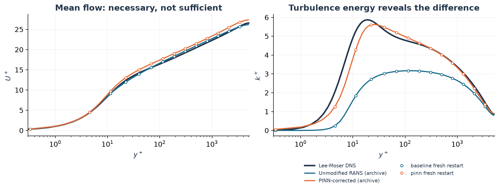

**Turbulent channel at friction Reynolds number Re_τ = 5200**,
defined by u_τδ/ν using friction velocity u_τ and channel half-height δ.
Wall units are y⁺ = yu_τ/ν and U⁺ = U/u_τ; **5200 is not the bulk Reynolds number**.
All plotted methods use this same Lee–Moser DNS reference case.

[Executed notebook and CPU setup](notebooks/week14/README.md) ·
[Lecture](lectures/week14_rans_pinn_nn.pdf) ·
[Run ledger](results/week14_validation/README.md) ·
[Paper-claim alignment](docs/WEEK14_PAPER_ALIGNMENT.md).

This completed teaching audit retains unsuccessful convergence criteria and
source-target regeneration differences. The plotted table-based PINN comparison
is **not** a verified reproduction of the paper's final PINN-NN curves.
The notebook reruns the small NN fit and checks retained CFD evidence; it does
not silently present saved solver fields as a fresh Run-All CFD calculation.

### Week 15 — Geometry-aware neural operators

#### Compact neural networks

Original Transolver: [double-step test, weights and results](results/family_transolver/README.md) · [additional g011 test](results/step_transolver/README.md).

**[Open Week 15: lecture, notebooks and guide](weeks/week15/README.md)**

Learn how geometry-aware neural operators generalize from single-step and other training geometries to a retrospective double-step family.
Compare whole-field prediction errors with reverse-flow topology, using the same CFD references and clearly separated historical and newly trained models.
The notebook exposes the split, training choices and unresolved low-Reynolds-number failures.

**Problem:** Predict velocity and pressure across changing channel geometry, including double-step cases excluded from training and validation. 
**CFD / data:** Retained channel-flow CFD fields and geometry masks: 100 training, 8 validation and 19 retrospective test cases; three `g005` cases are quarantined. This update generates no new CFD. 
**Learning method (compact-network evaluation):** Compare DeepONet, Geom-DeepONet, Geo-FNO, SMART, GeoTransolver and DoMINO. That suite uses a 19,200-update ceiling and three seeds; learning rates are selected using validation cases only.

**Results:** Historical Geom-DeepONet has 9.86% global velocity error; tuned Geom-DeepONet has 10.53%. Tuned DoMINO has the largest mean reverse-flow IoU (0.534), but 15.59% velocity error. Low-Reynolds-number reverse-flow magnitude remains inaccurate.

[Complete executed notebook](notebooks/week15/W15_Complete_Geometry_Generalization.ipynb) ·
[data and reproduction guide](notebooks/week15/README.md) ·
[Lecture](lectures/week15_geometry_generalization.pdf) ·
[post-audit evidence summary](results/week15_postaudit/README.md).

The frozen split contains 100 training, 8 validation and 19 retrospective
double-step test cases, with the three cases of geometry `g005` quarantined:
its floor drops in two steps and then rises again, so it shares the test
family's two-descending-step motif without belonging to the test family, and it
is kept out of training, validation and the test alike. The split was
reconstructed from the masks: no training or validation mask contains the two
consecutive descending steps that define the test family. The compact model configurations appear below. The unchanged original figures also retain the training-geometry panels. Every flow panel preserves the physical 5:1 aspect ratio.

Both test geometries are shown below with the compact model configurations. The double-step comparison includes historical DeepONet/Geom-DeepONet/Geo-FNO, tuned Geom-DeepONet/SMART/DoMINO, matched GeoTransolver, both explicitly labeled company-inspired proxies, and original Transolver. Fields share a speed scale within each figure; streamlines are computed from each field.

**Central-obstacle channel (g011): all four models and CFD.**

**Re = 100, geometry g011**, physical channel aspect ratio **5:1**.
Each row uses the same CFD case, a shared speed scale and its own streamlines.

**Double-step channel (g049): compact neural networks and CFD.**

**Re = 100, double-step geometry g049**, physical channel aspect ratio **5:1**.
The rows compare the same retained CFD field with the listed compact models.

Unchanged original figures: [historical/core comparison](results/week15_postaudit/core_g049_Re100.png) · [extended comparison](results/week15_postaudit/extended_g049_Re100.png).

Within the compact-network evaluation, the historical seed-17 Geom-DeepONet run had the lowest global velocity error
(9.86%), while
the learning-rate-selected Geom model was the strongest newly trained global-field model in that evaluation
(10.53%). DoMINO has the best mean reverse-flow IoU in the tuned suite (0.534),
but its test velocity error is 15.59%, so this is a topology-localized gain rather
than the best overall field reconstruction.
The main unresolved failure is Reynolds-stratified: historical Geom has only
0.096 IoU at Re=25, increasing to 0.628 at Re=100. Tuned Geom, SMART and DoMINO
improve the Re=25 IoU to 0.261, 0.299 and 0.357, respectively, but still
overpredict reverse-flow magnitude. The training data contain no Re=25
single-step case below 0.5H, so this regime extrapolates in both geometry and
the Reynolds-number/step-height combination.

The learning-rate sweep uses only non-double-step validation cases and selects
`1e-3` over `3e-4` and `1e-4` for Geom, SMART and DoMINO within a three-point
grid whose best point is its upper edge. At Re=25, tuned Geom's selected-seed
IoUs are approximately 0.19, 0.24 and 0.36, so the seed-17 figures should not be
read as the three-seed mean. Fresh single-stage training at either `3e-4` or
`1e-3`, rather than learning-rate tuning alone, improves the historical footprint
detection. Company-inspired
PhysicsX and LIFT variants are explicitly transparent proxies, not proprietary
implementations. The public LR archive retains the common-scale ablation and
failed vortex cases; zonal and fixed-context ablations remain in the author's
private complete handoff and are not claimed as public release assets.

#### Larger neural networks

**[Read the new teaching section](weeks/week15/larger_networks.md)** · [Results and artifact availability](results/week15_capacity_study/README.md) · [Run the lightweight analysis notebook](notebooks/week15/W15_Larger_Networks_Analysis.ipynb)

All six enlarged configurations completed one training seed (17). Three architectures also have completed controls under the same suite protocol:

| Matched architecture | Small velocity error | Large velocity error | Change in error |
| --- | ---: | ---: | ---: |
| Geometry-aware DeepONet | 17.0001% | 13.8010% | −18.82% |
| Geom-DeepONet | 12.3153% | 10.8179% | −12.16% |
| SMART | 9.9427% | 10.6642% | +7.26% |

These are arithmetic means over 19 retrospective test cases across eight geometries. The other three small controls were discontinued and are excluded. Separate-process checkpoint replay confirmed saved predictions before the execution environment reset; it does not replace a second training seed. The new weights and prediction arrays are currently unavailable; retained figures and recorded summary values support a retrospective teaching analysis.

**Double-step g049, Re=100: CFD and enlarged models.**

**Re = 100, g049 double-step channel, aspect ratio 5:1**: the same physical
case as the compact-model comparison, now with the enlarged networks.

The field panels use a shared speed scale and each prediction's own streamlines. The original Transolver row belongs to a **different training protocol** from the six-model suite; the figure supports visual inspection, not a controlled architecture ranking. [Inspect the harder Re=25 comparison](results/week15_capacity_study/figures/DoubleStep_All_Large_Models_Re25.png). The separate Transolver scratch/GeoPT experiment and its specifications are explained in the [capacity study](weeks/week15/larger_networks.md).

Students calculate paired capacity effects, compare velocity with reverse-flow location, audit artifact availability and design a finite follow-up experiment. Read the configuration and weight-availability tables before planning a rerun.

### Week 16 — Supersonic shape optimization

**[Open Week 16: lecture, notebooks and guide](weeks/week16/README.md)**

Build a CFD-to-learning design workflow for a fixed-volume supersonic body of revolution.
Use physically checked data to fit a pressure-signature surrogate, propose shapes, and assess retained designs with direct CFD.
The exercise distinguishes numerical verification, surrogate prediction error and the limits of near-field noise proxies.

**Problem:** Reduce near-field peak pressure at fixed body volume while constraining pressure drag. 
**CFD / data:** 44 Gmsh/SU2 **8.0.1** axisymmetric Euler cases at Mach 1.8, with 24 training, 6 validation, 8 test and 6 extrapolation cases. Eight finer-grid CFD references test the neural model; ten retained-design calculations and a three-grid Taylor–Maccoll study provide additional checks. 
**Learning method:** Compare POD-based ridge regression, MLP and Gaussian-process surrogates. The separately retained clean-data model is a fixed 32–32 tanh MLP with 12 POD coefficients and log pressure drag, fitted on the 24 training cases; its saved weights are audited without refitting.

**Results:** The retained model has 7.20% aggregate waveform error, 2.24% mean peak-pressure error and 2.27% mean drag error against the finer CFD references. Worst-case waveform error is 15.37%; extrapolation waveform error is 34.29%. Direct finer-grid CFD of the retained optimized geometry gives **20.66% peak-pressure reduction and 3.52% pressure-drag reduction**. These design gains belong to the directly checked retained geometry, not a newly verified optimum from the clean-data model. One alternative violates the drag constraint.

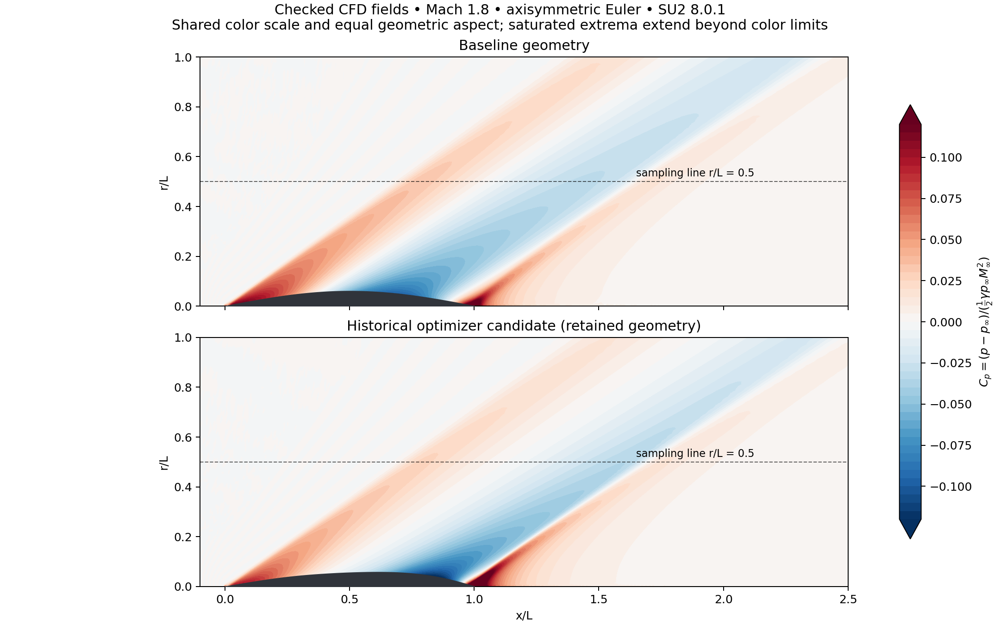

**Freestream Mach M∞ = 1.8**, γ = 1.4, p∞ = **101325 Pa**, T∞ = **288.15 K**.
The baseline and retained optimized bodies have the same volume and freestream
conditions. These are **axisymmetric inviscid Euler** calculations; viscosity
and a finite Reynolds number are not prescribed by this model.

[Executed notebook and assignment](notebooks/week16/README.md) · [Lecture](lectures/week16_supersonic_shape_optimization.pdf) · [Numerical evidence](results/week16_lowboom/README.md)

The finest Taylor–Maccoll cone pressure error is 1.16%. Atmospheric propagation and ground-level PLdB are not computed. The NASA SEEB-ALR reproduction failed its numerical and physical checks and remains a clearly labeled deferred research appendix; no successful NASA validation is claimed.

### Weeks 17–22 — Transformers and language modeling

Six CPU laboratories connect Q/K/V attention and a small next-character language
model to sensor reconstruction, autonomous wake prediction and transfer audits.
Each week has four coding exercises, an executed student notebook, separate
instructor solutions and a lecture. Current PDF page counts are listed in the
[lecture inventory](docs/COURSE_INVENTORY.md#lecture-files).

[17 · Attention](weeks/week17/README.md) · [18 · Language modeling](weeks/week18/README.md) · [19 · Sensors and tokens](weeks/week19/README.md) · [20 · Missing observations](weeks/week20/README.md) · [21 · Autonomous prediction](weeks/week21/README.md) · [22 · Transfer audits](weeks/week22/README.md)

[Setup and prerequisites](docs/TRANSFORMER_COURSE.md) · [Six figures and experiments](#transformer-labs) · [Review corrections and validation](docs/TRANSFORMER_SECOND_REVIEW_RESPONSE.md) · [Original Weeks 17–22 release notes](RELEASE_NOTES_v1.10.0.md). Interactive Colab and student workload acceptance remain open. See the [original release and its assets](https://github.com/Ehsan-Roohi/FlowMLLab/releases/tag/v1.10.0).

The six wake previews below use the same **32 × 78 fluid-region LBM grid**.
Coordinates are in cylinder diameters D, velocity in freestream U units and
vorticity in U/D. The cylinder is upstream outside the displayed rectangle;
its edge is not a wall. Each caption gives the Reynolds number and frame.

### Week 17 — Attention as a learned kernel

**[Open Week 17: lecture, notebooks and guide](weeks/week17/README.md)**

**Problem:** Which attention properties follow from the algebra, and which need physical evidence? 
**CFD / data:** Retained simulated wake observations; the contour preview uses Re105 frame 140 and the saved seed-17 SensorSet prediction. 
**Learning method:** Build Q, K and V, test permutation equivariance and vary temperature/key masks.

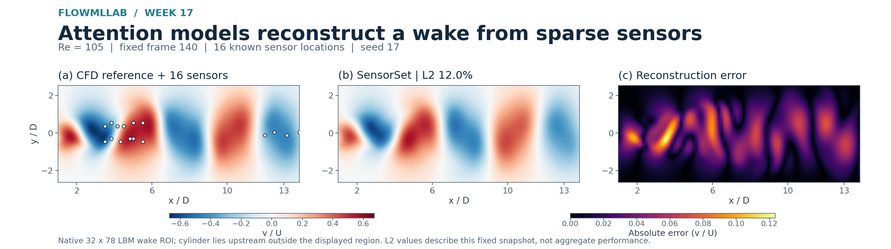

**Re = 105, frame 140, model seed 17.** The velocity contours compare the CFD reference, reconstruction from 16 sensors and absolute spatial error. The notebook separately inspects trained attention heads: their weights describe model computations and do not establish causal physical influence.

[Contour sources and reproduction](docs/assets/transformer-contours/README.md) · [Student notebook](notebooks/week17/W17_CFD_Transformer.ipynb) · [Lecture](lectures/week17_cfd_transformer.pdf) · [Setup and assignment](notebooks/week17/README.md)

### Week 18 — Language modeling and causal decoding

**[Open Week 18: lecture, notebooks and guide](weeks/week18/README.md)**

**Problem:** Train next-token predictors without revealing future inputs. 
**Data:** A small character model uses training-only vocabulary from course documents, with a separate validation document; wake coefficients provide the next-state example. 
**Learning method:** Shift targets, implement cross-entropy/perplexity and test every output position.

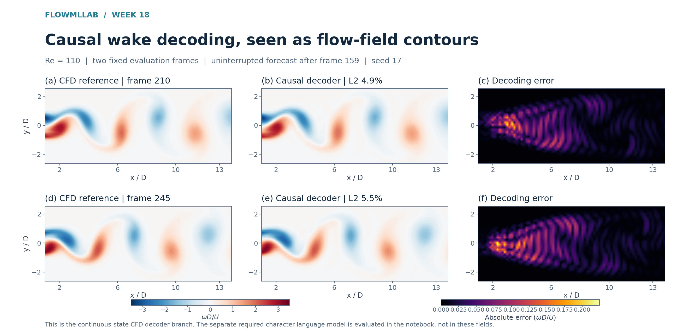

Vorticity contours show the continuous-state CFD decoder at fixed frames 210 and 245 of an uninterrupted Re110 forecast, with reference and absolute error. This is the CFD branch; the required notebook separately trains a small character language model and tests causal prefix invariance.

[Student notebook](notebooks/week18/W18_CFD_Transformer.ipynb) · [Lecture](lectures/week18_cfd_transformer.pdf) · [Setup and assignment](notebooks/week18/README.md)

### Week 19 — Tokenization and sensor design

**[Open Week 19: lecture, notebooks and guide](weeks/week19/README.md)**

**Problem:** How do observation design and tokenization constrain reconstruction? 
**CFD / data:** The retained 32 by 78 fluid-region wake fields and 16 sensors selected from the training representation. 
**Learning method:** Invert patches, compute the POD floor and solve noise-conditioned gappy reconstruction.

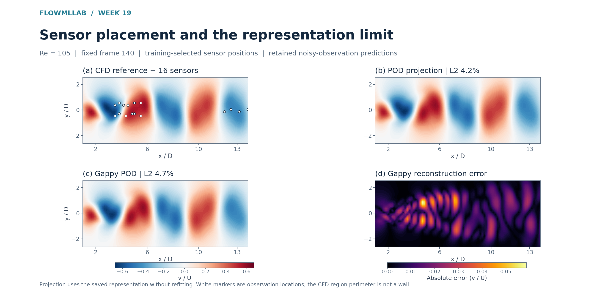

At Re105 frame 140, white markers locate the 16 sensors. Velocity contours compare the CFD reference, its projection into the saved training POD basis and noisy-observation gappy-POD reconstruction. The projection is a truth-dependent representation diagnostic. The notebook also compares point, patch and single-state token storage.

[Student notebook](notebooks/week19/W19_CFD_Transformer.ipynb) · [Lecture](lectures/week19_cfd_transformer.pdf) · [Setup and assignment](notebooks/week19/README.md)

### Week 20 — Learning with missing sensors

**[Open Week 20: lecture, notebooks and guide](weeks/week20/README.md)**

**Problem:** Reconstruct a velocity field when some observations are unavailable. 
**CFD / data:** Re90/Re110 fitting, Re100 selection and previously inspected Re105 retained evaluation. 
**Learning method:** Compare SensorSet, POD-DeepONet, ridge imputation and variable-sensor gappy POD using the same observations.

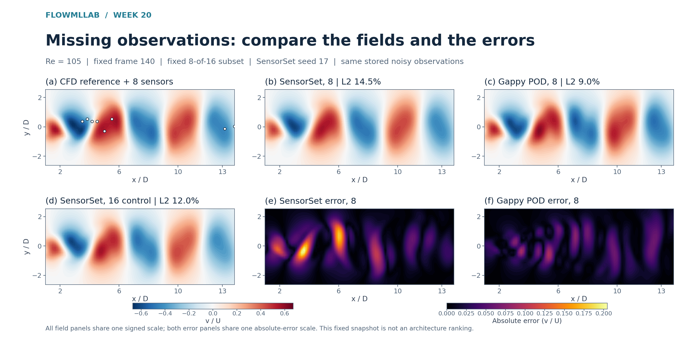

The fixed **Re = 105, frame 140** snapshot compares SensorSet and gappy POD using the same stored noisy observations from 8 of 16 sensors; the 16-sensor SensorSet prediction is a control. Shared field and error scales expose spatial differences. This snapshot does not rank architectures; the [paired three-seed augmentation ablation](results/transformer_sensor_ablation/README.md) separates training-recipe effects from architecture claims.

[Student notebook](notebooks/week20/W20_CFD_Transformer.ipynb) · [Lecture](lectures/week20_cfd_transformer.pdf) · [Setup and assignment](notebooks/week20/README.md)

### Week 21 — Autonomous prediction and phase

**[Open Week 21: lecture, notebooks and guide](weeks/week21/README.md)**

**Problem:** Forecast an uninterrupted wake trajectory without subsequent observation resets. 
**CFD / data:** Re110 fitting frames 0–159, autonomous validation 160–209 and retained evaluation 210–280. 
**Learning method:** Compare a causal Transformer, History-MLP, DMD and persistence; separate representation error from dynamics and inspect frequency/phase fits.

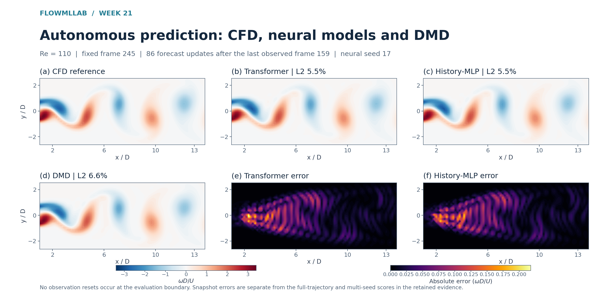

Vorticity contours compare the CFD reference, causal Transformer, History-MLP and DMD at **Re = 110, frame 245**, 86 forecast updates after the last observed frame 159. The two spatial-error panels share a scale. Panel L2 values describe this snapshot; full-trajectory, representation and multi-seed comparisons remain in the notebook and retained evidence.

[Student notebook](notebooks/week21/W21_CFD_Transformer.ipynb) · [Lecture](lectures/week21_cfd_transformer.pdf) · [Setup and assignment](notebooks/week21/README.md)

### Week 22 — Transfer and information budgets

**[Open Week 22: lecture, notebooks and guide](weeks/week22/README.md)**

**Problem:** Audit a transfer benefit before attributing it to pretraining. 
**CFD / data:** Re90 source and Re100/Re105/Re110 retained targets; budgets of 44, 84 and 154 target frames include validation and initialization observations. 
**Learning method:** Compare scratch, pretrained, matched-update, target-POD-MLP and DMD controls under fixed rollout initialization.

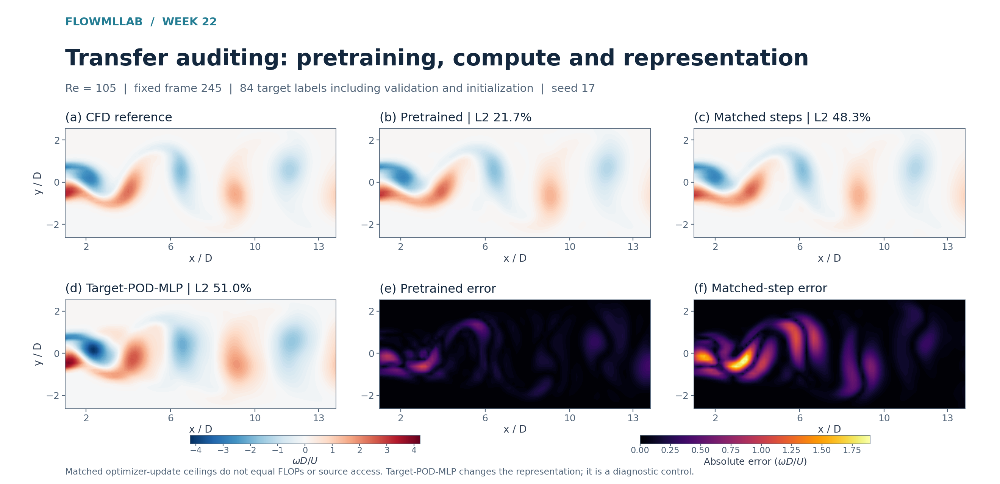

This fixed Re105 frame-245 example uses 84 total target labels and seed 17. Vorticity contours compare pretrained, matched-update scratch and target-POD-MLP predictions with CFD; shared error scales show the pretrained and matched-update residuals. Matched update ceilings do not equal FLOPs or source access, and target-POD-MLP changes the representation. The notebook and retained evidence cover all three Reynolds numbers, budgets and seeds.

[Student notebook](notebooks/week22/W22_CFD_Transformer.ipynb) · [Lecture](lectures/week22_cfd_transformer.pdf) · [Setup and assignment](notebooks/week22/README.md)

## Reuse and contribute

[Software manuscript archive](manuscript/README.md) · [Citation](CITATION.cff) · [Data provenance and reuse](DATA_PROVENANCE.md) · [Contributing](CONTRIBUTING.md)

Current release: **v1.15.0**

[GitHub release v1.15.0](https://github.com/Ehsan-Roohi/FlowMLLab/releases/tag/v1.15.0) · [Zenodo archive (all versions)](https://doi.org/10.5281/zenodo.22074169) · [Release history](https://github.com/Ehsan-Roohi/FlowMLLab/releases)

**Ehsan Roohi** · University of Massachusetts Amherst · [roohie@umass.edu](mailto:roohie@umass.edu)
