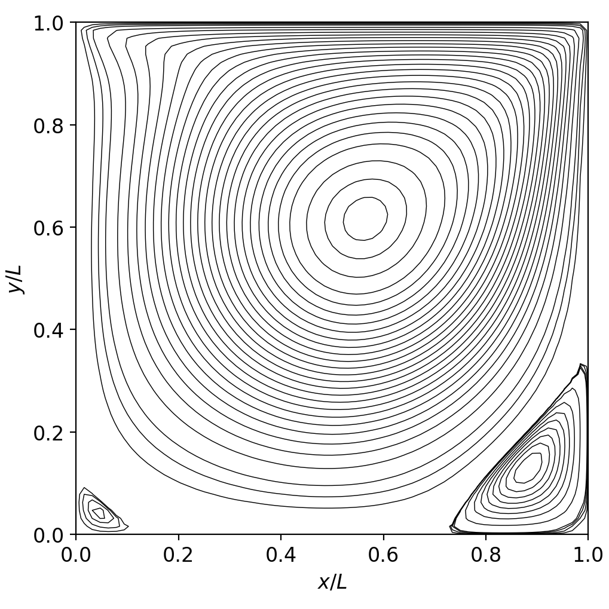
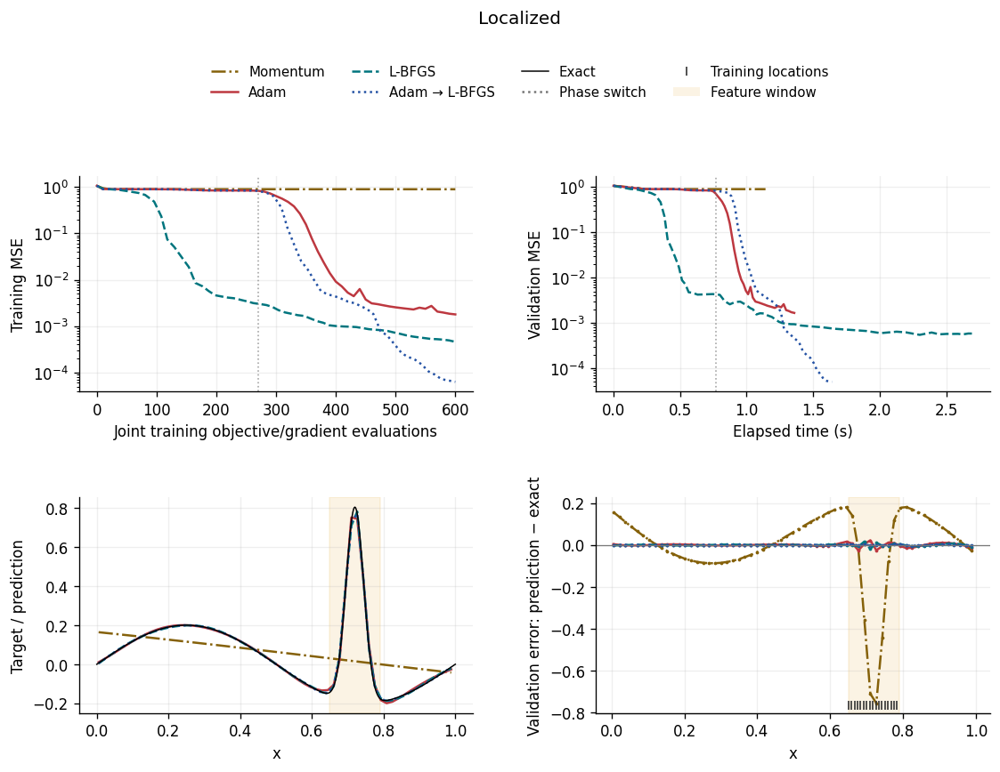
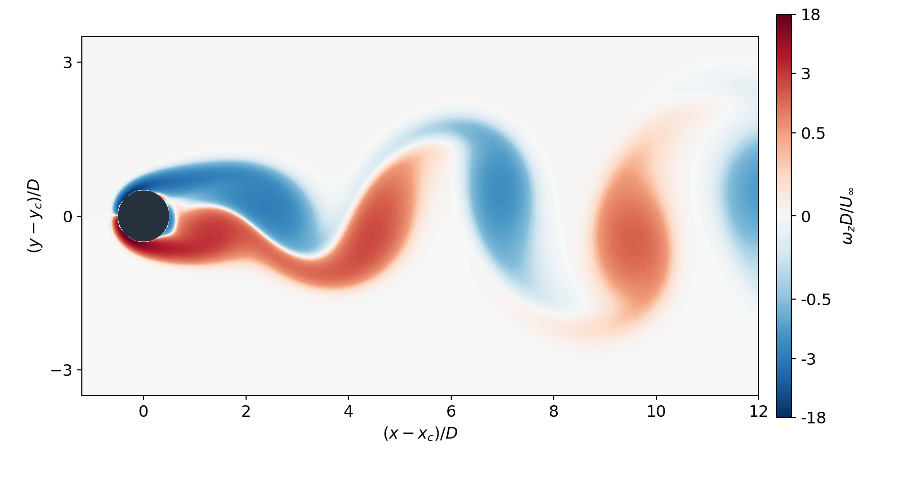

<h1></h1>

FlowMLLab is an open course and software toolkit for **scientific machine learning in fluid mechanics**. Run flow solvers, train predictive models, and test their predictions against physical benchmarks. The course spans continuum and rarefied flows, reduced-order models, physics-informed networks, neural operators, and attention for flow reconstruction.

Developed for **MIE 690A: AI in Fluid Mechanics** at the University of Massachusetts Amherst.

## Start here

- [**Open your first lab**](notebooks/week01/01_python_for_cfd_ai_fluids.ipynb) to learn the Python tools used in the course.
- [**Browse all weeks**](#continue-through-the-course) for guides, notebooks and lectures.
- [**Install FlowMLLab**](START_HERE.md) for setup, prerequisites and reproduction instructions.

[Course map](COURSE_MAP.md) · [Notebooks](notebooks/README.md) · [Lectures](lectures/README.md) · [Scientific results](docs/RESULTS_GUIDE.md) · [Attention and language modeling](docs/TRANSFORMER_COURSE.md)

## Results gallery

### Week 1 — Lid-driven cavity

At Re = 400, the moving lid drives a large clockwise vortex and weaker recirculation at the bottom corners. The black lines are streamfunction contours from the retained 65 × 65 solution. [Open Week 1](weeks/week01/README.md) · [View the Ghia benchmark comparison](results/article_figures/fig02_cavity_benchmark.png).

### Week 1.3 — What changes when you change the optimizer?

Four routes fit the same signal from identical starting weights and samples. The lower panels show which routes resolve the narrow peak and where errors remain. A separate exercise tests the SOAP and self-scaled Broyden sequence used in the deep-cavity study. [Open Week 1.3](weeks/week01_3/README.md) · [Read the lecture](lectures/week01_3_keras_optimizers.pdf).

### Week 7 — Vortex shedding behind a cylinder

Positive and negative vorticity alternate in the wake at Re = 100. The field comes from the retained two-dimensional lattice Boltzmann calculation, with 40 nodes per diameter at nondimensional time approximately 100. [Open Week 7](weeks/week07/README.md) · [Data and grid assessment](results/cylinder_d40/README.md).

**[Explore the full results gallery](docs/RESULTS_GALLERY.md)** for examples from every course unit.

## Continue through the course

Each week has a guide, a notebook link and its lecture or companion reading.

| Week | Topic | Notebook / lab | Lecture |
| --- | --- | --- | --- |
| [1](weeks/week01/README.md) | Python, numerical methods and CFD validation | [Week 1 labs](notebooks/week01/) | [Lecture 1](lectures/week01_numerical_foundations.pdf) · [TensorFlow/Keras guide](lectures/week01_02_tensorflow_keras.pdf) |
| [1.1](weeks/week01_1/README.md) | Specification, verification, physical gates and accountable AI use | [Week 1.1 lab](notebooks/week01_1/W1_1_AI_Assisted_Scientific_Software.ipynb) | [Lecture 1.1](lectures/week01_1_ai_assisted_scientific_software.pdf) |
| [1.2](weeks/week01_2/README.md) | SIMPLE, PISO and PIMPLE pressure-velocity coupling; Re=100 cavity | [Week 1.2 lab](notebooks/week01_2/W1_2_Cavity_Pressure_Velocity.ipynb) | [Lecture 1.2](lectures/week01_2_pressure_velocity.pdf) |
| [1.3](weeks/week01_3/README.md) | Controlled optimizer comparisons, target scaling and validation | [Week 1.3 lab](notebooks/week01_3/W1_3_Keras_Optimizers.ipynb) | [Lecture PDF](lectures/week01_3_keras_optimizers.pdf) |
| [2](weeks/week02/README.md) | Features, scaling, baselines and model validity | [Week 2 lab](notebooks/week02/AI_in_Fluids_Week2_Colab_Expanded.ipynb) | [Lecture 2](lectures/week02_supervised_learning_rarefaction.pdf) |
| [2.1](weeks/week02_1/README.md) | Bayesian prediction, calibration and uncertainty | [Week 2.1 lab](notebooks/week02_1/Probabilistic_UQ_CFD.ipynb) | [Lecture 2.1](lectures/week02_1_probabilistic_uq.pdf) |
| [3](weeks/week03/README.md) | Maxwellian sampling and particle simulation | [Week 3 labs](notebooks/week03/) | [Lecture 3](lectures/week03_kinetic_dsmc.pdf) |
| [4](weeks/week04/README.md) | CFD datasets, field surrogates and operator learning | [Week 4 labs](notebooks/week04/) | [Lecture 4](lectures/week04_cavity_surrogates_deeponet.pdf) |
| [4.1](weeks/week04_1/README.md) | POD–Galerkin and POD–DEIM | [Week 4.1 lab](notebooks/week04/W4_1_Classical_ROM_Cavity.ipynb) | [Week 4 companion](lectures/week04_cavity_surrogates_deeponet.pdf); theory in lab |
| [4.2](weeks/week04_2/README.md) | Matched Stokes input and learned Navier–Stokes correction | [Week 4.2 lab](notebooks/week04/W4_Lab4_Stokes_to_Navier_Stokes.ipynb) | [Week 4.2 companion](lectures/week04_2_stokes_to_navier_stokes.pdf) |
| [5](weeks/week05/README.md) | POD, physics-guided learning and frozen project protocols | [Week 5 project setup and tracks](notebooks/week05_06/README.md) | [Shared Weeks 5–6 guide](lectures/week05_06_project_guide.pdf) |
| [6](weeks/week06/README.md) | Closure testing, physical validation and reproducibility | [Week 6 closure track](notebooks/week05_06/P6_FP_Cavity_Closure.ipynb) · [All tracks](notebooks/week05_06/README.md) | [Shared Weeks 5–6 guide](lectures/week05_06_project_guide.pdf) |
| [7](weeks/week07/README.md) | LBM, vortex shedding and autonomous surrogates | [Week 7 lab](notebooks/week07/W7_Lattice_Boltzmann_Cylinder_Student.ipynb) | [Lecture 7](lectures/week07_cylinder_lbm_neural_surrogate.pdf) |
| [7.1](weeks/week07_1/README.md) | DSMC fields and Mach-to-field operators | [Week 7.1 lab](notebooks/week07_1/W7_1_Hypersonic_Rarefied_Cylinder_DeepONet.ipynb) | [Lecture 7.1](lectures/week07_1_hypersonic_rarefied_cylinder.pdf) |
| [7.2](weeks/week07_2/README.md) | Causal filtering of a cylinder wake from noisy sparse sensors | [Week 7.2 lab](notebooks/week07_2/README.md) | [Lecture 7.2](lectures/week07_2_cylinder_state_estimation.pdf) |
| [7.3](weeks/week07_3/README.md) | Masked pretraining and label efficiency in cylinder wakes | [Week 7.3 lab](notebooks/week07_3/README.md) | [Lecture 7.3](lectures/week07_3_masked_pretraining.pdf) |
| [7.4](weeks/week07_4/README.md) | Representation transfer and target-label efficiency for lift | [Week 7.4 lab](notebooks/week07_4/README.md) | [Lecture 7.4](lectures/week07_4_diverse_wake_pretraining.pdf) |
| [8](weeks/week08/README.md) | Exact compressible-flow branches and learned inverse maps | [Week 8 labs](notebooks/week08/README.md) | [Lecture 8](lectures/week08_gas_dynamics_sciml.pdf) |
| [9](weeks/week09/README.md) | Geometry-dependent and shock-aligned operators | [Week 9 labs](notebooks/week09/README.md) | [Lecture 9](lectures/week09_rarefied_deeponet_case_studies.pdf) |
| [10](weeks/week10/README.md) | Cavity and mono/diatomic shock reproduction | [Week 10 lab](notebooks/week10/README.md) | [Lecture 10](lectures/week10_dsmc_data_driven_surrogates.pdf) |
| [10.1](weeks/week10_1/README.md) | Molecular scattering and DSMC cylinder contours | [CPU scattering lab](notebooks/week10_1/W10_1_Collision_Map_Surrogate_Audit.ipynb) · [Research fields](results/abinitio_deeponet_cylinder/README.md) | [Lecture companion](lectures/week10_1_abinitio_collision_deeponet.md) |
| [11](weeks/week11/README.md) | Shock/vortex identification; alpha and pressure methods for vapor clouds | [Week 11 lab](notebooks/week11/README.md) | [Lecture 11](lectures/week11_shock_vortex_identification.pdf) |
| [12](weeks/week12/README.md) | Additive moments, observation-conditioned reconstruction and support | [Week 12 lab](notebooks/week12/README.md) | [Lecture 12](lectures/week12_dsmc_moment_reconstruction.pdf) |
| [13](weeks/week13/README.md) | Streamfunction PINNs: build one on CPU, then audit deep-cavity and four-case research runs | [Week 13 lab](notebooks/week13/README.md) | [Lecture 13](lectures/week13_rectangular_cavity_pinn.pdf) |
| [14](weeks/week14/README.md) | Davidson-based RANS, inverse PINN and neural closures | [Week 14 lab](notebooks/week14/README.md) | [Lecture 14](lectures/week14_rans_pinn_nn.pdf) |
| [15](weeks/week15/README.md) | Geometry and topology generalization across DeepONet, Geom-DeepONet, Geo-FNO, SMART, GeoTransolver and DoMINO | [Complete Week 15 notebook](notebooks/week15/W15_Complete_Geometry_Generalization.ipynb) | [Expanded Lecture 15](lectures/week15_geometry_generalization.pdf) |
| [16](weeks/week16/README.md) | Supersonic shape optimization with verified Gmsh/SU2 CFD | [Week 16 notebook](notebooks/week16/W16_Supersonic_Shape_Optimization.ipynb) | [Lecture 16](lectures/week16_supersonic_shape_optimization.pdf) |
| [17](weeks/week17/README.md) | Q/K/V algebra, permutation tests and attention interpretation | [Week 17 student notebook](notebooks/week17/W17_CFD_Transformer.ipynb) | [Lecture 17](lectures/week17_cfd_transformer.pdf) |
| [18](weeks/week18/README.md) | Next-character likelihood, perplexity and causal prefix invariance | [Week 18 student notebook](notebooks/week18/W18_CFD_Transformer.ipynb) | [Lecture 18](lectures/week18_cfd_transformer.pdf) |
| [19](weeks/week19/README.md) | Patch inversion, POD representation floors and noise-aware sensing | [Week 19 student notebook](notebooks/week19/W19_CFD_Transformer.ipynb) | [Lecture 19](lectures/week19_cfd_transformer.pdf) |
| [20](weeks/week20/README.md) | Sensor-to-field reconstruction, baselines and validation-only selection | [Week 20 student notebook](notebooks/week20/W20_CFD_Transformer.ipynb) | [Lecture 20](lectures/week20_cfd_transformer.pdf) |
| [21](weeks/week21/README.md) | History-MLP/DMD comparisons, representation error and rollout diagnostics | [Week 21 student notebook](notebooks/week21/W21_CFD_Transformer.ipynb) | [Lecture 21](lectures/week21_cfd_transformer.pdf) |
| [22](weeks/week22/README.md) | Target-label accounting, matched updates and representation controls | [Week 22 student notebook](notebooks/week22/W22_CFD_Transformer.ipynb) | [Lecture 22](lectures/week22_cfd_transformer.pdf) |

<!-- course-counts:start -->
[Course inventory](docs/COURSE_INVENTORY.md)
<!-- course-counts:end -->

## Reuse and contribute

[Software manuscript archive](manuscript/README.md) · [Citation](CITATION.cff) · [Data provenance and reuse](DATA_PROVENANCE.md) · [Contributing](CONTRIBUTING.md)

Current release: **v1.11.0**

[GitHub release v1.11.0](https://github.com/Ehsan-Roohi/FlowMLLab/releases/tag/v1.11.0) · [Zenodo archive v1.11.0](https://doi.org/10.5281/zenodo.24220731) · [Release history](https://github.com/Ehsan-Roohi/FlowMLLab/releases)

**Ehsan Roohi** · University of Massachusetts Amherst · [roohie@umass.edu](mailto:roohie@umass.edu)
