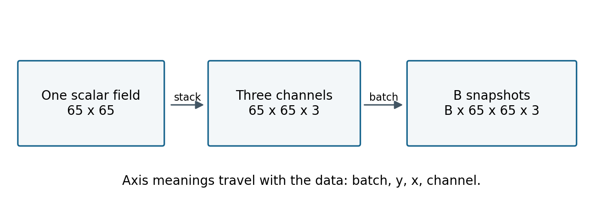
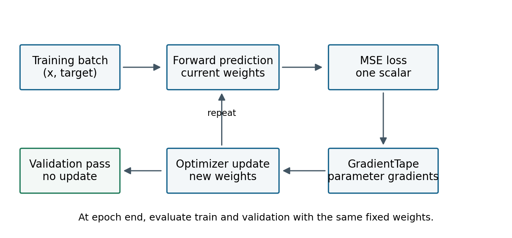
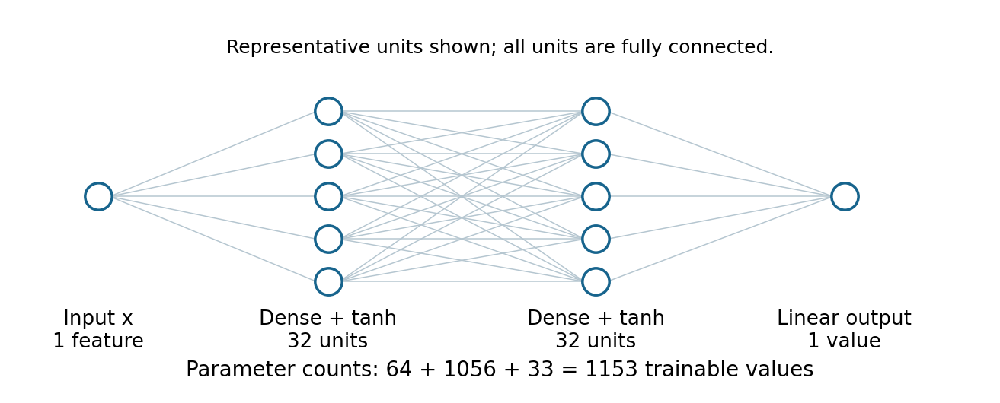
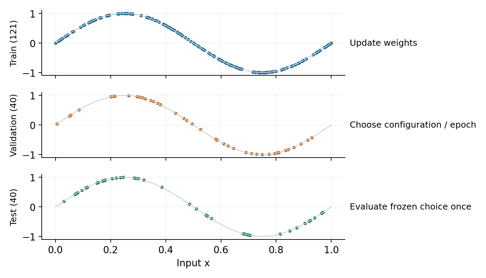
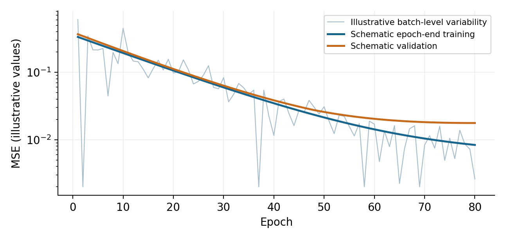
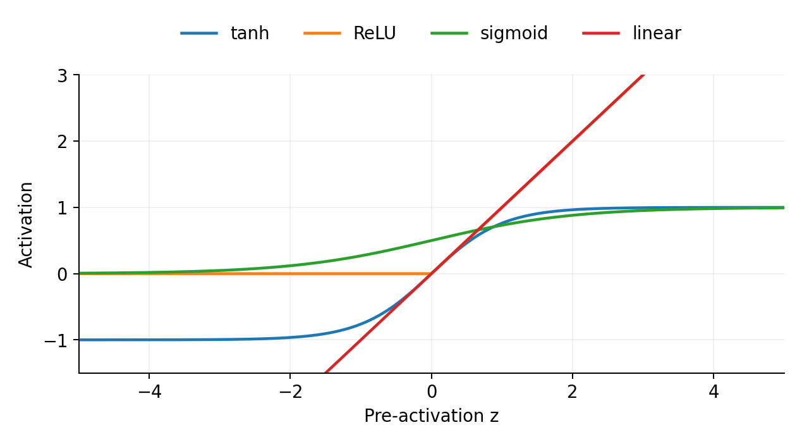
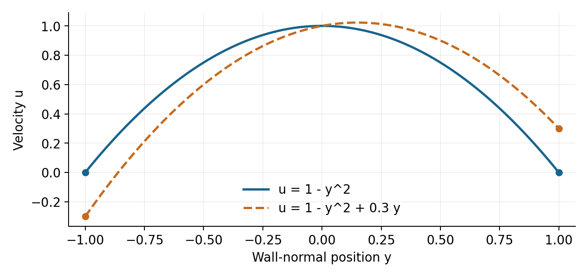
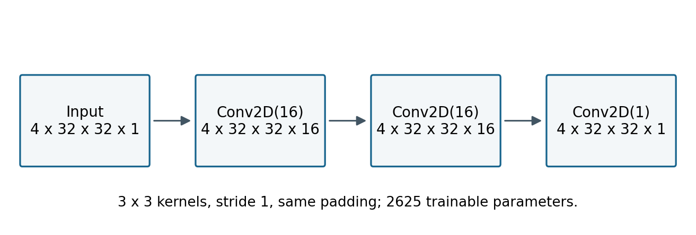

# TensorFlow and Keras for AI in Fluids
## Week 1, notebook 02 - a complete student companion

FlowMLLab

This guide accompanies notebooks/week01/02_tensorflow_for_ai_fluids.ipynb.
The course also contains a separate pressure-velocity lab called Week 1.2.
Here, notebook 02 means the introductory TensorFlow lab.

The first part explains every worked section in notebook order. The second
part turns the small sine-function network into a controlled laboratory.
You will change data counts, network architecture and training settings,
then explain the resulting predictions and loss curves.

Work with the notebook and this guide side by side. Run all cells once
in a fresh kernel before changing the configuration. Keep a baseline and
a short experiment record. State what you expected, what you changed,
what you measured and what the evidence supports.

The field examples are manufactured analytic functions. The sine network
learns a known function on a specified interval. The convolutional example
checks tensor shapes using random inputs. These examples establish the
programming and evaluation methods needed before learning from computed
or measured flow fields.

### Learning goals

Construct a correctly shaped tensor, check an automatic derivative,
train a small neural network and compare training with validation fairly.
Explain a loss change using a controlled experiment rather than
attributing it to a cause from the curve alone.

### What to submit

Submit the executed notebook, a compact experiment table and figures
showing predictions and loss histories. Report the analytic reference,
data counts and selected model. Evaluate the held-out test set after
model selection is complete.

### Guide map

Sections 1-8 follow tensors, field channels, losses and manual training.
Sections 9-16 explain the Keras experiments and their interpretation.
Sections 17-20 cover physics residuals, the CNN and submission requirements.

<!-- PAGEBREAK -->

# 1. Read the notebook as an experiment
## Notebook Section 0

The setup imports NumPy, Matplotlib and TensorFlow. NumPy supplies arrays
and sample coordinates. Matplotlib displays fields and profiles.
TensorFlow evaluates differentiable computations and stores trainable
parameters. Keras supplies model, layer and optimizer interfaces.

The cell prints the TensorFlow version and available devices. A central
processing unit is sufficient for this lab. A graphics processing unit
can change timing and numerical details. Save the library version and
device information with your results.

A notebook depends on its kernel state. Running a plotting cell before
the cell that creates its inputs can produce a missing name. Editing
the data without retraining can combine old weights with new labels.
Restarting the kernel and running from the top checks the computation
you intend to submit.

A saved Google Drive copy is a separate document. Open the current
GitHub or Colab link when checking a course update. The notebook revision
should agree with the material you are reading.

### Check every cell

Write down input shape, output shape and represented quantity.
An array with shape (121, 1) can represent 121 scalar coordinates.
It could also contain 121 scalar temperatures. Shape alone supplies
neither physical meaning nor units.

Identify values generated from an analytic formula, trainable values
and evaluation data. A lower loss is meaningful only after you know
which data and model state produced it.

### First independent checks

Run the field cell and inspect its shape. Calculate the first mean
squared error by hand. Run the scalar derivative and verify that the derivative is six.
These checks distinguish installation problems from mathematical
or data-handling problems.

| Item | Record |
|---|---|
| Environment | Python and TensorFlow versions |
| Device | CPU or accelerator |
| Configuration | Counts, seed and settings |
| Evidence | Executed cells and figures |
| Interpretation | Claim tied to a comparison |

<!-- PAGEBREAK -->

# 2. Tensors describe the arrangement of data
## Notebook Sections 1 and 3

A TensorFlow tensor is a multidimensional array. Rank counts its axes.
Shape gives the length of each axis. A scalar has shape (), a three-entry
vector has shape (3,) and a square field on a 65-by-65 grid has shape
(65, 65).

The notebook converts a NumPy array into a TensorFlow constant using
float32, a representation with 32 bits per number. Float64 uses 64 bits.
More precision changes storage and arithmetic cost. It cannot recover
information absent from measurements or a numerical solution.

tf.linspace and tf.meshgrid construct the field coordinates.
With indexing="xy", X and Y have shape (65, 65). The first index selects
a y-row. Thus phi[10, :] follows a horizontal line, while phi[:, 10]
follows a vertical line.

The manufactured field is phi = sin(pi x) sin(pi y). Its values are
zero on the unit-square boundary and one at the centre. The 65-point
grid includes that centre. Check these facts in the contour figure.

TensorFlow evaluates sine and multiplication over the arrays.
For h = f + 0.1 g, where g = X squared + Y squared, all arrays have
matching shapes. Printing minima and maxima checks the range but
does not validate every coordinate.



### Try it

Change N to 33, then 129. Predict the field shape and number of entries
before running. The function is unchanged while its sampling changes.
Explain why doubling points in both directions roughly quadruples the
number of entries.

The data of one float32 scalar field require 4 times Ny times Nx bytes.
Coordinate arrays, plotting buffers and TensorFlow objects require
additional memory.

<!-- PAGEBREAK -->

# 3. Variables, broadcasting and a silent shape error
## Notebook Sections 2 and 4

A tf.constant has a fixed value after construction. A tf.Variable
stores a value that can be updated. The notebook starts w at 0.5
and uses w.assign(2.0). The same variable now stores 2.0.

A model's weights and biases are variables. Input coordinates and
labels remain fixed for a training experiment. A CFD state can also
be updated, but mutability alone does not make it a learned parameter.

Broadcasting lets a smaller tensor participate in an operation with
a larger tensor. Shapes are compared from their trailing axes.
Corresponding lengths must match or one must be one.

Multiplying the notebook's (4, 5) field by a scalar produces a (4, 5)
result. Every entry receives the same scale.

The next cell demonstrates a silent error. Targets with shape (4, 1)
and predictions with shape (4,) produce a (4, 4) residual on subtraction.
Every prediction is compared with every target. The mean squared error
can look plausible although the intended pairing has been lost.

predictions_1d[:, None] changes the prediction shape to (4, 1).
The residual now has one entry per matched sample. In the worked example,
the correctly paired residual is zero.

### Diagnose before training

Print input, label and prediction shapes before calculating a loss.
For scalar regression, use inputs shaped (N, features), with labels
and predictions both shaped (N, 1). Check their shapes explicitly.

### Try it

Repeat with five samples. Explain why the incorrect residual contains
25 entries and the correct residual contains five. Change a single
prediction and identify which correctly paired residual should change.

A calculation that executes has passed a programming check.
Coordinate alignment, units and physical meaning require further checks.

<!-- PAGEBREAK -->

# 4. Channels retain their physical meaning
## Notebook Section 5

The notebook defines a manufactured streamfunction on the unit square.

psi = sin(pi x) sin(pi y) / pi

Velocity follows u = dpsi/dy and v = -dpsi/dx. Therefore

u = sin(pi x) cos(pi y)

v = -cos(pi x) sin(pi y)

Their divergence du/dx + dv/dy is zero. Out-of-plane vorticity is

omega = dv/dx - du/dy = 2 pi sin(pi x) sin(pi y).

The notebook independently checks these identities with centred
finite differences in the interior. The checks have tolerances
because discretization and roundoff introduce errors.

This analytic field has impermeable square walls. It does not impose
the no-slip moving-lid conditions of a lid-driven cavity. Describe it
as a manufactured demonstration field.

tf.stack([u, v, omega], axis=-1) gives shape (65, 65, 3).
The last axis identifies the channel. All channels must refer to the
same coordinates. sample[None, ...] adds a batch axis and produces
(1, 65, 65, 3).

Twenty such snapshots have shape (20, 65, 65, 3). The first index selects
a whole sample. In later CFD learning, train/test splits should reflect
the intended physical prediction. Holding out a new geometry requires
holding out that case's field, rather than a few neighbouring pixels.

### Try it

Change grid size and repeat the derivative checks. Record interior
divergence and vorticity errors. Explain why a consistent vorticity
definition matters even though the network accepts any correctly
shaped array.

When normalizing channels, state each scale and obtain learned
normalization statistics from training data only. Velocity and
vorticity need not have comparable ranges or the same units.

<!-- PAGEBREAK -->

# 5. A loss needs a definition and a sample set
## Notebook Section 6

For N matched scalar predictions, mean squared error is

MSE = sum of squared prediction-label differences / N.

The labels [1, 2, 3] and predictions [0.8, 2.2, 2.9] give squared errors
0.04, 0.04 and 0.01. Their sum is 0.09 and their mean is 0.03.
Use this hand calculation to check TensorFlow.

For a velocity label measured in metres per second, MSE has units
of squared velocity. Root mean squared error has velocity units.
A quantity called loss without its definition and scale is incomplete.

A data loss measures disagreement with labels. A partial differential
equation residual measures disagreement with a governing equation.
A squared equation residual can contribute to a training objective,
but it has a different interpretation from data MSE.

A physics-informed objective can combine data, equation and boundary
terms. Each term needs a declared normalization. A small velocity-data
MSE does not establish mass conservation or accurate pressure.

The sine example reports test MSE and relative L2 error.
Relative L2 divides the error-vector norm by the reference-vector norm
and multiplies by 100 for a percentage. This global normalization avoids
dividing separately by reference values near the sine zeros.
A nearly zero global norm would still require a different declared scale.

### Try it

Multiply both labels and predictions by 10. Predict the MSE before
running. It increases by a factor of 100. Add the same constant to both
arrays and repeat. The residuals and MSE are unchanged.

Compare models on the same coordinates with the same label definition,
units and scaling. Reducing a number by changing normalization does
not establish improved physical accuracy.

<!-- PAGEBREAK -->

# 6. Automatic differentiation records a computation
## Notebook Section 7

The notebook creates x0 as a trainable variable with value 3.
Inside tf.GradientTape it calculates y0 = x0 squared.
tape.gradient(y0, x0) returns 6.

A tape records supported TensorFlow operations executed while it is
active. Trainable variables are watched automatically. An ordinary
constant needs tape.watch when differentiating with respect to it.

The next example squares an unwatched constant and obtains None.
Repeating with tape.watch(coordinate) gives 6. None means that no
recorded differentiable path exists for the requested derivative.
A connected derivative with value zero is different.

Converting an intermediate value to NumPy interrupts the recorded
TensorFlow path. Keep TensorFlow operations inside the derivative
calculation. Convert the final result for plotting or an independent
check.

For prediction = a x + b, the MSE gradients are

dMSE/da = 2 mean((prediction - label) x)

dMSE/db = 2 mean(prediction - label).

The notebook calculates these formulas independently with NumPy.
Before training, a and b are zero while labels follow 2 x + 0.5.
Both gradients are negative. Subtracting a positive learning rate
times the gradients increases the parameters.

### Try it

Predict the gradient signs if all predictions exceed their positive
labels. Check one small update. Calculate the loss again after updating
rather than interpreting the loss at the previous parameter values.

The tape differentiates the computation you wrote. Labels, units,
boundary conditions and the selected physical model still need
independent scrutiny.

<!-- PAGEBREAK -->

# 7. Understand one update before running many
## Notebook Section 8

Gradient descent subtracts a scaled gradient.

a_new = a_old - learning_rate times dMSE/da

b_new = b_old - learning_rate times dMSE/db

The notebook starts a and b at zero and fits 50 points from the known
relation 2 x + 0.5. Gradients are recalculated after every update.
The history stores post-update MSE, so its last point corresponds to
the printed final parameters.

The known coefficients provide a stronger check than a decreasing
curve. Compare the predicted line with the reference and check both
a and b.



The worked learning rate 0.5 suits this scaled quadratic problem.
Changing the x range changes the objective's curvature and can change
the stable step-size range.

The separate scalar diagnostic uses L(w)=(w-2) squared.
Writing e=w-2 gives e_new=(1-2 eta) e_old, so the step-to-step
loss ratio is (1-2 eta) squared whenever the old loss is nonzero.
This exact result explains how an overly large step can increase loss.
It does not give a universal stability limit for a network using Adam.

### Try it

Change the target relation to 3 x - 0.2. Predict the coefficients, then
train from a fresh initialization. Increase the learning rate in a
separate experiment and identify when post-update loss first increases
or becomes non-finite.

Keep update count and coordinates fixed when comparing rates.
Changing target and rate together cannot isolate the effect of either.

<!-- PAGEBREAK -->

# 8. A dense network builds a nonlinear function
## Notebook Section 9, model construction

A dense layer forms weighted sums and adds a bias per output unit.
A layer with d inputs and h outputs has d times h plus h parameters.

The hidden activation transforms these sums. The baseline uses two
tanh hidden layers and a linear output. A linear output can represent
both signs of sin(2 pi x).

The architecture 1 -> 32 -> 32 -> 1 has 64 parameters in its first
layer, 1056 in its second and 33 in its output layer. The total is 1153.
Compare this arithmetic with model.count_params().



Keras supplies Sequential and Dense. TensorFlow evaluates their
operations and gradients. model.compile chooses optimizer and loss.
model.fit performs training. model(x, training=False) evaluates the
current weights without updating them.

Width counts the units in a hidden layer. Depth counts successive
hidden layers. HIDDEN_UNITS=(32, 32) specifies two hidden layers of
width 32. A tuple (16,) specifies one hidden layer.

Increasing width or depth changes capacity and optimization.
A sequence of linear dense layers remains affine, so depth alone
cannot accurately represent the full sine curve.

### Try it

Calculate the count for 1 -> 16 -> 16 -> 1 before building it.
The answer is 321. Compare with a single hidden layer of width 32.
The parameter counts differ even when the widest layer has the same
width.

A larger parameter count alone does not identify which model will
achieve the lowest validation error within a fixed training budget.

<!-- PAGEBREAK -->

# 9. Training, validation and test have different jobs
## Notebook Section 9, data construction

The baseline uses 121 training points, 40 validation points and 40
test points. Separate coordinate pools prevent overlap between roles.

Training points contribute gradients. Validation points assess the
model during development and select stopping time or architecture.
Test points assess the frozen choice. Selecting an architecture using
test error makes those test points model-selection data.

The target is sin(2 pi x) on [0, 1]. The task measures interpolation
at held-out coordinates from a known analytic function. It does not
test a new Reynolds number, geometry or coordinate outside [0, 1].



N_TRAIN, N_VAL and N_TEST request counts. make_sine_data uses disjoint,
independently ordered pools with nested prefixes. Changing a training
count preserves the validation and test coordinates. Training includes x=0 and x=1, enclosing the held-out points.
N_TRAIN supports 2-2000 and N_VAL/N_TEST support 1-2000.

Nested training sets make a count study easier to interpret because
the small set is contained in the large one. Inspect their spatial
coverage as well as the count. Adding points changes where labels
constrain the fit.

Forty points near x=0 do not cover a sine wave like forty points across
the interval. Likewise, many nearby pixels in one field do not provide
many independent flow cases.

### Try it

Print all three shapes and check the overlap assertions.
Repeat with N_TRAIN=30 while keeping validation and test counts fixed.
Verify that only the training coordinates change.

For a later CFD generalization study, state which complete physical
cases are held out. A random coordinate split and a held-out-geometry
split answer different engineering questions.

<!-- PAGEBREAK -->

# 10. Read the training configuration
## Notebook Section 9, experiment controls

Edit the named settings, rerun their defining cell and create a fresh
experiment. The helper resets the model and random seed.

| Control | Baseline |
|---|---|
| N_TRAIN / N_VAL / N_TEST | 121 / 40 / 40 |
| HIDDEN_UNITS | (32, 32) |
| ACTIVATION | "tanh" |
| LEARNING_RATE | 0.01 |
| BATCH_SIZE | 32 |
| MAX_EPOCHS | 300 |
| SEED | 42 |

An epoch is a pass through training data. A mini-batch is a subset used
for an update. With N points and batch size B, a conventional pass uses
ceil(N/B) batches, including a possible smaller final batch.
Here, 121 samples and batches of 32 mean four updates per full epoch.

Increasing N_TRAIN with the same epoch cap therefore changes information
and update count. Record both effects.

Adam uses estimates based on past gradients to adapt parameter updates.
LEARNING_RATE still controls an overall step scale.
The worked rate is specific to this small, scaled problem.

Early stopping monitors validation loss. restore_best_weights can
return weights from an earlier epoch than the last point shown.
Report the actual epoch count and selected validation result.

run_experiment returns a model, data, history, end_epoch_history
and summary. The summary includes counts, parameter count,
epochs_run, updates_run, train_mse, val_mse and fit_seconds.
Its losses describe the restored model.

### Try one controlled comparison

```python
small = run_experiment(
    "train30", n_train=30, n_val=40,
    n_test=40, seed=42)
print(small["summary"])
```

Change one factor at a time. Keep coordinates and training controls
fixed where possible. A fixed seed improves repeatability within an
environment, but model rankings can change with initialization.
Use validation-only repeats with declared seeds before drawing a
broad conclusion.

<!-- PAGEBREAK -->

# 11. Compare training and validation fairly
## Notebook Section 9, loss histories

Keras history["loss"] aggregates losses during an epoch while weights
change between batches. Validation loss is normally calculated after
the epoch using that epoch's weights.

The curves therefore differ in both data and evaluation timing.
Validation can be lower than logged training loss with fully disjoint
data.

The notebook also records end_epoch_history["train_mse"] and
end_epoch_history["val_mse"]. Both use the same end-of-epoch weights
with training=False. This removes the online-accumulation difference.



The baseline has no dropout or batch-normalization layers.
Other models can behave differently during training and inference.
If regularization is added, loss can also include penalties beyond
data MSE. Compare the same terms in the same mode.

### Answer these questions

1. Do online and end-of-epoch training losses differ?
2. How does validation compare at the same weights?
3. Does the function profile reveal a related spatial error?

A finite validation set estimates performance at its particular
coordinates. Its curve can fluctuate as weights change.
One low point does not establish a broad improvement.
Inspect neighbouring epochs, profiles and the stopping rule.

The last history entry and the restored model need not describe the
same weights. To report the final selected model, use summary train_mse
and val_mse, which are recomputed after restoration.

### Read the actual arrays

```python
same_weights = small["end_epoch_history"]
train_curve = same_weights["train_mse"]
val_curve = same_weights["val_mse"]
online_curve = small["history"].history["loss"]
```

Plot each against the matching epoch indices. Name the three curves
so the reader can distinguish their definitions.

<!-- PAGEBREAK -->

# 12. Investigate jumps in a loss curve
## Notebook loss-diagnostic experiments

A jump is an observation. Investigate its cause through an intervention.
First identify whether the horizontal axis counts batches, updates
or epochs and what quantity was recorded.

Start from the same data and seed. Reduce only LEARNING_RATE.
If large jumps shrink, that supports excessive step size as a
contributor in this setup. It does not prove every jump had that cause.

Next increase BATCH_SIZE with other settings fixed.
Mini-batch gradients use different subsets, which can pull updates in
different directions. A larger batch often reduces this variability
while changing updates per epoch.

Compare against updates or elapsed time as well as epochs when
interpreting efficiency. A smooth full-batch curve can represent
fewer updates.

Check data ordering and the helper's shuffle settings.
Batches grouped by nearby x coordinates emphasise different parts
of the sine wave. Record any ordering change.

| Observation | Controlled check |
|---|---|
| Large spikes | Reduce learning rate |
| Batch fluctuations | Increase batch size |
| Epoch mismatch | Compare same-weight MSE |
| Non-finite values | Check scale and updates |
| Restart discontinuity | Fresh model and optimizer |
| Validation rises alone | Inspect point coverage |

Use the scalar quadratic diagnostic to study a known loss ratio.
Return to the network, where parameter interactions and Adam's state
make the behaviour more complicated.

If the baseline has no jumps, report that. The optional learning-rate
and batch-size experiment plans provide controlled conditions to
investigate. Never add artificial spikes to an empirical curve.

### Deliverable

Give the baseline, one lower-rate run and one changed-batch run.
Show actual loss histories and profiles. Explain which intervention
changed the behaviour and what remains uncertain.

<!-- PAGEBREAK -->

# 13. Change training count and inspect the function
## Student experiment A

Compare training counts 30, 121 and 484 with N_VAL=40 and N_TEST=40.
Keep architecture, activation, seed, rate and stopping controls fixed.

Predict where sparse coverage could make the fit less accurate.
After running, inspect coordinates, function profiles and same-weight
training and validation histories.

Use validation results to compare runs. Keep test results reserved.
Record the selected model's validation MSE, actual epochs, updates,
parameter count and fit time.

| Run | N_train | N_val |
|---|---|---|
| A1 | 30 | 40 |
| A2 | 121 | 40 |
| A3 | 484 | 40 |

```python
counts = [30, 121, 484]
runs = [
    run_experiment(f"train{n}", n_train=n)
    for n in counts
]
for result in runs:
    print(result["summary"])
```

The optional experiment cell can run this plan by setting
RUN_EXTRA_EXPERIMENTS=True and EXPERIMENT="training_count".
Its separate EXPERIMENT_EPOCHS cap is 150 by default.
State the cap used rather than comparing it silently with a
300-epoch baseline.

More points can improve spatial coverage and constrain the function.
They also change updates per epoch. Discuss both effects.
A lower training MSE with fewer samples can coexist with a larger
validation error between sampled locations.

For a stronger data-efficiency study, compare a fixed update budget
or fixed wall-clock budget. The worked lab uses an epoch cap and
validation stopping, so describe its comparison accordingly.

### Deliverable

Overlay the analytic function and three prediction profiles.
Show training locations and validation histories.
Explain one spatial improvement or deterioration supported by
the figures. Retain the experiment summaries as a table.

<!-- PAGEBREAK -->

# 14. Change validation and test counts thoughtfully
## Student experiment B

Keep a trained model frozen and evaluate its validation MSE on
10, 40, 160 and 640 coordinates from the validation pool.
The notebook's validation_size_audit performs this estimator check
without retraining.

A larger validation count does not add gradient updates.
It changes the locations used to estimate error. Small sets can miss
a narrow region of poor prediction.

A second experiment can rerun early stopping using different N_VAL
values. This can change which epoch appears best and therefore the
restored model. Distinguish this selection effect from the frozen-model
estimator effect.

| Comparison | Keep fixed |
|---|---|
| Validation estimate | Model weights and train set |
| Early-stop selection | Train set and initialization |
| Test estimate | Final model and all choices |

```python
few_val = run_experiment(
    "val10", n_train=121, n_val=10)
more_val = run_experiment(
    "val40", n_train=121, n_val=40)
```

Compare the summary validation MSE and epochs_run, then inspect
the profiles. The two reported MSE values use different evaluation
sets, which must be acknowledged.

Choose N_TEST before the final test cell.
Changing it after freezing the model changes the error estimator,
not the learned network. Do not use that feedback to tune the model.

### Deliverable

Explain whether the validation-count study changed primarily
the estimate or the selected model. State how a small set could
miss spatial error.

A count sweep does not automatically supply a confidence interval.
Nested evaluation sets are dependent. Formal uncertainty assessment
requires a declared resampling or independent-sampling design.

<!-- PAGEBREAK -->

# 15. Make the network shallower, wider or deeper
## Student experiment C

With fixed data, compare (32,), (32, 32) and
(32, 32, 32, 32). Hold activation and training settings fixed.

These choices change depth and parameter count together.
They test model configurations under a declared budget.
They do not isolate depth independently of capacity.

For width, compare (8, 8), (32, 32) and (64, 64).
For depth, hold width fixed while varying hidden-layer count.
Record parameter counts in both studies.

```python
shallow = run_experiment(
    "shallow", hidden_units=(32,))
deep = run_experiment(
    "deep", hidden_units=(32, 32, 32, 32))
```

A larger network represents a wider function family but may require
more updates, different rates or more data. A worse result at the same
epoch cap can reflect optimization difficulty.

Use fresh weights and optimizer state for each run.
Continuing a previously trained model answers a different question
because it benefits from earlier updates.

| Evidence | Question |
|---|---|
| Profile | Where does the fit change? |
| Train MSE | Does it fit the labels? |
| Validation MSE | Does it fit between points? |
| Epochs and time | What did the result cost? |
| Parameter count | How much capacity changed? |

Compare architectures using validation. Freeze the choice before the
final test.

### Deliverable

Provide function profiles and validation histories for the shallow,
baseline and deep models. Describe the best and worst spatial regions.
Do not replace physical profiles with bars of aggregate errors.

A shallow network matching the baseline supports a conclusion about
this smooth one-dimensional task. It does not establish sufficiency
for high-dimensional fluid fields or other data distributions.

<!-- PAGEBREAK -->

# 16. Change the activation and explain the result
## Student experiment D

ACTIVATION selects the hidden nonlinearity.
Keep the output linear for the signed sine target.

tanh is smooth with output in [-1, 1]. Its slope decreases for large
input magnitudes. Sigmoid is smooth with output in [0, 1] and can
saturate. ReLU returns zero for negative input and the input itself
for positive input. None specifies a linear layer.



Compare "tanh", "relu", "sigmoid" and "linear" with the same widths,
seed and initial training controls.

```python
relu_run = run_experiment(
    "relu", activation="relu")
linear_run = run_experiment(
    "linear", activation="linear")
```

Changing activation can change the usefulness of an initialization
or learning rate. State that this first comparison fixes those choices.

A scalar-input ReLU network is piecewise affine.
It can approximate sine values with many line segments.
Its second derivative is zero within each segment and lacks a
classical value at the corners. This matters for second-order
physics residuals.

A small value error therefore does not make every activation equally
suitable for a residual requiring curvature.
Inspect first derivatives as well as function values.

### Try it

Use "linear" in every hidden layer and derive why the resulting model
is affine. Compare this prediction with its fitted profile.
Then compare tanh and ReLU derivative profiles, especially near
interval boundaries.

### Deliverable

Submit function and first-derivative profiles, validation MSE and
parameter counts. Explain one difference using activation shape
and the learning evidence.

If a second derivative is disconnected or undefined in an
implementation, report that explicitly. A substituted value is
not an independently verified physical residual.

<!-- PAGEBREAK -->

# 17. A derivative check differs from training a PINN
## Notebook Section 10

The first nested-tape example uses the exact function sin(pi x).
Its first derivative is pi cos(pi x), and its second derivative
is -pi squared sin(pi x). Therefore the ordinary differential
equation residual u'' + pi squared sin(pi x) is zero analytically.

The notebook uses float64 and verifies derivatives and residuals
against small tolerances.

The inner tape records the function and calculates the first
derivative. The outer records that derivative calculation and
obtains the second. Both explicitly watch coordinates.

The learned network approximates sin(2 pi x), whose derivative is
2 pi cos(2 pi x). Its residual uses the matching (2 pi) squared
factor. The frequency must match the target.

The network was trained on function values. Its residual is a
post-training diagnostic. A physics-informed neural network (PINN)
would include equation and boundary information in its objective
and require independent validation.

### Pointwise derivatives

For a vector target, tape.gradient sums contributions.
Each output row here depends only on its matching input row,
so the result supplies the pointwise derivative.
Layers coupling samples can require a Jacobian calculation.

Automatic differentiation differentiates the implemented composition.
Finite differences approximate derivatives from nearby samples.
Both need checks against known answers.

### Try it

Change frequency consistently in the analytic function,
first derivative and residual. Predict derivative amplitudes.
Then change only the residual's frequency and observe the mismatch.

For the learned network, compare value and derivative errors near
the interval ends. Accurate values alone do not guarantee accurate
gradient or curvature.

<!-- PAGEBREAK -->

# 18. Equations and boundary conditions need separate checks
## Notebook Section 10, channel example

The dimensionless steady, fully developed incompressible channel
problem uses y in [-1, 1], u'' + 2 = 0 and no-slip wall conditions
u(-1)=u(1)=0.

The solution is u = 1 - y squared.
The constant 2 represents the selected dimensionless pressure-gradient
and viscosity ratio. This laminar example is separate from Week 2's
rarefied-flow surrogate.

Adding 0.3 y leaves the second derivative unchanged.
The modified profile satisfies the equation but has wall velocities
-0.3 and +0.3.



The notebook checks the equation residual and both wall values.
For arbitrary c, u = 1 - y squared + c y gives u(-1)=-c and u(1)=c.
The differential equation alone does not determine c.

### Try it

Change c to -0.2 and 0.5. Predict wall values before running.
Overlay the profiles against wall-normal coordinate and preserve
the velocity signs.

### Connection to physical learning

A loss can combine data, equation and boundary terms.
A low total objective can hide a poorly satisfied component if
scales or weights are unsuitable. Record separate terms and
validate the predicted profile.

For a flow field, further checks can include conservation,
pressure consistency and an independent numerical or measured
reference. These analytic examples check mathematical identities
and programming before the larger problems are attempted.

<!-- PAGEBREAK -->

# 19. A CNN preserves spatial organisation
## Notebook Section 11

A convolutional neural network (CNN) applies local learned filters
at many grid locations with shared weights.

Input shape (4, 32, 32, 1) means four samples, a 32-by-32 grid
and one channel. The first layer creates 16 channels, the second
retains 16 and the final layer returns one.

With stride one and the specified "same" padding, the spatial
dimensions remain 32 by 32. The output is (4, 32, 32, 1).



The inputs are random probes and the model is untrained.
The output verifies a shape workflow and supplies no evidence
of physical prediction accuracy.

A 3-by-3 convolution from one to 16 channels has
3 times 3 times 1 times 16 weights plus 16 biases, giving 160.
This count does not grow with grid size because weights are shared.

The second layer has 3 times 3 times 16 times 16 plus 16 parameters,
giving 2320. The output has 3 times 3 times 16 plus one, giving 145.
The complete model has 2625 parameters.

### Try it

Change the batch count from four to seven.
Predict the output and parameter count.
Then replace the input's one channel with three aligned channels.
Update Input shape and recalculate the first layer's count.

Discuss how velocity and vorticity could form those channels
when paired physical data are available.

A field image retains spatial layout. Units, coordinates and boundary
information still supply its physical meaning. A trained field-to-field
model also needs matched targets and an appropriate held-out evaluation.

<!-- PAGEBREAK -->

# 20. Submission and interpretation checklist
## Notebook Section 12

Your submission should let another student reproduce the experiment
from a fresh kernel.

Include the manufactured scalar-field plot and explain its axes.
Describe channel and batch dimensions. Give manual-fit coefficients
and the known reference. Show the Keras profile, loss histories
and final held-out evaluation.

Complete two controlled comparisons from the experiment menu,
including one data-count and one network-design comparison.
The remaining comparisons are optional extensions. Include the
frozen-network validation-size audit and scalar loss-jump diagnostic.
State unchanged controls and changes in updates or stopping time.

### Questions to answer

1. Which samples updated weights?
2. Which selected stopping time and architecture?
3. When was the test evaluated?
4. Which training loss was compared with validation?
5. Which intervention explained a jump, if any?
6. Where did the profile improve or deteriorate?
7. Did value and derivative accuracy agree?
8. What did the channel and CNN checks verify?

Avoid attributing a difference to depth if parameter count and budget
changed too. Explain which intervention supports the claim.

| Symptom | First check |
|---|---|
| Missing TensorFlow | Active kernel and installation |
| Missing name | Run definitions from the top |
| Unexpected MSE | Label and prediction shapes |
| None gradient | Watched input and recorded path |
| Dtype error | Matching explicit dtypes |
| Non-finite loss | Scale and learning rate |
| Old Colab text | Reopen current source |

### API references

Read the official API explanations after the worked examples.

- [TensorFlow tensors](https://www.tensorflow.org/guide/tensor)
- [Automatic differentiation](https://www.tensorflow.org/guide/autodiff)
- [Keras training and evaluation](https://keras.io/api/models/model_training_apis/)
- [Keras FAQ on training and validation loss](https://keras.io/getting_started/faq/)
