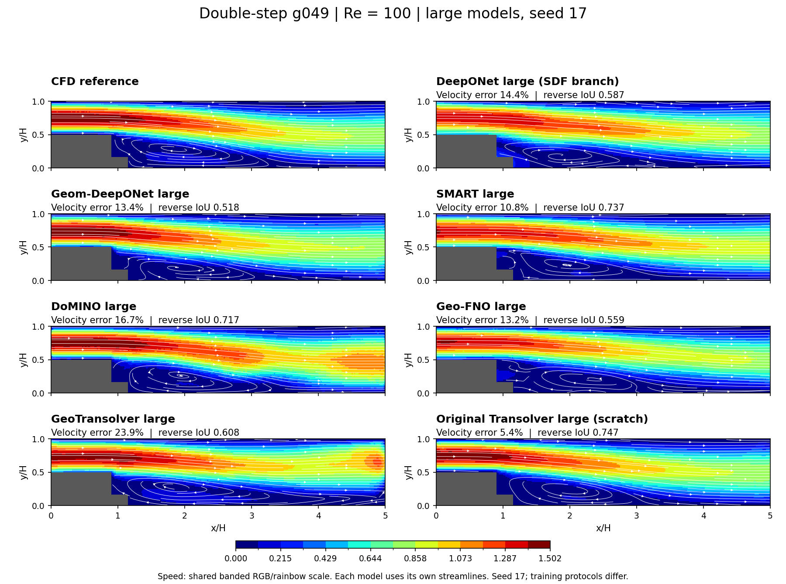
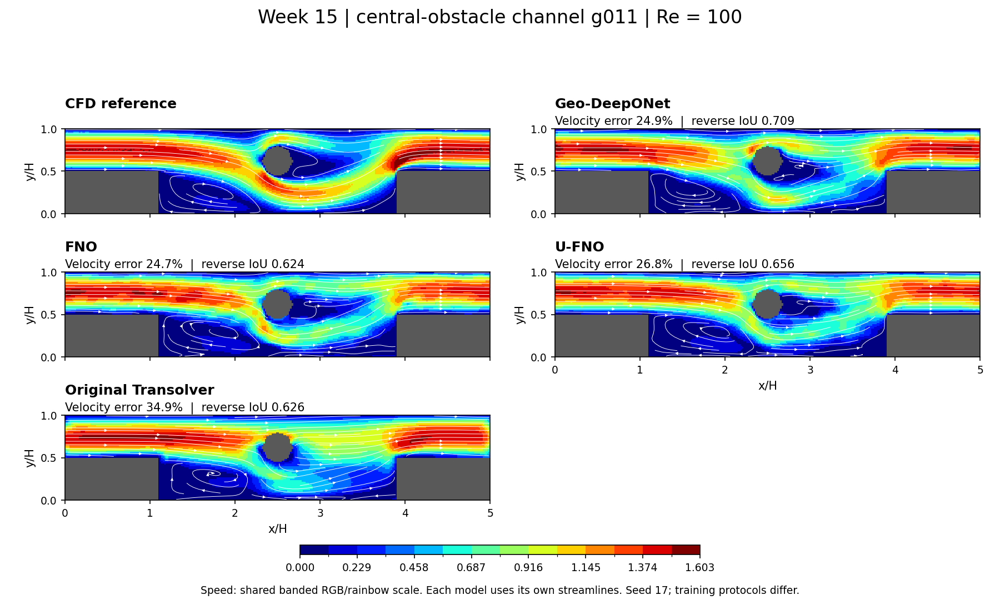
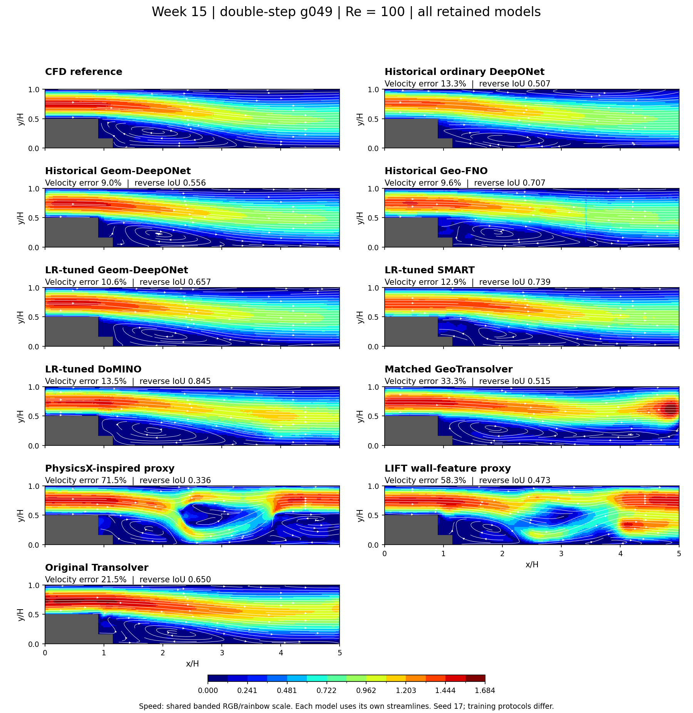

# Week 15 — Geometry-aware neural operators

Original Transolver: [run/verify notebook](../../notebooks/week15/W15_Original_Transolver_Double_Step.ipynb) · [double-step test, weights and results](../../results/family_transolver/README.md) · [additional g011 test](../../results/step_transolver/README.md).

## Larger-network extension

[**Does a larger network improve two-step flow prediction?**](../../weeks/week15/larger_networks.md) · [Configurations, results and artifact availability](../../results/week15_capacity_study/README.md) · [Analysis notebook](../../notebooks/week15/W15_Larger_Networks_Analysis.ipynb)

Study six enlarged geometry-aware models and the separate original-Transolver/GeoPT experiment. With completed matched controls, enlargement reduced mean velocity error for geometry-aware DeepONet (**18.82%**) and Geom-DeepONet (**12.16%**), while SMART's error increased (**7.26%**). Each configuration has **one training seed**; the three remaining compact controls were discontinued.

[View Re=25](../../results/week15_capacity_study/figures/DoubleStep_All_Large_Models_Re25.png). The shared contour scale makes flow differences visible; the separate Transolver protocol prevents treating this figure as a controlled cross-architecture ranking. The extension includes architecture specifications, recorded results, metric tradeoffs, future-experiment choices and student exercises. New weights and full prediction arrays are currently unavailable; see the artifact ledger before planning reproduction.

## Earlier configurations

**Central-obstacle channel (g011): all four models and CFD.**

**Double-step channel (g049): earlier compact configurations and CFD.**

Unchanged original figures: [historical/core comparison](../../results/week15_postaudit/core_g049_Re100.png) · [extended comparison](../../results/week15_postaudit/extended_g049_Re100.png).

## Complete post-audit edition

Start with [`W15_Complete_Geometry_Generalization.ipynb`](W15_Complete_Geometry_Generalization.ipynb).
It is the executed companion to the expanded
[`Week 15 lecture`](../../lectures/week15_geometry_generalization.pdf) and brings
the historical and new evidence into one reproducible narrative:

- ordinary DeepONet, Geom-DeepONet and Geo-FNO historical baselines;
- equal 19,200-update comparisons with SMART, GeoTransolver and DoMINO;
- transparent PhysicsX- and LIFT-inspired proxies, never presented as proprietary code;
- a validation-only sweep of peak learning rates `1e-3`, `3e-4` and `1e-4`;
- the rejected common reverse-scale ablation and other negative results;
- independent checks of 342 saved tuned prediction fields;
- Reynolds-stratified and reverse-flow topology diagnostics; and
- six seven-row CFD/model figures at the true 5:1 aspect ratio, with each
  model's own streamlines and no orange threshold overlay.

No new CFD is generated. No double-step motif enters training or validation,
`g005` remains quarantined, and the historically inspected double-step family
is described as a retrospective test. The original notebook and runs below
remain available as historical records and were not overwritten.

The compact repository retains the executed notebook, lecture, summary tables,
figures and checksums. Full checkpoints and saved fields are distributed through
the frozen [v1.8.0 Zenodo evidence record](https://doi.org/10.5281/zenodo.22840293)
rather than duplicated in Git history.

To reproduce the full post-audit notebook, download
`FlowMLLab_Week15_PostAudit_LR_Sweep.zip` from that record, verify its SHA-256
against [`release_assets_v1.8.0_sha256.txt`](../../release_assets_v1.8.0_sha256.txt),
and unzip it beside the checkout. Alternatively set
`FLOWMLLAB_WEEK15_LR_DIR` to the extracted directory. The verification notebook
does not import or retrain the PyTorch models; `python -m pip install -e ".[test]"`
is sufficient. The notebook finds the repository and evidence directory without
machine-specific paths.

The same Zenodo record contains all four files frozen in the release checksum
list:

- `FlowMLLab_Week15_PostAudit_LR_Sweep.zip` - full tuned-field verification;
- `FlowMLLab_Week15_Matched_Budget.zip` - equal-update architecture runs;
- `FlowMLLab_Week15_Family_Holdout.zip` - published but not independently
  audited for the present teaching conclusions; and
- `FlowMLLab_Week15_Teaching_Edition_v2.zip` - portable teaching handoff,
  likewise outside the completed independent audit.

GitHub does not duplicate these large release assets; Zenodo is the canonical
evidence host. The repository hashes let readers verify every downloaded file.

[`W15_Geometry_Operators_Step_Audit.ipynb`](W15_Geometry_Operators_Step_Audit.ipynb)
is the historical v1.6 audit notebook, retained unchanged as a separate record.
It includes:

- the exact ordinary-DeepONet builder already present in
  `qa/step_architecture_v5.py`, plus its retained three-seed DSMC V5 evidence;
- 130 sampled OpenFOAM fields spanning 51 geometry masks;
- the historical Geo-DeepONet/FNO/U-FNO `g011` audit;
- four unseen-geometry tests and a held-out double-step-family protocol; and
- CFD, ordinary DeepONet, Geo-DeepONet, and FNO velocity/streamline and pressure fields using
  common column scales.

The geometry-only strip separates confirmed ordinary-DeepONet training shapes
from the held-out g009 shape without distorting their physical aspect ratio.
The full-size CFD and model comparison follows with streamlines and pressure.
Historical Geo-DeepONet/FNO train-versus-validation geometry identities were not retained,
so their exact training members are not inferred.

Ordinary DeepONet now also has a separate three-seed OpenFOAM geometry-holdout
run with the same 107/11/12 case counts and 400-epoch budget. Its branch sees
Reynolds number only; geometry masks, SDF and geometry IDs are withheld. The
older retained V5 scores remain clearly labelled as a distinct DSMC study.

These historical protocols do not use the post-audit split. The v1.6 notebook
uses 106/21/3, the separate ordinary-DeepONet geometry holdout uses 107/11/12,
and every v1.8.0 post-audit table and figure uses 100/8/19 with three quarantined
`g005` cases. The names refer to different retained runs and their metrics must
not be mixed.

The historical notebook reports a raw reverse-flow overlap based on `u < 0`.
The post-audit material instead reports **filtered reverse IoU** using
`u < -0.01`, four-connectivity and an eight-cell minimum. The old metadata label
`p* = Re p` is also not treated as a verified physical nondimensionalization:
the saved pressure arrays scale approximately as `1/Re`, while all published
pressure errors remain case-wise gauge-invariant.

Rebuild with `python qa/build_step_operator_notebook.py`, then execute all cells.
The lecture is [`lectures/week15_geometry_generalization.pdf`](../../lectures/week15_geometry_generalization.pdf).
