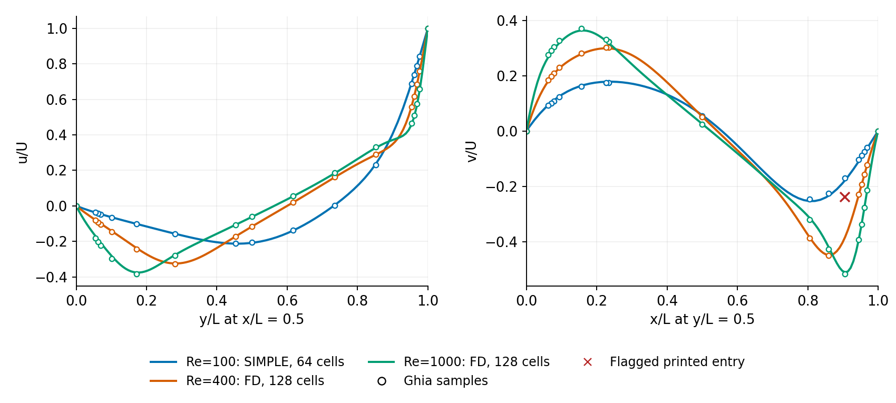
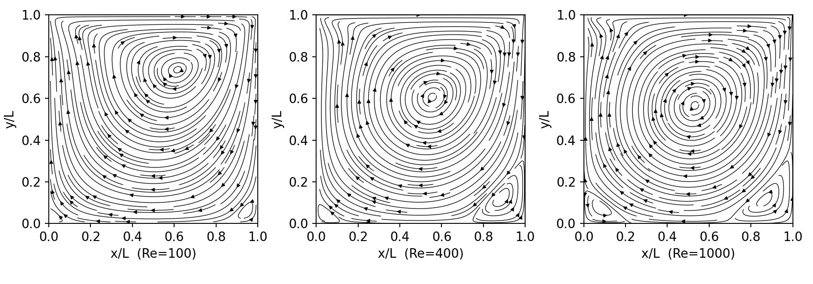
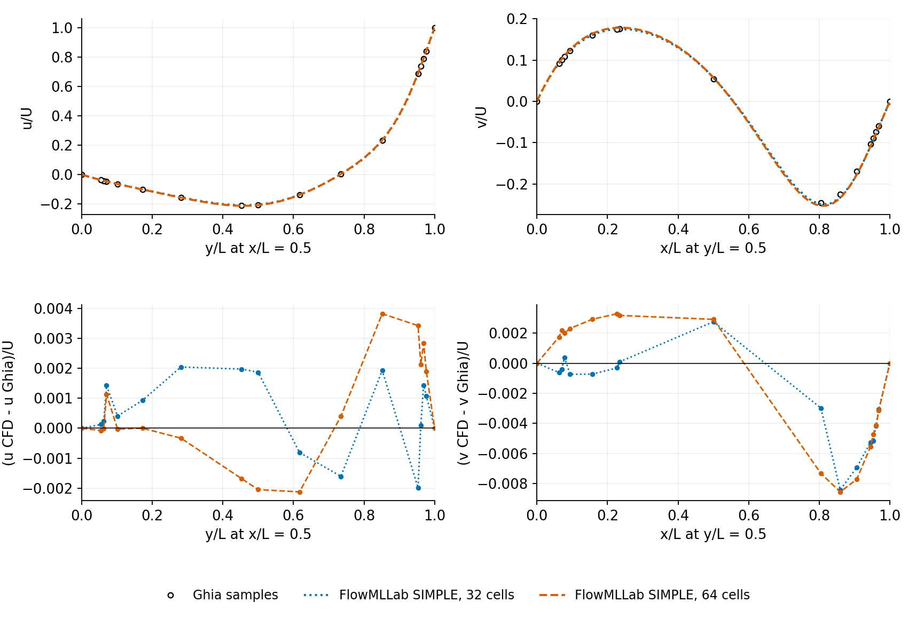
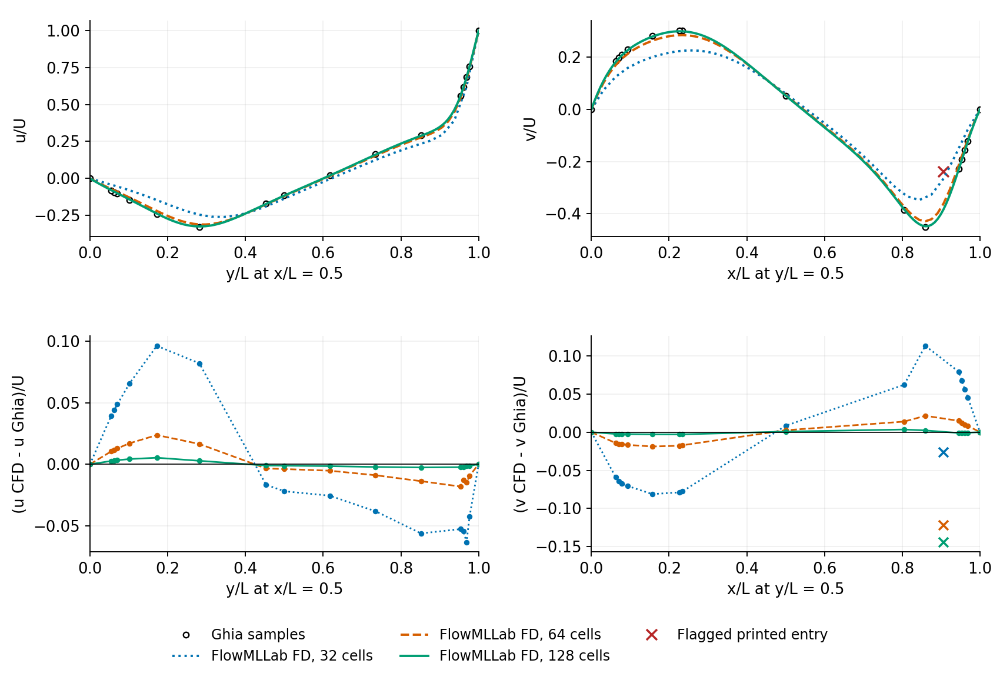
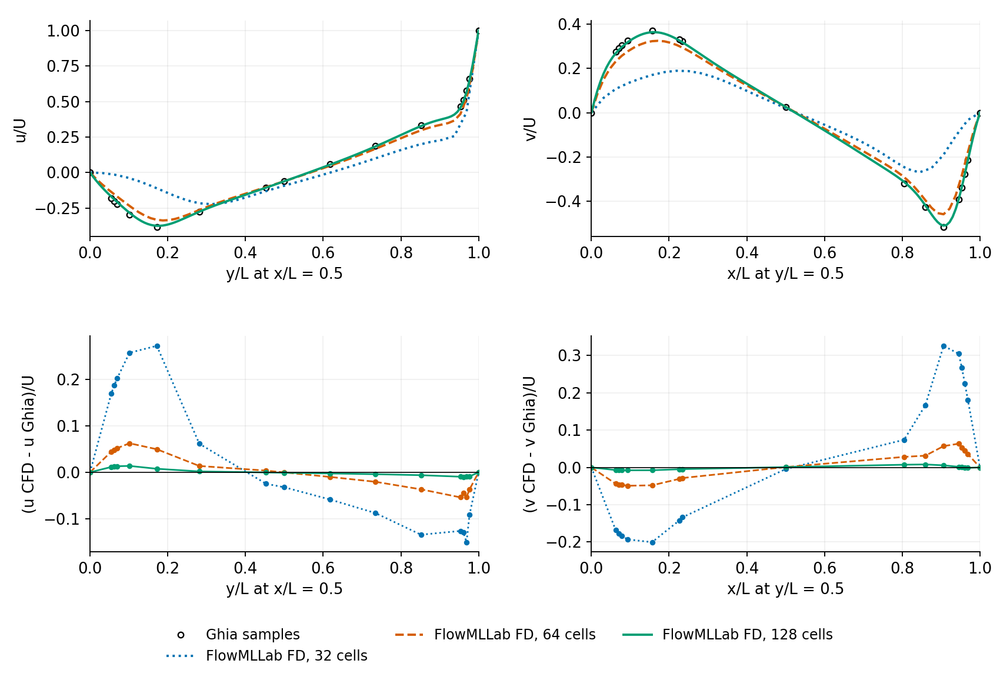

# Our CFD against the Ghia cavity benchmark

[Executed Lab 5](../../notebooks/week04/W4_Lab5_All_Re_Ghia_Validation.ipynb) now
opens and evaluates the actual FlowMLLab CFD fields by default. It includes the
computed streamlines, native-grid profiles, signed sample errors and eight
retained grid/method runs. No simulation or neural training was repeated to
make these plots.



| Re | Solver | Finest retained cells | u relative L2 | v relative L2, original table | v relative L2, screened |
| ---: | --- | ---: | ---: | ---: | ---: |
| 100 | SIMPLE | 64 | 0.003954 | 0.032607 | 0.032607 |
| 400 | Streamfunction-vorticity FD | 128 | 0.006019 | 0.146628 | 0.008972 |
| 1000 | Streamfunction-vorticity FD | 128 | 0.019881 | 0.017042 | 0.017042 |

These are fractional profile L2 errors, not percentages or area-integrated
field errors. The Re=400 printed v value at x/L=0.9063 is preserved and marked.
The screened metric omits that one predeclared sample, without substituting a
value. Its signed discrepancy remains plotted. Both scores are saved in the
[recomputed CSV](cfd_ghia_metrics.csv).

## Physical results and mesh changes

The black streamlines below are calculated from our retained velocity fields.
Ghia supplied centreline samples, not these two-dimensional fields.



Re=100: SIMPLE at 32 and 64 cells. The two-grid benchmark errors are nonmonotone;
this is not evidence of asymptotic grid convergence.



Re=400: FD at 32, 64 and 128 cells. Crosses below the profile mark the signed
discrepancy at the flagged printed sample; no discrepant extrema are clipped.



Re=1000: FD at 32, 64 and 128 cells.



## Data and numerical scope

The [provenance file](provenance.json) records each native NPZ hash and the metadata hash after LF newline normalization (the Git checkout convention).
The loader checks these and reproduces the earlier all-point Ghia norms before
plotting. SIMPLE uses its native staggered face velocities and physical endpoint
values; FD uses the boundary-inclusive field interpolated in both coordinates.
No fit to Ghia is used to generate a CFD curve.

The original [Re=100 runs](../week01_2_pressure_velocity/README.md) and
[Re=400/1000 runs](../week01_2_formulations/README.md) retain their inputs,
iteration histories and recorded steady criteria. Native momentum and vorticity
residuals are different equations. Passing those criteria does not establish
mesh/time-step independence or validate recovered pressure. These different
Re/method cases are not a matched optimizer or solver-speed comparison.

CFD fields at Re=3200, 5000, 7500 and 10000 remain missing. The
[all-seven-Re neural experiment](../cavity_ghia_allre/README.md) uses Ghia
profile labels and does not supply the missing CFD solutions. The
[existing POD-DeepONet](../pod_deeponet/README.md) instead predicts full CFD fields
over Re=100--400; its blind cases are 175, 275 and 375.

Reproduce from the repository root:

```sh
python qa/build_cavity_validation_evidence.py
python qa/build_cavity_expansion_lessons.py --only-validation
```

These commands regenerate the current comparison figures and Lab 5 only. They
do not modify source fields, frozen neural models or earlier student notebooks.
