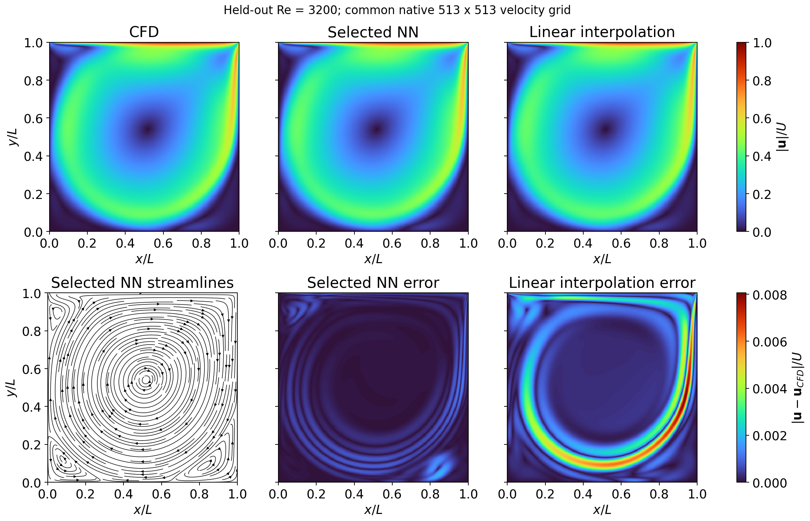
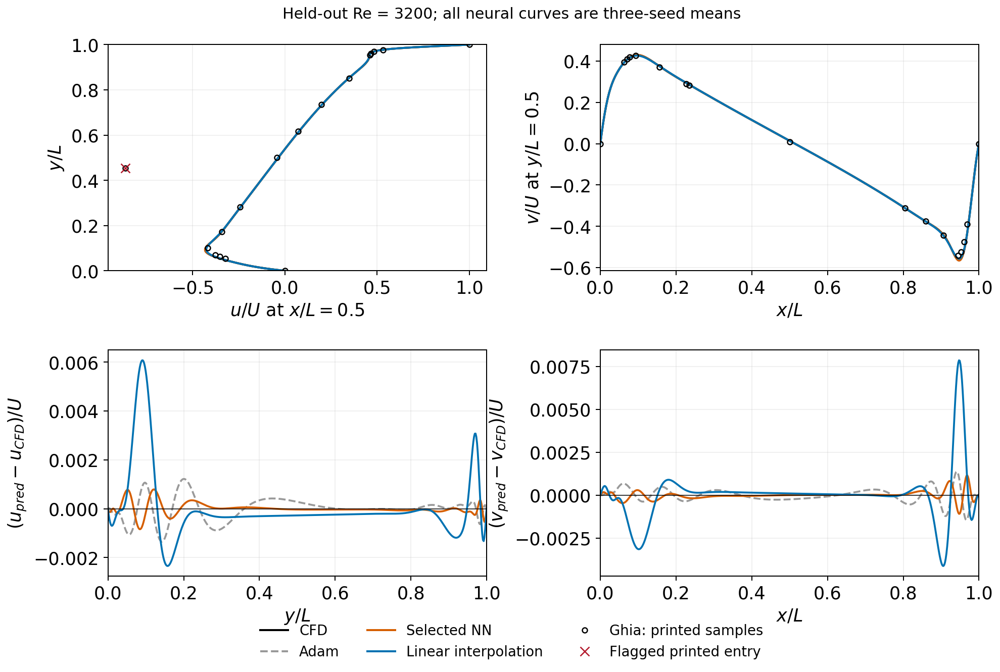
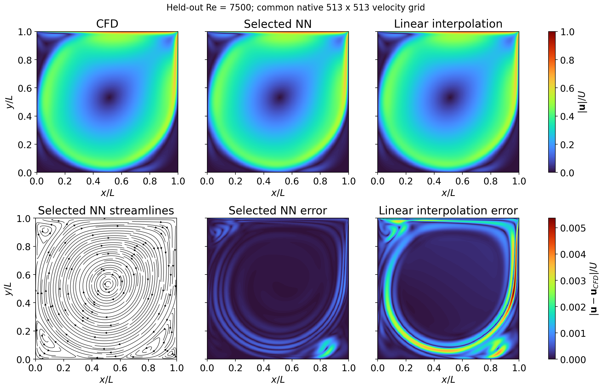
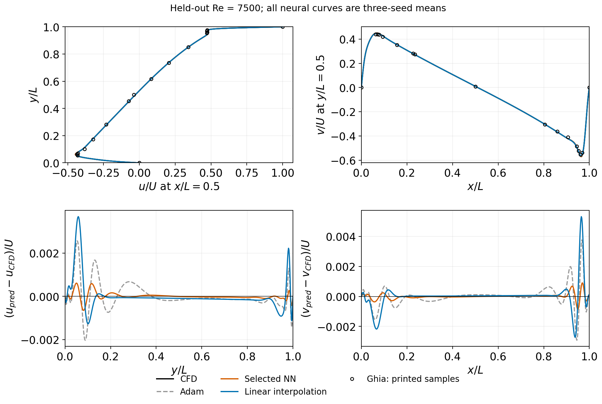

# Full-field cavity POD-DeepONet: fixed whole-Re tests

A training-only POD basis and a tanh branch predict both velocity components on
the native 513-by-513 grid. This is a supervised scalar-parameter surrogate,
not a data-free PINN. No Ghia sample enters fitting. Pressure is not a trained output. The [physical comparison gallery](flow_comparison/README.md) adds velocity-derived vorticity and reconstructed pressure, with their numerical limitations.

[Run Lab 8](../../notebooks/week04/W4_Lab8_High_Re_Field_DeepONet.ipynb) |
[Frozen design and validation amendment](../../docs/CAVITY_FIELD_NEURAL_PROTOCOL.md) |
[CFD discretization audit](../cavity_highre_ghia/README.md) |
[Primary-source literature check](../../docs/CAVITY_ALL_RE_NEURAL_LITERATURE.md)

Training Re: 100,250,500,750,1000,2500,4000,5000,6000,9000,10000.
Validation Re: 400,6500. Test Re: 3200,7500.
Selection: **hybrid_2**, mean validation vector
error across both Re and seeds 7,23,61. The delivered field averages those seeds.
Both interpolation baselines receive exactly the same training fields.

| Re | Neural mean | Linear in Re | Linear in log Re |
| --- | --- | --- | --- |
| 3200 | 0.0951% | 0.8400% | 0.5394% |
| 7500 | 0.0844% | 0.4703% | 0.3139% |

These are full-field vector relative L2 errors against the retained 512-cell
CFD solution, not speed-only errors, Ghia profile errors or exact physical error.

## Overlaid flow structures

[Streamlines, corner enlargements, vorticity, reconstructed pressure and signed differences](flow_comparison/README.md) compare Re1000 (training) with Re7500 (held out). All six figures also appear in Lab 8 and the Week 4 lecture.

## What improved, and what remains limited

The [validation scores](validation_scores.csv) retain every architecture/seed,
including deterioration after depth or per-mode weighting. All five candidates
have the same maximum function/gradient-evaluation budget. The capacity-matched
five-layer control distinguishes depth from a large parameter-count increase.

The initial nine-case training round had a 3.251% POD projection floor at
validation Re=400. Its [unscored retained trial](selection_round_1/ROUND_DECISION.json)
motivated two new independent CFD training cases at 500 and 750, before testing.
This is a validation-driven amendment, not a prospectively fixed training set.

The [projection table](projection_lower_bound.csv) uses test truth solely for
an oracle representation bound after prediction freezing. It is not a predictor.
[Physical diagnostics](physical_diagnostics.csv) separately re-evaluate wall,
divergence and nonlinear vorticity residuals. Linear basis constraints do not
enforce nonlinear momentum balance. The selected ensemble has nondimensional
nonlinear vorticity-transport Linf residuals of about 798 (Re=3200) and 296
(Re=7500), including sharp-corner derivative sensitivity. These large residuals
are a material limitation despite the small velocity-field discrepancy.

The 256-to-512 CFD vector discrepancy is 2.03% at Re3200 and 4.72% at Re7500.
Those sensitivities can exceed surrogate error. This experiment demonstrates
accuracy against a specified discretization, not mesh independence, physical
stability, a pressure solution or a data-free neural PDE solver.

## Reproduce without changing the experiment

The notebook verifies hashes and displays the retained result on CPU.
qa/run_cavity_field_operator.py has separate train and score stages. Training
refuses to run after test scores exist. The selected configuration, training
data reads, every model hash and frozen prediction hash are recorded in
[frozen_selection.json](frozen_selection.json); [scoring_receipt.json](scoring_receipt.json)
records target access after freezing. Source, weights, Adam moments and the
training RNG initialization state are retained. SciPy's internal L-BFGS history
is not serialized; these are completed fits, not resumable mid-L-BFGS checkpoints.

For a cross-platform audit of the retained frozen run, execute
`python qa/validate_cavity_highre.py`. It resolves the historical Windows
model paths without modifying the frozen manifest or its hashes. The original
training/scoring script is retained byte-for-byte as campaign provenance.
