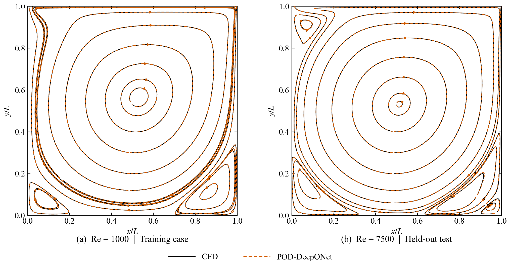
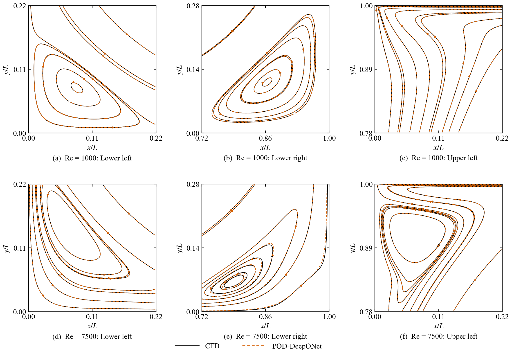
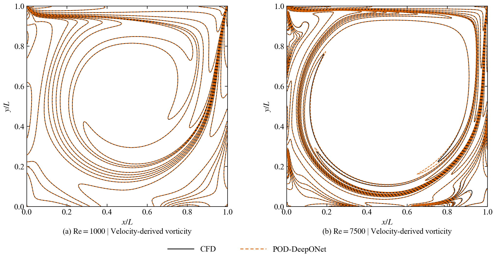
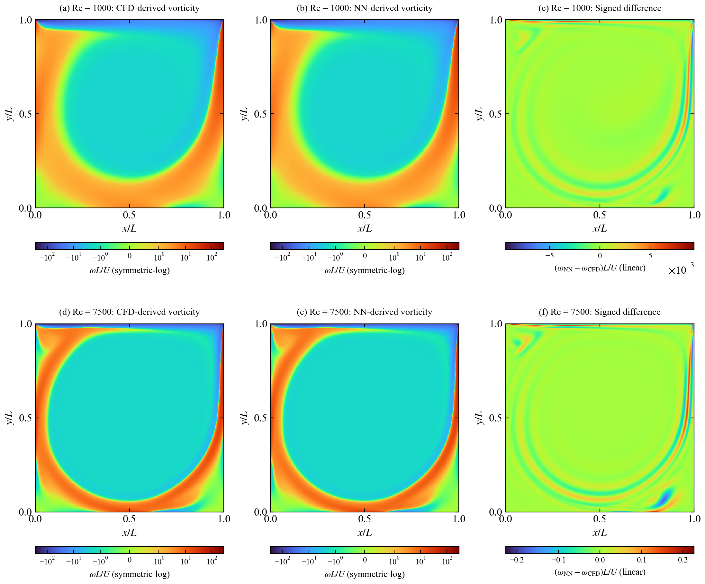
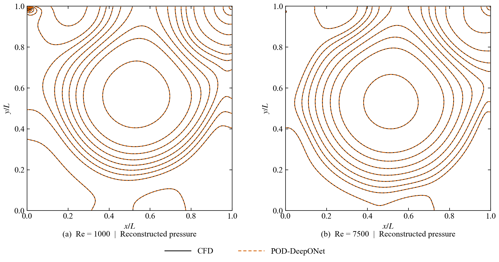
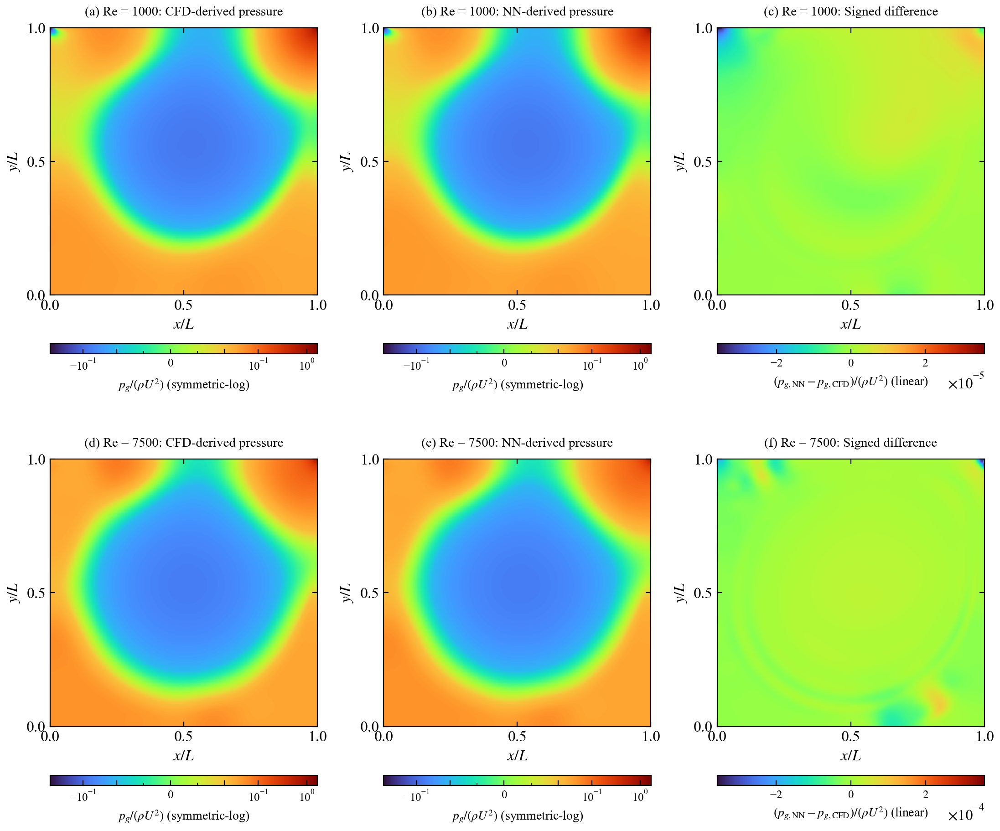

# CFD and frozen POD–DeepONet: physical field comparison

Re=1000 is a **training-case reconstruction**; Re=7500 is a **whole-Re held-out test**.
The selected `hybrid_2` model averages seeds 7, 23 and 61. No model, basis,
training data, frozen test coefficients or test-selection rule was changed.

[Executed Lab 8](../../../notebooks/week04/W4_Lab8_High_Re_Field_DeepONet.ipynb) ·
[Week 4 lecture](../../../lectures/week04_cavity_surrogates_deeponet.pdf) ·
[Verification](verification.json)

## Read the physical comparisons

### Overlaid streamlines

[Vector PDF](streamlines_overlay_Re1000_Re7500.pdf)

### Matched corner enlargements

[Vector PDF](corner_streamlines_overlay_Re1000_Re7500.pdf)

### Overlaid vorticity

[Vector PDF](vorticity_contours_overlay_Re1000_Re7500.pdf)

### Vorticity and signed difference

[Vector PDF](vorticity_fields_and_signed_error_Re1000_Re7500.pdf)

### Overlaid reconstructed pressure

[Vector PDF](pressure_contours_overlay_Re1000_Re7500.pdf)

### Pressure and signed difference

[Vector PDF](pressure_fields_and_signed_error_Re1000_Re7500.pdf)

## Definitions and limitations

Streamlines use identical prescribed seeds and integration settings. Each seed
is integrated independently, so another plotted curve cannot suppress it.
Streamline density is a visualization choice, not a speed measurement.

Vorticity is `omega = dv/dx - du/dy`, computed with the same centered stencil
from both velocity fields at 511×511 interior nodes. It is not an independently
trained network output or the wall-vorticity boundary stencil. The sign and all
interior extrema are retained. The four vorticity fields use one symmetric-log
scale (linear threshold 1 in omega L/U); signed discrepancies use linear scales
shown separately for each Re. Contour levels are recorded in verification.json.
[Vorticity metrics](vorticity_metrics.csv) report global L2, RMS, maximum signed
discrepancy and its location. The solid-body-rotation sign test gives omega=+2.

Pressure is the least-squares integral of the steady momentum gradient on the
same interior grid, with one zero-interior-mean gauge per entire field. The same
operator is used independently for CFD and neural velocities. Pressure is not a
network output, and no independent pressure-solver reference was used. The
reconstruction passes affine-gradient and second-order Kovasznay checks.
The pressure fields share a full-extrema symmetric-log scale with threshold
0.02 rho U²; signed discrepancies use linear scales. No values are clipped.

At Re7500 the derived-pressure neural/CFD L2 discrepancy is 0.05373%, while the
256-to-512 CFD pressure sensitivity is 8.90%. At Re1000 those numbers are
0.006901% and 1.274%. Do not turn a small surrogate error into a claim of
mesh-independent physical accuracy. The nonlinear momentum/vorticity residual
and sharp-corner sensitivity remain material limitations.

[Velocity and pressure metrics](comparison_metrics.csv) ·
[Pressure mesh sensitivity](pressure_mesh_sensitivity.csv)

## Historical hardware and cost context

Ghia, Ghia and Shin report 1.5 CPU minutes at Re1000 on 129×129 nodes, and
16–20 minutes for high-Re calculations up to Re10000 on 257×257 nodes, using
an Amdahl 470 V/6 and CSI–multigrid (1982 paper, pp. 387 and 410).
The Computer History Museum lists this 1975 mainframe at 3.5 MIPS, up to 8 MB
and \$3.75 million. This is hardware context, not the authors' purchase invoice.
As a dated desktop example, Apple's October 2024 Mac mini M4 launch offered
10 CPU cores and 16 GB from \$599. This is not a current retail quote and that
Mac was not the machine used for our Unity computations. Prices are nominal,
not inflation adjusted; MIPS cannot be equated to modern floating-point throughput.

Our retained one-core Unity solve timers sum to 277.50 s for the continuation
sequence on 257×257 nodes, and 2443.01 s on 513×513 nodes. Both sequences start
from an already available Re1000 seed and finish at Re10000. These are wall
solve timings, excluding seed creation, queue, transfers, temporal checks and
training. Ghia's CPU timing, initialization and algorithm differ: their ratio
is not a controlled hardware or algorithm speedup. A monetary run price cannot
be inferred without an actual tariff and allocation-time record.

Students can estimate a scenario with C = r t / 3600 for one allocated core,
where r is an **explicitly assumed** currency/core-hour rate. Keep CFD data
generation, training, inference, queue time and hardware purchase separate.
No measured dollar saving is asserted here.

- [Ghia, Ghia and Shin (1982), Journal of Computational Physics 48, 387-411](https://doi.org/10.1016/0021-9991(82)90058-4)
- [Computer History Museum: Amdahl 470V/6 Computer - CPU](https://www.computerhistory.org/revolution/mainframe-computers/7/169/677)
- [Apple Mac mini M4 launch, 29 October 2024](https://www.apple.com/newsroom/2024/10/apples-new-mac-mini-is-more-mighty-more-mini-and-built-for-apple-intelligence/)

[Machine-readable sources and measured timing scope](historical_cost_context.json)

## Reproduce

From the repository root, run `python -m flowmllab.cavity_comparison`.
This audits frozen source hashes, evaluates saved weights, verifies the pressure
operator and produces the six figure pairs and metric tables on CPU. It starts
no fitting or HPC work. Retained raw CFD and frozen model files remain unchanged.
