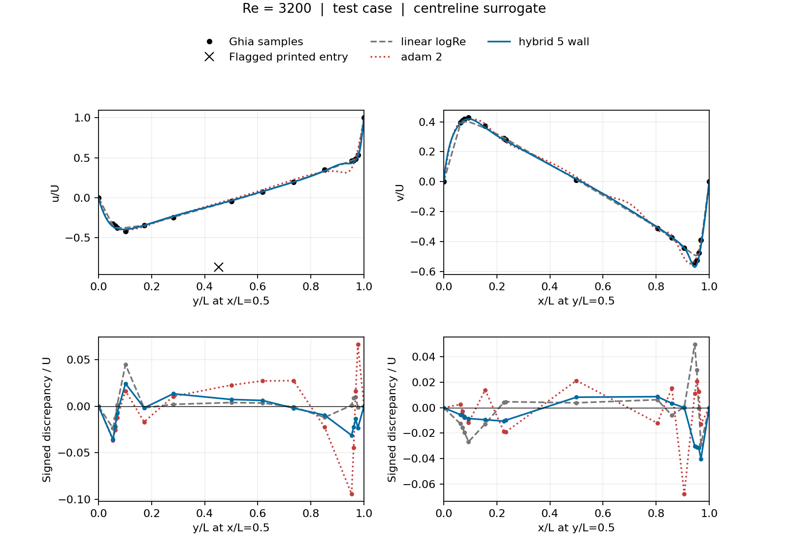
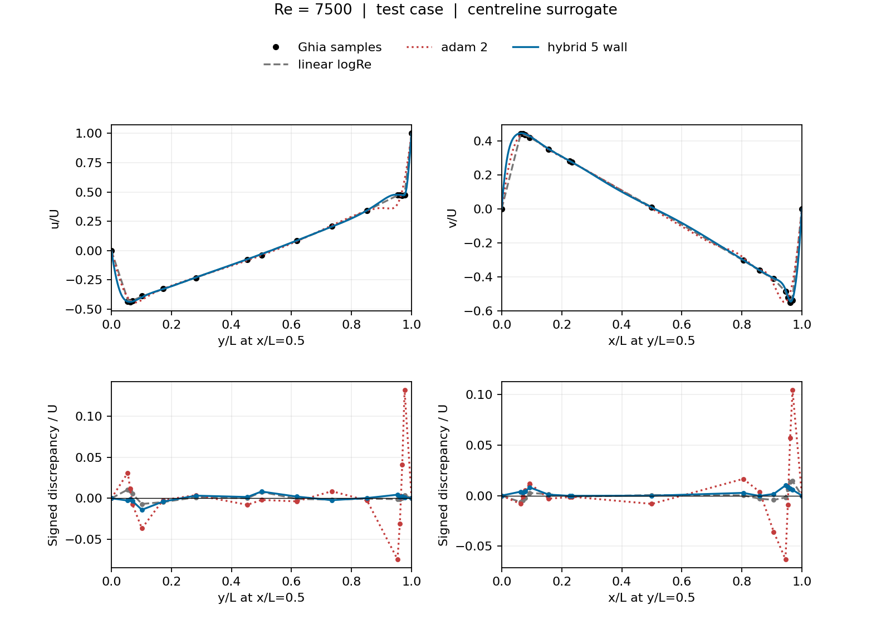

# All-Re cavity profiles: reference coverage and a CPU neural experiment

All seven published Ghia Reynolds numbers are now available to the Week 1,
Week 1.2 and Week 4 lessons. The full-field datasets already in the course are
unchanged. No new mesh-converged fields at Re=3200,5000,7500,10000 are claimed.

The new neural experiment is supervised **centreline regression**, not a PINN or
a DeepONet field solve. See the [new Lab 6](../../notebooks/week04/W4_Lab6_Ghia_Profile_Optimizer_Depth.ipynb)
and [benchmark data/policy](../../references/ghia/README.md).

See [our actual CFD versus Ghia](../cavity_cfd_ghia/README.md) for native solver
curves, grid comparisons and signed errors at Re=100,400,1000. Lab 5 now displays
that CFD evidence and the two held-out neural predictions by default.

## Split and comparison

- Train: Re=100,1000,5000,10000. Validation/model selection: Re=400.
- Test: Re=3200,7500, including all their points. No test targets enter fitting or selection.
- Width 24; 2 versus 5 hidden layers; tanh, Xavier initialization, exact endpoint lifts.
- Adam, L-BFGS, Adam then L-BFGS; uniform versus 3x near-wall data weights.
- Three initializations (7,23,61); 1200 joint function/gradient evaluations per fit.
- 721 versus 2521 parameters: this depth comparison is **not capacity matched**.
- Baseline: piecewise linear interpolation in log Re between training cases,
  with spatial interpolation only within the retained training profiles.

The entire objective is fixed during L-BFGS. The retained checkpoint is the
lowest training objective seen within the evaluation budget, including evaluated
line-search trials. Counts include those trials, not merely accepted optimizer steps.

`frozen_selection.json` was written before held-out scores, records all model
hashes, and selects **hybrid_5_wall** using mean u/v validation RMSE averaged
over all three seeds. The disclosed tests may now be used for classroom
interpretation, but future tuning on them needs a new test for a research claim.

## Measured outcomes

Values below average per-component RMSE over u/v and then over seeds. They are
not the RMSE of an averaged prediction. Units are lid speed U.

| Method | Test Re=3200 | Test Re=7500 |
| --- | ---: | ---: |
| Adam, 2 layers | 0.033949 | 0.038002 |
| L-BFGS, 2 layers | 0.050537 | 0.017614 |
| Adam -> L-BFGS, 2 layers | 0.039900 | 0.013904 |
| Adam -> L-BFGS, 5 layers | 0.026175 | 0.007462 |
| Adam -> L-BFGS, 5 layers, wall weights | 0.019739 | 0.005627 |
| Linear interpolation in log Re | **0.016294** | **0.005176** |

Greater depth plus wall weighting improves on the neural baseline, but the
simple interpolant wins both withheld cases. L-BFGS alone is sensitive to the
initialization. Do not infer that an optimizer, network depth or weighting rule
is universally best. Only 34 reference samples per case are available, so these
scores say nothing about errors away from the two centrelines.

[All per-seed scores](scores.csv) include screened and original printed-data
relative L2 norms. [Validation scores](selection.csv), [training history](history.csv),
[timing and evaluation counts](timing.csv) and [frozen selection](frozen_selection.json)
are retained. Timings are one shared-machine run, load-sensitive, without a
controlled timing warm-up: they are provenance, not a speed-ranking benchmark.

## Physical comparisons

Each plot has u/v profiles and signed error at actual reference samples. Neural
curves are means over three seeds, while the table above averages individual
errors. Flagged printed entries remain visible; no dense reference truth is invented.

| Reynolds number | Role | Profile and signed-error figure |
| ---: | --- | --- |
| 100 | train | [Figure](re100_profiles.png) |
| 400 | validation | [Figure](re400_profiles.png) |
| 1000 | train | [Figure](re1000_profiles.png) |
| 3200 | test | [Figure](re3200_profiles.png) |
| 5000 | train | [Figure](re5000_profiles.png) |
| 7500 | test | [Figure](re7500_profiles.png) |
| 10000 | train | [Figure](re10000_profiles.png) |




## Reproduce

From an updated checkout with NumPy, SciPy, pandas and Matplotlib:

```sh
python -m qa.run_ghia_profile_study
```

This regenerates the current teaching experiment and overwrites its derived
results. Preserve a scientific run before changing its protocol. For a new
full-field campaign use mesh/time-step/refinement gates in [Lab 5](../../notebooks/week04/W4_Lab5_All_Re_Ghia_Validation.ipynb);
do not reuse these sparse profiles as dense CFD labels.
