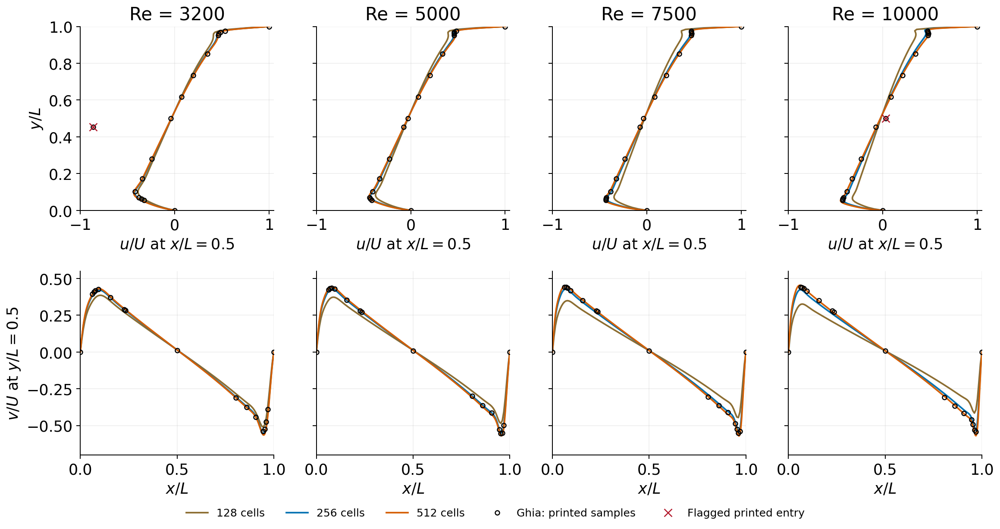
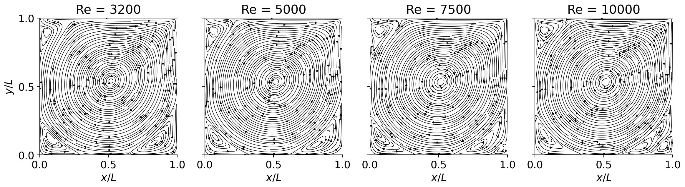
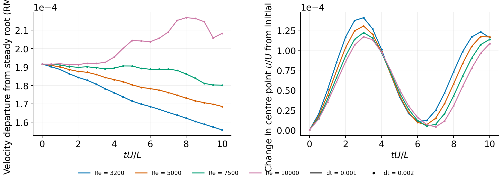

# Newly solved cavity CFD across the Ghia Reynolds range

These are actual steady Navier-Stokes fields, not curves fitted to benchmark
samples. Forty-five fields cover 15 Reynolds numbers on 128, 256 and 512 cells
per side. The seven Ghia cases are included; additional cases support the
separate full-field neural experiment. Original low-Re runs are preserved.

[Run Lab 7](../../notebooks/week04/W4_Lab7_High_Re_CFD_Ghia.ipynb) |
[Equations and execution protocol](../../docs/CAVITY_HIGH_RE_PROTOCOL.md) |
[Independent field/hash audit](verification.json) |
[Neural predictions](../cavity_field_deeponet/README.md)

The red crosses retain predeclared suspicious printed entries. Both raw and
screened scores are in [ghia_scores.csv](ghia_scores.csv); none is replaced.
Re=3200's finest screened u/v errors are 3.039% / 4.773%; Re=10000's are
2.058% / 2.524%. Refinement need not monotonically approach a sparse historical
benchmark with its own numerical error.

## Numerical meaning and limits

[Mesh sensitivity](mesh_sensitivity.csv) includes both centreline and native
full-field differences. The 256-to-512 vector discrepancies at Re=3200,5000,7500,
10000 are 2.03%, 3.14%, 4.72%, 6.32%. These fields solve their discrete equations
but are **not demonstrated mesh-independent physical truth**. Strong corner
differences remain. A neural model learns the stated 512-cell discretization.

[Matched-time checks](time_sensitivity.csv) perturb the same 256-cell root and
compare dt=0.002 with 0.001 through tU/L=10. All paired time-step checks pass.
The Re=10000 perturbation grows by 8.7% over this short interval, while the other
three decay. This single perturbation and short horizon do not prove or
disprove asymptotic stability.

## Reproduction and data

Each n128, n256 and n512 directory contains native x,y,u,v,psi,omega arrays and
JSON configuration, source hashes, convergence history and final SHA256.
Independent checks re-evaluate Poisson, vorticity transport, wall constraints,
streamfunction/velocity consistency and continuity. No pressure is reconstructed.

CPU runs used Unity Workspace flowml-ghia-highre-20261115. Its actual scratch
path, expiry, source identities and job records are in the protocol. Final
scientific fields were byte-verified on Lexar D:. The raw fields and provenance
are retained; transient live checkpoint traffic is not mirrored here.
