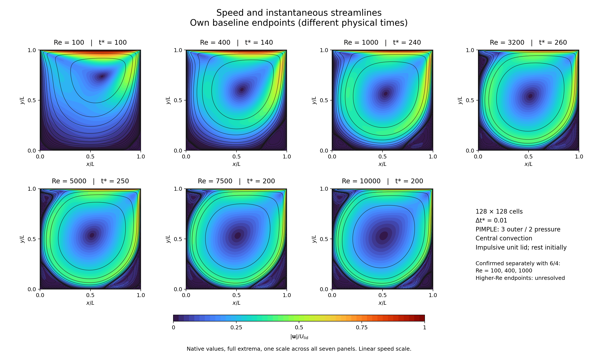
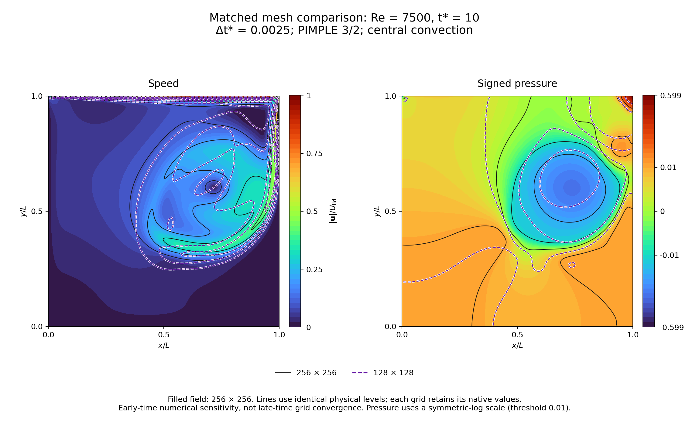

# Cavity continuation: final results and numerical sensitivity

[Open the CPU notebook](../../notebooks/week01_2/W1_2_Cavity_Stationarity_and_Resolution.ipynb) · [Run in Colab](https://colab.research.google.com/github/Ehsan-Roohi/FlowMLLab/blob/main/notebooks/week01_2/W1_2_Cavity_Stationarity_and_Resolution.ipynb) · [Browse the figures](https://ehsan-roohi.github.io/FlowMLLab/cavity-settling/)

All 22 configurations and three confirmation branches are closed. **Re = 100, 400 and 1000 pass the fixed-grid temporal stationarity checks and separate tighter-coupling confirmations.** The four higher-Re cases remain unresolved at their recorded endpoints. Completion of the scheduled work is not a claim that every flow became steady.

## Baseline and confirmation outcomes

| Re | Baseline end t* | Last full window | Failed gates / 16 | 6/4 confirmation end t* | Conclusion |
| ---: | ---: | --- | ---: | ---: | --- |
| 100 | 100 | 80–100 | 0 | 120 | Fixed-grid temporal stationarity confirmed |
| 400 | 140 | 120–140 | 0 | 160 | Fixed-grid temporal stationarity confirmed |
| 1000 | 240 | 220–240 | 0 | 260 | Fixed-grid temporal stationarity confirmed |
| 3200 | 260 | 240–260 | 12 | — | Unresolved at the recorded endpoint |
| 5000 | 250 | 200–250 | 12 | — | Unresolved at the recorded endpoint |
| 7500 | 200 | 150–200 | 13 | — | Unresolved at the recorded endpoint |
| 10000 | 200 | 150–200 | 13 | — | Unresolved at the recorded endpoint |

Baselines: 128 × 128 staggered cells, Δt* = 0.01, central convection, PIMPLE with 3 outer/2 pressure corrections. Confirmations change only the correction counts to 6/4. The 2D unit square starts from rest with an impulsive unit-speed lid; the other walls are stationary and all walls are impermeable. Time is t* = t U_lid/L. Pressure retains the native zero-area-mean gauge.

A candidate requires all 16 frozen gates in three consecutive full windows (length 20 for Re ≤ 3200; 50 for Re ≥ 5000), then a further full confirmation window. Partial first windows do not count. Gates are accumulated at every solver step; sampled plot histories are not a replacement for the gate evaluator. These are frozen engineering tolerances, not thresholds quoted from Ghia.

## Physical flow



**Different endpoint times are written on the panels.** These panels show the attained state, not a matched-time Reynolds-number comparison. The separate [t* = 100 comparison](lesson_figures/matched_t100_speed.pdf) uses identical physical time. All figures retain full field extrema and native values; no smoothing is used.

[Signed pressure](lesson_figures/endpoints_p.pdf) · [Signed vorticity](lesson_figures/endpoints_omega.pdf) · [Speed/streamlines PDF](lesson_figures/endpoints_speed.pdf)

## All 16 matched numerical comparisons

Every comparison below is evaluated at the exact recorded t* = 10. The grid controls use Δt* = 0.0025. A numerical comparator is not truth. Velocity differences are relative spatial L2 norms; fine-to-coarse bilinear cell-center sampling is used only for mesh difference norms. Plotted profiles preserve each grid's cell-center samples, and do not invent pressure at walls.

| Control | Re | Relative velocity difference (%) | Profiles |
| --- | ---: | ---: | --- |
| time_Re1000_0.01_vs_0.005 | 1000 | 0.12011 | [PDF](figures/profiles_time_Re1000_0.01_vs_0.005_t10.pdf) |
| time_Re1000_0.005_vs_0.0025 | 1000 | 0.06055 | [PDF](figures/profiles_time_Re1000_0.005_vs_0.0025_t10.pdf) |
| time_Re1000_0.01_vs_0.0025 | 1000 | 0.18064 | [PDF](figures/profiles_time_Re1000_0.01_vs_0.0025_t10.pdf) |
| time_Re7500_0.01_vs_0.005 | 7500 | 3.99442 | [PDF](figures/profiles_time_Re7500_0.01_vs_0.005_t10.pdf) |
| time_Re7500_0.005_vs_0.0025 | 7500 | 2.14268 | [PDF](figures/profiles_time_Re7500_0.005_vs_0.0025_t10.pdf) |
| time_Re7500_0.01_vs_0.0025 | 7500 | 6.07685 | [PDF](figures/profiles_time_Re7500_0.01_vs_0.0025_t10.pdf) |
| time_Re10000_0.01_vs_0.005 | 10000 | 3.61931 | [PDF](figures/profiles_time_Re10000_0.01_vs_0.005_t10.pdf) |
| time_Re10000_0.005_vs_0.0025 | 10000 | 1.96784 | [PDF](figures/profiles_time_Re10000_0.005_vs_0.0025_t10.pdf) |
| time_Re10000_0.01_vs_0.0025 | 10000 | 5.48959 | [PDF](figures/profiles_time_Re10000_0.01_vs_0.0025_t10.pdf) |
| grid_Re3200_128_vs_256 | 3200 | 4.23317 | [PDF](figures/profiles_grid_Re3200_128_vs_256_t10.pdf) |
| grid_Re5000_128_vs_256 | 5000 | 7.76839 | [PDF](figures/profiles_grid_Re5000_128_vs_256_t10.pdf) |
| grid_Re7500_128_vs_256 | 7500 | 31.99883 | [PDF](figures/profiles_grid_Re7500_128_vs_256_t10.pdf) |
| grid_Re10000_128_vs_256 | 10000 | 55.31213 | [PDF](figures/profiles_grid_Re10000_128_vs_256_t10.pdf) |
| coupling_Re1000_3x2_vs_6x4 | 1000 | 0.00022 | [PDF](figures/profiles_coupling_Re1000_3x2_vs_6x4_t10.pdf) |
| coupling_Re7500_3x2_vs_6x4 | 7500 | 0.03703 | [PDF](figures/profiles_coupling_Re7500_3x2_vs_6x4_t10.pdf) |
| coupling_Re10000_3x2_vs_6x4 | 10000 | 0.05081 | [PDF](figures/profiles_coupling_Re10000_3x2_vs_6x4_t10.pdf) |

Mesh sensitivity is about 4.23%, 7.77%, 32.00% and 55.31% at Re = 3200, 5000, 7500 and 10000. These early-time controls do **not** establish late-time grid independence. The large high-Re sensitivity prevents an accuracy claim based on an apparently settled movie. An unresolved endpoint is not proof of physical unsteadiness, 3D instability or turbulence.



Filled 256 × 256 reference field and 128 × 128 dashed contours use identical physical levels; both are at t* = 10 and Δt* = 0.0025. Native signed pressure uses symmetric-log normalization, linear within ±0.01. The fine grid is a numerical comparator.

## Every baseline's histories and late profiles

| Re | Signed probes, energy, streamfunction and equation defects | Late velocity and pressure profiles |
| ---: | --- | --- |
| 100 | [History](figures/history_continue_re100_n128_dt0p01_o3p2.pdf) | [Profiles](lesson_figures/late_profiles_re100.pdf) |
| 400 | [History](figures/history_continue_re400_n128_dt0p01_o3p2.pdf) | [Profiles](lesson_figures/late_profiles_re400.pdf) |
| 1000 | [History](figures/history_continue_re1000_n128_dt0p01_o3p2.pdf) | [Profiles](lesson_figures/late_profiles_re1000.pdf) |
| 3200 | [History](figures/history_continue_re3200_n128_dt0p01_o3p2.pdf) | [Profiles](lesson_figures/late_profiles_re3200.pdf) |
| 5000 | [History](figures/history_continue_re5000_n128_dt0p01_o3p2.pdf) | [Profiles](lesson_figures/late_profiles_re5000.pdf) |
| 7500 | [History](figures/history_continue_re7500_n128_dt0p01_o3p2.pdf) | [Profiles](lesson_figures/late_profiles_re7500.pdf) |
| 10000 | [History](figures/history_continue_re10000_n128_dt0p01_o3p2.pdf) | [Profiles](lesson_figures/late_profiles_re10000.pdf) |

The upper-left and central probes are fixed spatial positions, not tracked vortex centers. Late profiles label each actual time and any tighter-coupling branch separately.

## Reproducible evidence

- [Summary JSON](summary.json), [stationarity outcomes CSV](stationarity_outcomes.csv) and [all matched controls CSV](matched_controls.csv).
- [Scientific manifest](manifest.json): SHA-256 and sizes for all 248 exported scientific files; [full analysis, gzip JSON](data/analysis.json.gz).
- [Native fields](data/fields): all 22 configurations at exact t* = 10, all seven baselines at t* = 100 and their own endpoints, and three confirmation endpoints. These selected snapshots are not full restart sets.
- [All baseline/control windows and diagnostic histories](data/cases), [three confirmation reports](data/confirmations), and [frozen policies/source capsule](provenance).
- [Retained 23 analysis figures](figures) and [additional native-field/late-profile figures](lesson_figures). Every plotted input has a verified source identity.

The complete analysis is published losslessly; selected native fields make the figures reproducible without copying every frequent checkpoint into Git. Full recovery sets and intermediate native snapshots remain in the research storage. The configuration's legacy end_time = 10 identifies the original seed, while each native snapshot/status records its actual continuation time. This publication does not supersede the [original startup lesson](../cavity_startup/README.md) or the [0–100 movies](../cavity_continuation/README.md).

```bash
python qa/build_cavity_settling_lesson.py build
python qa/build_cavity_settling_lesson.py execute
python qa/build_cavity_settling_lesson.py check
```

These commands read and plot stored results. They do not submit or resume CFD jobs. The companion concludes with five specific student investigations and required deliverables.
