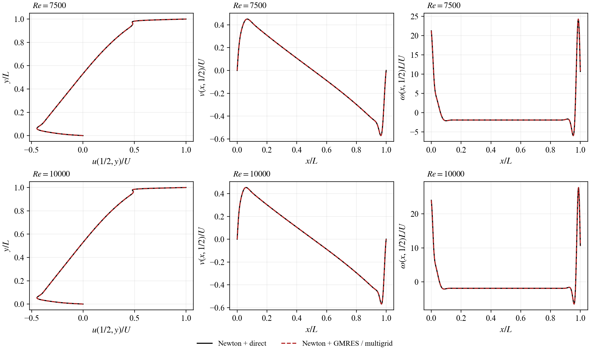
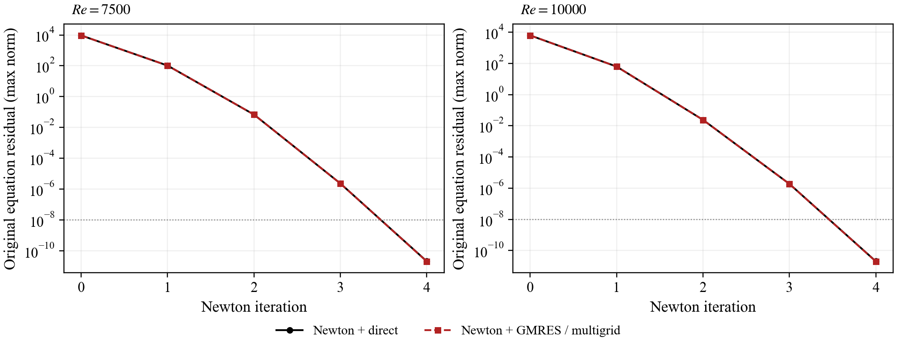

# Matched cavity solver experience

The existing sparse-direct Newton solver was faster than the tested GMRES/multigrid candidate at Re=7500 and 10000 on 257-by-257 and 513-by-513 nodes. The candidate took **1.95-2.17 times as long** in three-repeat warm comparisons. Setup consumed **89.3-95.2%** of candidate solve time. We retain the baseline for these tested workloads.

This is a measured implementation result, not a universal verdict about multigrid and not a reimplementation of Ghia's CSI-MG.

## Learn from the experiment

- [Lab 7: CFD audit and executable solver appendix, Section 8](../../notebooks/week04/W4_Lab7_High_Re_CFD_Ghia.ipynb)
- [Lab 8: what this means for neural training data, Section 9](../../notebooks/week04/W4_Lab8_High_Re_Field_DeepONet.ipynb)
- [Week 4 lecture, solver-benchmark evidence appendix](../../lectures/week04_cavity_surrogates_deeponet.pdf)
- [Full measured report](REPORT.md), [summary timings](timings.csv), [raw trial records](evidence.json), [whole-field agreement audit](paired_fields_audit.json)

The notebook reanalyses retained measurements on CPU. No solver or training run is needed. The six unsuccessful candidate pilots remain in the record; failed runs are not counted as fast successful solves.

Both solvers converge to effectively the same discrete solution. Full-field differences near 1e-14 describe solver agreement, not physical or Ghia error.

## Timing and correctness boundaries

Warm Re7500 uses the retained Re6500 field; warm Re10000 uses Re9000. The 257-node 20-root continuation test has only one repetition per method. Solve timing includes Jacobian/preconditioner setup but excludes seed creation, imports, queue, file I/O and post-run verification. The recorded linear total already includes setup. Identical final acceptance tests do not imply identical inner tolerances: the candidate additionally checks the original linear defect at 1e-7.

Preconditioner reuse is an untested proposal. A cost model predicts that 53.6-57.4% less setup cost would be needed to tie the baseline if other costs stayed fixed; no such acceleration is claimed.

## Evidence and reproduction

`manifest.json` records SHA256 for the byte-verified compact evidence. The separately retained 146,274,361-byte full archive has SHA256 `fbfd423b06883c36268849d08647ebcc68d797ae49aeb82ae55090dd1c27313e`. It preserves 40 trial records, frozen numerical code, exact inputs, complete successful recoveries and representative full fields. It is not downloaded by Run All.

Experimental source: [linear solver](../../flowmllab/cavity_krylov.py), [single-trial benchmark](../../qa/benchmark_cavity_solvers.py), [bounded pilot](../../qa/run_cavity_solver_strong_pilot.py), [paired matrix](../../qa/run_cavity_solver_matrix.py), [summary audit](../../qa/summarize_cavity_solver_benchmark.py). The original production solver is unchanged. Full-grid reruns require deliberate resource planning and fresh allocated scratch; do not run a saved site-specific batch path blindly.
