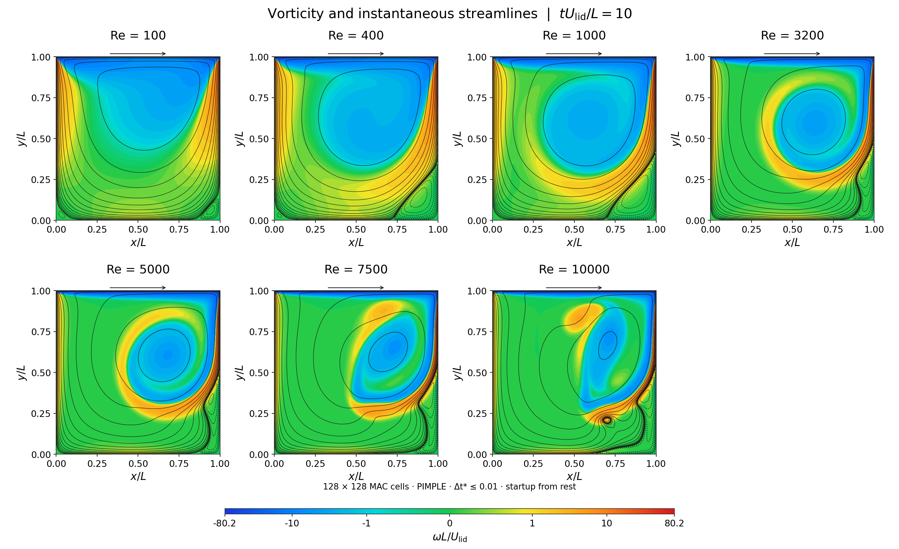
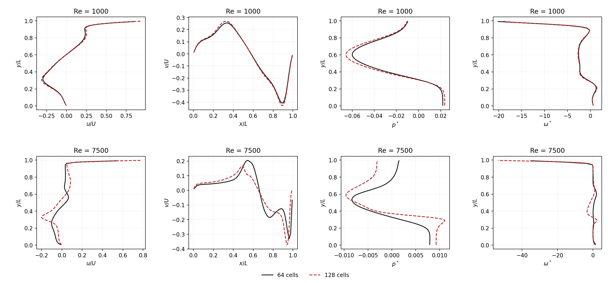

# How cavity circulation develops

A physical-time companion to Week 1.2: follow the lid-driven cavity from rest, inspect speed, signed vorticity and pressure, and test which structures survive changes in numerical resolution.

[CPU notebook](../../notebooks/week01_2/W1_2_Cavity_Startup_Movies.ipynb) · [Complete Week 1.2 lecture](../../lectures/week01_2_pressure_velocity.pdf) · [Standalone startup appendix](cavity_startup_lecture_appendix.pdf)

## Watch the flow

[Speed and instantaneous streamlines](media/cavity_startup_speed.mp4) · [Signed vorticity](media/cavity_startup_omega.mp4) · [Signed pressure](media/cavity_startup_p.mp4)

All seven cases use Re = 100, 400, 1000, 3200, 5000, 7500 and 10000. The square starts from rest; the top lid starts impulsively and moves right at unit speed. The other walls are stationary and all walls are impermeable. There is no lid ramp.

| Shared control | Displayed setting |
|---|---|
| Mesh | 128 × 128 MAC cells |
| Physical interval | 0 ≤ tU/L ≤ 10 |
| Maximum timestep | ΔtU/L = 0.01 |
| Coupling | PIMPLE, 3 outer / 2 pressure corrections |
| Convection | central |
| Saved frames | Every 0.1 physical-time unit, including rest |

Finite-time 2D startup on 128 x 128 MAC cells, dt*=0.01, t*=0..10. Re >= 3200 remains strongly mesh-sensitive: matched 64-to-128 velocity differences are 17-70% at t*=10. These are provisional finite-grid teaching trajectories, not mesh-independent predictions, steady Ghia validation, or 3D turbulence evidence.



The domain, field limits and streamline levels stay fixed across cases and times. Speed has a linear scale. Signed vorticity uses a symmetric-log scale, linear within |ωL/U| ≤ 1; native zero-mean pressure uses a symmetric-log scale, linear within |p/(ρU²)| ≤ 0.01. Full recorded extrema are retained. Contour drawing interpolates between native samples; no scientific field is filtered or clipped. Solid streamfunction contours are negative and dashed contours positive. Instantaneous streamlines are not particle pathlines.

## What the refinement tests showed

The first 32-to-64-cell comparison changed the final velocity field by 13.2% at Re = 1000 and 77.6% at Re = 7500 in the stated relative L2 norm. Those changes were much larger than the timestep/corrector sensitivities, motivating a finer mesh. A smooth picture alone did not establish accuracy.

| Matched 64-to-128-cell study, tU/L = 10 | Velocity relative L2 difference | Pressure RMS difference | Vorticity RMS difference |
|---|---:|---:|---:|
| Re = 100 | 1.18% | 0.01026 | 0.8517 |
| Re = 400 | 2.09% | 0.003239 | 1.017 |
| Re = 1000 | 4.49% | 0.00288 | 1.38 |
| Re = 3200 | 17.1% | 0.005992 | 2.176 |
| Re = 5000 | 33.4% | 0.007835 | 2.799 |
| Re = 7500 | 57.6% | 0.01017 | 3.485 |
| Re = 10000 | 69.7% | 0.009996 | 3.762 |

These comparisons keep ΔtU/L = 0.01 and coupling settings fixed. Fine fields are sampled at coarse cell centers solely for the numerical difference. Pressure has zero area mean on each original grid. These are observed sensitivities, not an external error bound or a steady Ghia validation.



## Student work

The notebook defines eight concrete tasks: measure circulation development and vortex appearance; halve the timestep; vary PISO/PIMPLE correction counts; compare grids; test the pressure gauge; audit a high-Re claim; and submit physical profiles, time histories, exact settings and measured CPU costs. Its default fresh solve uses 16 × 16 cells at Re = 100 to tU/L = 0.2, while the larger verified trajectories are loaded for immediate inspection. A GPU is not required.

## Evidence and reproduction

- `fine128/`: displayed native staggered velocities, transient pressure, exact frame times, actual-step diagnostics and configuration in compressed NPZ files; matching JSON receipts contain SHA-256 hashes, solver-source hashes and recorded CPU times.
- `base/`, `mesh32/`, `dt_half/`, `correctors/`, `matched64/`: retained controlled numerical comparisons; these files are scientific evidence, not disposable animation frames.
- [Sensitivity values](sensitivity.json), [movie provenance](media/movies.json), [presentation selection](presentation.json), and [Unity run receipt](unity_runs.json).
- [Frozen simulation source](simulation_source.tar.gz) and its [manifest](simulation_source_manifest.json) preserve the code actually run. Current rendering/admission hashes are identified separately from the simulation source hashes.

From the repository root:

```bash
python qa/build_cavity_startup.py solve --reynolds 100 --cells 32 --dt .02 --end-time 4 --interval .1 --output results/cavity_startup/student_experiment
python qa/build_cavity_startup.py render --input results/cavity_startup/student_experiment --output results/cavity_startup/student_experiment --reynolds 100
python qa/build_cavity_startup_learning.py all
python qa/build_cavity_startup_learning.py execute
python qa/append_cavity_startup_lecture.py
```

Rebuilding the teaching documents requires the repository test extras, PyMuPDF (`python -m pip install -e ".[test]" "PyMuPDF>=1.24,<2"`) and Times New Roman via `FLOWMLLAB_TNR_DIR`. The `all` action regenerates notebook source; `execute` then runs that notebook in a fresh CPU kernel and renews its execution receipt. The append command preserves and verifies all 74 existing lecture pages.

The solve command refuses to overwrite existing scientific evidence. Use a new directory for a new configuration. FFmpeg is needed only for MP4 export. The published observation times correspond to actual solution steps; neither steady SIMPLE iterations nor interpolated steady solutions are used as a physical clock.
