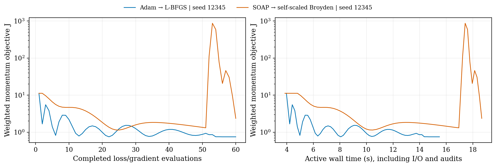

# D/W = 5 optimizer cost gate

This is a short **cost and recovery check**, not a CFD-accuracy result. Both arms
used the same fresh initial model and 8192 frozen balanced samples, the same
Quadro RTX 8000 allocation, and 50 first-order plus 10 quasi-Newton loss/gradient
evaluations. No reference field values were accessed by this assessment.

Each point is one actual loss/gradient closure. The first 50 evaluations belong
to Adam or SOAP. The final 10 are quasi-Newton closure calls, including line-search
trials. The orange excursions are trial losses, not accepted SSB endpoint losses.
The SOAP → self-scaled Broyden arm exhausted this very short refinement budget
before accepting its first SSB step; its final model correctly remained at the
SOAP endpoint. This must not be interpreted as evidence that a sufficiently
budgeted SSB refinement is inferior or unstable.

Optimizer-step time was 11.689 s for Adam → L-BFGS and 15.024 s for SOAP → SSB.
The right plot instead uses active wall time, including independent audits and
checkpoint I/O. Initial small-history cost does not establish the cost of a much
longer SSB generator history. The separately declared three-seed scientific pilot
has 2000 first-order plus 8000 quasi-Newton evaluations per arm and starts fresh.

[evaluation_manifest.json](evaluation_manifest.json) binds the original frozen
predictions, original training manifests/contracts, raw and normalized histories,
paired model/sample hashes and actual hardware. These cost-only fields are not
presented as a trained-accuracy comparison.
