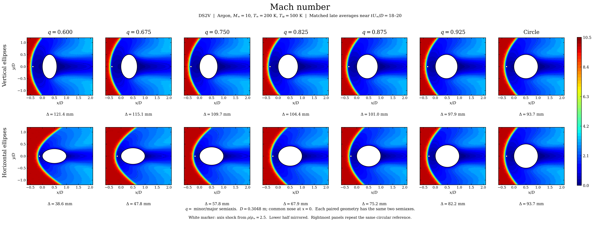
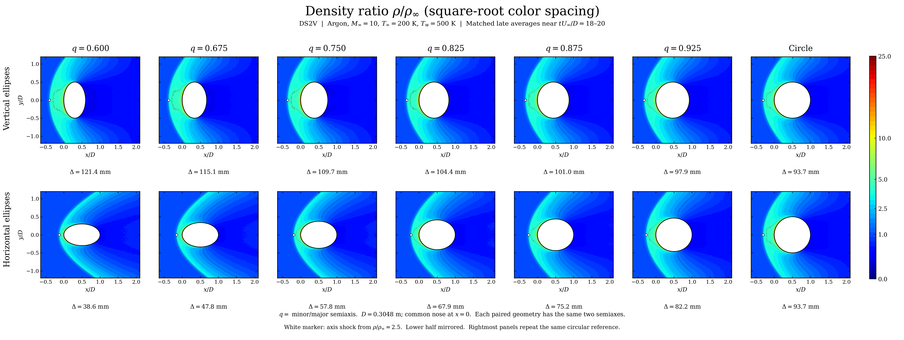
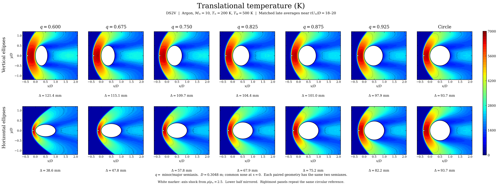
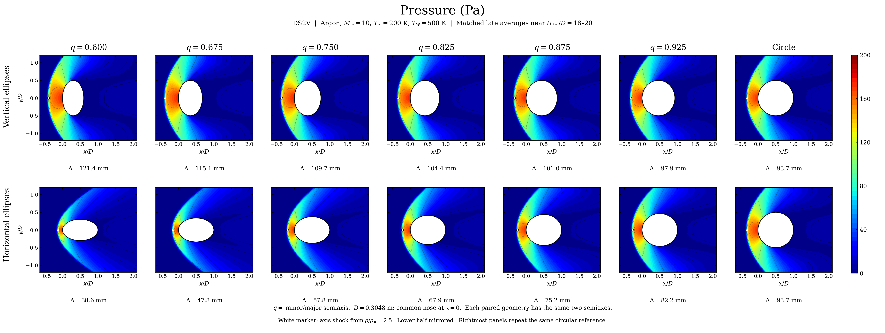

# Matched DS2V circle and ellipse contours

The four RGB figures compare 13 native DS2V solutions at the same freestream and wall conditions. Each figure uses one spatial extent and one color mapping across every panel.

- The upper row contains vertical ellipses.
- The lower row contains the corresponding horizontal ellipses with the same two semiaxes exchanged.
- Columns use minor/major semiaxis ratios q = 0.600, 0.675, 0.750, 0.825, 0.875 and 0.925.
- The rightmost column repeats the same circular reference in both rows.
- The lower half is reflected from the computed symmetry half-domain.

[Four-page PDF](all_fields_rgb.pdf) · [Shock positions and late-window drift](shock_comparison.csv) · [Source and field hashes](provenance.json)

## Mach number

[Full-resolution RGB PNG](mach_rgb.png)

## Density

The density colors use a shared square-root mapping, gamma = 0.5, to resolve the shock-region density changes while retaining the complete range up to the wall-density peak. The colorbar shows the actual density ratio. The other three fields use linear colors.

[Full-resolution RGB PNG](density_rgb.png)

## Translational temperature

[Full-resolution RGB PNG](temperature_rgb.png)

## Pressure

[Full-resolution RGB PNG](pressure_rgb.png)

## Physical conditions and sampling

The retained inputs use argon at nominal freestream Mach 10, temperature 200 K, number density 4.247e20 per cubic metre, velocity 2634.1 m/s and wall temperature 500 K. The comparison length D is 0.3048 m. The same base domain and 400 x 200 divisions are used, with DS2V internal collision subdivision and 3,906,250 nominal simulated particles.

The contour renderer linearly interpolates native sampling-cell values on a shared display grid, with solid and large-gap masks.

The nose is fixed at x=0. Coordinates use the same D for all panels. The larger semiaxis is 0.1524 m. Rotating the paired ellipses changes their projected width relative to the stream.

All plotted fields are native averages from the final scheduled block near tU_inf/D = 18 to 20. The retained older vertical/circle references and fresh orientation runs are identified individually in the provenance. Earlier blocks that were shortened by native averaging resets are excluded from these contours.

The boundary has 90 line segments in the simulated upper half. To resolve a cut-cell initialization failure, the horizontal q=0.750 case uses a 0.75-degree shift of interior boundary vertices along the same analytic ellipse. Its semiaxes and base mesh remain matched.

## Shock comparison

The marker is the near-axis density crossing rho/rho_inf = 2.5, measured with the same strip and smoothing settings for all cases. The CSV includes crossings at 2.2 and 2.8 and earlier-window drift wherever that volume field is retained.

Blank drift entries indicate an earlier volume field is unavailable in the retained local archive. The eight fresh orientation cases have absolute drift below 0.35 mm between their last two matched blocks.

| Minor/major ratio | Vertical shock distance (mm) | Horizontal shock distance (mm) |
| --- | ---: | ---: |
| 0.600 | 121.41 | 38.60 |
| 0.675 | 115.15 | 47.78 |
| 0.750 | 109.73 | 57.79 |
| 0.825 | 104.35 | 67.88 |
| 0.875 | 100.98 | 75.21 |
| 0.925 | 97.93 | 82.23 |

The circular reference distance is 93.74 mm using the same density criterion.

This is a fixed-base-grid pilot with one stochastic realization per geometry. A full seed and mesh study for the newly added geometries remains necessary for a publication-level uncertainty estimate.

## Reproduce the figures

The source is plot_contours.py. It requires NumPy, SciPy, Matplotlib and Pillow, plus the three owner-retained result archives listed below. Run it with the data directory as its first argument:

    python plot_contours.py /path/to/data-directory

The output directory is DS2V_Contours_Current under that data directory. Raw solver archives remain in research storage and are not bundled in this repository. Their SHA256 hashes are listed in provenance.json.

Expected folders under the data directory:

- DS2V_Circle_Ellipse_Long_20261103
- DS2V_DeepONet_Holdout_20261104
- DS2V_Orientation_Pairs_20261105

Each folder contains results.tar.gz and SHA256SUMS.
