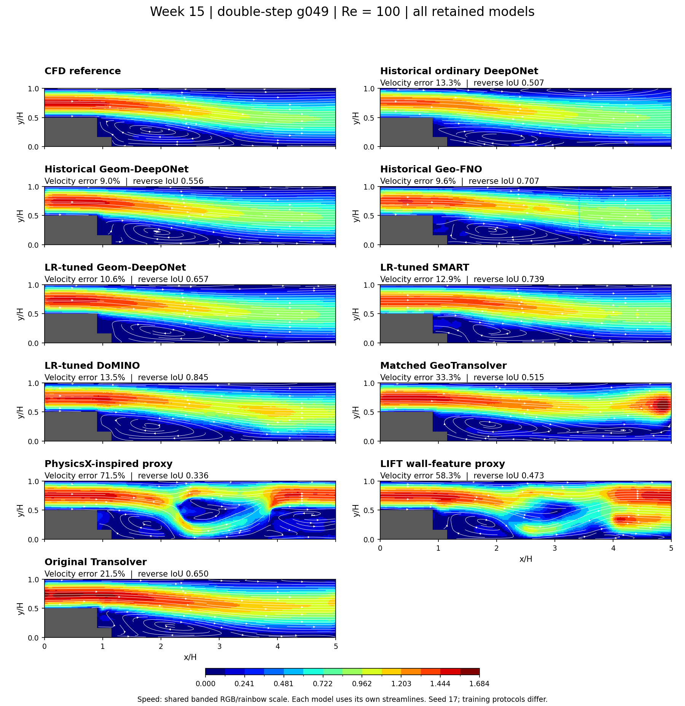

# Original Transolver — Week 15 double-step test

This experiment uses the **same post-audit double-step split** as the Week 15
comparison: **100 train / 8 validation / 19 retrospective test cases**.
The three g005 cases are quarantined, including removal from the older 103-case
recovered training split. No new CFD was generated.

<p align="center"><a href="all_models_g049_Re100.png"></a></p>

The plotted case is the existing homepage case g049/Re=100, with fixed seed 17.
All historical, tuned and matched model fields are copied from the frozen
[post-audit archive](https://doi.org/10.5281/zenodo.22840293); their SHA-256 hashes
were checked against the repository's existing figure provenance. CFD velocities, mean-centered fluid pressure and
fluid masks are checked again when rebuilding this figure. All panels use a
common speed scale, their own streamlines and the physical 5:1 aspect ratio.
The rainbow/jet palette restores the original style. All ten model configurations are visible. Click the image for full resolution.

Unchanged originals: [core](../week15_postaudit/core_g049_Re100.png) · [extended](../week15_postaudit/extended_g049_Re100.png).

## Results

For the displayed g049/Re=100 case:

| Seed | Velocity error | Reverse IoU |
|---|---:|---:|
| 17 | 21.50% | 0.650 |
| 29 | 41.46% | 0.308 |
| 43 | 16.43% | 0.504 |

The seed dependence is substantial. None of these three velocity errors beats the plotted tuned baselines. No best-seed selection was used for the comparison figure.

## Training and interpretation

- Original upstream irregular-mesh Transolver, vendored with its MIT license:
  3 layers, width 64, 4 heads, 16 slices, 100,351 parameters.
- Seeds 17, 29 and 43; 1,200 epochs × 16 updates = 19,200 updates per seed.
- Each update samples one training case and 1,024 fluid points uniformly.
- Inputs: coordinates, geometric SDF and Reynolds number. Train-only scaling.
- AdamW, cosine learning rate 1e-3 to 1e-5; normalized u/v/pressure MSE.
- Checkpoint: minimum validation MSE across **all fluid points of the eight
  validation cases**, checked every 25 epochs plus epoch 1.
- Inference: complete fluid cloud, without query chunking or target-derived
  sampling. All 19 test fields are evaluated only after checkpoint selection.
- Equal update ceilings do **not** equalize FLOPs, training losses, sampled-point
  exposure or tuning effort. This is a retrospective comparison, not proof of
  architecture superiority or a prospectively untouched generalization test.
- IoU uses u < -0.01, four-connected components, minimum eight cells, matching
  the definition used in the Week 15 display. `reverse_iou` in the CSV is the
  additional unfiltered u < 0 metric and must not be confused with it.

## Saved evidence and reproduction

Each `seed_*` directory includes `best.pt`, train-only `scaling.npz`, the complete
training/validation history, manifest, metrics and **all 19 prediction/CFD fields**.
`verification.json` records independent checkpoint reloads of all 57 fields.
The original 130-case input dataset remains at
[`../step_operator_audit/source/dataset.npz`](../step_operator_audit/source/dataset.npz).
The original upstream source is [here](../../flowmllab/vendor/transolver/).

```bash
pip install -e '.[transolver]'
python qa/train_family_transolver.py --seed 17
python qa/train_family_transolver.py --seed 29
python qa/train_family_transolver.py --seed 43
python qa/verify_family_transolver.py
python qa/plot_family_transolver.py
python qa/plot_week15_all_models.py
```

[Executable notebook](../../notebooks/week15/W15_Original_Transolver_Double_Step.ipynb) ·
[Full per-case metrics](comparison.csv) · [Reynolds-stratified seed statistics](summary.json)

[Re=50 comparison](comparison_g049_Re50.png) ·
[Re=25: all three Transolver seeds](g049_Re25.png) ·
[Re=50: all three seeds](g049_Re50.png) ·
[Re=100: all three seeds](g049_Re100.png)
