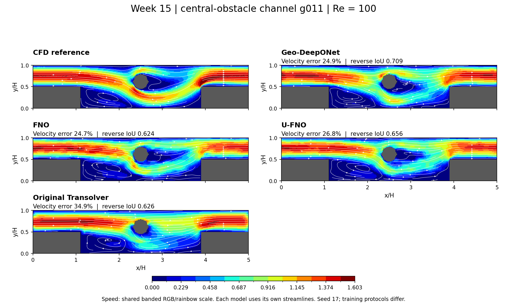
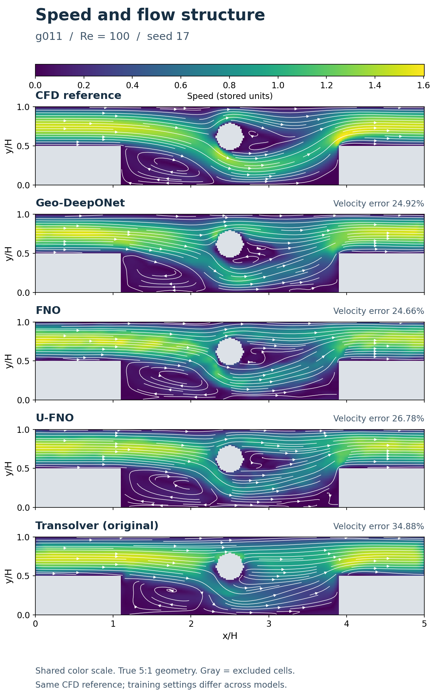
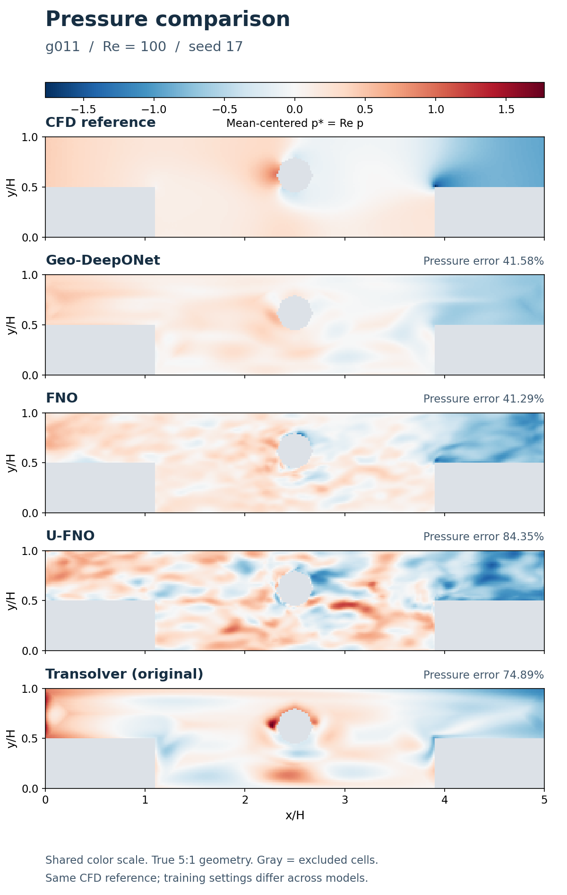
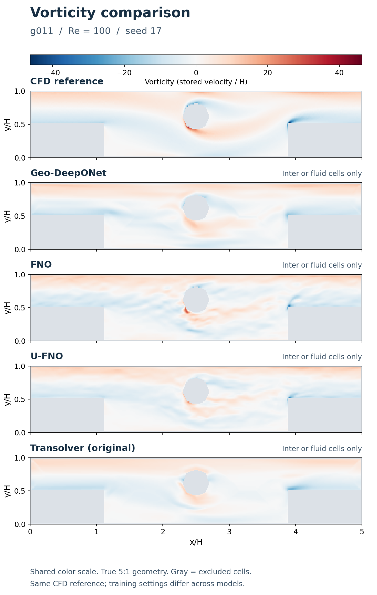
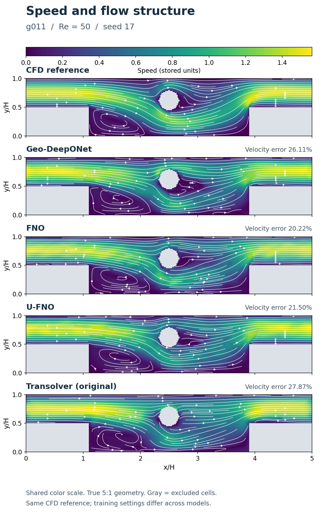
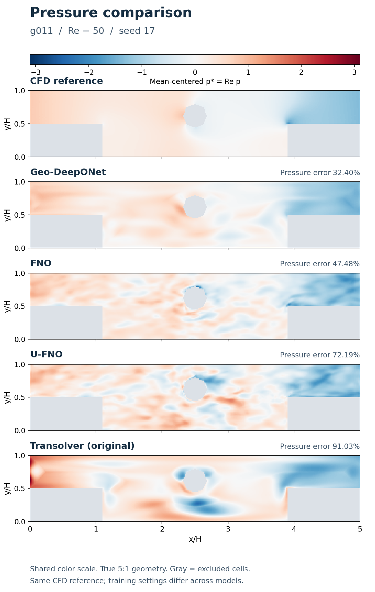
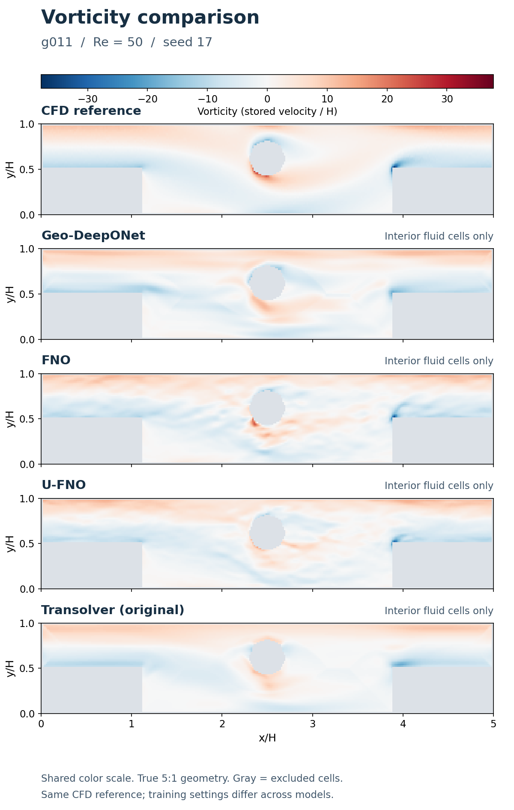
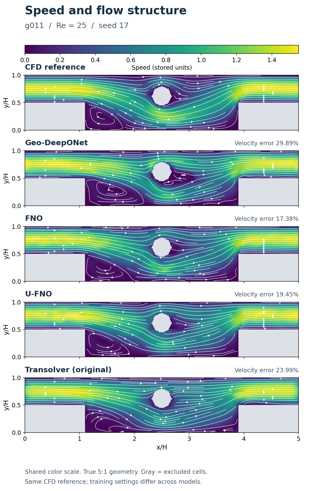
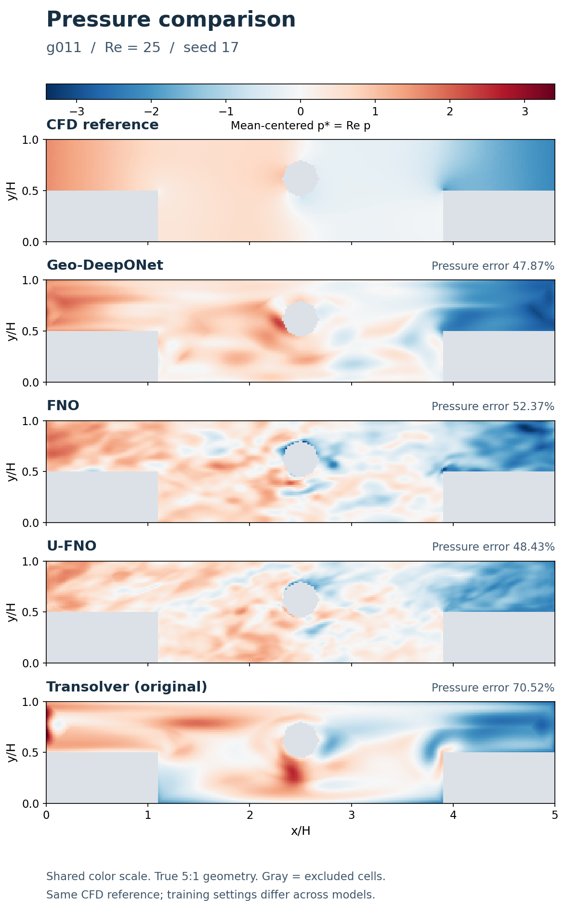
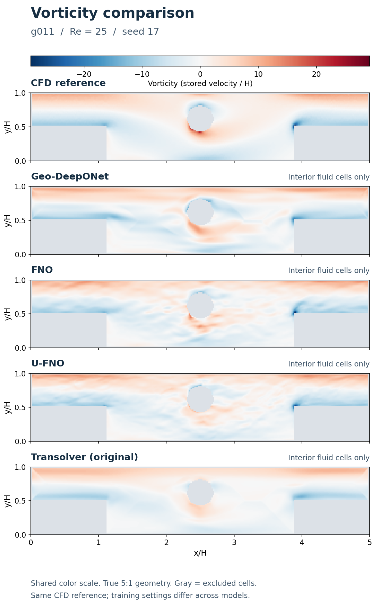

# Original Transolver on the same g011 step-flow cases

This is an actual new CPU training run of the **original Transolver** on the
existing OpenFOAM archive, not a renamed GeoTransolver result, a synthetic field,
or a DSMC micro-step experiment. The historical geometry split is recovered
exactly: **106 training, 21 validation, three g011 test cases (Re 25/50/100)**.

[Model source](../../flowmllab/vendor/transolver/Transolver_Irregular_Mesh.py) ·
[Frozen protocol](../../qa/step_transolver_protocol.md) ·
[Training script](../../qa/train_step_transolver.py) ·
[Recompute figures](../../qa/plot_step_transolver.py) ·
[Notebook](../../notebooks/week15/W15_Original_Transolver_Step.ipynb)

**Data and weights:** [full 130-case CFD dataset](../step_operator_audit/source/dataset.npz) ·
[seed 17 checkpoint and fields](seed_17) · [seed 29](seed_29) · [seed 43](seed_43).
Each seed directory contains `best.pt`, `scaling.npz`, three prediction/reference
NPZ files, scalar metrics, training history and a provenance manifest.

## What happened

The compact model has 100,351 parameters, three blocks, width 64, four attention
heads and 16 learned slices. All three seeds (17/29/43) completed 400 epochs,
6,400 optimizer updates each. Checkpoints were selected on validation only.
Each update samples one training case and 1,024 fluid points. Validation and
test use the whole fluid point cloud; targets never determine inference inputs.

Values below are Transolver's **mean ± sample standard deviation over three
seeds**. Historical Geo-DeepONet values are the one retained seed (17),
recomputed with the same metric definitions; they have no seed error bar.

| Re | Geo velocity error % | Transolver velocity error % | Geo centered-pressure error % | Transolver centered-pressure error % | Transolver reverse-flow IoU |
|---|---:|---:|---:|---:|---:|
| 25 | 29.89 | 25.67 ± 1.83 | 47.87 | 71.38 ± 0.88 | 0.474 ± 0.144 |
| 50 | 26.11 | 28.60 ± 0.89 | 32.40 | 93.37 ± 11.45 | 0.641 ± 0.037 |
| 100 | 24.92 | 36.43 ± 1.57 | 41.58 | 73.08 ± 1.70 | 0.568 ± 0.086 |

**Interpretation:** Transolver's mean velocity error is lower than this historical
Geo run at Re=25, higher at Re=50/100, and its centered-pressure error is higher
at all three Reynolds numbers. There is no general superiority result. All
three selected checkpoints are at the 400-epoch budget boundary: training
saturation has not been established. Test performance did not trigger tuning,
extra epochs, a different seed choice or a replacement of the frozen results.

The existing FNO and U-FNO fields are also included in [comparison.csv](comparison.csv).
Reverse IoU means all fluid cells with u<0; it differs from the filtered
u<-0.01 metric in the separate double-step post-audit experiment. Centered
pressure errors differ from historical raw-pressure errors because each
field's mean pressure is removed independently.

## Updated comparison figures

All figures show **seed 17 fixed in advance**, not the best test seed. Each row
uses its own velocity streamlines, common column color scales and the true 5:1
physical domain aspect. Gray cells are solid or excluded derivative stencils.
Historical figures are preserved; these add the new fifth row to the comparison.

Each quantity now occupies the full GitHub content width. The three-column
scientific overview remains available as a download, rather than a tiny inline image.

### Re = 100





<details>
<summary>Pressure comparison — Re 100</summary>



</details>

<details>
<summary>Vorticity comparison — Re 100</summary>



</details>

[Download the three-column overview](fields_Re100.png)

### Re = 50



<details>
<summary>Pressure comparison — Re 50</summary>



</details>

<details>
<summary>Vorticity comparison — Re 50</summary>



</details>

[Download the three-column overview](fields_Re50.png)

### Re = 25



<details>
<summary>Pressure comparison — Re 25</summary>



</details>

<details>
<summary>Vorticity comparison — Re 25</summary>



</details>

[Download the three-column overview](fields_Re25.png)

## Reproduce

From a complete repository checkout (Python 3.10+):

```bash
python -m pip install -e '.[transolver]'
python qa/test_step_transolver.py
python qa/train_step_transolver.py --seed 17
python qa/train_step_transolver.py --seed 29
python qa/train_step_transolver.py --seed 43
python qa/verify_step_transolver.py
python qa/plot_step_transolver.py
```

Saved checkpoints, scalers and prediction/reference arrays are included with
explicit author authorization. Verification and figure regeneration do not
require training. `seed_*/manifest.json` records exact
software, scaling, source/data/checkpoint hashes, splits, histories and timings.
The completed CPU runs used PyTorch 2.15.0+cpu and one thread per run; training
plus validation took approximately 115–125 seconds each while the three runs
were concurrent. This is not a hardware-normalized speed comparison.

[verification.json](verification.json) records an independent checkpoint reload
that reproduced **all nine saved predictions bit-for-bit** in this environment.
[figure_provenance.json](figure_provenance.json) pins the plotted inputs.

## Limits and attribution

- Same historical split/reference does not imply identical training: original
  Geo/FNO/U-FNO used near-wall/reverse-flow loss weights, whereas this run uses
  unweighted normalized MSE and a different sampling budget. Original complete
  training code is unavailable. No equal-FLOP or fully tuned ranking is claimed.
- This historically examined g011 geometry is a retrospective benchmark,
  not an unopened final test and not the g049 double-step-family benchmark.
- The SDF and geometry mask are allowed geometry inputs; CFD fields are labels.
  No target gradient, velocity patch or reference reverse-flow mask enters input.
- Number-of-query flexibility is not query-set invariance. Predictions depend
  on companion points through slice aggregation. No inference chunking is used.
- The original Transolver code is vendored with its MIT license and pinned
  [upstream provenance](../../flowmllab/vendor/transolver/PROVENANCE.md).
  Only imports, initialization dependency and device portability were adapted.
- Source paper: [Wu et al., ICML 2024](https://proceedings.mlr.press/v235/wu24r.html).
  The separate [GeoTransolver result](../../lectures/source/week15_geometry_generalization.md#9-transolver-and-geotransolver)
  belongs to a different architecture and benchmark; it is not overwritten.
