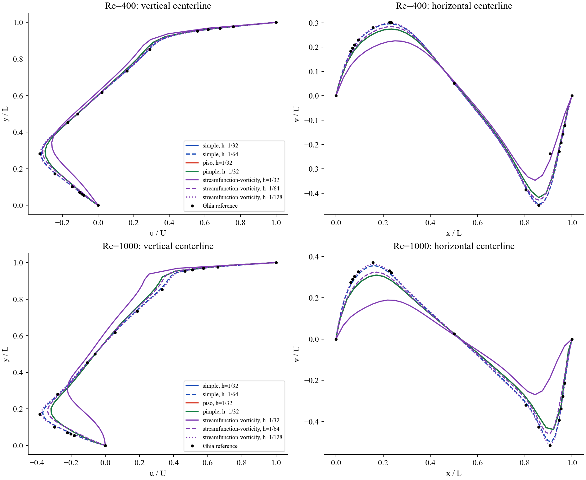
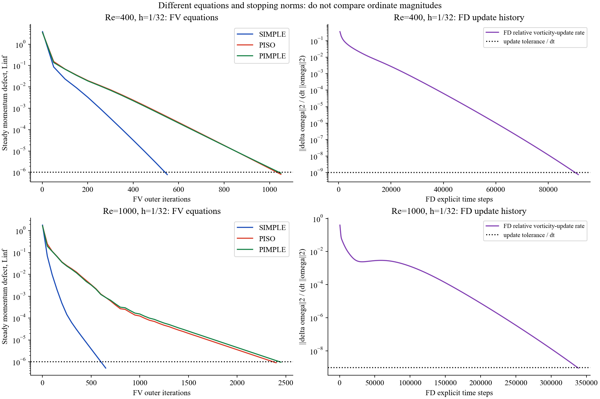
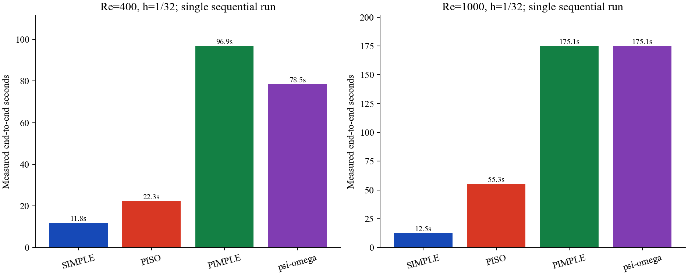
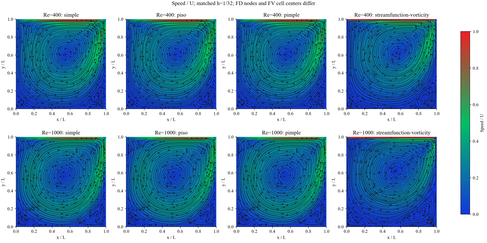
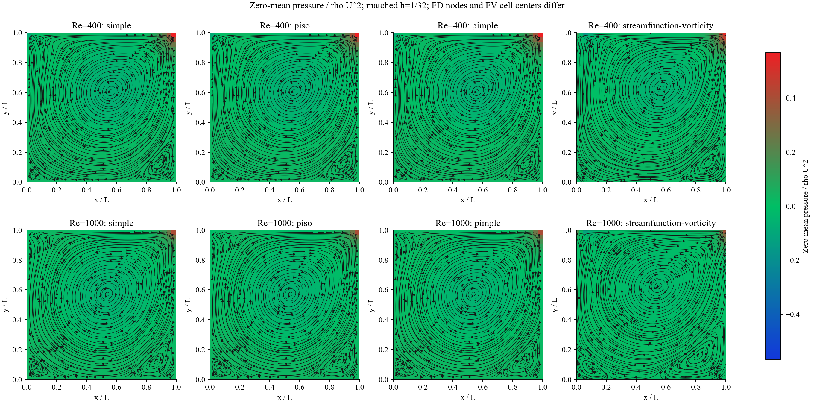
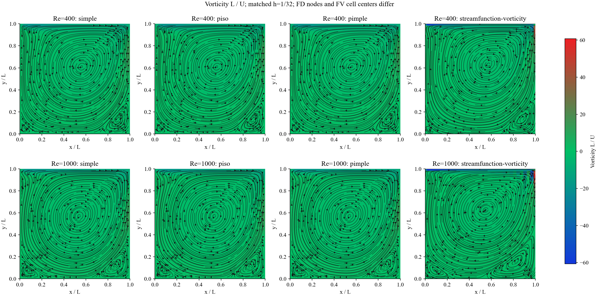
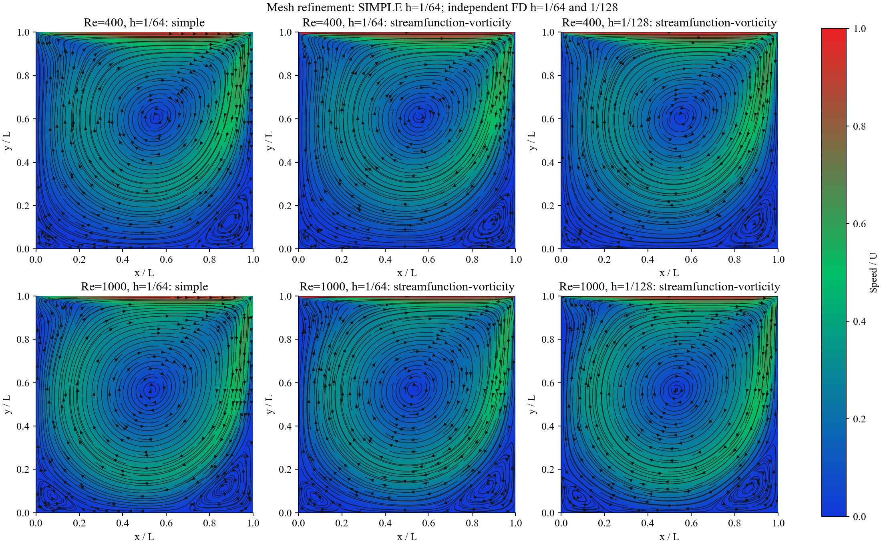

# Week 1.2: streamfunction-vorticity versus pressure-velocity methods

Executed 20 October 2026. Fresh sequential CPU runs from rest, one BLAS/OMP thread. No external CFD solver. The original Week-1 and Re=100 sources are unchanged.

## What is matched, and what differs

Unit square, unit discontinuous lid, stationary no-slip walls, 2D laminar incompressible flow; Re=400 and 1000. All four methods use h=1/32 for the timing comparison. FD uses 33x33 boundary-inclusive nodes; FV uses 32x32 pressure cells and staggered face velocities. Matching spacing does not make their discrete equations identical. Central convection is used in both.

FV settings: velocity relaxation 0.5, pressure relaxation 0.2, steady momentum Linf <1e-6, continuity <1e-9; PISO 2 corrections, PIMPLE 3 outer x 2 inner, dt=0.05. SIMPLE is steady. FD: forward Euler dt=0.001, central differences, DST Poisson solve, wall-vorticity boundary condition; relative vorticity update <1e-12 at three consecutive 500-step checks after 5000 steps, plus independently recomputed steady vorticity RHS Linf <1e-6. Interior centered-divergence is checked separately. FD pressure is reconstructed after the solve by least squares, not solved by pressure correction.

FD update histories divided by dt describe a relative vorticity-change rate; they are not FV momentum residuals. A steady RHS check prevents treating a small time-step update as sufficient convergence. The pressure reconstruction discrepancy is retained, and pressure has no independent Ghia benchmark. No transient-order validation is claimed.

## Accuracy, convergence and timing

| Re | Method | h | Status | Steps/iterations | End-to-end seconds | u relative L2 | v relative L2, all | v sensitivity* | Continuity Linf | Steady native defect |
|---:|---|---|---|---:|---:|---:|---:|---:|---:|---:|
| 400 | simple | 1/32 | converged | 550 | 11.793 | 0.03607 | 0.14773 | 0.08433 | 6.70e-15 | 7.83e-07 |
| 400 | piso | 1/32 | converged | 1050 | 22.278 | 0.03607 | 0.14773 | 0.08433 | 1.19e-13 | 8.06e-07 |
| 400 | pimple | 1/32 | converged | 1050 | 96.949 | 0.03608 | 0.14773 | 0.08434 | 9.39e-14 | 9.14e-07 |
| 400 | streamfunction-vorticity | 1/32 | converged | 91500 | 78.475 | 0.11888 | 0.26728 | 0.27405 | 1.55e-15 | 1.40e-08 |
| 400 | simple | 1/64 | converged | 2100 | 71.061 | 0.00834 | 0.14686 | 0.01853 | 4.80e-14 | 8.17e-07 |
| 400 | streamfunction-vorticity | 1/64 | converged | 78500 | 28.382 | 0.02930 | 0.13623 | 0.05857 | 3.55e-15 | 1.54e-08 |
| 400 | streamfunction-vorticity | 1/128 | converged | 77500 | 70.928 | 0.00602 | 0.14663 | 0.00897 | 7.11e-15 | 1.50e-08 |
| 1000 | simple | 1/32 | converged | 650 | 12.459 | 0.08674 | 0.14150 | n/a | 7.17e-15 | 5.12e-07 |
| 1000 | piso | 1/32 | converged | 2400 | 55.302 | 0.08675 | 0.14151 | n/a | 6.86e-14 | 8.97e-07 |
| 1000 | pimple | 1/32 | converged | 2450 | 175.140 | 0.08675 | 0.14151 | n/a | 6.67e-14 | 9.52e-07 |
| 1000 | streamfunction-vorticity | 1/32 | converged | 338500 | 175.065 | 0.34687 | 0.60144 | n/a | 4.44e-16 | 1.93e-08 |
| 1000 | simple | 1/64 | converged | 1800 | 62.141 | 0.02590 | 0.03464 | n/a | 1.76e-14 | 9.56e-07 |
| 1000 | streamfunction-vorticity | 1/64 | converged | 192500 | 69.579 | 0.09280 | 0.13041 | n/a | 3.55e-15 | 2.59e-08 |
| 1000 | streamfunction-vorticity | 1/128 | converged | 201500 | 171.387 | 0.01988 | 0.01704 | n/a | 7.11e-15 | 2.89e-08 |

*At Re=400 the published Ghia v entry at x=0.9063 is retained in the all-point metric. The separately labeled sensitivity omits that one entry; no value is replaced. Re=1000 uses all points. Ghia, Ghia & Shin (1982), tables I/II, DOI 10.1016/0021-9991(82)90058-4. Relative L2 here is the Euclidean norm at tabulated sample locations, not an area-integrated field norm.

Nonconverged cases are retained and marked NOT STEADY/LIMIT in plots. Their errors describe the last iterate, not an accepted steady solution. Timing bars for a limit case are consumed budget, not time to convergence.

Initial rejected attempts are retained under attempts/: the Re=400 relative-update stop did not pass the independent steady gate, and Re=1000 reached its 200000-step limit. Accepted reruns use update tolerance 1e-12 and a 400000-step budget; the physical equations and steady-RHS gate were not relaxed.

The final column is a vorticity-transport RHS for FD and a momentum defect for FV. These are different quantities and must not be ranked numerically against one another. The discrete divergence checks also live on different grids.

Timing includes each solver call and FD pressure recovery, excluding archive writing, plotting and notebook setup. It is one sequential sample per configuration on this host; other system activity was not controlled. Different dt, stopping norms, unknown counts and implementation costs mean these are measured costs of these implementations/settings, not a universal algorithm ranking. Time-to-equal-accuracy needs resolution studies and repeated timing.

## Measured interpretation

- Re=400, h=1/32: FD errors are 11.89% (u) and 26.73% (all-point v); SIMPLE errors are 3.61% and 14.77%. FD/SIMPLE elapsed-cost ratio is 6.65 for these settings; FD convergence status is converged. This is not a time-to-steady ratio when FD did not converge.
- Re=400, FD refinement to h=1/64: u error 2.93%, all-point v error 13.62%; Re=400 v sensitivity 5.86%. This finer result is not used in the h=1/32 timing bars.
- Re=400, FD h=1/128: u error 0.60%, all-point v error 14.66%; convergence=converged. This is a separate FD resolution study, not a four-method 128-cell timing comparison.
- Re=400, FD pressure-reconstruction gradient discrepancy is 0.732. This full-grid diagnostic includes strong lid/corner effects and is not a validated pressure-error estimate; do not interpret pressure-color agreement as pressure accuracy.
- Re=1000, h=1/32: FD errors are 34.69% (u) and 60.14% (all-point v); SIMPLE errors are 8.67% and 14.15%. FD/SIMPLE elapsed-cost ratio is 14.05 for these settings; FD convergence status is converged. This is not a time-to-steady ratio when FD did not converge.
- Re=1000, FD refinement to h=1/64: u error 9.28%, all-point v error 13.04%. This finer result is not used in the h=1/32 timing bars.
- Re=1000, FD h=1/128: u error 1.99%, all-point v error 1.70%; convergence=converged. This is a separate FD resolution study, not a four-method 128-cell timing comparison.
- Re=1000, FD pressure-reconstruction gradient discrepancy is 0.816. This full-grid diagnostic includes strong lid/corner effects and is not a validated pressure-error estimate; do not interpret pressure-color agreement as pressure accuracy.

### Solver work (different linear systems)

| Re | Method | h | FV pressure corrections | FD streamfunction Poisson solves | FD pressure LSQR iterations |
|---:|---|---|---:|---:|---:|
| 400 | simple | 1/32 | 550 | - | - |
| 400 | piso | 1/32 | 2100 | - | - |
| 400 | pimple | 1/32 | 6300 | - | - |
| 400 | streamfunction-vorticity | 1/32 | - | 91501 | 214 |
| 400 | simple | 1/64 | 2100 | - | - |
| 400 | streamfunction-vorticity | 1/64 | - | 78501 | 427 |
| 400 | streamfunction-vorticity | 1/128 | - | 77501 | 836 |
| 1000 | simple | 1/32 | 650 | - | - |
| 1000 | piso | 1/32 | 4800 | - | - |
| 1000 | pimple | 1/32 | 14700 | - | - |
| 1000 | streamfunction-vorticity | 1/32 | - | 338501 | 214 |
| 1000 | simple | 1/64 | 1800 | - | - |
| 1000 | streamfunction-vorticity | 1/64 | - | 192501 | 418 |
| 1000 | streamfunction-vorticity | 1/128 | - | 201501 | 838 |

FV pressure corrections, FD DST solves and pressure-reconstruction LSQR iterations are distinct work units, not interchangeable operation counts.

### Primary vortex (sampled streamfunction minimum)

| Re | Method | h | x/L | y/L | psi_min |
|---:|---|---|---:|---:|---:|
| 400 | simple | 1/32 | 0.5625 | 0.6250 | -0.106493 |
| 400 | piso | 1/32 | 0.5625 | 0.6250 | -0.106493 |
| 400 | pimple | 1/32 | 0.5625 | 0.6250 | -0.106492 |
| 400 | streamfunction-vorticity | 1/32 | 0.5625 | 0.6250 | -0.094061 |
| 400 | simple | 1/64 | 0.5625 | 0.6094 | -0.111978 |
| 400 | streamfunction-vorticity | 1/64 | 0.5625 | 0.6094 | -0.109041 |
| 400 | streamfunction-vorticity | 1/128 | 0.5547 | 0.6094 | -0.112771 |
| 1000 | simple | 1/32 | 0.5312 | 0.5625 | -0.102431 |
| 1000 | piso | 1/32 | 0.5312 | 0.5625 | -0.102428 |
| 1000 | pimple | 1/32 | 0.5312 | 0.5625 | -0.102428 |
| 1000 | streamfunction-vorticity | 1/32 | 0.5625 | 0.6250 | -0.069855 |
| 1000 | simple | 1/64 | 0.5312 | 0.5625 | -0.113601 |
| 1000 | streamfunction-vorticity | 1/64 | 0.5312 | 0.5781 | -0.105220 |
| 1000 | streamfunction-vorticity | 1/128 | 0.5312 | 0.5703 | -0.115466 |

Vortex positions are sampled grid locations, not sub-grid fitted centers. The FV 32-cell calls used SIMPLE/PISO/PIMPLE order at Re=400, then Re=1000. Accepted FD 32-cell reruns followed the retained failed attempts; the 64-cell SIMPLE/FD calls followed afterward. Calls did not overlap. Factorization caches and unrelated host load can affect timing. The FD-only 128-cell calls were last. No repeated-run uncertainty interval is available; finer grids can sometimes require fewer transient steps and hence do not guarantee monotonically increasing wall time.

## Student investigation

Start at 32 cells; finer grids and higher Re can require longer runs and more memory. Compare benchmark errors before comparing speed. Preserve all failures. At least two resolutions are needed to investigate mesh sensitivity, and two do not establish asymptotic order. A converged iteration is not necessarily an accurate flow. Report the primary vortex position, both velocity errors and the Re=400 reference sensitivity alongside any speed comparison. Small corner vortices may remain under-resolved.

Reproduce with `python qa/run_week01_2_formulations.py` then `python qa/run_week01_2_formulations.py --cells 64 --methods simple streamfunction-vorticity`, `python qa/run_week01_2_formulations.py --cells 128 --methods streamfunction-vorticity`, and `python qa/report_week01_2_formulations.py`. Fresh notebook runs are opt-in. Raw JSON/NPZ archives retain histories, settings, source hashes, software versions, and pressure-recovery diagnostics.
