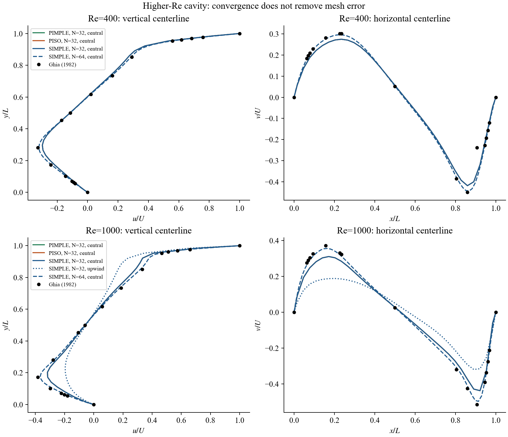
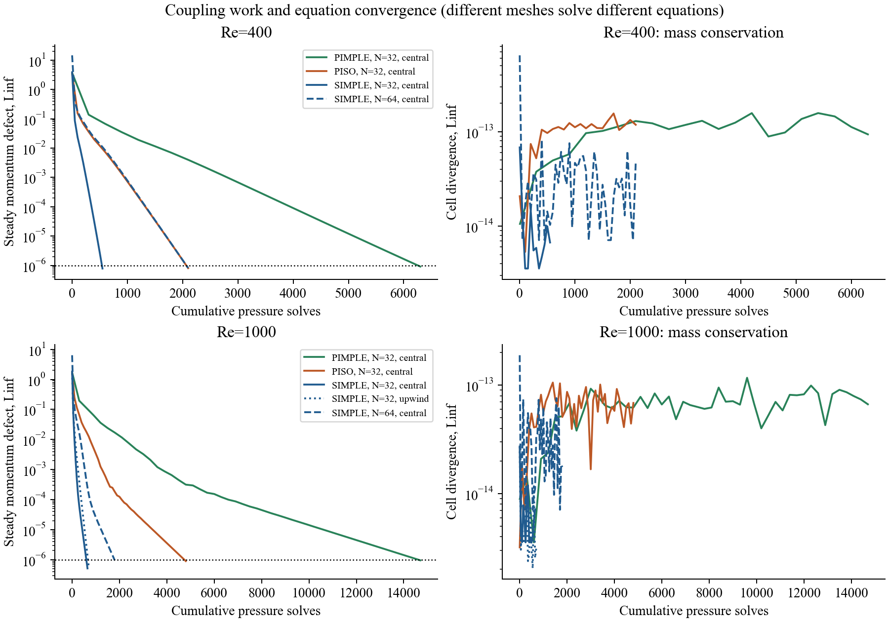
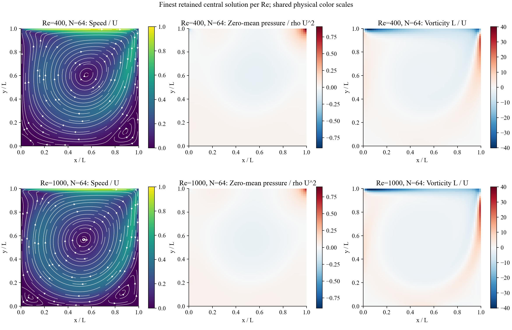

# Week 1.2: experimental higher-Re cavity study

Executed 15 October 2026. Independent Python finite-volume calculations; no external CFD solver. The retained Re=100 source and evidence are unchanged.

## Research context

- [Pascau and Garcia (2010)](https://congress2.cimne.com/eccomas/proceedings/cfd2010/papers/01330.pdf) compare PISO/SIMPLEC-family variants at Re=1000 on a uniform 100x100 grid and Re=5000 on a wall-clustered 100x100 grid. The preferred variant depends on the case and relaxation. These are collocated-grid results, not a ranking of our MAC PIMPLE solver.
- [NASA driven-cavity validation](https://www.grc.nasa.gov/www/wind/valid/cavity/cavity.html) uses fine grids for higher Re (400 and 3200). This is a compressible low-Mach WIND calculation, not SIMPLE/PISO evidence.
- [OpenFOAM cavity tutorial](https://www.openfoam.com/documentation/tutorial-guide/2-incompressible-flow/2.1-lid-driven-cavity-flow) discusses grid/time-step refinement. Its high-Re turbulent example changes the physical model and cannot qualify a 2D laminar Python solver.
- [NIST FiPy](https://pages.nist.gov/fipy/en/latest/generated/examples.flow.stokesCavity.html) illustrates SIMPLE pressure correction and relaxation in Stokes flow; it does not validate finite-Re behavior.
- [PySIMPLE](https://github.com/VishalKandala/PySIMPLE) is an inspectable staggered-grid educational implementation. Its example settings are not evidence of an arbitrary high-Re accuracy range.

There is no universal maximum Reynolds number inherent in the algorithm name. Mesh resolution, convection, relaxation, time discretization, coupling convergence and the physical/model assumptions must be assessed separately.

## Protocol and measured outcomes

Unit square, discontinuous unit moving lid, no-slip stationary walls, density 1, nu=1/Re. Uniform MAC grids. SIMPLE relaxation: velocity 0.5, pressure 0.2. PISO: two corrections; PIMPLE: three outer loops and two corrections. Backward Euler dt=0.05. All runs start from rest. Steady momentum Linf target 1e-6; continuity is also checked independently. Fixed iteration limits are retained in each config.

Jobs overlapped on one local CPU host. Wall times are illustrative and must not be used as a controlled speed ranking; pressure/momentum solve counts are the reproducible work measures.

| Re | Method | Cells | Scheme | Status | Iterations | Momentum Linf | Ghia u rel L2 | Ghia v rel L2 (all) | v sensitivity* | Pressure solves |
|---:|---|---:|---|---|---:|---:|---:|---:|---:|---:|
| 1000 | PIMPLE | 32 | central | converged | 2450 | 9.516e-07 | 0.08675 | 0.1415 | - | 14700 |
| 400 | PIMPLE | 32 | central | converged | 1050 | 9.139e-07 | 0.03608 | 0.1477 | 0.08434 | 6300 |
| 1000 | PISO | 32 | central | converged | 2400 | 8.971e-07 | 0.08675 | 0.1415 | - | 4800 |
| 400 | PISO | 32 | central | converged | 1050 | 8.059e-07 | 0.03607 | 0.1477 | 0.08433 | 2100 |
| 1000 | SIMPLE | 32 | central | converged | 650 | 5.124e-07 | 0.08674 | 0.1415 | - | 650 |
| 1000 | SIMPLE | 32 | upwind | converged | 700 | 6.047e-07 | 0.2346 | 0.3928 | - | 700 |
| 1000 | SIMPLE | 64 | central | converged | 1800 | 9.558e-07 | 0.0259 | 0.03464 | - | 1800 |
| 400 | SIMPLE | 32 | central | converged | 550 | 7.832e-07 | 0.03607 | 0.1477 | 0.08433 | 550 |
| 400 | SIMPLE | 64 | central | converged | 2100 | 8.166e-07 | 0.008341 | 0.1469 | 0.01853 | 2100 |

*Re=400 sensitivity omits only the published v entry at x=0.9063 (-0.23827), an isolated departure from adjacent tabulated values. The all-point metric is always shown. No replacement reference value is invented. Other Reynolds numbers use every point.

Reference: Ghia, Ghia and Shin (1982), tables I/II, DOI [10.1016/0021-9991(82)90058-4](https://doi.org/10.1016/0021-9991(82)90058-4), printed pp.398-399. Numeric entries were checked against the original scanned tables. Benchmark data are numerical reference data, not an exact continuum solution.

## Coupling agreement at fixed discrete equations

Maximum absolute differences from SIMPLE on the same 32-cell central grid (u, v and zero-mean p):

- Re=400, PIMPLE: {'u': 2.5498249862643263e-06, 'v': 1.9944749000133655e-06, 'p': 9.261913690022938e-07}; both converged: True.
- Re=400, PISO: {'u': 1.2171354965562209e-06, 'v': 9.760884870368969e-07, 'p': 4.671123188804138e-07}; both converged: True.
- Re=1000, PIMPLE: {'u': 9.042003154879907e-06, 'v': 9.083306753421283e-06, 'p': 3.6136871696887396e-06}; both converged: True.
- Re=1000, PISO: {'u': 8.189491406906946e-06, 'v': 8.225823817153977e-06, 'p': 3.2770751814820143e-06}; both converged: True.

## Interpretation and student requirements

Convergence of the equation residual does not remove spatial error. Compare 32/64 meshes before accepting either solution; two meshes do not establish asymptotic order. First-order upwind is a numerical-diffusion control, not automatically a better answer. Pressure has no Ghia validation here.

The notebook includes opt-in fresh runs, retained results, reference plots, a mesh study and explicit submission requirements. Target <5% velocity-centerline relative L2 error plus refinement evidence. Keep the all-point Re=400 v diagnostic and explain its reference sensitivity. Compare methods only at the same mesh, scheme and final residual/field-error targets. Retain failures.

Re=400/1000 are experimental exploration settings, not a general high-Re qualification. No Re=5000/10000 runs, turbulence validation, temporal-order validation or higher-Re physical stability limit is claimed. The historical Re=100 lecture remains the qualified baseline; this report and the notebook extension describe the new experiments.
