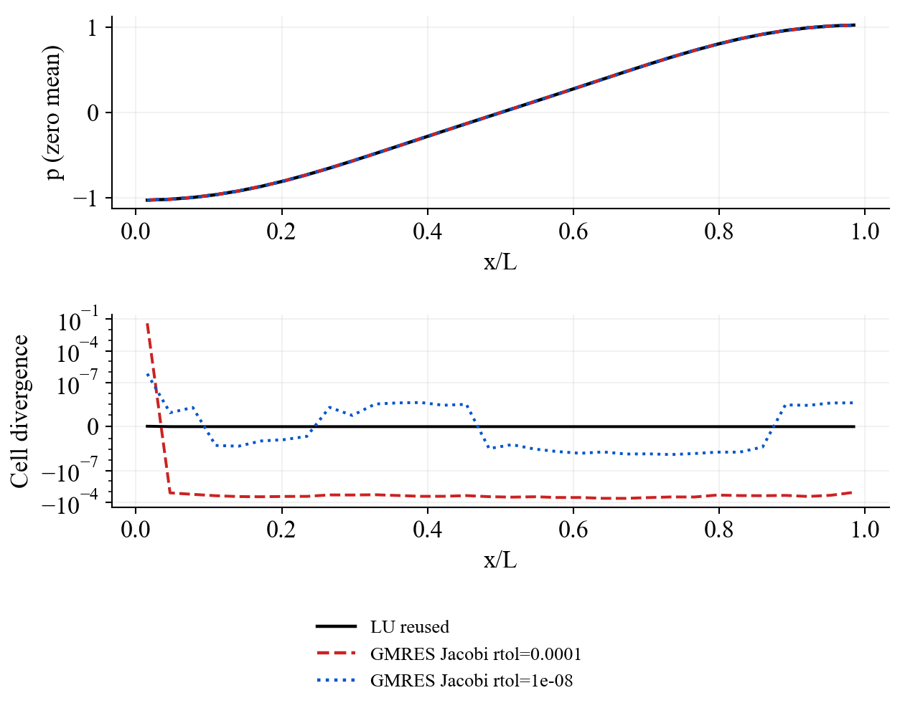
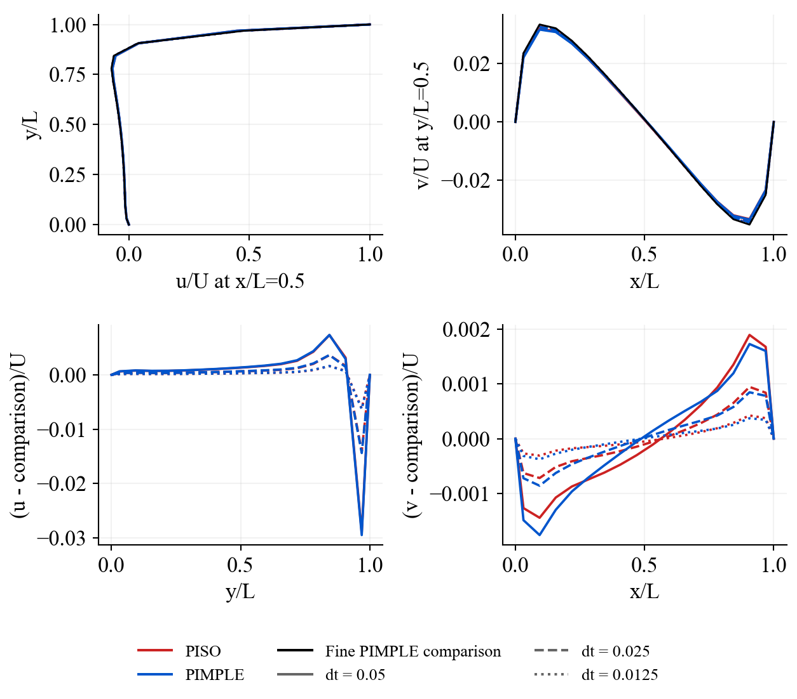

# From CFD readings to controlled CPU experiments

[Notebook](../../notebooks/week01_2/W1_2_Cavity_Pressure_Velocity.ipynb) ·
[Lecture](../../lectures/week01_2_pressure_velocity.pdf) ·
[Teaching sequence](../../notebooks/week01_2/COMPARISON_AND_TEACHING.md)

Predict an outcome, change one control, inspect physical profiles and conservation,
then explain the measured cost. Tables L and T2 and Figures 22–23 extend the
existing Week 1.2 lesson. The original steady solver and earlier results are
preserved. The experiments use NumPy/SciPy on CPU; no GPU is required.

## What the four readings contribute

| Reading | Exercise it informs | What is different in this lesson |
| --- | --- | --- |
| [Barba and Forsyth (2018), *CFD Python: the 12 steps to Navier–Stokes equations*, JOSE 1(9), 21](https://jose.theoj.org/papers/10.21105/jose.00021) | Worked example → one changed control → explanation and challenge | Their finite-difference cavity/channel sequence does not rank our three finite-volume algorithms. |
| [KTH SG2212/SG3114 (2017), Task 1, Q2–Q6](https://www.kth.se/social/files/58ad81f0f276542156c566ab/project.pdf) | Table L: compare pressure-solver setup and solution cost alongside divergence; Q6 motivates reused LU and GMRES | KTH uses a MATLAB projection solver. Our original Python test freezes one pressure operator and projects analytic trial velocities. |
| [Boroujerdi and Hamzeh (2019), *Comparison of varieties of numerical methods applied to lid-driven cavity flow: coupling algorithms, staggered grid vs. collocated grid, and FUDS vs. SUDS*, IJMME 14, 7](https://doi.org/10.1186/s40712-019-0104-7) | Exercise S and Tables 6a–6c: separate algorithm, mesh and convection effects | Their SIMPLE/SIMPLEC/SIMPLER, grid placement and first-/second-order-upwind comparisons differ from our SIMPLE/PISO/PIMPLE and central/upwind controls. |
| [Barton (1998), *Comparison of SIMPLE- and PISO-type algorithms for transient flows*, IJNMF 26, 459–483](https://onlinelibrary.wiley.com/doi/10.1002/%28SICI%291097-0363%2819980228%2926%3A4%3C459%3A%3AAID-FLD645%3E3.0.CO%3B2-U) | Table T2: compare profiles at the same physical time and test time-step and correction-count sensitivity separately | Barton studies square-cylinder and step flows with different time schemes. Here we use cavity startup, common backward Euler, and include PIMPLE. |

These are independently implemented teaching experiments, not reproductions
of the papers. Source-specific performance rankings are not universal rules.

## Table L: linear solve work and mass balance

On a closed unit square, freeze `A = -D d G`, with `d = 0.05`. For each analytic
trial face velocity, solve `A p = b = -D q*`, then correct `q = q* - d G p`.
The complete residual obeys **`D q = -(b - A p)`**, including the omitted gauge
row. A relative iterative-solver tolerance is not an absolute mass-defect limit.
The trial fields are not cavity solutions; no Reynolds number is assigned.

The retained study compares 16 and 32 cells per side and three right-hand
sides for each fixed operator. It times LU rebuilt for every RHS, reused LU,
and Jacobi-preconditioned GMRES at relative tolerances 1e-4 and 1e-8. Each row
has a warm-up and three timed batches. Matrix assembly and diagnostics are
outside the timer; factorization/preconditioner setup and all RHS solves are
inside. GMRES uses restart 50, at most 200 restart cycles and zero initial guesses.

On the 32-cell problem, median batch times were **8.68 ms** for rebuilding LU
and **3.10 ms** for reusing it. Both reached maximum divergence about 3.38e-12.
GMRES reached its own relative stopping criterion, but tightening it from
1e-4 to 1e-8 changed the worst cell divergence from **0.0383 to 4.21e-6**.
Nearly identical pressure profiles therefore need not have equal mass balance.
These small-matrix timings do not establish a universal direct/iterative ranking.
LU reuse is valid only while the operator is unchanged; the full cavity's
momentum diagonals generally change.



Figure 22 uses the first trial field. The pressure profile is interpolated to
y/L=0.5; signed divergence is shown on the bottom cell row, y/L=1/64, with a
symmetric-log scale. Table L reports maxima over all three RHS fields.
[Table L](pressure_table.csv) · [Raw diagnostics and timing samples](study.json)

## Table T2: startup at the same physical time

Every case uses **Re=100, 16 MAC cells per side, a unit-square cavity, unit lid
speed, initially stationary fluid, central convection, backward Euler and
final time tU/L=0.2**. PISO uses two inner corrections; PIMPLE uses three outer
passes and two inner corrections. Their time steps are 0.05, 0.025 and 0.0125.
Each complete trajectory is repeated three times on the same CPU host.

The numerical comparison field uses PIMPLE at dt=0.003125 with six outer and
four inner corrections. Its sensitivity checks use dt=0.00625 and, separately,
twelve outer/eight inner corrections at dt=0.003125. All comparisons use
native face velocities on the same mesh and physical end time.

The earlier Exercise B (Table T) is preserved. It uses cell-centered velocities
and a different comparison time step; align both the norm and comparison field
before comparing its reported percentages with Table T2.

At dt=0.05, PISO's velocity discrepancy from the fine comparison is **6.259%**
and PIMPLE's **6.163%**; their median times are **0.0214 s** and **0.0546 s**.
PIMPLE reduces the final nonlinear step defect from **0.139 to 0.000222**,
but the velocity discrepancy changes far less. Halving dt reduces discrepancy
for both. Thus a much smaller algebraic defect is not necessarily a comparable
gain in temporal accuracy.

Halving the comparator's dt changes its velocity field by **0.4453%**;
doubling its correction counts changes it by about **1.9e-14%**. The observed
time sensitivity is larger than the small same-dt differences between PISO
and PIMPLE. Refine the reference before interpreting those differences as
proven accuracy improvements. These sensitivity measures are not rigorous
error bounds. The coarse mesh and impulsive lid startup also limit the claim.



Figure 23 shows both physical velocity components and their signed differences
from the fine comparison. Red is PISO, blue is PIMPLE and line style denotes dt.
Steady Ghia profiles are not used to score startup fields.
[Table T2](startup_table.csv) · [Native arrays](fields.npz)

## Run, vary and report

The notebook displays retained tables by default. Set `RUN_LINEAR_STUDY=True`
or `RUN_STARTUP_EXTENSION=True` to repeat a study on CPU and generate its own
profiles. Change the RHS count, GMRES tolerance or time steps through the
exposed controls. Use the earlier Exercise B controls to vary inner/outer
corrections at a fixed time step. Report the changed controls, conservation,
solver status, repeated cost and reference sensitivity, not just the fastest row.

To reproduce the complete measurement bundle into a new empty output directory:

```bash
OMP_NUM_THREADS=1 OPENBLAS_NUM_THREADS=1 MKL_NUM_THREADS=1 \
python qa/run_week01_2_literature_studies.py --output /path/to/empty/results
```

The successful Unity CPU job was **1895356**, exit 0, elapsed 47 seconds.
An initial packaging attempt failed before simulation because package imports
were missing; the complete-source retry used the same scientific source.
[Submission provenance](unity_submission.json) ·
[Remote/local SHA256 verification](transfer_verification.json) ·
[Recomputed numerical checks](verification.json) ·
[Release checks](release_validation.json)

Raw repeated timings, configurations, host/thread details and scientific source
hashes are retained in `study.json`. The fields archive is SHA256-verified on
transfer and reload. Timing is host-specific; hosted Colab execution has not
been tested. No original licensed source PDF is redistributed here.
