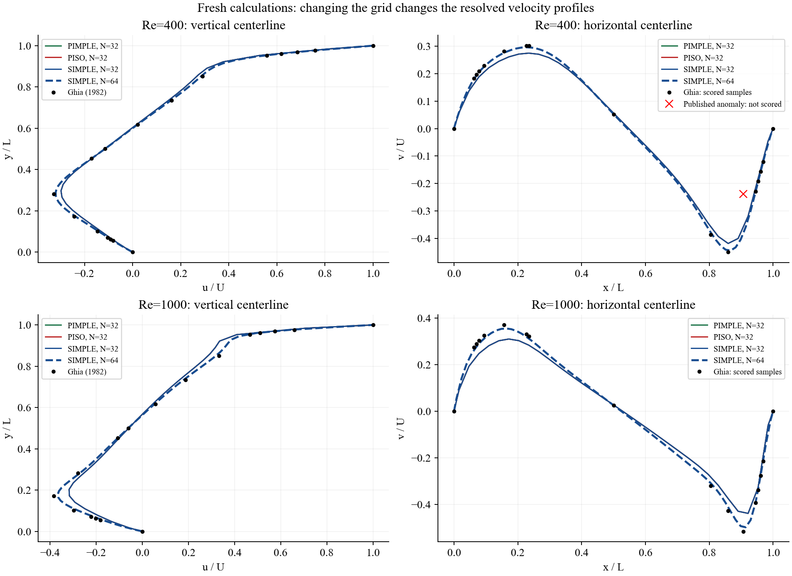
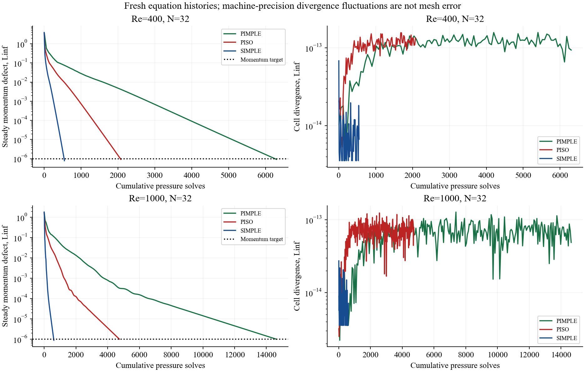
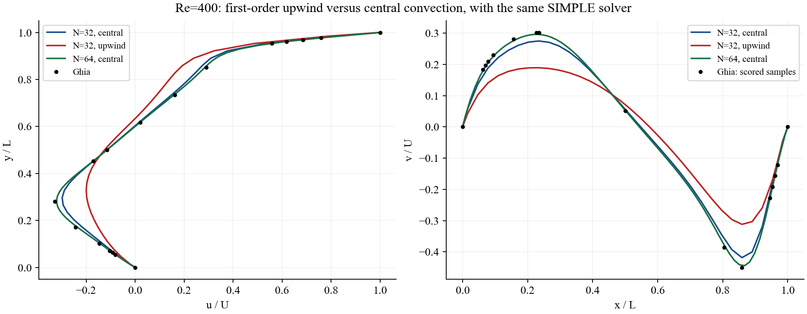

# Student cavity study: selected fresh checks

The student's October 2026 report supplied 12 central-convection cases.
The table below contains **nine separate author-side calculations** with
the current Python solver: eight corresponding central cases and one
matched upwind case. No CFD package is used.

[Review and corrected teaching explanations](../../docs/reviews/student_cavity_20261026.md)
 | [Student-reported measurements](submitted_summary.csv)
 | [Fresh measurements](fresh_summary.csv)
 | [Source report hashes and provenance](provenance.json)
 | [Validation](validation.json)

## Configuration and evidence

Unit-square two-dimensional laminar cavity, unit lid speed, viscosity 1/Re,
impermeable walls and an unsmoothed moving-lid corner. The configurations
retain dt=0.05, velocity relaxation 0.5, pressure relaxation 0.2, two PISO
corrections and three PIMPLE outer passes. The steady momentum target is
1e-6; divergence is separately checked below 1e-9. Every JSON records the
full configuration, solver hashes and numerical-library versions.

The original report did not include the raw source-run arrays, a complete
configuration or machine specifications. Fresh checks therefore establish
agreement of selected reported numerical results under the explicit settings
above; they do not establish identical execution environments. Four submitted
64-cell PISO/PIMPLE cases remain student-reported. The student report does
not include a streamfunction-vorticity run; that independent formulation
remains available in the existing Week 1.2 comparison.

| Method | Re | N | Convection | Iterations | Pressure solves | Local seconds | u error (%) | v error (%) |
| --- | ---: | ---: | --- | ---: | ---: | ---: | ---: | ---: |
| PIMPLE | 400 | 32 | central | 1050 | 6300 | 122.97 | 3.6075 | 8.4338 |
| PISO | 400 | 32 | central | 1040 | 2080 | 49.75 | 3.6074 | 8.4336 |
| SIMPLE | 400 | 32 | central | 550 | 550 | 18.87 | 3.6073 | 8.4333 |
| SIMPLE | 400 | 32 | upwind | 800 | 800 | 13.58 | 13.8720 | 31.1102 |
| SIMPLE | 400 | 64 | central | 2070 | 2070 | 239.13 | 0.8341 | 1.8532 |
| PIMPLE | 1000 | 32 | central | 2440 | 14640 | 109.08 | 8.6748 | 14.1515 |
| PISO | 1000 | 32 | central | 2370 | 4740 | 37.46 | 8.6748 | 14.1515 |
| SIMPLE | 1000 | 32 | central | 610 | 610 | 7.59 | 8.6743 | 14.1507 |
| SIMPLE | 1000 | 64 | central | 1790 | 1790 | 112.32 | 2.5904 | 3.4642 |

Runtime is a single sequential local wall-clock observation per case.
It is not a repeat-averaged performance result or a reproduction of the
student's timings. Pressure solves measure one part of the work; they do
not include momentum assembly/factorization or equate costs across grids.

Errors use relative L2 at Ghia Table I/II reference positions. At Re=400
the anomalous v sample at x/L=0.9063 is preserved but excluded from the
qualified norm; all-point diagnostics remain in each result JSON.

## Velocity profiles: refinement and coupling



Solid lines are the three 32-cell coupling methods. The dashed SIMPLE
line uses 64 cells. All curves are computed profiles, and the reference
is shown only at its actual sample positions. The red cross is the
unscored published anomaly. Close method curves at a fixed grid are
expected when they converge to the same discrete steady equations.

## Equation histories and coupling work



These plots use only the matched 32-cell central cases. Divergence is
already near sparse-solve round-off while momentum continues to change.
Fluctuations around machine precision do not indicate a loss of spatial
accuracy. The final momentum and divergence values are checked directly
from each saved face-velocity and pressure field.

## A matched upwind comparison



The central and upwind 32-cell cases share the same Reynolds number,
coupling method, relaxation and stopping targets. The 64-cell central
profile is a separately labeled refinement comparison. Both coarse
calculations converge, so smaller equation defects do not explain the
difference in profile accuracy. This measured case supports the numerical
diffusion explanation; it does not rank every upwind scheme or establish
a general stability advantage.

## Reproduce

From a complete checkout with the project dependencies installed:

```bash
# Rebuild figures and tables from hash-verified retained fields:
python qa/review_student_cavity.py
# Calculate any missing fresh cases (can take several minutes or longer):
python qa/review_student_cavity.py --run
# Check report arithmetic, fresh fields and executed teaching cells:
python qa/validate_student_cavity_review.py
```

Existing results are reused only when solver hashes and full configurations
match; field hashes are verified before reuse. To measure new timings,
make a separate output directory and document the new run conditions.
Retained fields and figures here are kept separate from the original course
benchmark archives. The two new notebook code cells were executed separately;
pre-existing notebook sources and outputs are preserved. This revision does
not claim a fresh hosted Colab Run All.
