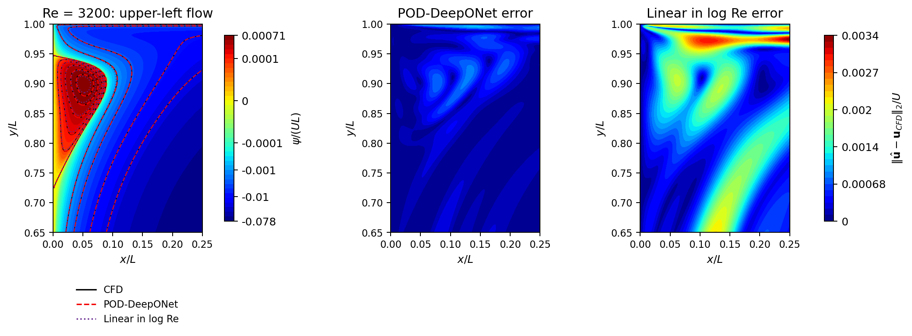
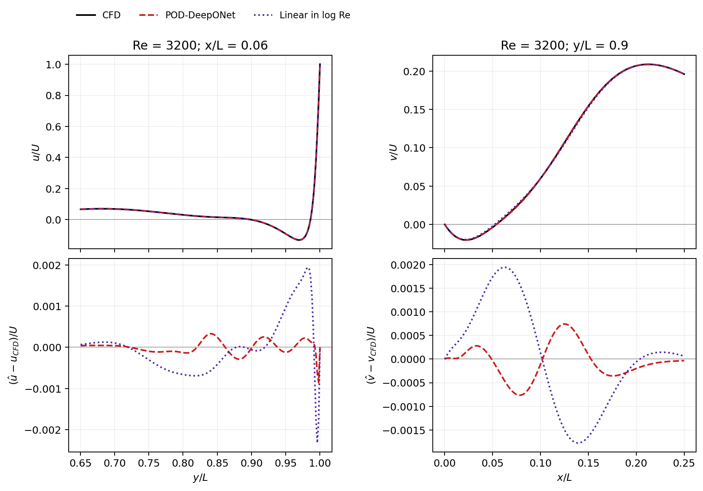
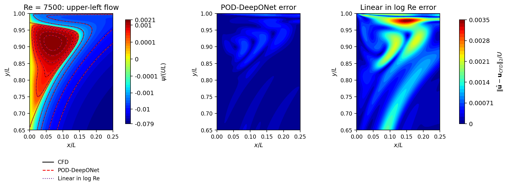
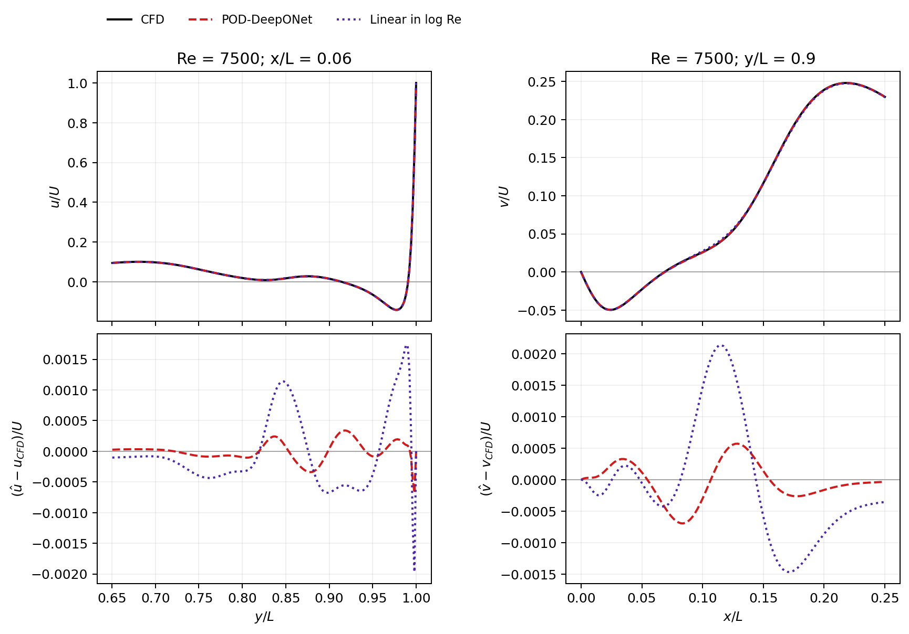

# Upper-left cavity vortex: frozen field audit

[Lab 5](../../notebooks/week04/W4_Lab5_All_Re_Ghia_Validation.ipynb) · [Lab 8 full-field experiment](../cavity_field_deeponet/README.md) · [Lecture 4](../../lectures/week04_cavity_surrogates_deeponet.pdf)

This is a post-hoc physical diagnostic of the already frozen whole-Re tests,
Re=3200 and 7500. It does not train or select a network. The profile MLP in Lab 5
predicts two centreline curves and cannot supply a two-dimensional vortex map.
The fields inspected here come from the separate Lab 8 POD-DeepONet and its
retained 513-by-513 CFD targets. All source hashes are checked before use.

| Re | Model | Whole-field velocity error (%) | Upper-left-window velocity error (%) | Signed peak-strength error (%) | Centre displacement in native cells |
| --- | --- | ---: | ---: | ---: | ---: |
| 3200 | POD-DeepONet | 0.09508 | 0.09570 | -0.7954 | 0 |
| 3200 | Linear in log Re | 0.53940 | 0.39691 | -6.3074 | 1.414 |
| 7500 | POD-DeepONet | 0.08439 | 0.07680 | -0.1661 | 1 |
| 7500 | Linear in log Re | 0.31387 | 0.32694 | -0.1008 | 1.414 |

The neural field resolves the upper-left island in both cases and improves the
local velocity error. Interpolation has the smaller peak-strength error at
Re=7500, so the network does not win every metric. Report that distinction.
At Re=7500 the CFD centre is (0.06640625, 0.9140625), while the neural maximum is
(0.068359375, 0.9140625). These are grid-node locations, not sub-grid estimates.
The field error is relative to the retained numerical solution; its mesh and
steady-branch limitations remain in the [CFD audit](../cavity_highre_ghia/README.md).

The diagnostic window is 0 ≤ x/L ≤ 0.25 and 0.65 ≤ y/L ≤ 1. The CFD
streamfunction is filled on the native grid, with a symmetric-log transform
linear near zero and the full field range retained. All methods use identical
physical contour levels. The vector-error maps use a shared linear scale per
Reynolds number and preserve the largest error of either method. Fixed profile
cuts at x/L=0.06 and y/L=0.90 show signed component discrepancies. These are
not the Ghia centreline locations. No field is smoothed to hide disagreement.

Streamfunction uses u=∂ψ/∂y and v=−∂ψ/∂x. A positive interior island in this
window counter-rotates against the main negative island. Peak ψ is a strength
proxy, not circulation computed by integrating vorticity. The neural ψ uses
the same affine training-field combination as its velocity prediction; it is
not an extra fitted output. A missing positive island is reported as absent,
never replaced by the largest boundary value.

[Exact metrics](corner_metrics.csv) · [Source hashes and execution record](verification.json)

To regenerate on CPU, run `python qa/build_week04_lab5_corner_audit.py` from the
repository root. It recreates the figures, preserves existing Lab 5 exercises,
and executes the complete updated notebook with a fresh Jupyter kernel on CPU.
