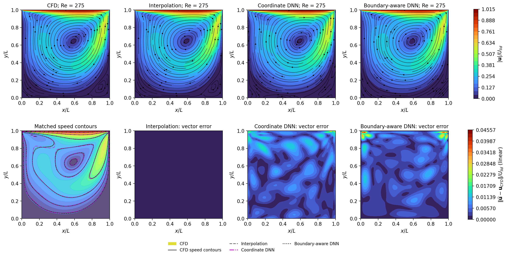

# Week 4 Lab 2: scalar and velocity-field surrogates

The [executed notebook](../../notebooks/week04/W4_Lab2_Scalar_and_Field_Surrogates_Student.ipynb) compares interpolation, quadratic regression, a three-seed scalar neural ensemble, a coordinate DNN and a boundary-aware coordinate DNN. Every method has a physical or scalar prediction plot. Training and validation histories, signed centreline errors, wall errors and interior divergence accompany the field comparisons. The original five questions remain, followed by seven concrete engineering investigations.

## Reference data and assessment

The retained calculation uses `data/cavity_data.npz`: eleven native 65 × 65 incompressible lid-driven-cavity fields at Re = 100–400. Positions and velocities are normalized by cavity width and lid speed. The open lid has unit horizontal velocity; stationary walls and the two lid-corner nodes have zero velocity. These are matched native-grid CFD comparisons, not additional Ghia table entries or a high-Re grid-convergence study.

| Role | Reynolds numbers |
|---|---|
| Fit | 100, 150, 200, 250, 300, 400 |
| Validation | 225, 350 |
| Public test | 175, 275, 375 |

All target scaling, gradients and interpolation brackets use fitting cases only. Whole validation cases select the retained neural checkpoint. There are 7,350 fitting coordinates, including wall-adjacent rows and columns, and 8,450 validation coordinates. Coordinates from one flow are correlated: these counts do not create thousands of independent Reynolds-number cases.

The public test cases were inspected during development of this teaching lab. The boundary construction and longer training budget were subsequently selected using fitting/validation data only. Test fields never enter fitting or checkpoint selection, but these results are **not a new untouched research test**. A new independent CFD case is required to make that claim after adapting the model.

## Methods and controls

Scalar targets are the minimum streamfunction and the native-grid position of the primary vortex. Vortex coordinates are grid-quantized. The scalar DNN uses two 32-unit tanh layers and three linear outputs, with fitting-only target standardization. Seeds 11, 22 and 33 each run 600 full-batch Adam steps followed by at most 250 L-BFGS iterations. The checkpoint with the lowest recorded validation MSE is restored. Seed spread describes initialization sensitivity; it is not a calibrated uncertainty interval.

The two field DNNs each use three 48-unit tanh layers, 4,994 parameters, seed 690, the same training points and an Adam learning rate of 0.002. Both run 400 full-batch Adam steps and at most 2,400 accepted L-BFGS iterations. The raw model predicts the two velocity components directly. The boundary-aware model uses the dimensionless coordinates to construct

- `s = x(1-x)` and `d = s² + (1-y)²`;
- the lid lifting `g = y s²/d` and envelope `e = 4 y s(1-y)/d`;
- `u = g + e Nᵤ` and `v = e Nᵥ`, with zero at the two zero-denominator corner nodes.

This enforces the specified wall values, without imposing incompressibility or momentum balance. The construction avoids the vanishing quadratic corner envelope of the retained product-lifting baseline. Increasing the optimizer budget also matters; the change from that baseline must not be attributed to the lifting alone. The final raw-versus-boundary comparison uses the same architecture and iteration budget.

Actual L-BFGS iteration/objective/gradient counts are retained in [frozen_models.json](frozen_models.json). Both field models reached 2,400 accepted iterations, but the raw model used 2,625 objective evaluations and the boundary-aware model 2,583. Equal iteration budgets are not equal objective-evaluation or wall-time budgets. The last accepted iterate is not automatically used: selection remains based on recorded validation MSE.

## Results and limitations

The relative velocity L2 error below is the norm of the full vector error divided by the norm of the reference velocity field. It does not divide each point by a near-zero velocity.

| Re | Interpolation | Coordinate DNN | Boundary-aware DNN |
|---:|---:|---:|---:|
| 175 | 0.4644% | 1.9032% | 1.8328% |
| 275 | 0.2116% | 1.9858% | 1.9103% |
| 375 | 0.4339% | 2.4268% | 2.5451% |

Interpolation wins on this smooth, densely sampled Reynolds interval. The boundary-aware model has exactly zero wall error and a slightly lower global L2 error than the raw model at Re = 175 and 275. It loses at Re = 375, has larger maximum error at all three tests, and does not improve interior divergence. Its upper-corner regional errors also remain larger. These failures are visible in the saved fields and profiles rather than removed from the comparison.

The largest boundary-aware vector errors are 0.06039, 0.04557 and 0.05778 times lid speed, respectively. Maximum raw-model errors are 0.03060, 0.03450 and 0.03854. [field_metrics.csv](field_metrics.csv) retains global, wall, four interior-corner and divergence diagnostics. The corner regions extend 0.2 cavity widths from both adjoining walls and exclude the wall nodes. Divergence uses the same finite-difference operator for every method on the native grid, excluding a two-cell boundary rim. The nearly zero CFD/interpolation diagnostic reflects the discrete velocity construction and linear interpolation; it does not certify the exact continuous Navier–Stokes equations.

The teaching lesson is that low field error, exact wall values and conservation are separate properties. The small low-Re set does not establish high-Re corner-vortex accuracy. Pressure is not a prediction target in this lab. [Lab 3](../../notebooks/week04/W4_Lab3_DeepONet_Cavity_Student.ipynb) introduces a POD field representation. Its final refit uses all eight development cases after selection, whereas this lab retains six fitting cases and two validation cases, so cross-lab errors are not an equal-information architecture ranking.

## Retained outputs

- [Fitting CFD fields](fitting_cfd_fields.png), [scalar predictions](scalar_trends.png), [scalar loss histories](scalar_losses.png), and [field loss histories](field_losses.png).
- Field comparisons: [Re 175](field_re175.png), [Re 275](field_re275.png), [Re 375](field_re375.png). Within each comparison, speed and linear error scales retain all extrema; contour overlays use identical physical levels.
- Signed centreline profiles: [Re 175](profiles_re175.png), [Re 275](profiles_re275.png), [Re 375](profiles_re375.png).
- Wall and divergence diagnostics: [Re 175](wall_diagnostics_re175.png), [Re 275](wall_diagnostics_re275.png), [Re 375](wall_diagnostics_re375.png).
- Each figure also has a vector PDF with the same stem. `native_test_predictions.npz` and `scalar_predictions.npz` contain the native numeric arrays; `frozen_weights.npz`, `frozen_models.json` and `training_histories.json` retain model and selection evidence. `product_lifting_baseline/` retains the initial benchmark evidence, and `corner_validation*.json/npz` the validation-only amendment evidence.

## Reproduction and verification

Run all cells in the notebook on CPU. Controls for network widths, activation, seeds, sampling stride and optimizer budgets are exposed. The supplied default uses the checked-in data; an accepted class dataset can be supplied with the same documented fields and case roles. The bootstrap installs TensorFlow through the `ml` optional dependency.

A fresh complete Run All was executed on 20 November 2026 on Unity `cpu086`, using two CPU threads, Python 3.12.3 and TensorFlow 2.20.0, with no GPU. It took **56.36 seconds**, produced **13 inline figures** and **zero error outputs**. The complete Slurm job, including tests and export, took 68 seconds. This is a recorded HPC CPU measurement, not a laptop or hosted-Colab timing claim. Four targeted regression tests passed; the boundary transformation had zero boundary error and a three-weight finite-difference gradient discrepancy of 4.55 × 10⁻¹¹.

[Execution receipt](../../qa/week04_lab2_execution.json), [Unity receipt](../../qa/week04_lab2_unity_run.json), [return-copy verification](../../qa/week04_lab2_transfer.json), [gradient check](../../qa/week04_lab2_gradient_check.json) and [pinned dependencies](../../qa/week04_lab2_requirements.txt) record provenance. The executed code and current numeric artifacts are unchanged by a subsequent [presentation-only replot](../../qa/week04_lab2_presentation.json) that reduced crowded tick labels and added Reynolds labels to standalone wall plots. It did not retrain a model. Training-source and presentation-source hashes are recorded separately. The exact [training helper source](training_helper_source.py) is retained for reconstruction; expendable transfer archives and the completed package-download cache were removed after verification, with [local](../../qa/week04_lab2_local_cleanup.json) and [remote](../../qa/week04_lab2_remote_cleanup.json) deletion receipts.

