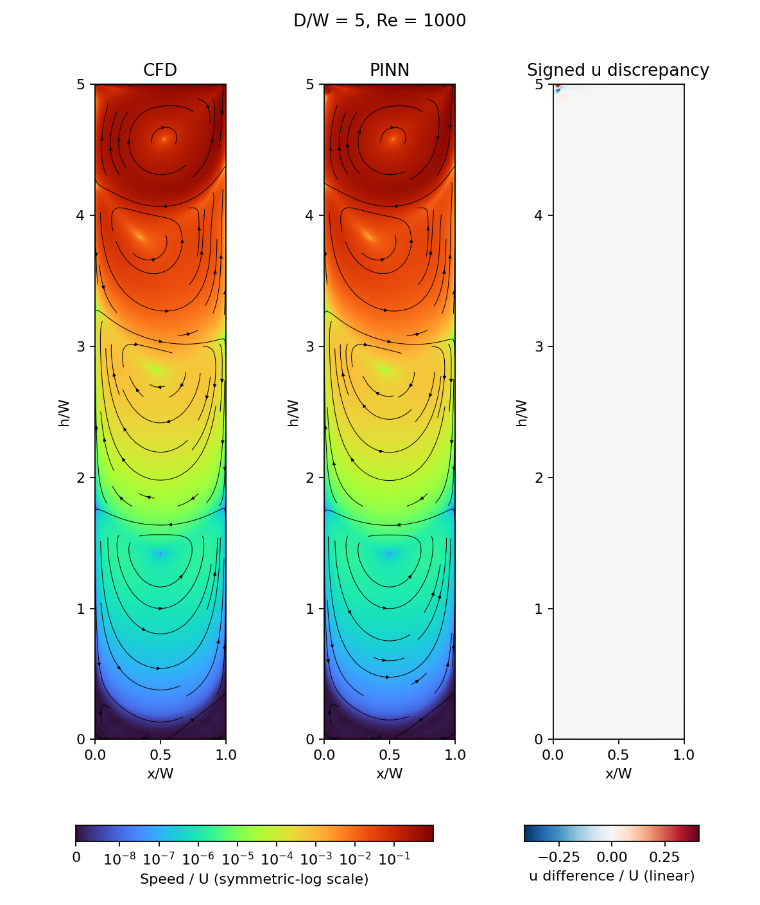
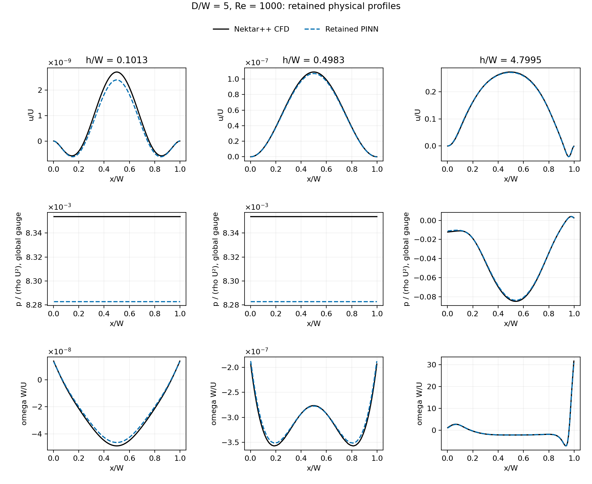

# D/W=5: physical fields and regional accuracy

[CPU research notebook](../../notebooks/week13/W13_Deep_Cavity_D5_Regional_Accuracy.ipynb) ·
[Data identity](../../data/week13_d5/README.md) ·
[Paper and original ancillary code](https://arxiv.org/abs/2610.38814v2).

The notebook uses actual retained author fields at **Re=100,250,500,1000**, on a
common 121x605 grid and with the matched Gaussian-regularized lid. Geometric depth
D/W=5 is distinct from network layer count. Existing D=1/2 and D=2.2 teaching
examples remain available in the original Week 13 notebook.

`regional_metrics.csv` is recomputed from the supplied arrays, for Interior,
Upper-left, Floor_0.4 and Floor_0.65. It reproduces 128 retained assessment
numbers; `verification.json` records the check. For nearly zero whole-interior
pressure means, the absolute tolerance is 8 machine epsilons times regional
pressure RMS, rather than a meaningless relative tolerance on cancellation noise.
All retained arrays are exactly equal to their source arrays.

| Re | Physical fields | u, pressure and vorticity profiles |
| ---: | --- | --- |
| 100 | [CFD/PINN/error](re100_fields.png) | [Three retained heights](re100_profiles.png) |
| 250 | [CFD/PINN/error](re250_fields.png) | [Three retained heights](re250_profiles.png) |
| 500 | [CFD/PINN/error](re500_fields.png) | [Three retained heights](re500_profiles.png) |
| 1000 | [CFD/PINN/error](re1000_fields.png) | [Three retained heights](re1000_profiles.png) |

Speed contours in each matched CFD/PINN pair share their complete extrema and
a symmetric-log transform; signed u error uses a linear diverging scale.
Do not compare color intensity across different transforms. The profile figures
use actual retained rows and preserve signed pressure and velocity.




## What the retained research supports

Interior velocity discrepancies are about 5.13%-7.85% across these four common-grid
cases. The floor has extremely weak flow, so always show both reference RMS and
absolute error beside relative error. Pressure uses one frozen whole-interior
gauge; regional signed offset and shape RMS are separate diagnostics. Sampled
vorticity can have much larger relative error than velocity.

`workflow_metrics.csv` separately retains the authors' **161x801 Re=1000**
assessment for Control, Soft residual, Refined and Half envelope. Its source
hash and scope are recorded in `workflow_provenance.json`. It is not newly
recomputed from the 121x605 common fields. Control-to-refined interior velocity
discrepancy decreases from 5.624% to 2.658%, and pressure RMS from 0.002793 to
0.001167 rho U squared. The Half envelope variant has lower interior pressure
RMS than Refined in this retained table: no single workflow wins every observable.

The paper's SOAP/self-scaled-Broyden refinement, transferred initialization and
regional/envelope choices have unequal accumulated histories. These rows cannot
isolate one optimizer, sampler or network-depth effect. One retained trajectory
per configuration is not an independent-seed study or a mesh-convergence claim.

## Portable postprocessing

```python
from flowmllab.deep_cavity_audit import load_bundle, evaluate
data, manifest = load_bundle('data/week13_d5')
rows = evaluate(data)
```

The publishing build script accepts the original author assessment directory,
hash-verifies it, omits only redundant speed arrays, and regenerates current
teaching plots. Unique research data and optimizer/restart state are not removed.
