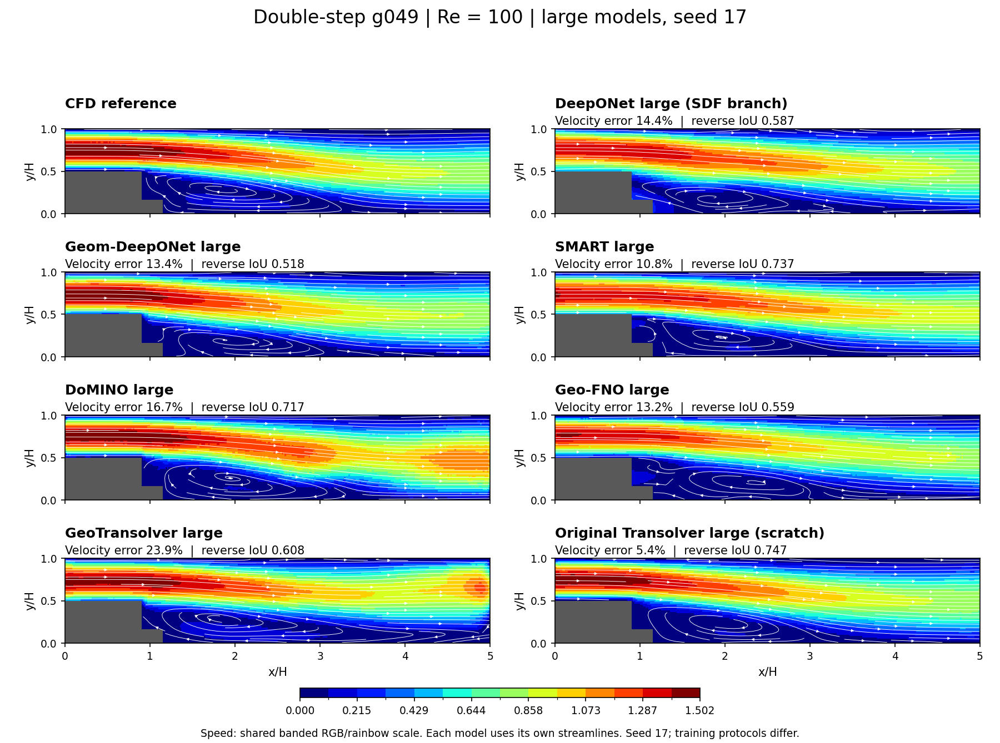

# Week 15 — Enlarged-network capacity study

[Educational lesson and exercises](../../weeks/week15/larger_networks.md) ·
[Executed analysis notebook](../../notebooks/week15/W15_Larger_Networks_Analysis.ipynb) ·
[Week 15 guide](../../weeks/week15/README.md)

**Retained seed-17 findings:** the completed matched controls show velocity-error
reductions of 18.82% for geometry-aware DeepONet and 12.16% for Geom-DeepONet,
and a 7.26% increase for SMART. Six enlarged architectures completed training;
the three other small controls were interrupted and then excluded at the user's
request. No new training is scheduled by this publication.

This is a retrospective teaching record of results verified before a temporary
execution environment reset. The figures and reported summaries survive.
**New trained weights, full prediction arrays, histories and original replay
reports are currently unavailable.** This directory does not claim complete
training/inference reproducibility. Missing values are empty in CSV and `null`
in JSON; they are not inferred or zero-filled.

## Results and configuration files

| File | Meaning |
| --- | --- |
| [native_capacity_results.csv](native_capacity_results.csv) | Six large runs and three completed small controls; 19-case means, one seed |
| [original_transolver_results.csv](original_transolver_results.csv) | Separate compact / large-scratch / large-GeoPT experiment |
| [g049_Re100_results.csv](g049_Re100_results.csv) | Retained metrics for one illustrated case; not test means |
| [reported_results.json](reported_results.json) | The same retained values, provenance and precision notes |
| [paired_comparisons.json](paired_comparisons.json) | Calculated capacity effects and retained case-win counts |
| [architectures.json](architectures.json) | Model specifications, parameter conventions and upstream source pins |
| [protocols.json](protocols.json) | Split, sampling, normalization, losses, selection, replay and runtime records |
| [artifact_availability.json](artifact_availability.json) | Available versus recorded-but-unavailable artifacts |
| [figure_manifest.json](figure_manifest.json) | SHA-256, dimensions, provenance and scope of the retained figures |
| [data_split_verification.json](data_split_verification.json) | Fresh dataset hash check and effective case/geometry membership after quarantine |
| [notebook_execution.json](notebook_execution.json) | Cell-execution record for the summary-analysis notebook |

The six-model suite uses 19,200 updates, 512 sampled rows/update, RMS-scaled
targets, reverse-zone/vorticity loss terms and a physical validation score.
Original Transolver uses 19,200 updates, 1,024 uniform points/update, mean/std
scaling, plain normalized field MSE and MSE validation selection. **Do not use
the two tables as a controlled architecture leaderboard.** No timings or equal-
compute claims are reconstructed from update/parameter counts.

Both sizes of the capacity-study DeepONet receive the full SDF in the branch.
The old Reynolds-only ordinary DeepONet is a different baseline. GeoPT is
transferred only to the compatible original Transolver backbone. There is one
training seed per new configuration; a separate-process checkpoint replay is
not a second training seed.

## Retained two-step figures



[Same geometry at Re=25](figures/DoubleStep_All_Large_Models_Re25.png) ·
[CFD, enlarged scratch Transolver and GeoPT transfer](figures/CFD_vs_Large_Networks_Re100.png)

These files preserve the original numerical raster figures byte-for-byte.
Each model supplies its own streamlines; within each figure the banded speed
scale is shared. The original Transolver panel comes from a separate protocol.
Case labels are not the 19-case mean. The raw field arrays used to create these
new plots have not been recovered, so fresh contour regeneration is unavailable.

## Data and split

The original data and split already exist in the repository; they are not
duplicated here:

- [Dataset](../step_operator_audit/source/dataset.npz): 130 cases, 51 masks,
  grid 60 × 300, SHA-256
  `28d4d4c440cdc4c1ac1d13749ce00b0690d99f29cf20fd56c65fc00b6a8058fd`.
- [Archived family split](../step_geometry_generalization/source/family_frozen_split_recovered.json).
  **Apply the g005 quarantine:** the archived train list includes g005; the
  experiment removes its three cases after identifying geometry masks. The
  effective split is 100 train / 8 validation / 19 test / 3 quarantined.
- Test geometries: `12, 45, 46, 47, 48, 49, 50, 51`. All are historically
  inspected; this is not a new blind test. No new CFD was generated.

Pressure comparisons are case-wise mean-centered. The historical stored
pressure label is not a verified dimensional convention. Reverse IoU uses
`u < -0.01`, four-connectivity and a minimum component size of eight cells.
The lesson explains metric tradeoffs and the limitations of recovered extent
and relative reverse-speed errors.

## Weights: what can actually be downloaded?

| Weight artifact | Availability and role |
| --- | --- |
| [Old compact original Transolver, seed 17](../family_transolver/seed_17/best.pt) | Available existing baseline; **not** a large checkpoint |
| [Official GeoPT 8-layer pretrained model](https://huggingface.co/GeoPT/GeoPT_Pretrained_Models/tree/45df8bd3d02f9ab36a25d86d0a048e9d72572fd3) | Upstream pretrained initialization; **not** the fine-tuned two-step model |
| Large original Transolver scratch | Previously replayed, currently unavailable |
| Large original Transolver with GeoPT transfer | Previously replayed, currently unavailable |
| Nine completed native-suite small/large checkpoints | Previously replayed, currently unavailable |
| Three unfinished small controls | No completed result published |

Recorded large scratch checkpoint SHA-256:
`cce7120dd732a1c0d1efe5262830ba4a68e898d3a17bcba92b47f9c5b53a845c`.
Recorded fine-tuned GeoPT checkpoint SHA-256:
`63e1dbd31e85b8f501151eb8f2cd956592b87a4d0211d766b882b0d9e2665635`.
These identify missing files; they are not download links or present-file checks.
The official pretrained SHA-256 is
`c0b1b9c4e5d533dbc249190d3d1fbe8e6b066b36d325cf4377cc0d613c02d1c2`.

## Run the available analysis

From the repository root, using Python 3.11+:

```sh
python results/week15_capacity_study/analyze_results.py
```

The script validates CSV/JSON consistency and computes matched-pair arithmetic.
It does not claim to remeasure test metrics from missing field arrays. The
notebook also displays retained figures and compares case-level and mean GeoPT
outcomes. No ML dependencies are needed for this summary analysis.

All eight analysis cells passed in a fresh Python process using in-process
IPython, including three image displays. This host denied the sockets needed
for an external Jupyter kernel, so a hosted Jupyter/Colab Run All is not claimed.
The [execution helper](../../qa/execute_week15_capacity_notebook.py) and record
state that distinction. It requires `nbformat` and `IPython` for output capture.

`build_results.py` reconstructs tables from explicitly curated retained values;
it is a data-curation script, not a model trainer or independent measurement.

## Recovered source for future regeneration

The [large original Transolver trainer](../../qa/train_family_transolver_large.py)
and [pinned GeoPT downloader](../../qa/download_geopt_checkpoint.py) were
recovered from experiment commit
[`692202f`](https://github.com/Ehsan-Roohi/FlowMLLab/commit/692202f9b0c16ca3a81f1386b48358d3315e6071).
Its old in-progress narrative is superseded by the retained results here. The
recovered trainer's invocation and output model label were corrected for this
publication, so future GeoPT runs identify the transferred initialization;
the training and selection logic was retained. The trainer depends on the
existing vendored Transolver, NumPy, PyTorch and the
dataset/split paths above. Training was **not rerun for this publication**.

```sh
# Optional regeneration; long training, not part of the lightweight notebook.
python qa/download_geopt_checkpoint.py --output /path/to/durable/geopt
python qa/train_family_transolver_large.py --seed 17 --threads 2 \
  --output /path/to/durable/transolver_large_scratch
python qa/train_family_transolver_large.py --seed 17 --threads 2 \
  --pretrained /path/to/durable/geopt/GeoPT_8layers.pt \
  --output /path/to/durable/transolver_large_geopt
# Resume with the identical settings/output directory plus --resume.
```

Those commands regenerate model training and saved fields. Their built-in
`case_metrics.csv` uses the older **unfiltered** `u < 0` overlap; it must not be
substituted for the filtered IoU in this study. The six-model runtime adapters
and full metric source are currently missing. Source pins and descriptive
configs are supplied to support recovery, not advertised as an executable full
suite reproduction. Observed runtime versions are descriptive, not a lockfile.

For the next experiment, archive source, environment, train-only scalings,
best and resumable weights, every per-case field and metric, histories and
fresh-process replay evidence outside the execution host before reporting a
completed reproducible model release. Use multiple common training seeds for
uncertainty and geometry-level reporting for generalization.
