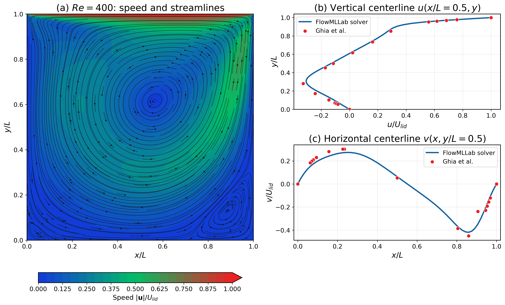

# Week 1 — Numerical foundations

[Course home](../../README.md) · [All weeks](../README.md) · [Week 1.1 →](../week01_1/README.md)

Python, numerical methods and CFD validation.

## Lecture and notebooks

**Lecture:** [Lecture 1](../../lectures/week01_numerical_foundations.pdf)

| Notebook | Read | Run / setup |
| --- | --- | --- |
| Python for CFD and AI | [Open notebook](../../notebooks/week01/01_python_for_cfd_ai_fluids.ipynb) | [Open in Colab](https://colab.research.google.com/github/Ehsan-Roohi/FlowMLLab/blob/main/notebooks/week01/01_python_for_cfd_ai_fluids.ipynb) |
| TensorFlow for AI in fluids | [Open notebook](../../notebooks/week01/02_tensorflow_for_ai_fluids.ipynb) | [Open in Colab](https://colab.research.google.com/github/Ehsan-Roohi/FlowMLLab/blob/main/notebooks/week01/02_tensorflow_for_ai_fluids.ipynb) |
| Cavity CFD and Ghia validation | [Open notebook](../../notebooks/week01/03_cavity_ghia.ipynb) | [Open in Colab](https://colab.research.google.com/github/Ehsan-Roohi/FlowMLLab/blob/main/notebooks/week01/03_cavity_ghia.ipynb) |

### Notebook 02: TensorFlow self-study route

**Revised 2 November 2026.** The expanded lab explains tensor axes and precision, catches silent broadcasting errors, derives and verifies loss gradients, and separates training, validation and test data in a small Keras experiment. Analytic velocity/vorticity fields and a parallel-plate momentum balance connect the programming steps to fluid mechanics. Guided checkpoints, self-check hints and troubleshooting accompany the runnable examples.

The notebook generates its own demonstration data and runs on a CPU. Open it through the Colab link above and check its **2026-11-02** revision label; an older Google Drive copy will not update automatically. Keep your existing work separately.

**Moving to Week 2:** finish Sections 1–9 and the readiness checklist at the end of notebook 02. If you can identify input/target shapes, perform a gradient update and explain the three data roles, continue to [AI in Fluids — Week 2](https://colab.research.google.com/github/Ehsan-Roohi/FlowMLLab/blob/main/notebooks/week02/AI_in_Fluids_Week2_Colab_Expanded.ipynb). Its first sections revisit a neuron and one update. The channel-residual and convolution examples can be revisited alongside later topics.

**Module guides:** [Week 1 labs](../../notebooks/week01/)

## What you will work on

- Eulerian fields, nondimensionalization, boundary conditions
- Python/NumPy/TensorFlow for scientific work
- Numerical convergence versus validation

## Suggested route

Read the lecture, then work through the notebooks in the listed order. Read each notebook’s setup instructions before running its cells; use the figures and evidence below to interpret the results.

## Experiment and results

**Problem:** Lid-driven cavity benchmark. 
**CFD / data:** FlowMLLab finite-difference streamfunction–vorticity Navier–Stokes solver. 
**Learning method:** Notebook 02 trains introductory TensorFlow/Keras examples on analytic teaching data. The cavity benchmark in notebook 03 uses no neural network; CFD is checked against Ghia centreline data.

Start with a numerical solution and an independent benchmark: cavity fields,
centerlines and Ghia comparisons establish what a useful training label means.
[Figure contract](../../ARTICLE_FIGURE_MAP.md)

---

[Course home](../../README.md) · [All weeks](../README.md) · [Week 1.1 →](../week01_1/README.md)
