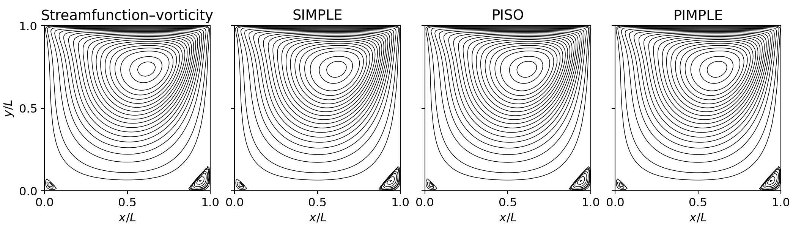

# Week 1.2 - Pressure-velocity coupling

[Course home](../../README.md) · [All weeks](../README.md) · [← Week 1.1](../week01_1/README.md) · [Week 1.3 →](../week01_3/README.md)

**Optional numerical branch:** complete the Week 1 cavity lab first. You can start Week 2 supervised learning without finishing this algorithm comparison.

<!-- cavity-seven-re -->
Separate follow-on notebooks cover [all seven Ghia Reynolds numbers](../../notebooks/week04/W4_Lab5_All_Re_Ghia_Validation.ipynb) and [CPU profile-surrogate optimization and depth](../../notebooks/week04/W4_Lab6_Ghia_Profile_Optimizer_Depth.ipynb). Earlier notebook cells and outputs are preserved. [Benchmark data](../../references/ghia/README.md) · [Measured results](../../results/cavity_ghia_allre/README.md) · [Research ideas and sources](../../docs/CAVITY_RESEARCH_ROADMAP.md).
<!-- /cavity-seven-re -->

A pressure-coupling extension after the original Week 1: start at Re=100,
then compare Re=400 and 1000 on 32 and 64 cells per side. The original
streamfunction-vorticity notebook remains unchanged.

The four panels use the same streamline levels on the retained Re = 100 solutions.

[Open in Colab](https://colab.research.google.com/github/Ehsan-Roohi/FlowMLLab/blob/main/notebooks/week01_2/W1_2_Cavity_Pressure_Velocity.ipynb) | [Lecture](../../lectures/week01_2_pressure_velocity.pdf) | [Measured report](../../results/week01_2_pressure_velocity/README.md) | [Detailed guide](../../notebooks/week01_2/README.md)

## Class sequence

1. Inspect the four-formulation centerline and field comparisons.
2. Derive the pressure operator from MAC face continuity.
3. Trace SIMPLE, PISO and PIMPLE on the same momentum equations.
4. Check conservation, pressure gauge and algorithm limits.
5. Recompute one method and explain its measured cost and benchmark error.
6. Use the three flowcharts to distinguish frozen inner corrections from
   outer coefficient updates. Inspect the measured one-step coupling study.
7. Discuss the comparative papers and design a matched-error transient test
   before expanding the Reynolds-number qualification.
8. Use the notebook's separate experimental Re=400/1000 section: reproduce the
   retained runs, refine 32 to 64 cells, and compare central/upwind errors.
   [Measured higher-Re study](../../results/week01_2_higher_re/README.md).

[Expanded comparison, flowcharts and teaching plan](../../notebooks/week01_2/COMPARISON_AND_TEACHING.md)

## Student output

Velocity and pressure fields, Ghia centerlines, momentum and continuity
residuals, grid/refinement evidence and one scientifically bounded method choice.
Distinguish steady iteration from physical time. Re=100 is the introductory
qualification; Re=400 and 1000 extend the retained steady comparison with
explicit equation-defect and Ghia profile checks. These cases do not establish
transient accuracy, grid independence or turbulence qualification. The next
experiment is temporal refinement for a changing lid.

[Source](../../flowmllab/pressure_velocity.py) | [Tests](../../tests/test_pressure_velocity.py) | [Retained configurations and field hashes](../../results/week01_2_pressure_velocity/manifest.json)

[Return to course map](../../COURSE_MAP.md)

## Before running higher Reynolds numbers

**Runtime and hardware warning.** Higher Reynolds numbers generally need finer meshes
and more iterations to resolve the flow. These runs can take substantially longer
and use more memory; a stronger CPU and more RAM may be needed. Doubling cells per
side quadruples the number of 2-D cells, and total work can grow by more than four
times because convergence and linear solves also change. Start at 32 cells, run
one method, measure its time, then decide whether to refine. Do not launch every
128-cell case at once. Cached figures below require no new CFD solve. Fresh runs
are opt-in; there is no guaranteed completion time on a student's computer.

