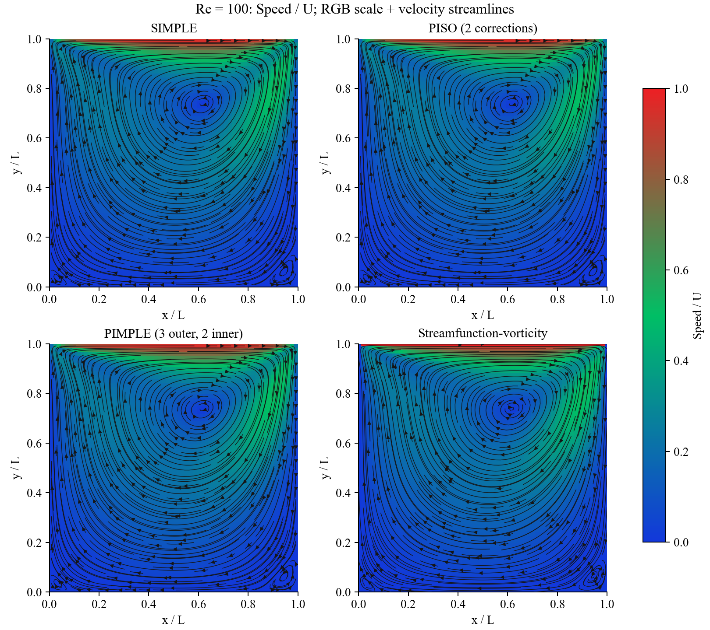

# Week 1.2 - Pressure-velocity coupling

An independent Re=100 extension after the original Week 1. The original
streamfunction-vorticity notebook remains unchanged.

[Open in Colab](https://colab.research.google.com/github/Ehsan-Roohi/FlowMLLab/blob/main/notebooks/week01_2/W1_2_Cavity_Pressure_Velocity.ipynb) | [Lecture](../../lectures/week01_2_pressure_velocity.pdf) | [Measured report](../../results/week01_2_pressure_velocity/README.md) | [Detailed guide](../../notebooks/week01_2/README.md)

## Class sequence

1. Inspect the four-formulation centerline and field comparisons.
2. Derive the pressure operator from MAC face continuity.
3. Trace SIMPLE, PISO and PIMPLE on the same momentum equations.
4. Check conservation, pressure gauge and algorithm limits.
5. Recompute one method and explain its measured cost and benchmark error.
6. Use the three flowcharts to distinguish frozen inner corrections from
   outer coefficient updates. Inspect the measured one-step coupling study.
7. Discuss the comparative papers and design a matched-error transient test
   before expanding the Reynolds-number qualification.
8. Use the notebook's separate experimental Re=400/1000 section: reproduce the
   retained runs, refine 32 to 64 cells, and compare central/upwind errors.
   [Measured higher-Re study](../../results/week01_2_higher_re/README.md).

[Expanded comparison, flowcharts and teaching plan](../../notebooks/week01_2/COMPARISON_AND_TEACHING.md)

## Student output

Velocity and pressure fields, Ghia centerlines, momentum and continuity
residuals, grid/refinement evidence and one scientifically bounded method choice.
Distinguish steady iteration from physical time. Only Re=100 steady behavior
is qualified; the next experiment is temporal refinement for a changing lid.
The new higher-Re section is an experimental 2D steady study with explicit
accuracy gates and student deliverables, rather than a turbulence qualification.

[Source](../../flowmllab/pressure_velocity.py) | [Tests](../../tests/test_pressure_velocity.py) | [Retained configurations and field hashes](../../results/week01_2_pressure_velocity/manifest.json)

[Return to course map](../../COURSE_MAP.md)

## Before running higher Reynolds numbers

**Runtime and hardware warning.** Higher Reynolds numbers generally need finer meshes
and more iterations to resolve the flow. These runs can take substantially longer
and use more memory; a stronger CPU and more RAM may be needed. Doubling cells per
side quadruples the number of 2-D cells, and total work can grow by more than four
times because convergence and linear solves also change. Start at 32 cells, run
one method, measure its time, then decide whether to refine. Do not launch every
128-cell case at once. Cached figures below require no new CFD solve. Fresh runs
are opt-in; there is no guaranteed completion time on a student's computer.

