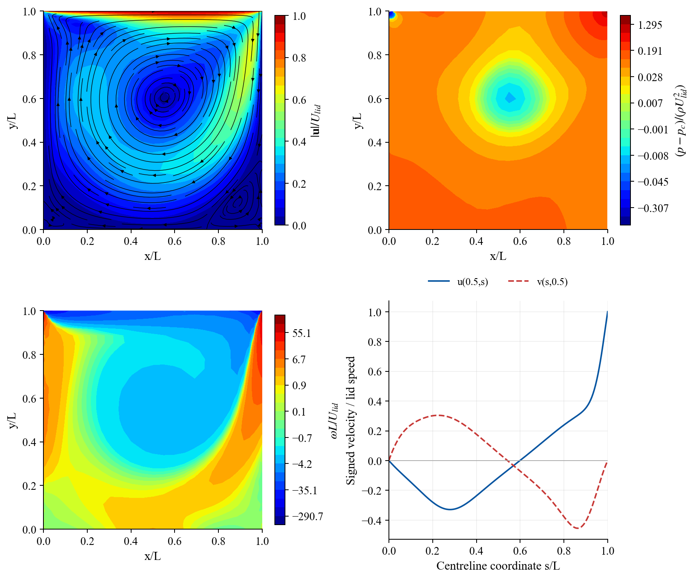
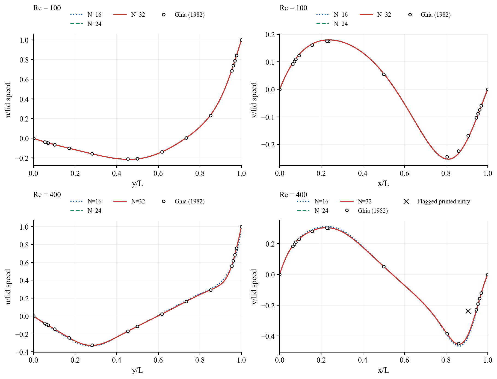

# Week 1.4 - Spectral and discontinuous Galerkin methods

[Course home](../../README.md) · [All weeks](../README.md) · [Pressure-velocity prerequisite](../week01_2/README.md) · [Week 2 supervised learning](../week02/README.md)

An optional numerical-methods extension after SIMPLE, PISO and PIMPLE. Build spectral and DG algorithms on an ordinary CPU, verify their operators, then solve the actual steady lid-driven cavity with Chebyshev collocation at Re=100 and 400. The optimizer branch in Week 1.3 is not a prerequisite.

[Student notebook](../../notebooks/week01_4/W1_4_Spectral_DG_CPU.ipynb) · [Lecture PDF](../../lectures/week01_4_spectral_dg.pdf) · [Setup](../../notebooks/week01_4/README.md) · [Executed evidence](../../results/week01_4_spectral_dg/README.md)

Actual cavity at Re=400 on the unit square: open top edge moves at unit speed, the other walls are stationary, and viscosity is 1/400. The mixed Chebyshev solve uses N=32, or 33×33 velocity nodes, and a centre pressure gauge. Speed is linear-scaled; pressure and signed vorticity use symmetric-log scales with linear intervals 0.01 and 1 respectively. Full native-node extrema are retained. These are freshly solved CFD fields, not reference-only illustrations.

The original Ghia velocity samples are markers; lines are our fresh CFD results at N=16,24,32. The flagged Re=400 printed v entry remains visible. Both unfiltered and screened scores, algebraic residuals and off-grid continuity defects are retained in the [numerical evidence](../../results/week01_4_spectral_dg/README.md).

## Class sequence

1. Distinguish spatial discretization from pressure-velocity coupling.
2. Construct Chebyshev nodes and differentiation matrices; test exact polynomials and a nonsmooth target.
3. Solve a two-dimensional manufactured Poisson equation and compare accuracy with finite differences.
4. Derive modal Legendre DG, its numerical flux and its degree-zero finite-volume limit.
5. Transport smooth, localized and discontinuous scalar profiles with SSPRK3.
6. Compare h/p allocation, signed errors, mass, energy, time-step sensitivity and computational work.
7. Solve the complete steady cavity, inspect velocity/pressure/vorticity and compare computed profiles with Ghia.
8. Complete nine investigations, including actual cavity refinement, Reynolds-number changes, boundary regularity and failed-convergence diagnosis.

## Student output

An executed notebook, revised numerical tables, three decisive figures including cavity fields and CFD-versus-Ghia profiles, and a 400-600 word method recommendation. The default experiments need NumPy/SciPy and plotting packages, with no GPU or cluster dependency. The complete cavity solver here is Chebyshev collocation; DG transport is the separate flux-learning component. Larger high-order flow studies remain an advanced extension.
