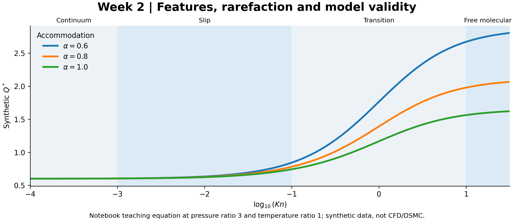

# Week 2 — Supervised learning and rarefaction

[Course home](../../README.md) · [All weeks](../README.md) · [← Week 1.3](../week01_3/README.md) · [Week 2.1 →](../week02_1/README.md)

Features, scaling, baselines and model validity.

## Lecture and notebooks

**Lecture:** [Lecture 2](../../lectures/week02_supervised_learning_rarefaction.pdf)

| Notebook | Read | Run / setup |
| --- | --- | --- |
| Supervised learning and rarefaction | [Open notebook](../../notebooks/week02/AI_in_Fluids_Week2_Colab_Expanded.ipynb) | [Open in Colab](https://colab.research.google.com/github/Ehsan-Roohi/FlowMLLab/blob/main/notebooks/week02/AI_in_Fluids_Week2_Colab_Expanded.ipynb) |

## What you will work on

- Features, targets, scaling, and losses
- Knudsen number and model validity
- Baseline before neural model

## Suggested route

Complete Week 1 Python and the Keras readiness checklist. Sections 1–3 revisit a neuron, one gradient update and activations; treat them as a refresher if these are already familiar. Focus next on scaling, data splits and a baseline. Then take [Week 1.3 optimizers](../week01_3/README.md) or continue to Week 3/4 according to the [learning path](../../START_HERE.md#learning-order-and-optional-branches).

## Experiment and results

**Problem:** Predict response across Knudsen number and accommodation. 
**CFD / data:** Synthetic teaching equation; no CFD/DSMC run. 
**Learning method:** Ridge regression, not a neural CFD model.

The Week-2 notebook's synthetic response illustrates how Knudsen number and
accommodation affect the learning problem. This is a teaching equation, not a
CFD/DSMC result. [Run the lab](../../notebooks/week02/AI_in_Fluids_Week2_Colab_Expanded.ipynb)

---

[Course home](../../README.md) · [All weeks](../README.md) · [← Week 1.3](../week01_3/README.md) · [Week 2.1 →](../week02_1/README.md)
