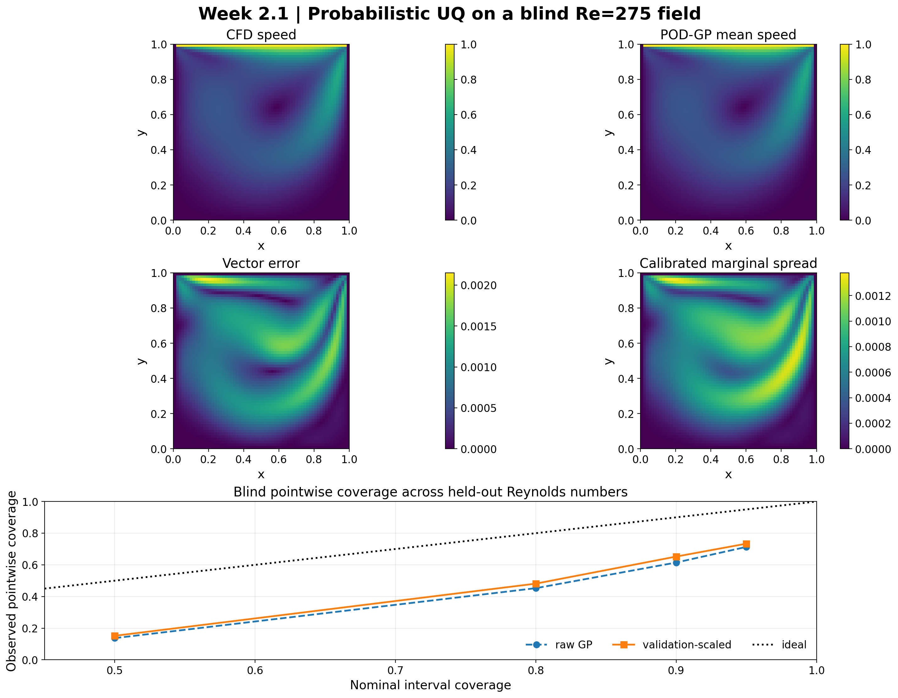

# Week 2.1 — Probabilistic uncertainty

[Course home](../../README.md) · [All weeks](../README.md) · [← Week 2](../week02/README.md) · [Week 3 →](../week03/README.md)

Bayesian prediction, calibration and uncertainty.

## Lecture and notebooks

**Lecture:** [Lecture 2.1](../../lectures/week02_1_probabilistic_uq.pdf)

| Notebook | Read | Run / setup |
| --- | --- | --- |
| Probabilistic UQ for CFD surrogates | [Open notebook](../../notebooks/week02_1/Probabilistic_UQ_CFD.ipynb) | [Open in Colab](https://colab.research.google.com/github/Ehsan-Roohi/FlowMLLab/blob/main/notebooks/week02_1/Probabilistic_UQ_CFD.ipynb) |

## What you will work on

- Observation models, Bayesian prediction, proper scores, and calibration

## Suggested route

After Week 2 regression, scaling and data splits, complete the scalar Bayesian sections. Return to the POD–Gaussian-process field sections after [Week 4 POD and field surrogates](../week04/README.md). Read the retained calibration results before changing the model; the POD section is not a prerequisite for starting the course.

## Experiment and results

**Problem:** Predict cavity quantities and fields with uncertainty. 
**CFD / data:** Retained FlowMLLab cavity CFD data. 
**Learning method:** Bayesian regression and POD–Gaussian processes; non-neural models.

Bayesian and POD–Gaussian-process predictions are checked with proper scores
and blind coverage; the retained under-coverage is part of the lesson.
[UQ evidence](../../results/probabilistic_uq/README.md)

---

[Course home](../../README.md) · [All weeks](../README.md) · [← Week 2](../week02/README.md) · [Week 3 →](../week03/README.md)
