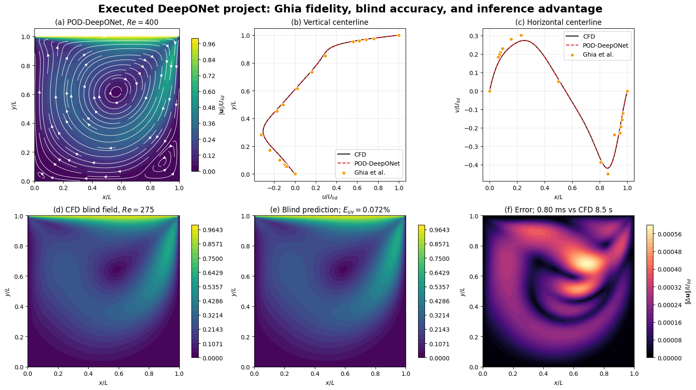
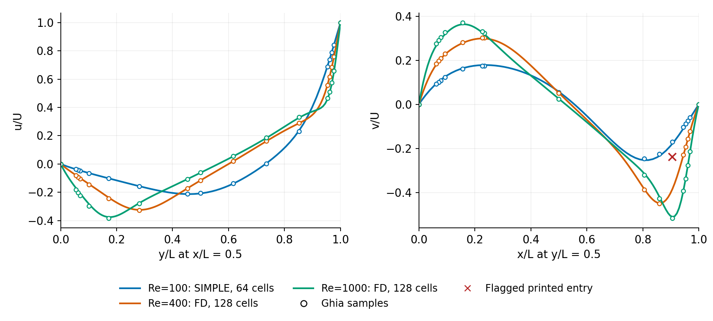

# Week 4 — Cavity surrogates and DeepONet

<!-- cavity-seven-re -->
Separate follow-on notebooks cover [all seven Ghia Reynolds numbers](../../notebooks/week04/W4_Lab5_All_Re_Ghia_Validation.ipynb) and [CPU profile-surrogate optimization and depth](../../notebooks/week04/W4_Lab6_Ghia_Profile_Optimizer_Depth.ipynb). Earlier notebook cells and outputs are preserved. [Benchmark data](../../references/ghia/README.md) · [Measured results](../../results/cavity_ghia_allre/README.md) · [Research ideas and sources](../../docs/CAVITY_RESEARCH_ROADMAP.md).
<!-- /cavity-seven-re -->

[Course home](../../README.md) · [All weeks](../README.md) · [← Week 3](../week03/README.md) · [Week 4.1 →](../week04_1/README.md)

CFD datasets, field surrogates and operator learning.

## Lecture and notebooks

**Lecture:** [Lecture 4](../../lectures/week04_cavity_surrogates_deeponet.pdf)

| Notebook | Read | Run / setup |
| --- | --- | --- |
| Lab 1: CFD data production | [Open notebook](../../notebooks/week04/W4_Lab1_CFD_Data_Production_Student.ipynb) | [Open in Colab](https://colab.research.google.com/github/Ehsan-Roohi/FlowMLLab/blob/main/notebooks/week04/W4_Lab1_CFD_Data_Production_Student.ipynb) |
| Lab 2: scalar and field surrogates | [Open notebook](../../notebooks/week04/W4_Lab2_Scalar_and_Field_Surrogates_Student.ipynb) | [Open in Colab](https://colab.research.google.com/github/Ehsan-Roohi/FlowMLLab/blob/main/notebooks/week04/W4_Lab2_Scalar_and_Field_Surrogates_Student.ipynb) |
| Lab 3: POD-DeepONet cavity | [Open notebook](../../notebooks/week04/W4_Lab3_DeepONet_Cavity_Student.ipynb) | [Open in Colab](https://colab.research.google.com/github/Ehsan-Roohi/FlowMLLab/blob/main/notebooks/week04/W4_Lab3_DeepONet_Cavity_Student.ipynb) |
| Lab 5: our CFD versus Ghia and seven-Re coverage | [Open notebook](../../notebooks/week04/W4_Lab5_All_Re_Ghia_Validation.ipynb) | [Open in Colab](https://colab.research.google.com/github/Ehsan-Roohi/FlowMLLab/blob/main/notebooks/week04/W4_Lab5_All_Re_Ghia_Validation.ipynb) |
| Lab 6: profile surrogates, optimizers and depth | [Open notebook](../../notebooks/week04/W4_Lab6_Ghia_Profile_Optimizer_Depth.ipynb) | [Open in Colab](https://colab.research.google.com/github/Ehsan-Roohi/FlowMLLab/blob/main/notebooks/week04/W4_Lab6_Ghia_Profile_Optimizer_Depth.ipynb) |
| Lab 7: new high-Re CFD and mesh/time checks | [Open notebook](../../notebooks/week04/W4_Lab7_High_Re_CFD_Ghia.ipynb) | [Open in Colab](https://colab.research.google.com/github/Ehsan-Roohi/FlowMLLab/blob/main/notebooks/week04/W4_Lab7_High_Re_CFD_Ghia.ipynb) |
| Lab 8: full-field POD-DeepONet and interpolation | [Open notebook](../../notebooks/week04/W4_Lab8_High_Re_Field_DeepONet.ipynb) | [Open in Colab](https://colab.research.google.com/github/Ehsan-Roohi/FlowMLLab/blob/main/notebooks/week04/W4_Lab8_High_Re_Field_DeepONet.ipynb) |
| Advanced Lab 9: label-free PINN audit (after Week 13 Part A) | [Open notebook](../../notebooks/week04/W4_Lab9_Label_Free_Ghia_PINN_Audit.ipynb) | [Prerequisites and CPU setup](../../START_HERE.md#fresh-cavity-pinn-studies) |

**Module guides:** [Week 4 labs](../../notebooks/week04/)

## What you will work on

- Data qualification
- Scalar and coordinate surrogates
- Operator learning with an interpretable trunk

## Suggested route

Begin with Labs 1–3: qualify CFD, build simple surrogates, then learn the POD coefficients. Lab 5 audits seven-Re coverage; take Lab 7 mesh/time checks before Lab 8 high-Re field learning. Lab 6 is a separate profile-regression and optimizer branch, with Ghia samples as labels. Weeks 4.1/4.2 are optional ROM and Stokes-correction extensions. **Lab 9 is an advanced return visit after [Week 13 Part A](../week13/README.md), not the next introductory lesson.**

## Experiment and results

**Problem:** Map Reynolds number to cavity fields. 
**CFD / data:** FlowMLLab finite-difference streamfunction–vorticity Navier–Stokes solver. 
**Learning method:** POD–DeepONet: learned parameter-to-coefficient map with a fixed POD spatial basis.

Complete-case testing combines field error, wall/divergence checks, reference
centerlines and measured inference cost.
[Model and validation evidence](../../results/pod_deeponet/README.md)

## CFD validation and all-seven-Re profile learning

[Lab 5](../../notebooks/week04/W4_Lab5_All_Re_Ghia_Validation.ipynb) opens our CFD
solutions at Re=100,400,1000, shows grid changes and signed Ghia discrepancies,
before the higher-Re CFD checks in [Lab 7](../../notebooks/week04/W4_Lab7_High_Re_CFD_Ghia.ipynb).
Its frozen profile predictions at Re=3200 and 7500 are a separate learning example,
not the CFD reference. Complete those CFD checks before the Lab 8 full-field tests.
[Lab 6](../../notebooks/week04/W4_Lab6_Ghia_Profile_Optimizer_Depth.ipynb) provides
the full seven-Re profile-regression protocol and optimizer/depth exercises.
The historical profile fit remains separate. New Labs 7 and 8 now add the actual high-Re CFD and full-field neural experiment.

[Native CFD results](../../results/cavity_cfd_ghia/README.md) ·
[Neural predictions and interpolation baseline](../../results/cavity_ghia_allre/README.md)

---

[Course home](../../README.md) · [All weeks](../README.md) · [← Week 3](../week03/README.md) · [Week 4.1 →](../week04_1/README.md)

[New CFD evidence](../../results/cavity_highre_ghia/README.md) · [Full-field neural tests](../../results/cavity_field_deeponet/README.md).

## Measured solver experience

Labs 7 and 8 now end with a measured CPU solver comparison: why fewer Krylov
iterations did not reduce cavity solve time. The appendix includes successful
and failed trials, signed physical profiles, setup-cost analysis and exercises
using saved records. [Evidence and lesson links](../../results/cavity_solver_benchmark/README.md).

## Label-free PINN audit

[Lab 9](../../notebooks/week04/W4_Lab9_Label_Free_Ghia_PINN_Audit.ipynb)
examines a fresh 42-run experiment across all seven Ghia Reynolds numbers.
It separates exact boundary/continuity identities from field accuracy,
independent residuals, seed sensitivity and actual corner-sampling coverage.
The finite baseline failed its accuracy gates; the supervised field-model
results remain separate. [All outcomes and physical figures](../../results/cavity_pinn_campaign/README.md).
The existing Week 4 labs are preserved, and the lecture adds theory and results.
