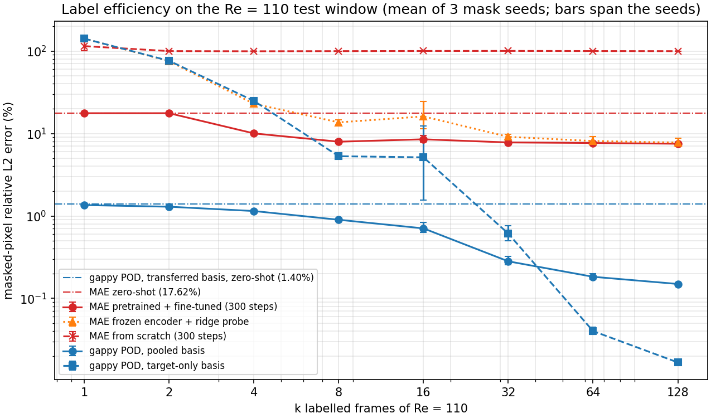

# Week 7.3 — Self-supervised pretraining and label efficiency

[Course home](../../README.md) · [All weeks](../README.md) · [← Week 7.2](../week07_2/README.md) · [Week 7.4 →](../week07_4/README.md)

Masked-autoencoder pretraining on unlabelled wakes; error versus number of labelled frames against gappy POD.

## Lecture and notebooks

**Lecture:** [Lecture 7.3](../../lectures/week07_3_masked_pretraining.pdf)

| Notebook | Read | Run / setup |
| --- | --- | --- |
| Self-supervised pretraining and label efficiency (cylinder wake) | [Open notebook](../../notebooks/week07_3/W7_3_Masked_Pretraining_Label_Efficiency.ipynb) | [Open in Colab](https://colab.research.google.com/github/Ehsan-Roohi/FlowMLLab/blob/main/notebooks/week07_3/W7_3_Masked_Pretraining_Label_Efficiency.ipynb) |

**Module guides:** [Week 7.3 lab](../../notebooks/week07_3/README.md)

## What you will work on

- Self-supervised pretraining and label efficiency

## Suggested route

Complete Week 7 wake dynamics and Week 7.2 sparse-sensor reconstruction. Read the attention primer below before opening the masked-autoencoder notebook. Compare label budgets with the gappy-POD baseline, then continue to Week 7.4 transfer. Weeks 17–22 later provide the full attention and forecasting sequence.

## Before this lab: patches and attention

The masked autoencoder uses a **Transformer**, so read this short mechanism
before inspecting pretraining results. A patch is a small block of the flow
field flattened into a token; the mask hides some tokens during training.
The encoder processes visible tokens, and the decoder predicts the hidden
field values. Reconstruction loss uses the declared hidden-pixel mask.

For a token matrix $X$, learned matrices $W_Q$, $W_K$ and $W_V$ form
$Q=XW_Q$, $K=XW_K$ and $V=XW_V$. One attention head computes

$$A=\operatorname{softmax}(QK^T/\sqrt{d_k}),\qquad Z=AV.$$

Here each row of $Q$ is a query, each row of $K$ is a key, each row of $V$ is a
value, and $d_k$ is the query/key width. Row-wise softmax makes each row of $A$
sum to one; $Z$ mixes the values using those weights. Position information
locates the patches. Multiple heads learn different mixtures. These weights
describe the model's computation, not proof of a physical causal connection.

Before running the lab, explain which pixels are visible, which enter the
reconstruction loss, and which labelled frames are reserved for evaluation.
For a worked Q/K/V calculation, read the opening attention example in
[Week 17](../../notebooks/week17/W17_CFD_Transformer.ipynb); completing all six
Transformer units is not required here.

## Experiment and results

**Problem:** Complete a wake field from 25% of its patches for a new trajectory with few labelled frames. 
**CFD / data:** The four retained FlowMLLab D2Q9–TRT LBM wakes (Re = 90, 100, 105, 110). 
**Learning method:** A masked autoencoder pretrained on the unlabelled Re90/Re100 wakes (He et al., 2022; the MAPA protocol of Tang, Spalding and Cogan, 2026), used zero-shot, with a frozen linear probe, fine-tuned and from scratch; gappy POD with transferred, target-only and pooled bases as the matched classical baselines.

The pretrained pipeline beats the same architecture from scratch at every label
count under the matched 300-step downstream budget. At `k = 1, 2`, validation
early stopping keeps the zero-shot pretrained weights; label-driven improvement
starts at `k = 4`. With the full pretraining budget the from-scratch model still
fails at `k = 2`. Gappy POD with a basis transferred from the unlabelled wakes is
nevertheless an order of magnitude more accurate (**about 1.4%** zero-shot
against **about 18%** for the network), and its pooled basis improves with every
label. The classical win is retained and explained: this periodic wake is low-rank.
[Protocol, all methods and limits](../../results/week07_3_pretraining/README.md)

---

[Course home](../../README.md) · [All weeks](../README.md) · [← Week 7.2](../week07_2/README.md) · [Week 7.4 →](../week07_4/README.md)
