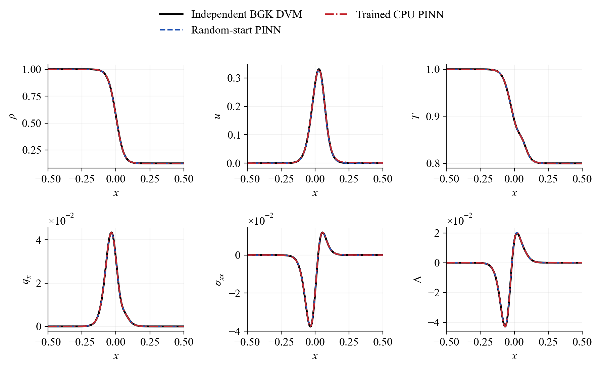
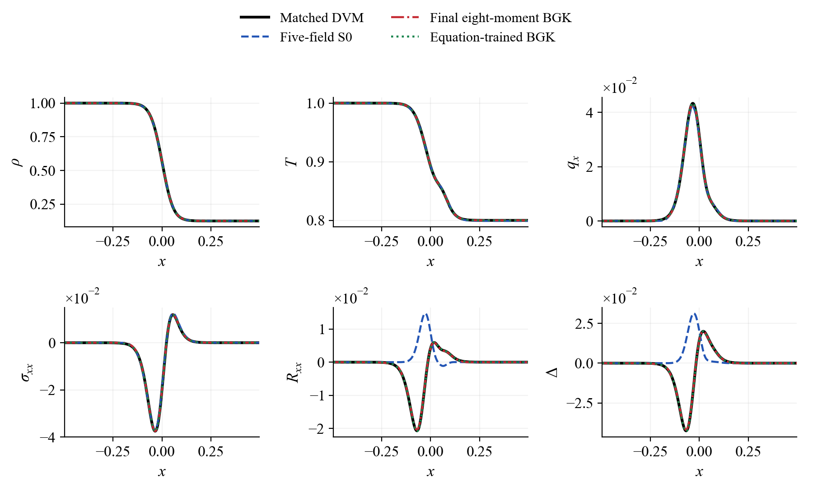

# Week 10.2 - One-dimensional kinetic shocks: BGK, Shakhov, PINNs and DVM

[Course home](../../README.md) · [All weeks](../README.md) · [← Week 10.1](../week10_1/README.md) · [Week 11 →](../week11/README.md)

How much of a distribution has a network learned when its density looks right?
Train a small BGK PINN from random weights on CPU, then use signed heat flux,
stress and fourth-order moments to compare it with an independent DVM.

## Lecture and notebook

[Lecture PDF](../../lectures/week10_2_bgk_shakhov_shock_pinn_dvm.pdf) ·
[Notebook](../../notebooks/week10_2/W10_2_BGK_Shakhov_Shock_PINN_DVM.ipynb) ·
[Open in Colab](https://colab.research.google.com/github/Ehsan-Roohi/FlowMLLab/blob/main/notebooks/week10_2/W10_2_BGK_Shakhov_Shock_PINN_DVM.ipynb) ·
[CPU setup and exercise map](../../notebooks/week10_2/README.md)

Read after Weeks 2, 3, 8 and 10. Start with the collision and moment calculations
before interpreting the saved neural results. The full Week 13 PINN research
audit is an optional continuation, not a prerequisite for this self-contained
introduction.

## Computation and physical interpretation

The fresh CPU exercises compute jump conditions, collision invariants, the
different BGK/Shakhov heat-flux relaxation rates and a positive-distribution
counterexample showing why g and h cannot determine separate R and Delta.
The retained experiments then compare transient shock tubes, three stationary
Mach-2 initializations and moment-supervised BGK states with matched DVM profiles.

The added from-scratch section exposes hidden depth and width, Adam/L-BFGS/hybrid
optimization, and density/momentum/energy loss weights. Every fit starts fresh;
DVM targets do not enter its loss. The CPU DVM uses matched initial/inflow states
and a separate finite-volume algorithm. Tables H-I compare initial and trained
predictions and check reference space/time and velocity sensitivity. Table J
supports a seven-configuration controlled study.

**Transient BGK tube:** t = 0.02, x ∈ [−0.5, 0.5], constant τ = Kn = 1 in
the source convention, Pr = 1, γ = 5/3 and R_g = 1. Left/right (ρ, u, T) =
(1, 0, 1)/(0.125, 0, 0.8), smoothed by H = [1 + tanh(20x)]/2; pressure ratio 10.
**No stationary upstream Mach is prescribed:** both reservoirs initially rest.
The initial and trained CPU PINNs share the independent 800-cell DVM reference.

This short-time problem has a collision fraction below 2%, so an untrained
characteristic prediction can already look good. Report the actual change after
training; low errors alone do not demonstrate that the network learned the whole
solution. The small CPU model is distinct from the retained research results below.

**Same transient BGK initial states and t = 0.02, τ = Kn = 1, Pr = 1**,
with a **6400-cell DVM** and **399 common comparison nodes**. There is no imposed
stationary upstream Mach here either. The notebook separately studies a
**stationary M₁ = 2 Shakhov shock**, Pr = 2/3 and τ = 1/ρ; it is not either
of the two figures above.

All displayed methods use the same declared comparison nodes and 6400-cell
reference. The five-field state can reproduce lower moments while missing
fourth-order moments. Adding moment supervision improves that state, but the
equation-trained model remains more accurate for several nonequilibrium moments.
The reference's training, scaling and assessment roles remain explicit; this
comparison is not an independent held-out generalization test.

[Physical profiles, metrics and limitations](../../results/week10_2_kinetic_shock/README.md) ·
[Paper v2](https://arxiv.org/abs/2605.29211v2) ·
[Pinned source repository](https://github.com/Ehsan-Roohi/PINNs-DVM/tree/add5388f7da5f7eace95fff97d34d6ed58b90169)

## Assignment

Complete the seven research-audit investigations linked to tables A-G and the
five fresh-training investigations linked to H-J. Vary one
numerical control at a time, retain signed physical curves, quantify seed effects,
and distinguish reference-data availability from an independent test. Report
the source's failed criteria alongside low global error norms.
