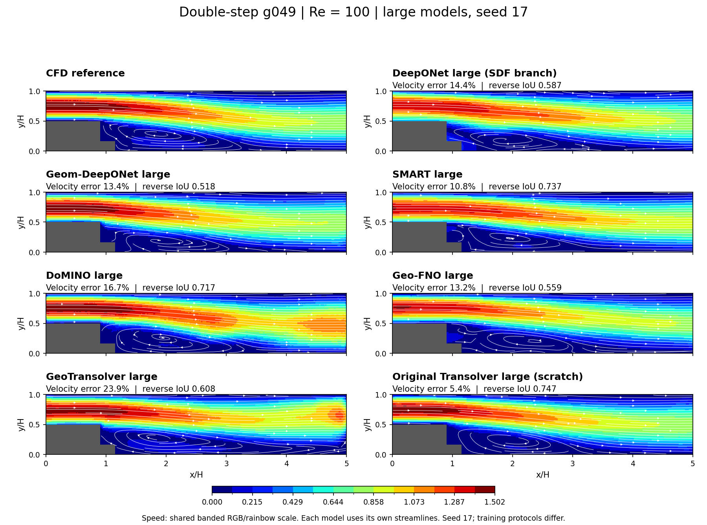
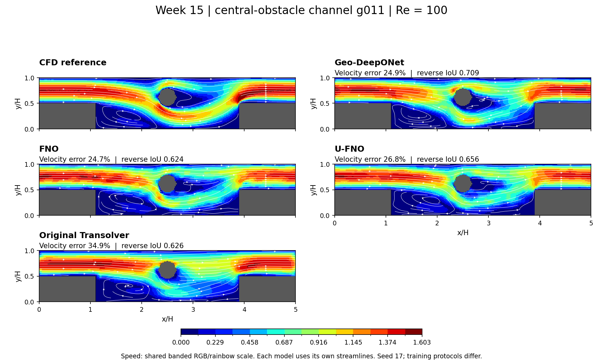
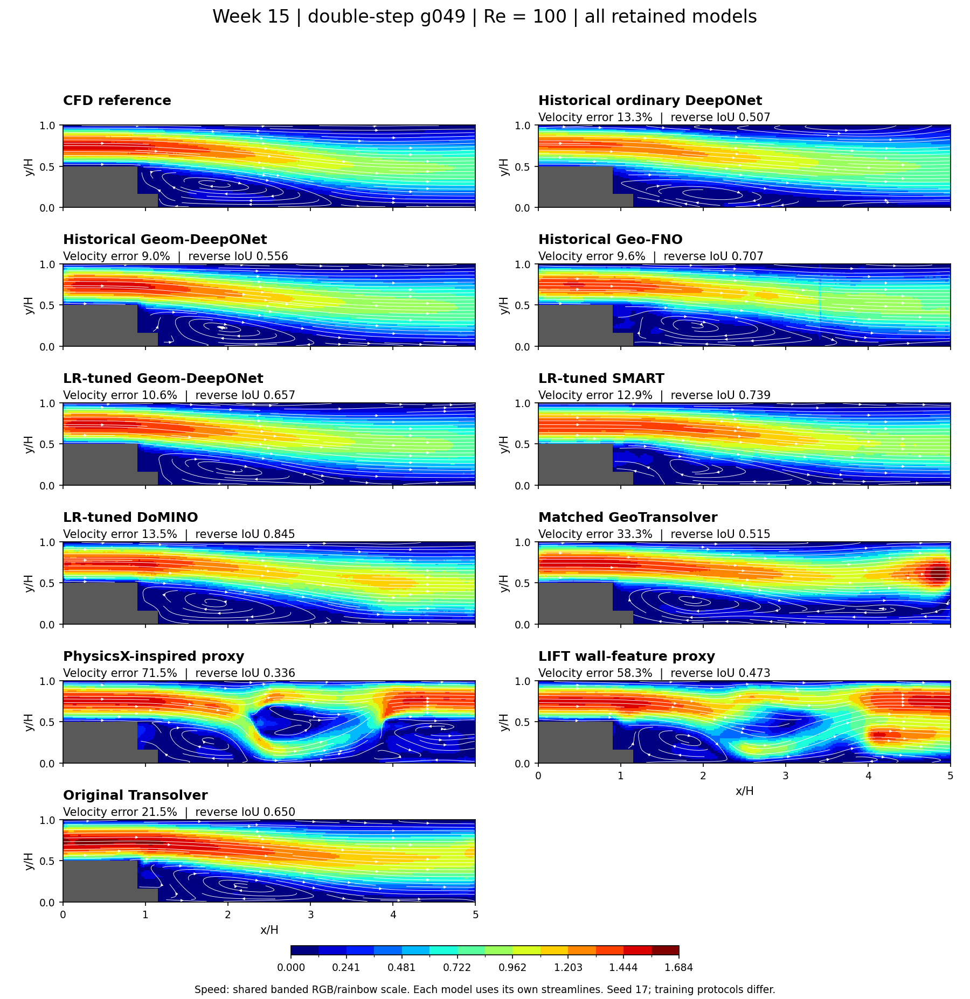

# Week 15 — Geometry-aware neural operators

Original Transolver: [run/verify notebook](../../notebooks/week15/W15_Original_Transolver_Double_Step.ipynb) · [double-step test, weights and results](../../results/family_transolver/README.md) · [additional g011 test](../../results/step_transolver/README.md).

## Larger-network extension

[**Does a larger network improve two-step flow prediction?**](../../weeks/week15/larger_networks.md) · [Configurations, results and artifact availability](../../results/week15_capacity_study/README.md) · [Analysis notebook](../../notebooks/week15/W15_Larger_Networks_Analysis.ipynb)

Study six enlarged geometry-aware models and the separate original-Transolver/GeoPT experiment. With completed matched controls, enlargement reduced mean velocity error for geometry-aware DeepONet (**18.82%**) and Geom-DeepONet (**12.16%**), while SMART's error increased (**7.26%**). Each configuration has **one training seed**; the three remaining compact controls were discontinued.

[View Re=25](../../results/week15_capacity_study/figures/DoubleStep_All_Large_Models_Re25.png). The shared contour scale makes flow differences visible; the separate Transolver protocol prevents treating this figure as a controlled cross-architecture ranking. The extension includes architecture specifications, recorded results, metric tradeoffs, future-experiment choices and student exercises. New weights and full prediction arrays are currently unavailable; see the artifact ledger before planning reproduction.

## Earlier configurations

[Course home](../../README.md) · [All weeks](../README.md) · [← Week 14](../week14/README.md) · [Week 16 →](../week16/README.md)

Geometry and topology generalization across DeepONet, Geom-DeepONet, Geo-FNO, SMART, GeoTransolver and DoMINO.

**Central-obstacle channel (g011): all four models and CFD.**

**Double-step channel (g049): earlier compact configurations and CFD.**

Unchanged original figures: [historical/core comparison](../../results/week15_postaudit/core_g049_Re100.png) · [extended comparison](../../results/week15_postaudit/extended_g049_Re100.png).

## Lecture and notebooks

**Lecture:** [Expanded Lecture 15](../../lectures/week15_geometry_generalization.pdf)

| Notebook | Read | Run / setup |
| --- | --- | --- |
| Geometry-aware neural operators (local checkout) | [Open notebook](../../notebooks/week15/W15_Complete_Geometry_Generalization.ipynb) | [Setup and reproduction guide](../../notebooks/week15/README.md) |
| Larger-network capacity analysis (no training) | [Open notebook](../../notebooks/week15/W15_Larger_Networks_Analysis.ipynb) | [Study, specifications and exercises](larger_networks.md) |
| Historical geometry-operator audit (optional) | [Open notebook](../../notebooks/week15/W15_Geometry_Operators_Step_Audit.ipynb) | [Setup and reproduction guide](../../notebooks/week15/README.md) |

## What you will work on

- Geometry-aware neural operators: ordinary DeepONet, Geom-DeepONet, Geo-FNO, SMART, GeoTransolver and DoMINO

## Suggested route

Read the lecture, then work through the notebooks in the listed order. Read each notebook’s setup instructions before running its cells; use the figures and evidence below to interpret the results. Use the complete post-audit notebook with a local clone and its linked evidence archive. The historical notebook is retained for comparison.

## Experiment and results

Learn how geometry-aware neural operators generalize from single-step and other training geometries to a retrospective double-step family.
Compare whole-field prediction errors with reverse-flow topology, using the same CFD references and clearly separated historical and newly trained models.
The notebook exposes the split, training choices and unresolved low-Reynolds-number failures.

**Problem:** Predict velocity and pressure across changing channel geometry, including double-step cases excluded from training and validation. 
**CFD / data:** Retained channel-flow CFD fields and geometry masks: 100 training, 8 validation and 19 retrospective test cases; three `g005` cases are quarantined. This update generates no new CFD. 
**Learning method (earlier post-audit suite):** Compare DeepONet, Geom-DeepONet, Geo-FNO, SMART, GeoTransolver and DoMINO. That suite uses a 19,200-update ceiling and three seeds; learning rates are selected using validation cases only.

**Results:** Historical Geom-DeepONet has 9.86% global velocity error; tuned Geom-DeepONet has 10.53%. Tuned DoMINO has the largest mean reverse-flow IoU (0.534), but 15.59% velocity error. Low-Reynolds-number reverse-flow magnitude remains inaccurate.

[Complete executed notebook](../../notebooks/week15/W15_Complete_Geometry_Generalization.ipynb) ·
[data and reproduction guide](../../notebooks/week15/README.md) ·
[24-page lecture](../../lectures/week15_geometry_generalization.pdf) ·
[post-audit evidence summary](../../results/week15_postaudit/README.md).

The frozen split contains 100 training, 8 validation and 19 retrospective
double-step test cases, with the three cases of geometry `g005` quarantined:
its floor drops in two steps and then rises again, so it shares the test
family's two-descending-step motif without belonging to the test family, and it
is kept out of training, validation and the test alike. The split was
reconstructed from the masks: no training or validation mask contains the two
consecutive descending steps that define the test family. The enlarged training
examples appear first inside the comparison figure, with solid gray, fluid white,
and the physical 5:1 aspect ratio.

The displayed `g049/Re=100` comparison, selected because its larger vortex is
easier to inspect on the course homepage, places the CFD field above historical
ordinary DeepONet, historical Geom-DeepONet, historical Geo-FNO, and the
validation-tuned Geom-DeepONet, SMART and DoMINO models. Every row uses its own
streamlines, one shared banded speed scale, and no reverse-flow threshold overlay.

Within the earlier post-audit suite, the historical seed-17 Geom-DeepONet run had the lowest global velocity error
(9.86%), while
the learning-rate-selected Geom model was the strongest newly trained global-field model in that earlier suite
(10.53%). DoMINO has the best mean reverse-flow IoU in the tuned suite (0.534),
but its test velocity error is 15.59%, so this is a topology-localized gain rather
than the best overall field reconstruction.
The main unresolved failure is Reynolds-stratified: historical Geom has only
0.096 IoU at Re=25, increasing to 0.628 at Re=100. Tuned Geom, SMART and DoMINO
improve the Re=25 IoU to 0.261, 0.299 and 0.357, respectively, but still
overpredict reverse-flow magnitude. The training data contain no Re=25
single-step case below 0.5H, so this regime extrapolates in both geometry and
the Reynolds-number/step-height combination.

The learning-rate sweep uses only non-double-step validation cases and selects
`1e-3` over `3e-4` and `1e-4` for Geom, SMART and DoMINO within a three-point
grid whose best point is its upper edge. At Re=25, tuned Geom's selected-seed
IoUs are approximately 0.19, 0.24 and 0.36, so the seed-17 figures should not be
read as the three-seed mean. Fresh single-stage training at either `3e-4` or
`1e-3`, rather than learning-rate tuning alone, improves the historical footprint
detection. Company-inspired
PhysicsX and LIFT variants are explicitly transparent proxies, not proprietary
implementations. The public LR archive retains the common-scale ablation and
failed vortex cases; zonal and fixed-context ablations remain in the author's
private complete handoff and are not claimed as public release assets.

---

[Course home](../../README.md) · [All weeks](../README.md) · [← Week 14](../week14/README.md) · [Week 16 →](../week16/README.md)
