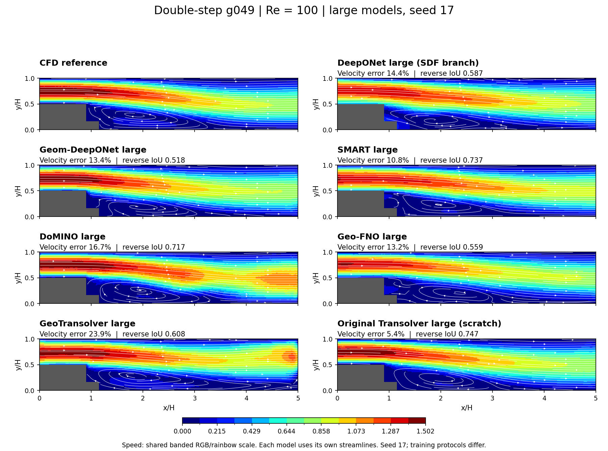
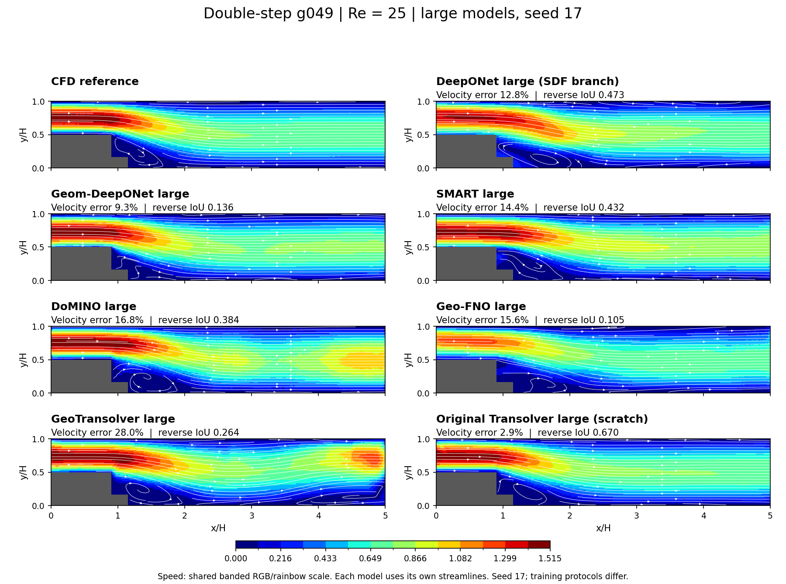
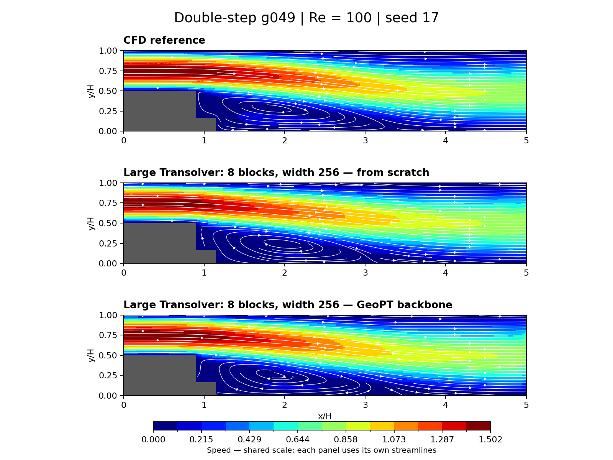

# Week 15 extension — Does a larger network predict two-step flow better?

[Week 15](README.md) · [Course home](../../README.md) · [Results and artifact inventory](../../results/week15_capacity_study/README.md) · [Analysis notebook](../../notebooks/week15/W15_Larger_Networks_Analysis.ipynb)

**Answer from the completed controls:** enlargement reduced mean velocity error
for geometry-aware DeepONet and Geom-DeepONet, but increased it for SMART.
Original Transolver also improved substantially when enlarged under its own
training protocol. GeoPT initialization did not improve every metric relative
to the enlarged Transolver trained from scratch. Capacity is one experimental
variable, not a guarantee of better flow physics.

This extension records the completed seed-17 capacity study of 15 November 2026.
It supplements the historical and three-seed post-audit experiments; it does
not replace their tables or convert their results into new capacity controls.

## Learning goals and route

After this extension, you should be able to distinguish capacity, initialization
and training-protocol effects; interpret velocity, pressure and recirculation
metrics together; audit whether weights and prediction fields are actually
available; and propose a finite next experiment justified by evidence.

1. Inspect the two-step contours and explain where the models disagree.
2. Read the split, architecture and protocol tables before comparing scores.
3. Run the lightweight analysis notebook. It uses the published CSV files and
   Python's standard library; it performs no training and downloads no weights.
4. Complete the exercises and write a decision memo for a specific flow objective.

## 1. The physical and statistical question

The target is a steady channel flow with two consecutive descending floor steps.
A jet and separated shear layers pass over the expanded channel portions.
Pressure recovery and separation produce low-speed recirculating regions.
Predicting its location, footprint and reverse velocity is harder than matching
the dominant forward-flow region. A convincing speed contour alone therefore
does not establish accurate recirculation.

All runs use the same retained OpenFOAM dataset: **130 cases, 51 geometry
identities, 60 × 300 raster**, with Reynolds numbers 25, 50 and 100. There is no
new CFD campaign in this extension. The frozen family split has **100 training,
8 validation and 19 retrospective test cases**. Three cases of geometry `g005`
remain quarantined because its two drops followed by a contraction share the
test-family motif. Test geometry IDs are `12, 45, 46, 47, 48, 49, 50, 51`.
Training, validation and test geometry identities are disjoint.

The 19 tests contain eight geometries and unequal Reynolds-number coverage:
eight cases at Re=25, six at Re=50 and five at Re=100, verified against the
surviving dataset in this publication.
Their arithmetic case mean gives each case equal weight, not each geometry.
It is not a pooled field norm, a geometry-balanced mean or a seed mean. The
published aggregate scores below cannot recover missing Reynolds-stratified or
geometry-balanced results.

The family has already been inspected historically. This is a **retrospective
benchmark**, not an untouched prospective generalization test. Further decisions
informed by these results require a new holdout for stronger generalization claims.

## 2. See the enlarged predictions against CFD

### Two-step g049, Re = 100

### The same geometry, Re = 25

These are retained numerical plots, not synthesized flow illustrations. Every
panel uses that model's own streamlines, a common banded speed scale within
the figure, gray solid regions and the physical 5:1 domain aspect ratio.
The labels are **single-case** metrics; the tables below average 19 test cases.
The original Transolver panel uses a different training protocol from the six
operators. Its inclusion provides a visual reference, not a controlled ranking.

Read the figures by locating separation and reverse-flow termination, inspecting
the reverse-flow speed, and then comparing the main jet. A similar-looking
vortex can still have an incorrect reverse velocity or footprint. The `g049`
illustrations do not stand in for all eight test geometries.

## 3. What does “larger” mean for each architecture?

An eight-block, width-256 transformer prescription cannot be assigned literally
to a Fourier operator or a branch–trunk network. Capacity was increased using
each architecture's own structure. Parameters differ considerably, so this is
neither a parameter-matched nor a FLOP-matched comparison.

| Architecture | Enlarged configuration | Parameter count / convention |
| --- | --- | ---: |
| Geometry-aware DeepONet | Branch and trunk: 8 tanh hidden layers, width 256; 256 latent features per output; split-both contraction | 5,925,123 real parameters |
| Geom-DeepONet | Four author-style subnetworks; latent width 128, hidden width up to 256; two-stage paths with 8 affine layers; SIREN frequency 10 | 5,465,089 real parameters |
| SMART | Latent width 256, 8 encoder/decoder blocks, 8 heads; 32 geometry latents, 128 geometry samples | 11,380,676 real parameters |
| DoMINO | Volume model; geometry neurons 32, processor filters 8; basis, aggregation, position and parameter widths 256; grid 32 × 16 × 8 | 2,941,051 real parameters |
| Geo-FNO | Width 48; 8 spectral operators, modes 12 × 12, regular grid 40 × 40; IPHI width 64 | 6,730,325 complex-or-real entries; **12,038,741 real scalars** |
| NVIDIA GeoTransolver | 8 layers, hidden 256, 8 heads, 32 slices; local hidden width 32 | 9,367,179 real parameters |
| Original Transolver | 8 blocks, hidden 256, 8 heads, 32 slices, MLP ratio 2 | 3,859,011 real parameters |

**Representation matters.** Both sizes of the capacity-study DeepONet receive
the full geometric SDF in the branch, scaled by `sqrt(18000)`, plus `Re/100`.
This is not the historical ordinary DeepONet whose branch sees Reynolds number
only. Branch and trunk outputs are split by output channel; the DeepXDE-style
trunk has its final tanh before contraction. Geom-DeepONet uses the original
four-subnetwork construction and its sinusoidal branch of the trunk.

SMART uses the author implementation; DoMINO and GeoTransolver use the pinned
NVIDIA implementation. DoMINO represents the 2D boundary by an eight-level
extrusion for its 3D geometry operations; the targets remain 2D CFD, with no
claim of a 3D flow simulation. Geo-FNO keeps the author Fourier operations and
uses 512 fixed geometry-only context points per case. All inference inputs are
geometry, coordinates and Reynolds number; no test velocity or pressure is an input.

The completed small controls use DeepONet 2 × 128 with latent 64 per output;
Geom-DeepONet latent 32 with 50/64-wide hidden subnetworks; and SMART latent 64,
2 blocks and 4 heads. Other small-control runs were interrupted and deliberately
excluded. Their large results remain useful observations, but have no completed
matched capacity counterpart in this extension.

[Machine-readable architecture records](../../results/week15_capacity_study/architectures.json)
give the retained configuration details, upstream revisions and unknown fields.

## 4. Two training protocols — keep them separate

| Choice | Six-architecture capacity suite | Original Transolver experiment |
| --- | --- | --- |
| Training realization | Seed 17 per configuration | Seed 17 per configuration |
| Updates | 600 epochs × 32 = 19,200 | 1,200 epochs × 16 = 19,200 |
| Samples per update | 512 rows: 192 uniform fluid rows + 64 five-point derivative stencils | 1,024 uniformly sampled fluid points |
| Targets | Case-centered pressure; each target channel divided by training-only RMS | Training-only target mean and standard deviation |
| Loss | Scaled field MSE + 0.25 reverse-zone velocity MSE + 0.1 stencil-vorticity MSE | Unweighted normalized u/v/pressure MSE |
| Optimizer | Adam, epsilon 1e-7, gradient norm clip 1 | AdamW, weight decay 1e-5, gradient norm clip 1 |
| Learning rate | Cosine, 3e-4 → 3e-5 | Cosine, 1e-3 → 1e-5 |
| Validation | Full fluid clouds; epoch 0, 1, every 20, and end | Full fluid clouds; epoch 1, every 25, and end |
| Selection | Minimum geometry-balanced physical validation score | Minimum mean per-case normalized validation MSE |
| Test timing | After validation checkpoint selection | After validation checkpoint selection |

The suite's selection score is

\[
S=0.25 E_U/100+0.20 E_p/100+0.20 E_\omega/100
 +0.25(1-\mathrm{IoU})+0.10 E_{U,\mathrm{reverse}}/100.
\]

The terms are aggregated by validation geometry before selection. Vorticity
scales and target scales come from training data. The test is not an early
stopping signal. Attention models are evaluated on the complete fluid cloud;
query chunking would change their context.

Equal updates do not imply equal point exposure: the nominal row counts are
9,830,400 and 19,660,800 respectively. Stencil rows may overlap; these counts
are neither unique observations nor FLOP estimates. Runtime, memory and
energy records were not retained in the recovered evidence and are not inferred.

## 5. Metrics: define the engineering objective first

Velocity error is `100 ||U_pred − U_CFD||₂ / ||U_CFD||₂` over fluid cells, using
both velocity components. Pressure error uses the same relative norm after
subtracting each field's own case mean, so a pressure gauge shift does not
change the score. The old stored pressure label is not treated as a verified
physical nondimensionalization; this extension reports centered stored-field
errors and does not infer dimensional pressure from it.

Filtered reverse-flow IoU compares the sets `u < −0.01`, after removing
four-connected components smaller than eight cells. It measures footprint
overlap, depends on the threshold/filter and does not measure reverse-flow
magnitude. Vorticity error and reverse-zone velocity error are relative errors;
the reverse-zone metric uses the CFD region `u < −0.01`. Its denominator can
be small, producing very large percentages. Future reporting should add an
inlet-normalized absolute reverse-speed error.

The retained reverse-flow extent error is an absolute streamwise footprint
extent discrepancy in domain coordinates, normalized here by `H = 1`.
It is a footprint diagnostic, not a separately resolved wall-shear zero or
proof of an accurate physical reattachment location. Its original per-case
records and metric implementation are not recovered; use the aggregate only
with that limitation.

## 6. The completed matched controls

All entries are arithmetic means across the same 19 test cases, seed 17.
Positive reduction below means that enlargement lowered error.

| Matched model | Small velocity error | Large velocity error | Relative error reduction | Cases with lower error | Small → large reverse IoU |
| --- | ---: | ---: | ---: | ---: | ---: |
| Geometry-aware DeepONet | 17.0001% | 13.8010% | 18.82% | 16/19 | 0.3372 → 0.4381 |
| Geom-DeepONet | 12.3153% | 10.8179% | 12.16% | 14/19 | 0.3872 → 0.3955 |
| SMART | 9.9427% | 10.6642% | −7.26% | 6/19 | 0.4910 → 0.4629 |

| Model / size | Centered pressure error | Vorticity error | Reverse-zone velocity error | Reverse-flow extent error / H |
| --- | ---: | ---: | ---: | ---: |
| DeepONet small | 53.3313% | 36.5003% | 312.3370% | 0.5956 |
| DeepONet large | 41.2247% | 26.6138% | 230.6034% | 0.7167 |
| Geom small | 36.6863% | 22.2484% | 182.5236% | 0.2851 |
| Geom large | 30.6994% | 18.5121% | 119.2127% | 0.2175 |
| SMART small | 39.0889% | 17.7644% | 158.9482% | 0.2886 |
| SMART large | 49.3306% | 21.1619% | 142.8496% | 0.3351 |

DeepONet improves velocity, pressure, vorticity and overlap, yet its extent
error worsens. Geom-DeepONet improves all listed means, but the IoU gain is
only 0.0083. SMART worsens most means while improving reverse-zone velocity.
These are metric tradeoffs under one configuration and budget, not universal
statements about the architectures or a demonstrated statistical capacity law.

## 7. All six enlarged configurations

| Enlarged model | Mean velocity error | Mean filtered reverse IoU | Matched small control in this extension |
| --- | ---: | ---: | --- |
| Geometry-aware DeepONet | 13.8010% | 0.4381 | Completed |
| Geom-DeepONet | 10.8179% | 0.3955 | Completed |
| SMART | 10.6642% | 0.4629 | Completed |
| DoMINO | 17.5705% | 0.4602 | Not completed; excluded |
| Geo-FNO | 15.8196% | 0.3134 | Not completed; excluded |
| NVIDIA GeoTransolver | 20.8320% | 0.3235 | Not completed; excluded |

SMART has the smallest mean velocity error among these six enlarged
configurations, while its own small control is better. Both facts can hold.
DoMINO's overlap is close to SMART's, but its global velocity error is larger.
The missing controls are not zero-valued results and cannot be replaced by
older LR-tuned or differently configured runs.

## 8. Original Transolver and GeoPT initialization

| Original Transolver, seed 17 | Parameters | Mean velocity error | Centered pressure error | Filtered reverse IoU |
| --- | ---: | ---: | ---: | ---: |
| Compact: 3 blocks, width 64 | 100,351 | 14.4261% | 210.4279% | 0.4186 |
| Large: 8 blocks, width 256; scratch | 3,859,011 | 5.5128% | 59.3233% | 0.5526 |
| Same large model; GeoPT backbone | 3,859,011 | 6.1150% | 57.2614% | 0.4911 |

Under this protocol, enlargement from scratch reduces mean velocity error by
about 61.79% relative to the compact configuration. GeoPT has slightly lower
mean pressure error than the large scratch model, but higher mean velocity
error and lower mean reverse IoU. On the illustrated `g049/Re=100` case GeoPT
has lower velocity error (4.5733% versus 5.3602%) and higher IoU (0.8008 versus
0.7465). A favorable example therefore does not establish a better test mean.

GeoPT transfers **3,855,680 compatible parameters** from the pinned official
checkpoint. The first 2D projection and task head are newly initialized; the
original 3D geometry/dynamics prompt is not reproduced. This is a disclosed
backbone-transfer experiment, not a reproduction of the full GeoPT task.
GeoPT weights cannot initialize unrelated DeepONet, SMART, Fourier or DoMINO
architectures. Those enlarged models were trained from scratch.

## 9. Evidence, weights and reproducibility

The original training session completed nine suite runs: six large models and
three small controls. Their selected checkpoints were loaded in a separate
process and all 19 prediction fields per run were compared with saved outputs
(`rtol=1e-5`, `atol=1e-6`, with exact truth/mask checks). Both enlarged original
Transolver runs had exact prediction replay recorded. **Replay is an inference
check, not an independently trained seed.**

The temporary execution environment subsequently reset. The retained figures,
reported aggregate metrics and original Transolver training source were
recovered. The new trained weights, full per-case prediction arrays, histories
and original replay reports have **not** been recovered. This publication
preserves the available evidence and records that gap; it does not claim a
complete downloadable trained-model release or fresh replay in this revision.
Old public checkpoints are linked as old checkpoints, not substituted for
these new ones. Recorded hashes identify missing files; they do not supply them.

| Artifact | Current availability |
| --- | --- |
| Original dataset and frozen split | Existing repository files; paths and dataset SHA-256 in the results inventory |
| Retained capacity figures | Included in this update with file hashes |
| Recorded aggregate results and selected g049 metrics | Included as CSV; unknown fields remain blank |
| Architecture and protocol records | Included as JSON; reconstructed from retained experiment records |
| Original Transolver large training source and GeoPT downloader | Recovered from the experiment branch and included |
| Official GeoPT pretrained weights | Upstream pinned download; distinct from fine-tuned two-step weights |
| Old compact original Transolver checkpoint | Existing repository file; distinct from new large models |
| New large/small suite weights and fine-tuned Transolver weights | Previously verified; currently unavailable |
| New full per-case arrays, training curves, replay-report files | Currently unavailable; no replacement data invented |
| Three unfinished small controls | Excluded; no completed result claimed |

See the [artifact inventory](../../results/week15_capacity_study/README.md) for
exact paths, checksums, upstream revisions, available scripts and recovery limits.
The analysis notebook reproduces calculations from recorded summaries. Full
training/inference reproduction requires recovering or regenerating the missing
artifacts under the recorded protocol.

## 10. Decide what to do next

| Your engineering question | Evidence available now | Finite next step |
| --- | --- | --- |
| Does capacity help bulk velocity prediction? | Two suite pairs improve, one worsens; one seed each | Replicate the most relevant small/large pair on the same three predeclared seeds |
| Where does reverse flow end? | DeepONet's global error and extent error move in opposite directions | Recover per-case fields; evaluate footprint extent and wall-shear reattachment separately |
| Does pretraining help? | GeoPT gains on one shown case and pressure mean, but loses on velocity/IoU means | Repeat scratch/GeoPT with identical seeds, training and validation rules |
| Which architecture is most efficient? | Update counts and parameter counts differ; timing is unavailable | Measure memory, wall time and inference cost on one fixed device before a resource-matched comparison |
| Does a model generalize to new topology? | Historically inspected two-step benchmark | Freeze choices and evaluate a genuinely untouched geometry family |

First recover or regenerate durable weights and per-case predictions for the
chosen pair, with atomic checkpoints and storage outside a transient session.
Then report paired seed differences and geometry-level breakdowns. Avoid an
unbounded model search based on repeatedly opening this test family.

## 11. Student exercises

**Exercise 1 — Calculate the capacity effect.** Use the CSV files or notebook
to compute `100 × (E_small − E_large) / E_small` for each completed pair.
Compare the mean changes with the counts of improved cases. Explain why 16/19
cases do not represent 16 independent geometry replications.

**Exercise 2 — Choose for a physical objective.** A design team cares about
the downstream extent of recirculation; another cares about bulk velocity.
Use the DeepONet metrics to argue whether both teams should choose the same
size. State what further field-level evidence you would request before using
the model to set a reattachment-sensitive design dimension.

**Exercise 3 — Audit a leaderboard.** Someone claims “Transolver is the best
architecture because 5.51% is below 10.66%.” Identify at least four protocol
differences that prevent that causal conclusion. Compute the two nominal
sample-row totals and explain why neither measures unique data or equal compute.

**Exercise 4 — Inspect the flow, then check the average.** Compare the Re=25
and Re=100 figures without interpreting color alone as reverse flow. Use the
streamline directions and single-case labels. For GeoPT, contrast the favorable
Re=100 example with the aggregate scratch comparison. Explain how selecting
one attractive case could change the narrative.

**Exercise 5 — Audit a model release.** Make a checklist for dataset, split,
source, preprocessing, selected checkpoint, prediction arrays and replay proof.
Mark each available, recorded-but-unavailable, or not produced. Explain what
a checksum, replay check and second training seed each establish.

**Exercise 6 — Write a one-page next-experiment memo.** Choose one question,
one primary metric and a finite compute budget. Predeclare three common seeds,
the validation rule, data split and all preprocessing. Explain how you will
keep checkpoints durable and when the test may be opened. Separate an equal-
update capacity question from a best-performance-with-more-compute question.

Instructor interpretation and suggested assessment

1. Expected reductions are approximately +18.82%, +12.16% and −7.26%; the
   improved-case counts are 16, 14 and 6 out of 19. These quantify one seed.
2. DeepONet's extent discrepancy rises from 0.5956H to 0.7167H despite better
   velocity and IoU. The preferred model depends on the objective; extent is
   also not a resolved wall-shear reattachment metric.
3. Normalization, sampled-point structure, loss, optimizer, validation score
   and architecture parameter budgets differ. Nominal rows are 9,830,400 versus
   19,660,800; repetitions, stencil structure and FLOPs still matter.
4. GeoPT is better on g049/Re=100 velocity and overlap, but worse on the
   corresponding 19-case means. Speed magnitude alone cannot determine the sign of u.
5. Missing weights and prediction files prevent a fresh full replay of the new
   results. A second process verifies reconstruction; another seed measures a
   different training realization. Neither certifies CFD accuracy.
6. A strong memo identifies a decision it will change, fixes the protocol and
   budget, proposes geometry-aware reporting and preserves every required artifact.

Suggested rubric: numerical calculations 20%; physical interpretation 25%;
comparability/evidence audit 25%; justified, finite experimental design 30%.

